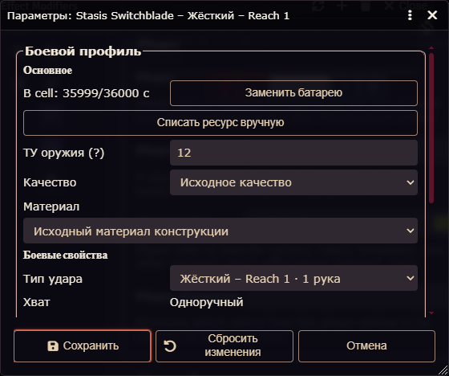

# UT-INHERIT-FIX: Tactical AESA, Floater Missile, Stasis Switchblade

Дата: 14.11.2026, Europe/Moscow. Версия модуля сохранена: **0.2.3**.

Три адресные блокировки устранены в генераторах и общих сервисах. Проверено **150 адресных Node-тестов без ошибок** и реальные действия GM/PLAYER OWNER в Foundry **14.364 / GGA 0.18.23**. Полный многотысячный набор не запускался.

## Источники и характер выводов

Использованы только книги из BooksCodex; интернет и прежние отчёты не служили первоисточником. PDF читались без записи в библиотеку, по рабочему процессу PDF skill. Проверено соответствие печатной нумерации: Ultra-Tech — PDF-страница = печатная + 1; Characters — +2; Campaigns — печатная −335.

- Ultra-Tech (2007): UT65, UT121, UT145–146, UT163–164, UT168–169. Носитель AESA Armored Hovercraft UT227 сохранён из существующего профиля; новый аудит транспорта не проводился.
- Basic Set: Characters, B15 и B74 — Basic Lift и Payload.
- Basic Set: Campaigns, B406, B413, B430, B458 — monowire/whip, конус и наведение, столкновения, команды роботизированной ракете по отсылке UT168.

Прямые числа, унаследованные правила и проектные решения разделены ниже. Отдельной опубликованной строки AESA не заявляется.

## Tactical AESA

**Было:** отсутствовали Acc, боевые Range, HT-поправка и governing skill; устройство останавливалось как source-manual.

**Основание наследования:** UT65 прямо направляет к Microwave Disruptors UT121: “See Microwave Disruptors (p. 121)”. Выбор именно Tactical Disruptor — утверждённая пользователем проектная трактовка этой ссылки.

**Перенято:** HT-8 aff (3 yd), Acc18, Range600/1200, RoF1, Gunner (Beams), общая обработка microwave-конуса и сопротивления. Rcl1 сохраняет общий контракт beam-атаки. Используется существующий microwave resolver, без второго обработчика воздействия.

**Сохранено своё:** установка на транспорт, неограниченное питание машины, дальность обнаружения конкретного массива. Для существующего Armored Hovercraft это 10 миль; она не подставляется в боевой Range. Масса, цена, переносная D cell, Shots50(5), ST18M и Bulk-8 базового устройства не перенесены.

HT, SM, +3 за ½D, Sealed/DR и исключение неэкранированных соединений проходят существующий сервис сопротивления; провал отключает на минуты по степени провала. Затронутые конусом цели и последствия выбираются вручную, как у исходного Tactical Disruptor. HP Damage не выдумывается.

Для старого standalone AESA добавлена проекция исправленного источника при чтении: проверяются точный equipment ID и хеш источника. Заполненные пользовательские overrides остаются; чтение не переписывает flags и прошлые shotSnapshots.

**Проверки:** GM и OWNER выполнили настоящий GGA Attack; батареи и патроны не списывались. По три реальных HT-броска на роль: SM-4 до ½D, SM+3 за ½D с Sealed DR10, затем тот же случай с неэкранированным подключением. Получены поправки −12, +8 и −2; итог зависит от настоящих кубов. Проверены данные Range и старый сохранённый экземпляр с ручным Acc20.

**Изменённые файлы:** `scripts/ut-microwave-source.js`, `scripts/ut-next-eleven-source.js`, `scripts/tools/ammo-service.js`, `scripts/tools/weapon-power.js`, `scripts/tools/standalone-weapon-service.js`, `tests/ut-next-eleven.test.mjs`.

**Противоречия:** отдельная строка AESA не требуется; выбор базового боевого профиля явно помечен как проектное решение, а не новая официальная эррата.

## Floater Missile

**Было:** пустой список launcherModeIds и явный запрет Floater в сервисе robot ammunition.

**Основание:** UT168 описывает Floater как “Similar to the Striker Missile”. Striker непосредственно допускает любую 100mm боевую часть и любую подходящую 100mm missile launcher. Общий интерфейс 100mm вынесен в один источник, читаемый обеими ракетами.

**Перенято:** семейство 100mm_missile, обе существующие TML 100mm (TL9 и TL10), допустимые боевые части и существующий путь genius missile. Программирование/команды — Artillery (Guided Missile); выбор цели, полёт и подтверждение попадания остаются ручными в рамках действующего механизма Striker. Регистрируется запуск одного физического робота, затем GGA Damage использует сохранённую боевую часть. Новый автономный AI не создавался.

**Сохранено своё:** TL10^; дальность 320 миль = 563200 ярдов; реактивная система без выброса газов и contragravity; ST3/DX14/IQ6/HT12; HP6/Will6/Per13; Speed8/Dodge11; SM-4, 5 lb; Air Move120, Enhanced Move2; 10 минут; Aerobatics12/Observation11; опубликованные traits и цены $5000 / $1000 на TL11. Не скопированы Hyperspectral Vision, SM-2, ST6, 17 lb и 4000-ярдовый радар Striker. Обычный rocket backblast удалён из профиля запуска; дополнительный множитель ×5 дальности reactionless-рецепта не применяется поверх собственных 320 миль.

**Боевые части:** для каждой TML предлагается 188 исполнимых каталоговых вариантов Floater: 94 конфигурации для версии ракеты TL10 и 94 для TL11. Это комбинации вариантов боевых частей и их собственных исполнений, а не 188 разных выстрелов. Полная матрица и 34 идентификатора категорий находятся в JSON-аудите. Сохраняются прежние ограничения размера, ТУ кампании, исполнений и рецептов. Дополнительные Homing и reactionless-рецепты исключены, поскольку ракета уже имеет собственные наведение и двигатель. Это наследование действующего ассортимента Striker, без повторного аудита всех боеприпасов UT.

Самостоятельные компоненты боевых частей разрешаются общим resolver; штатный кинетический урон обычной 25 lb ракеты не подменяет столкновение робота. Для чистого kinetic/Monochain и других зависимых от столкновения случаев сохранена существующая ручная процедура с фактической скоростью и HP по B430; произвольный Damage не назначен.

**Payload и масса:** B15/B74 дают Payload3 = 0.3×BL: для ST3 это 0.54 lb, для ST6 — 2.16 lb. Эти значения сохранены; дополнительные Lifting ST, увеличенный Payload или масса не придуманы. Табличные 25 lb — масса штатной ракеты TML, а не отдельно доказанная масса любой 100mm боевой части. В проверенных записях нет отдельной массы и геометрии каждой такой части, поэтому из SM-4/5 lb нельзя вывести доказанный запрет всего наследования. Инженерная вместимость остаётся неразложенной источником; игровая совместимость берётся из ссылки Floater→Striker. Утверждение, что опубликованные 5 lb обязательно исключают массу полезной нагрузки, не делается.

**Проверки:** обе TML прошли данные и общий resolver со всеми предлагаемыми robot warheads. Реально за каждую роль выполнены два запуска Floater: HE и Shaped Charge. На запуск списывается одна ракета, backblast отсутствует; самостоятельный Damage проходит штатный GGA. После смены боевой части и F5 два повторных Damage на роль остались связаны со снимком и не списали новые ресурсы. Исходный Striker отдельно прошёл реальный запуск и Damage за GM.

**Изменённые файлы:** `scripts/ut-next-eleven-source.js`, `scripts/tools/ut-robot-ammunition.js`, `tests/ut-next-eleven.test.mjs`.

**Противоречия:** числовая инженерная масса всех payload не определяется этими страницами; конкретного источникового несовпадения, запрещающего все 100mm варианты, не установлено. Это не основание возвращать прежнюю полную блокировку.

## Stasis Switchblade

**Было:** для всех жёстких Reach генератор ставил `power:null` и `powerUnspecified`; обычное управление батареей отсутствовало.

**Основание:** UT164 устанавливает “Its effect is identical to a monowire switchblade”, затем перечисляет собственные отличия. B/10 hr, работа жёсткого режима, Ready для изменения длины/режима и гибкое применение без питания наследуются от Monowire Switchblade UT163–164.

**Перенято:** B cell / 36000 секунд, общий ресурс экземпляра для всех жёстких длин, существующие замена, ручное списание времени, NR и защита повторного/устаревшего списания. Модуль сохраняет прежнюю учётную конвенцию: завершённая атака жёстким клинком расходует одну секунду; другое фактическое время работы списывается явно. Это конвенция сервиса, а не отдельный дословный расход на атаку из книги. Дополнительная энергия stasis web не назначается.

**Сохранено своё:** TL12^, цена $20000, жёсткие Reach C–30 и sw+1d+R(10) cut, гибкий Reach1–30* и sw+1d-1(10) cut; клинок не ломается и может парировать force/energy. Ready и особые условия monowire остаются явными ручными правилами.

При нулевой батарее выполнение жёсткой атаки отклоняется; гибкий режим выбирается вручную и не требует питания. Автоматический таймер, принудительная смена выбора и переписывание Actor.system не добавлены. После замены батареи жёсткий режим снова работает.

**Проверки:** GM и OWNER выполнили жёсткую атаку Reach30 и Damage, исчерпали ресурс через обычный сервис ручного списания, получили отказ жёсткой атаки, выполнили гибкую атаку/Damage, заменили B cell и выполнили жёсткую Reach1. Все кубы — настоящие; повторный Damage не расходует батарею. Node отдельно проверяет NR72000 и неизменность снимка после смены режима.

OWNER также проверил реальные кнопки редактора: Нет не пишет ресурс; NR изначально снят; Да устанавливает B/36000; ручное списание 2 секунд даёт 35998; выбор гибкого режима убирает питание, возврат к жёсткому сохраняет заряд. Окно немодальное. Foundry работал на en, собственные подписи OleGURPS были русскими.

### Целевой снимок интерфейса

HTML/CSS и компоновка не перерабатывались. У Stasis восстановились существующие ресурсные контролы, поэтому сохранён один реальный целевой снимок: **B cell, точный остаток, «Заменить батарею», ручное списание и выбранный Reach1**. Изображение не дорисовывалось. Снимок сделан после расхода одной секунды, до дополнительного UI-теста замены/списания.

**Изменённые файлы:** `scripts/ut-exotic-melee-source.js`, `tests/melee-ut-exotic.test.mjs`.

**Противоречия:** отдельного расхода stasis web в источнике не задано; питание обычного switchblade наследуется без придуманной надбавки.

## Итог проверок и сохранность данных

| Набор | Пройдено | Ошибок |
|---|---:|---:|
| `tests/ut-next-eleven.test.mjs` | 29 | 0 |
| `tests/ut-microwave-six.test.mjs` | 61 | 0 |
| `tests/melee-ut-exotic.test.mjs` | 60 | 0 |
| Всего адресных тестов | **150** | **0** |

Команды: `node --test --test-concurrency=1 <указанный файл>`; проверки запускались адресно. После последних правок повторялись только затронутые файлы. В первом прогоне новая фикстура Stasis ошибочно вызывала loadState без Foundry global; она исправлена повторным чтением атаки, проверки истории сохранены. Итог melee — 60/60. Sandbox первоначально запрещал spawn дочернего Node; адресные проверки завершены с разрешённым запуском вне sandbox. Ограниченный одним ядром повторный прогон был медленным на фоне инициализации программного renderer; последние изменённые файлы подтверждены прямым Node-запуском.

Синтаксис и строгий UTF-8 проверены во всех 9 изменённых файлах; `node tools/check-ui-dashes.mjs` прошёл. Старые утверждения о запрете AESA/Floater и неопределённом питании Stasis заменены проверками нового обоснованного контракта; независимые характеристики исходных моделей сохранены.

В live-проверке: 6 временных Actor, 15 снимков атак (9 GM, 6 PLAYER OWNER), 32 сообщения с реальными бросками; загруженных/подставленных Roll — 0. Дополнительные три GM-действия — адресная регрессия исходных Tactical Disruptor, Striker и Monowire Switchblade. Для AESA вместо HP Damage используются настоящие HT-сопротивления; для робота вместо броска попадания стрелка регистрируется физический запуск.

В обеих сессиях после F5 совпали хеши всех 15 shotSnapshots и ресурсов 6 Actor; порядок Actor в коллекции мог измениться, сравнение выполнялось по ID. Смена режима Stasis, выбор другой боевой части и переключение на другое тестовое оружие не пересчитали историю. Повторный GGA Damage после F5 не расходовал ресурс.

Реальные персонажи, GGA/GCS и пользовательский Actor.system не изменялись. Изменялось только собственное тестовое содержимое и flags собственных экземпляров. Существующие сторонние изменения рабочего дерева, AGENTS.md, packs и старые отчёты оставлены. Commit/push/tag/release не выполнялись; версия не менялась.

## Нагрузка и очистка

Создан только headless Chrome с отдельным профилем на A:, постоянные OG-QA-GM/OG-QA-PLAYER повторно использованы без паролей. SwiftShader подтверждён CDP SystemInfo.getInfo и WebGL renderer. В собственных QA-контекстах ограничена частота PIXI до 5 FPS.

По 234 измерениям максимальный CPU собственных QA-процессов — **31.605%**, максимальный измеренный GPU engine — **0.0%**. Один замер Windows GPU вернул invalid performance-counter sample; последующие замеры восстановились. Отсутствие нагрузки не выводилось только из флагов Chrome. Применялась общая affinity: сначала одно ядро, затем пять из 16 для live; лимит дополнительно контролировался измерениями. Порог снижения 45%, остановка при длительной высокой GPU-нагрузке; пороги не достигались. Пользовательские процессы не ограничивались.

Временная область: `A:\CodexTemp\ut-inherit-fix-20261114`; небольшой каталог служебных скриптов — `<module>/.qa-ut-inherit`. Пик созданных файлов — примерно **162.7 MiB**; PDF и текст книг не копировались. Обе временные директории удалены после проверки точных путей и владения; итоговые материалы в docs/reports сохранены.

Удалены 6 собственных Actor, 6 Token, 44 новых QA ChatMessage; тестовый браузер и контексты закрыты. Исходные Actor, Token, сообщения и все пользователи сохранены; постоянные QA-аккаунты остались, действующая сессия «Распорядителя» активна. Остатков временных Actor — 0.

Материалы: [JSON-аудит](2026-11-14_10-38-40_UT-INHERIT-FIX_three-models_audit.json), [индекс](README.md).
