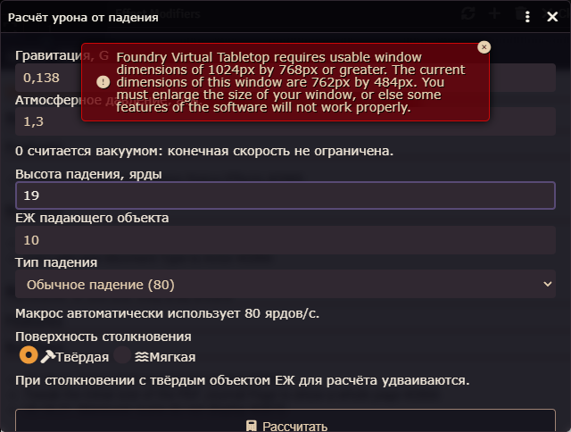
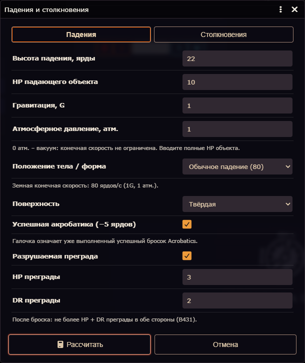
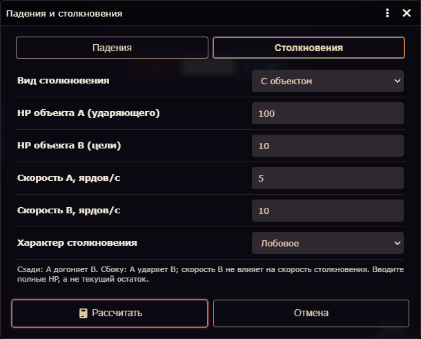
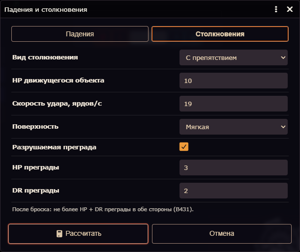
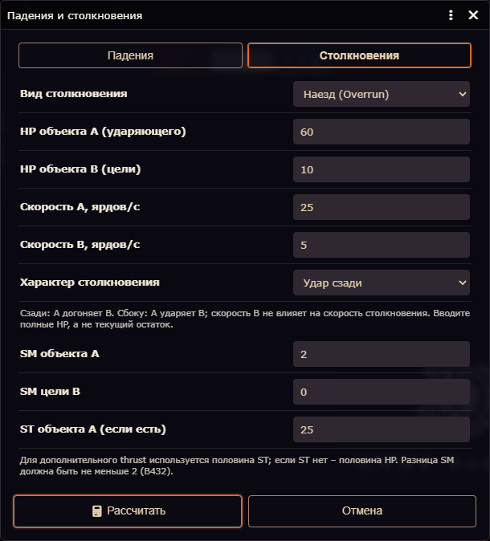

# FALL-COLLISION: падения и столкновения

Дата пакета: 2026-11-14 12-02-15 (Europe/Moscow). Foundry 14.364 / GGA 0.18.23. Версия модуля не изменена. Commit, push, tag и release не выполнялись.

## Результат

Существующий `game.olegurpsQOL.falling.open()` расширен двумя вкладками. «Столкновения» содержит режимы «С объектом», «С препятствием» и «Наезд (Overrun)». ID макроса `OQfalling0000001`, команда и единственная кнопка запускателя сохранены. Название RU – «Падения и столкновения», EN-словарь – «Falls and Collisions». По постоянной политике проекта собственный интерфейс остаётся русским и при языке Foundry en.

## Первоисточник и сверка прежнего кода

Оригиналы прочитаны только из BooksCodex, без записи в библиотеку. PDF Campaigns: печатные B430/B431/B432 соответствуют PDF 95/96/97, B378 – PDF 43. Characters: B9 – PDF 11, B16 – PDF 18. SHA-256 указаны в JSON-аудите. Прочитаны полные нужные страницы, включая примечания и таблицы.

| Правило | Прежний falling.js | Итог |
|---|---|---|
| B430, HP × скорость / 100 | Формула и общий basicDamageDice корректны | Переиспользованы без изменения basicDamageDice |
| B431, скорость √(21.4 × g × высота) | Скорость не округлялась до целого | Округляется до ближайшего целого перед пределом конечной скорости |
| B431, конечная скорость | Земная скорость × √g / √давления; вакуум без предела | Формула сохранена; местная конечная скорость отдельно не округляется |
| B431, твёрдая/мягкая поверхность | Удвоение HP только для твёрдой корректно | Единая функция для падений и препятствий |
| B431, Controlled Falls | Отсутствовали | max(0, исходная высота − 5) один раз, без броска Acrobatics |
| B431, разрушаемое препятствие | Отсутствовало | Предел HP + DR в пунктах для обеих сторон; кубики не заменяются пределом |
| B432, углы и ответный урон | Отсутствовали | Сумма/неотрицательная разность/скорость A; соответствующие ограничения кубиков |
| B432, Overrun | Отсутствовал | Разница SM ≥2; thrust от половины ST при наличии, иначе HP; половина вниз по B9 |
| B378, Knockback | Не связан автоматически | Изучен только контекст; автоматических столкновений после отбрасывания нет |

Реальная расчётная ошибка: отсутствие обязательного округления скорости. Пример 1G, высота 1 ярд, HP15, твёрдая поверхность: раньше √21.4 ≈4.626 →1.388к →1к; теперь 5 →1.5к →2к. При 0.138G, 19 ярдах и HP10 скорость меняется с ≈7.491 на 7, но итог остаётся 1к. Начальные 1.3 атм. изменены на 1 по заданию; это новая настройка по умолчанию, а не ошибка старой сохранённой атмосферы.

Дополнительно обнаружено, что DialogV2 в Foundry 14 удаляет встроенный style из содержимого прежнего окна. Стили перенесены в штатный CSS модуля; реальная проверка подтверждает grid-компоновку. Сторонние стили не изменялись.

В самой B431 есть расхождение таблицы с разрешённой альтернативной формулой: для 100 ярдов таблица даёт 47, округлённая √2140 даёт 46. Выполнено прямое требование задания использовать формулу; тест и чат используют те же 46, скрытой подстановки таблицы нет.

## Настройки и поведение

- Новый пользователь: 0.138G, 1 атм., 19 ярдов, HP10, обычное падение 80 ярдов/с, своё значение 120, твёрдая поверхность; обе новые галочки выключены.
- Старый `world.gurpsFallDamageMacro` сохранён. terminalEarth мигрирует на прежние пресеты или custom только при чтении; старые давление, гравитация и customTerminal не сбрасываются. Открытие и отмена ничего не записывают.
- Все поля остаются в DOM; переключения не уничтожают ввод. Неактивные поля скрыты и исключены из проверки текущего расчёта. Отдельные параметры трёх режимов сохраняются после расчёта.
- Сзади A догоняет B: max(0, vA−vB). Сбоку ударяет A: скорость B не участвует. При равных скоростях лобового столкновения дополнительного ограничения более медленного участника нет.
- Нулевая высота/скорость даёт 0 повреждений. При нулевой скорости наезда дополнительный Overrun не создаётся.
- Преграда необязательна. При включении показываются только HP и DR; после броска для движущегося объекта и преграды применяется min(повреждения, HP+DR). Помощник, как прежде, сообщает кубики, а не выполняет бросок или применение к HP.
- Overrun добавляется отдельно от обычного столкновения. ST необязателен. B16/существующий basicStrengthDamage переиспользован; таблицы ST и другие помощники не менялись.
- В чате видны ситуация, итоговые кубики и специальные условия. Исходные величины, формулы и ограничения кубиков находятся в закрытом details. Карта, токены, цель и Combat не требуются.
- Две модульные world-копии со старыми стандартными именами переименованы. Изменено только name; ID и команды сохранены. Миграция идемпотентна и не затрагивает пользовательские названия или макросы без модульного признака.

## Проверяемые примеры

| Ситуация | Результат |
|---|---|
| Падение 17 ярдов, 1G, HP10, твёрдая поверхность | v19; 3.8к →4к |
| Падение 19 ярдов, 0.138G, HP10 | v7; 1.4к →1к |
| 3 ярда, успешная акробатика | Эффективная высота 0; v0; урон 0 |
| 22 ярда, акробатика, 1G, HP10, преграда HP3 DR2 | Высота17; v19; 4к, после броска не более5 в обе стороны |
| 10000 ярдов, 1G, вакуум | v463; HP10 и твёрдая поверхность →93к |
| Те же условия, 1 атм., обычное тело | v80; 16к |
| Лобовое: HP100/v5 против HP10/v10 | v15; A→B 2к, B→A 2к; медленный A ограничен |
| B432: HP60/v25 догоняет HP10/v5 | v20; A→B 12к, B→A 2к |
| Боковое: HP10/v10 против HP100/v99 | v10; 1к в обе стороны; ответ B ограничен |
| Наезд: HP60, SM2 против SM0, ST отсутствует | Обычное 12к/2к; дополнительно thr(ST30)=3к |
| То же, ST25 | Дополнительно thr(ST12)=1к−1 |
| Разница SM1 | Только обычное столкновение |

Матрица фактических входов/ожиданий/результатов находится в JSON-аудите: все 12 примеров совпали.

## Автоматические и реальные проверки

Адресный набор `tests/fall-collision.test.mjs`: **82/82**. Связанные `unified-launcher`, `explosive-ammunition`, `strength-41-99`, `russian-ui-audit`: **63/63**. Всего **145/145**, полный suite не запускался. Использован `node --test --experimental-test-isolation=none --test-concurrency=1`: обычная изоляция процессов блокировалась средой с spawn EPERM. Проверки не ослаблялись.

Проверены пресеты и миграция, ноль, акробатика по обе стороны 5 ярдов, 0.138G, вакуум, предел скорости, обе поверхности, преграды и DR0, дробные границы кубиков, углы/ответный урон, SM<2/=2/>2, ST/HP, недопустимые/переполняющие числа, отмена и адресная миграция названий макросов. Синтаксис изменённых JS и `node tools/check-ui-dashes.mjs` прошли.

Реальная среда: Foundry **14.364**, GGA **0.18.23**, отдельные контексты OG-QA-GM (роль4) и OG-QA-PLAYER (роль1), Canvas отключён только в тестовых клиентах, активной сцены нет. Для инструмента Actor OWNER не требуется: PLAYER выполнял те же действия без Actor/Token. По **32 проверки** и **8 различных расчётов** в итоговом протоколе каждой роли: старые flags, customTerminal, переключения, условные поля, отмена, неверный ввод, ноль, преграда, встречный урон, HP/ST Overrun, причина отказа по SM, повторное открытие и Actor.system.

За обе роли отдельно прошли F5 с сохранением режима/ST/SM, исходный compendium-макрос, русский интерфейс при клиентском i18n en и разделение настроек разных пользователей. Для языка изменялось только поле в памяти QA-клиента с немедленным восстановлением; глобальные настройки Foundry и словари GGA не менялись.

Первый GM-прогон завершил 8 расчётов, но сборщик протокола имел слишком короткий тайм-аут. После исправления оформления и сборщика выполнен итоговый прогон. Ещё по одному расчёту на роль проверили разделение flags. Всего создано 26 расчётных сообщений и 2 служебных приветствия GGA; все 28 удалены после теста. Полные результаты проверок сохранены внутри аудита, без исходных Actor.system.

## Интерфейс: реальные снимки

Сравнивать появление двух вкладок, общую сетку полей, акробатику и необязательную преграду, а также замену набора полей при смене режима. Изображения сняты через CDP и не дорисовывались. Исходный снимок содержит штатное предупреждение Foundry о размере viewport; итоговые сняты при 1300×1100 без предупреждения и проверены визуально.

Исходный помощник:

Падения, обе новые галочки и поля преграды:

Столкновение с объектом:

Столкновение с препятствием:

Наезд:

## Сохранность данных и очистка

После закрытия QA-контекстов сравнение со снимком до теста подтвердило: **Actor.system без изменений**, исходные ChatMessage сохранены, QA-flags восстановлены, роли QA-пользователей сохранены. «Распорядитель» остался действующей основной сессией. Аккаунты, пароли, GGA/GCS, пользовательские персонажи и исторические snapshots не изменялись. Собственные Actor/Token не создавались. Остальные исходные изменения рабочего дерева не откатывались. Единственное целевое изменение постоянных world-данных – названия двух стандартных модульных макросов.

Тестовый профиль и приватные исходные снимки находились в `A:\CodexTemp\olegurps-fall-collision-20261114`, вне репозитория. Оценка пикового объёма – **163.4 MiB**. Собственный браузер закрыт, его процессы отсутствуют. **Временная папка удалена; отсутствие проверено после удаления.** Итоговые материалы сохранены в этой папке docs/reports. BooksCodex и системные TEMP/TMP не менялись.

## Нагрузка и честные ограничения

CDP SystemInfo и WebGL подтвердили **ANGLE (Google, Vulkan 1.3.0 (SwiftShader Device (Subzero) (0x0000C0DE)), SwiftShader driver)**. Windows GPU Engine проверялся по собственным PID, включая все доступные физические/виртуальные движки; максимальный измеренный счётчик **0%**. До UI-нагрузки первый образец показывал GPU0%; независимый замер до самого запуска Chrome не выполнялся.

На старте зарегистрировано нарушение CPU-лимита: **78.094%**, 2026-11-14T12:01:41.2710761+03:00. Монитор в том же образце немедленно ограничил собственное дерево одним ядром. После этого максимум **46.841%**. Позднее применены общий Job Object 35% там, где назначение доступно, общие четыре логических ядра всему QA-дереву и контроль фактической суммы. Sandbox-процессы Chrome частично отвергают переназначение Job Object; ограничение affinity не выдаётся за самостоятельное доказательство. Записана серия 301 измерений и все действия. Пользовательские процессы не ограничивались. Стартовый пик нельзя считать соблюдением ≤50%; это явно зафиксированный недостаток данного QA-запуска.

Полный перезапуск сервера Foundry не выполнялся, чтобы сохранить сессию владельца; сохранение в User flags и F5 обоих клиентов проверены. Для половины HP/ST ниже1 либо вне поддерживаемого диапазона таблицы дополнительный Overrun явно оставлен ручным; отдельная формула не выдумана. Не реализованы пассажиры/Whiplash, Dropping, случайные зоны, последствия Knockback, автоматическое изменение HP и физика токенов.

## Изменённые файлы

- scripts/tools/falling.js
- scripts/tools/fall-collision-rules.js
- scripts/tools/fall-collision-presentation.js
- scripts/module-macros.js
- scripts/russian-ui.js
- styles/olegurps-qol.css
- lang/ru.json
- lang/en.json
- data/macros/olegurps-macros.json
- tests/fall-collision.test.mjs
- tools/fall-collision-live.mjs
- tools/fall-collision-scenarios.js
- tools/fall-collision-monitor.ps1
- tools/build-fall-collision-report.mjs

JSON-аудит: [2026-11-14_12-02-15_FALL-COLLISION_falls-collisions_audit.json](2026-11-14_12-02-15_FALL-COLLISION_falls-collisions_audit.json). Индекс: [README.md](README.md).
