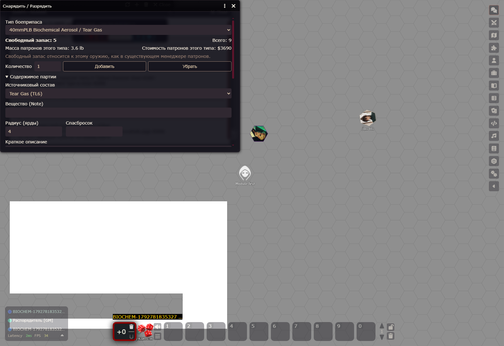

# OleGURPS QOL — единая биохимия HT/UT

23.10.2026. Foundry 14.364, GGA 0.18.23. Изменения без commit/push/merge/release и без изменения версии.

## Результат и действующее решение пользователя

Общий каталог содержит **58 структурированных форм** веществ, включая формы доставки наноагентов. Общий resolver, AmmoService, редактор партии, native GGA и shotSnapshot используют одну запись эффекта. В реестре найдено **58 существующих режимов** с исполнимыми сочетаниями (109 строк «режим/физический носитель/доставка»). Новые модели оружия не создавались.

**После химической или инъекционной атаки доступна штатная кнопка броска для одного выделенного токена. СП, попадание, проникновение, применимая защита и иммунитет не блокируют сам бросок и не требуют подтверждения.** Фактическое воздействие и последствия игрок или ведущий определяет вручную по GURPS. Это последнее решение пользователя заменяет пункты исходного задания о подтверждении DR и автоматическом отсутствии эффекта при непробитии. Нет автоматического урона, состояний, изменения HP/HT/черты персонажа или таймеров циклов.

Tear Gas — отдельный наполнитель **UT Biochemical Aerosol**, а не только отдельный HT Spray. Смесь Tear Gas + Vomiting Agent — другой наполнитель и другая партия. Оба видны в общем поле «Источниковый состав». Для 10mm действует face-only без облака; жидкости/инъекции не становятся совместимыми с газом из-за одного названия.

[Штатная кнопка HT в настоящей карточке атаки](images/ut-biochemical-native-resistance.png). [Ранее показанные рикошеты Vortex](images/ut-fluid-vortex-ricochets.png) сохраняются.

## Источники и границы

Прочитаны локальные PDF BooksCodex: UT134,139–140,146,153,159–162,169; HT171,180 и применимые ссылки Basic Set B347–348,428–429,437,439. Для UT2007 печатная UT N соответствует PDF N+1. PDF/GCS и пользовательские overrides не менялись. Официальная страница эрраты самостоятельно не загружалась; применён существующий утверждённый overlay scripts/ut-errata.js.

UT153: Aerosol — 10mm face/1 доза; 15mm r1/3; 18.5mm r1.5/5; 25mm r2/10; 40mm r4/40; 64mm r7/150; 100mm r10/300. Liquid — 15mm r1/1; 18.5mm r1.5/2; 25mm r2/4; 40mm r4/16; 64mm r9/**65**; 100mm r18/**250**. Последние два числа — утверждённая эррата; исходные ошибочные 8/16 не возвращены. Цена наполненного заряда = цена носителя + дозы × цена наполнителя; ракеты сохраняют раздельную экономику корпуса/наведения/боевой части. Неизвестная цена не подменяется нулём.

HT не получает UT-патрон по совпадению калибра. Проверяется точная существующая физическая связь и подтверждённая конструкция HT. В текущем каталоге нет подтверждённых environment_profiles для универсального переоснащения всех HT-патронов химией UT. Общий адаптер для таких подтверждённых HT-профилей есть; источниково неопределённые пары ниже остаются закрыты. HT180 Tear Gas Spray подключён по отдельному источниковому правилу: существующий melee-режим, Reach1–2, широкая струя +2, обычный штраф лица −5, фиксированная подача 20 готовых зарядов. Его два HT−2 имеют длительность MoF минут по HT180.

Squirt Carbine/Large Squirt Carbine HT180 не получили произвольные UT-жидкости: нет доказанной совместимости состава с игрушечным пластиком и перевода дозы в пинту; MEA/коррозионные составы прямо противоречат ограничению HT180. Pepper Spray не добавлялся в новый каталог. Grav/Gauss Needler не приравниваются к газовому 3mmN: их твёрдый снаряд не доказывает инъекционную ёмкость. Parasite Seed требует капсулу размером с яблочное семя, поэтому источник не доказывает её помещение в существующий drug dart/ice sliver.

Контактные гели/контактные версии ядов хранятся как отдельные справочные формы, но не выдаются за аэрозоль или инъекцию. Digestive, лекарства, Aegis как лечебное средство и новые устройства введения не добавлены. Стоимость Nanoglop в UT169 задана за площадь облака, не за универсальную дозу; автоматический перевод в дозовую цену не выдуман. Dominator требует выбранную программу недостатков; базовая цена $100 × points, TL12^ ×2, обратимость ×2, затем множитель доставки. Неизвестная итоговая цена отмечается неизвестной.

## Данные и исполнение

- scripts/tools/biochemical-catalog.js — общий неизменяемый источник: доставка, сопротивление, защита, иммунитеты, длительность/повторы, цена и источник. CatalogService предоставляет записи напрямую.
- scripts/tools/biochemical-integration.js — общий адаптер подтверждённой конструкции к эффекту и общему редактору партии; ut-fluid.js использует тот же каталог.
- Общий редактор Ammo Management сохраняет chemicalId, Note, радиус, спасбросок и описание в отдельной физической партии. Свободный Note не разбирается как команда и не превращается автоматически в вещество. Старые партии без chemicalId остаются совместимыми и ручными.
- AttackProfileResolver сохраняет уже вычисленные эффект, дозы, радиус, стоимость и компоненты. Подмена магазина/наполнителя не меняет прошлый shotSnapshot. Native Damage воспроизводит прежнюю атаку и ресурсов не расходует.
- AmmoService проверяет совместимость и кампанийный TL внутри общей очереди Actor, атомарно расходует физический заряд/дозы и необходимую энергию/LP. У Partisan только готовый внешний Drugged Dart; литейка не создаёт препарат. Сохраняются UAW 5+5, обычный предел10, старые остатки и исторические снимки.
- ETC/LP/EM применяются прежним общим resolver к носителю; самостоятельная химическая боевая часть не получает умножение piercing-урона. Ручной учёт моторного питания и исключения Tank/LP/18.5mm сохраняются. Micromissile доступен через существующий Homing + выбранную биохимическую боевую часть. Gyroc Micromissile + Shotshell и шесть Homing Ice Gun остаются запрещены.
- resistance-roll.js использует действующий HT выделенного Actor и настоящие 3d6 GGA, без Target. Одна проверка запускается прямо; несколько проверок выбираются в немодальном окне. Отмена ничего не пишет. Источник берётся из сохранённого эффекта сообщения, без пересчёта по текущему магазину/каталогу. Новые результаты химических проверок содержат sourceMessageId.
- Чат содержит краткое уникальное действие вещества, радиус и короткую ссылку. Note/спасбросок/описание не обрезаются. Краткая карточка показывает химический эффект/HT, инъекционный piercing или самостоятельный linked-компонент из общего профиля; исходный piercing не выдаётся за урон заменяющего химического заряда.

## Каталог веществ и формулы

TL ниже — TL вещества. Для патрона действует максимум TL физического носителя, конструкции/датчика и вещества; например, Tear Gas TL6 в UT153 требует доступности самого UT-заряда TL9. Для HT180 готовый spray имеет TL7. Формы наноагентов: injection ×1, blood-жидкость ×2, contact mist ×1, contact gas ×10, contact gel ×2, respiratory mist ×5. Никакого автоматического улучшения TL старых партий.

| ID | Вещество | TL | Доставка | Цена дозы $ | Проверки | Уникальное действие / источник |
| --- | --- | --- | --- | --- | --- | --- |
| `riot` | Riot Gas | 9 | aerosol, spray, vortex | 2 | Основное воздействие: HT-4 | Каждую секунду HT−4: тошнота; провал ≥5 — рвота, затем тошнота MoF минут. UT160 |
| `musk` | Musk | 9 | aerosol, spray, vortex | 2 | HT не предусмотрен | Bad Smell на 2 недели; час мытья сокращает срок на день. Sealed защищает тело, но не костюм. UT160 |
| `nerve` | Lethal Nerve Gas | 9 | aerosol, spray, vortex | 10 | Основное воздействие: HT-6; Остаточное загрязнение: HT-3 | HT−6 (остаточное загрязнение −3): 1d tox, 6 циклов по минуте; неврологические последствия по потере HP. UT160 |
| `sleep` | Sleep Gas | 9 | aerosol, spray, vortex | 0.5 | Основное воздействие: HT-6 | HT−6: без сознания MoF минут, затем обычный сон. UT160 |
| `paralysis` | Paralysis Gas | 10 | aerosol, spray, vortex | 10 | Основное воздействие: HT-6 | Каждый ход HT−6: провал 1–2 — падение и неподвижность на ход; ≥3 — паралич MoF минут; критпровал — 1d и кома. UT160 |
| `pheromone` | Pheromone Spray | 10 | aerosol, spray, vortex | 20 | Основное воздействие: HT-2 | HT−2: Lecherousness (9) в облаке + MoF минут; обычно только тот же вид. UT160 |
| `mask` | Mask | 10 | aerosol, spray, vortex | 30 | HT не предусмотрен | Forensics по следам и выслеживание по запаху −6; сам Mask легко обнаруживается. UT160 |
| `antitangler` | Anti-Tangler Aerosol | 10 | aerosol, spray, vortex | 1 | HT не предусмотрен | Растворяет связи Tangler за 1 секунду. UT160 |
| `smoke` | Smoke | 9 | aerosol, spray, vortex | не определена | HT не предусмотрен | Визуальные атаки и наблюдение −10; блокирует ladar. Облако 1–4 минуты. UT160 |
| `colored` | Colored Smoke | 9 | aerosol, spray, vortex | 0.1 | HT не предусмотрен | Визуальные атаки и наблюдение −7. Облако 1–4 минуты. UT160 |
| `hot` | Hot Smoke | 9 | aerosol, spray, vortex | 0.15 | HT не предусмотрен | Smoke; также мешает Infravision, Hyperspectral Vision и Night Vision. UT160 |
| `prism` | Prism Smoke | 9 | aerosol, spray, vortex | 0.2 | HT не предусмотрен | Hot Smoke; блокирует лазеры, кроме X-ray и gamma-ray. UT160 |
| `electromagnetic` | Electromagnetic Smoke | 9 | aerosol, spray, vortex | 0.3 | HT не предусмотрен | Hot Smoke; также мешает Radar и Imaging Radar. UT160 |
| `radiant` | Radiant Prism | 10 | aerosol, spray, vortex | 3 | HT не предусмотрен | Prism + electromagnetic; срок /2, IR/radar −5; без фильтра 1 HP/с при вдыхании. UT160 |
| `firefoam` | Firefoam | 9 | liquid, spray | 1 | HT не предусмотрен | Тушит огонь до (TL−8)d; больший ослабляет на 3d секунд. UT160 |
| `mea` | Metal Embrittlement Agent | 10 | liquid, spray | 5 | HT не предусмотрен | Заданный сплав: 3d cor/час, 12 часов или до очистки; полностью охваченный SM≥+2 умножает урон на SM. UT160 |
| `disassembler` | Disassembler Nanoglop | 11 | liquid, spray | не определена | HT не предусмотрен | Радиус /2 (ниже 1 ярда — только прямое попадание); 15 секунд, удвоенный урон disassembler: 2×(1d−2)(10) cor/с; только Sealed DR. UT161,169. UT161,169 |
| `replicator` | Replicator Nanoglop | 12 | liquid, spray | не определена | HT не предусмотрен | Replicating disassemblers: превращение материи и распространение вручную по UT161,169. UT161,169 |
| `tear` | Tear Gas | 6 | aerosol, spray, vortex | 10 | Кашель — дыхание: HT-2; Слепота — глаза: HT-2 | HT−2 отдельно: кашель/слепота в облаке + MoF минут; Vision −1…−3 на ярд. B439. B439 |
| `tear_vomit` | Tear Gas + Vomiting Agent | 6 | aerosol, spray, vortex | не определена | Кашель — дыхание: HT-2; Слепота — глаза: HT-2; Рвота — дыхание: HT-2 | Два HT−2: кашель/слепота в облаке + MoF минут; третий HT−2: рвота в облаке + 5×MoF минут. HT171. HT171 |
| `mustard` | Mustard Gas | 6 | aerosol, spray, vortex | 10 | Контакт — без задержки: HT-4; Вдыхание — задержка 2 часа: HT-1 | Контакт: HT−4, 1 tox ×24/8 ч; вдыхание: задержка 2 ч, HT−1, 1d tox ×6/час. B439. B439 |
| `nerve_poison` | Nerve Poison | 9 | injection | 10 | Основное воздействие: HT-7 | HT−7: 1d tox, 6 циклов по минуте; неврологические последствия по утрате HP. UT161 |
| `sleep_poison` | Sleep Poison | 9 | injection | 0.5 | Основное воздействие: HT-6 | HT−6: сонливость; провал ≥5 — без сознания MoF минут. UT161 |
| `nerve_contact` | Nerve Poison — Contact | 9 | contact-application | 100 | Основное воздействие: HT-5 | Контактная версия: HT−5; 1d tox, 6 циклов по минуте. UT161 |
| `sleep_contact` | Sleep Poison — Contact | 9 | contact-application | 5 | Основное воздействие: HT-4 | Контактная версия: HT−4; сонливость, при провале ≥5 — без сознания MoF минут. UT161 |
| `splatter` | Splatter Nano | 11 | injection | 100 | HT не предусмотрен | Только follow-up. После ≥1 минуты: 1d tox за минуту циркуляции, максимум 30d на дозу; запуск по таймеру/сигналу вручную. UT162 |
| `parasite_seed` | Parasite Seed | 12 | capsule | 10000 | Основное воздействие: HT-4 | Капсула размером с яблочное семя: каждый час HT−4; успех уничтожает её, провал −3 HT до превращения при HT0. Вручную. UT162 |
| `parasite_seed_mind` | Parasite Seed — Mind Trapping | 12 | capsule | 100000 | Основное воздействие: HT-4 | Parasite Seed с захватом сознания; капсула требует подходящего устройства. Последствия вручную. UT162 |
| `nanoburn_injection` | Nanoburn — инъекция | 10 | injection | 5 | Основное воздействие: HT-6 | HT−6: паралич 3×MoF минут; 1d−1 tox каждые 3 минуты следующие 30 минут. Только углеродная жизнь. UT161 |
| `nanoburn_blood` | Nanoburn — слизистые | 10 | liquid, spray | 10 | Основное воздействие: HT-6 | HT−6: паралич 3×MoF минут; 1d−1 tox каждые 3 минуты следующие 30 минут. Только углеродная жизнь. UT161 |
| `nanoburn_contact_mist` | Nanoburn — контактный туман | 10 | aerosol, spray, vortex | 5 | Основное воздействие: HT-6 | HT−6: паралич 3×MoF минут; 1d−1 tox каждые 3 минуты следующие 30 минут. Только углеродная жизнь. UT161 |
| `nanoburn_contact_gas` | Nanoburn — контактный газ | 10 | aerosol, spray, vortex | 50 | Основное воздействие: HT-6 | HT−6: паралич 3×MoF минут; 1d−1 tox каждые 3 минуты следующие 30 минут. Только углеродная жизнь. UT161 |
| `nanoburn_contact_gel` | Nanoburn — контактный гель | 10 | contact-application | 10 | Основное воздействие: HT-6 | HT−6: паралич 3×MoF минут; 1d−1 tox каждые 3 минуты следующие 30 минут. Только углеродная жизнь. UT161 |
| `nanoburn_respiratory` | Nanoburn — вдыхание | 10 | aerosol, spray, vortex | 25 | Основное воздействие: HT-6 | HT−6: паралич 3×MoF минут; 1d−1 tox каждые 3 минуты следующие 30 минут. Только углеродная жизнь. UT161 |
| `nanotracers_injection` | Nanotracers — инъекция | 10 | injection | 100 | HT не предусмотрен | Через минуту: сигнал/запах не менее суток, +5 к подходящему выслеживанию при известном и обнаруживаемом сигнале. UT161 |
| `nanotracers_blood` | Nanotracers — слизистые | 10 | liquid, spray | 200 | HT не предусмотрен | Через минуту: сигнал/запах не менее суток, +5 к подходящему выслеживанию при известном и обнаруживаемом сигнале. UT161 |
| `nanotracers_contact_mist` | Nanotracers — контактный туман | 10 | aerosol, spray, vortex | 100 | HT не предусмотрен | Через минуту: сигнал/запах не менее суток, +5 к подходящему выслеживанию при известном и обнаруживаемом сигнале. UT161 |
| `nanotracers_contact_gas` | Nanotracers — контактный газ | 10 | aerosol, spray, vortex | 1000 | HT не предусмотрен | Через минуту: сигнал/запах не менее суток, +5 к подходящему выслеживанию при известном и обнаруживаемом сигнале. UT161 |
| `nanotracers_contact_gel` | Nanotracers — контактный гель | 10 | contact-application | 200 | HT не предусмотрен | Через минуту: сигнал/запах не менее суток, +5 к подходящему выслеживанию при известном и обнаруживаемом сигнале. UT161 |
| `nanotracers_respiratory` | Nanotracers — вдыхание | 10 | aerosol, spray, vortex | 500 | HT не предусмотрен | Через минуту: сигнал/запах не менее суток, +5 к подходящему выслеживанию при известном и обнаруживаемом сигнале. UT161 |
| `shrike_injection` | Shrike Nano — инъекция | 11 | injection | 500 | HT не предусмотрен | Каждую минуту состязание с Aegis: уничтожение проигравшего агента; ничья продолжает борьбу. Уровни и усиление дозой — вручную. UT161–162 |
| `shrike_blood` | Shrike Nano — слизистые | 11 | liquid, spray | 1000 | HT не предусмотрен | Каждую минуту состязание с Aegis: уничтожение проигравшего агента; ничья продолжает борьбу. Уровни и усиление дозой — вручную. UT161–162 |
| `shrike_contact_mist` | Shrike Nano — контактный туман | 11 | aerosol, spray, vortex | 500 | HT не предусмотрен | Каждую минуту состязание с Aegis: уничтожение проигравшего агента; ничья продолжает борьбу. Уровни и усиление дозой — вручную. UT161–162 |
| `shrike_contact_gas` | Shrike Nano — контактный газ | 11 | aerosol, spray, vortex | 5000 | HT не предусмотрен | Каждую минуту состязание с Aegis: уничтожение проигравшего агента; ничья продолжает борьбу. Уровни и усиление дозой — вручную. UT161–162 |
| `shrike_contact_gel` | Shrike Nano — контактный гель | 11 | contact-application | 1000 | HT не предусмотрен | Каждую минуту состязание с Aegis: уничтожение проигравшего агента; ничья продолжает борьбу. Уровни и усиление дозой — вручную. UT161–162 |
| `shrike_respiratory` | Shrike Nano — вдыхание | 11 | aerosol, spray, vortex | 2500 | HT не предусмотрен | Каждую минуту состязание с Aegis: уничтожение проигравшего агента; ничья продолжает борьбу. Уровни и усиление дозой — вручную. UT161–162 |
| `dominator_injection` | Dominator Nano — инъекция | 12 | injection | не определена | Основное воздействие: HT-6 | Задержка 6 часов, HT−6: запрограммированный допустимый ментальный недостаток, постоянный эффект. Программа и последствия вручную. UT161–162 |
| `dominator_blood` | Dominator Nano — слизистые | 12 | liquid, spray | не определена | Основное воздействие: HT-6 | Задержка 6 часов, HT−6: запрограммированный допустимый ментальный недостаток, постоянный эффект. Программа и последствия вручную. UT161–162 |
| `dominator_contact_mist` | Dominator Nano — контактный туман | 12 | aerosol, spray, vortex | не определена | Основное воздействие: HT-6 | Задержка 6 часов, HT−6: запрограммированный допустимый ментальный недостаток, постоянный эффект. Программа и последствия вручную. UT161–162 |
| `dominator_contact_gas` | Dominator Nano — контактный газ | 12 | aerosol, spray, vortex | не определена | Основное воздействие: HT-6 | Задержка 6 часов, HT−6: запрограммированный допустимый ментальный недостаток, постоянный эффект. Программа и последствия вручную. UT161–162 |
| `dominator_contact_gel` | Dominator Nano — контактный гель | 12 | contact-application | не определена | Основное воздействие: HT-6 | Задержка 6 часов, HT−6: запрограммированный допустимый ментальный недостаток, постоянный эффект. Программа и последствия вручную. UT161–162 |
| `dominator_respiratory` | Dominator Nano — вдыхание | 12 | aerosol, spray, vortex | не определена | Основное воздействие: HT-6 | Задержка 6 часов, HT−6: запрограммированный допустимый ментальный недостаток, постоянный эффект. Программа и последствия вручную. UT161–162 |
| `dominator_fast_injection` | Dominator Nano (TL12^) — инъекция | 12^ | injection | не определена | Основное воздействие: HT-6 | Задержка 1 минута, HT−6: запрограммированный допустимый ментальный недостаток. Цена ×2; последствия вручную. UT161–162 |
| `dominator_fast_blood` | Dominator Nano (TL12^) — слизистые | 12^ | liquid, spray | не определена | Основное воздействие: HT-6 | Задержка 1 минута, HT−6: запрограммированный допустимый ментальный недостаток. Цена ×2; последствия вручную. UT161–162 |
| `dominator_fast_contact_mist` | Dominator Nano (TL12^) — контактный туман | 12^ | aerosol, spray, vortex | не определена | Основное воздействие: HT-6 | Задержка 1 минута, HT−6: запрограммированный допустимый ментальный недостаток. Цена ×2; последствия вручную. UT161–162 |
| `dominator_fast_contact_gas` | Dominator Nano (TL12^) — контактный газ | 12^ | aerosol, spray, vortex | не определена | Основное воздействие: HT-6 | Задержка 1 минута, HT−6: запрограммированный допустимый ментальный недостаток. Цена ×2; последствия вручную. UT161–162 |
| `dominator_fast_contact_gel` | Dominator Nano (TL12^) — контактный гель | 12^ | contact-application | не определена | Основное воздействие: HT-6 | Задержка 1 минута, HT−6: запрограммированный допустимый ментальный недостаток. Цена ×2; последствия вручную. UT161–162 |
| `dominator_fast_respiratory` | Dominator Nano (TL12^) — вдыхание | 12^ | aerosol, spray, vortex | не определена | Основное воздействие: HT-6 | Задержка 1 минута, HT−6: запрограммированный допустимый ментальный недостаток. Цена ×2; последствия вручную. UT161–162 |

### Структурированные условия, длительности и повторы

Это описание для ручного применения, без автоматического воздействия или блокирования броска.

| ID | Защита / иммунитеты | Длительность | Повторы / исходы |
| --- | --- | --- | --- |
| `riot` | Защита дыхания блокирует соответствующее воздействие; глаза проверяются отдельно. применимый иммунитет к веществу | `{"whileExposed":true,"afterExposureMinutesPerMoF":1,"afterExposureThreshold":5}` | `{"repeats":{"intervalSeconds":1,"whileExposed":true},"outcomes":{"failure":"nausea","failureBy5":"retching"}}` |
| `musk` | Нужен контакт; применимая герметичная защита блокирует воздействие. применимый иммунитет к веществу | `{"seconds":1209600}` | `{"repeats":{"manual":true},"outcomes":{}}` |
| `nerve` | Нужен контакт; применимая герметичная защита блокирует воздействие. применимый иммунитет к веществу | `{"manual":true}` | `{"repeats":{"count":6,"intervalSeconds":60},"outcomes":{"failureDamage":"1d tox","hpThresholds":[{"lostFraction":0.3333333333333333,"effect":"coughing, mild neurological disorder"},{"lostFraction":0.5,"effect":"nausea, severe neurological disorder"},{"lostFraction":0.6666666666666666,"effect":"crippling neurological disorder"}]}}` |
| `sleep` | Нужен контакт; применимая герметичная защита блокирует воздействие. применимый иммунитет к веществу | `{"unconsciousMinutesPerMoF":1,"then":"ordinary sleep"}` | `{"repeats":{"none":true},"outcomes":{}}` |
| `paralysis` | Нужен контакт; применимая герметичная защита блокирует воздействие. применимый иммунитет к веществу | `{"minorFailureSeconds":1,"paralysisMinutesPerMoF":1,"paralysisFailureThreshold":3}` | `{"repeats":{"intervalSeconds":1,"whileExposed":true},"outcomes":{"failureBy1or2":"fall and immobility","criticalFailure":"1d damage and coma"}}` |
| `pheromone` | Защита дыхания блокирует соответствующее воздействие; глаза проверяются отдельно. применимый иммунитет к веществу | `{"whileExposed":true,"afterExposureMinutesPerMoF":1}` | `{"repeats":{"manual":true},"outcomes":{"failure":"Lecherousness (9)","restriction":"same species"}}` |
| `mask` | Защита зависит от действия состава.  | `{"manual":true}` | `{"repeats":{"manual":true},"outcomes":{}}` |
| `antitangler` | Защита зависит от действия состава.  | `{"manual":true}` | `{"repeats":{"manual":true},"outcomes":{}}` |
| `smoke` | Защита зависит от действия состава.  | `{"minimum":60,"maximum":240}` | `{"repeats":{"manual":true},"outcomes":{}}` |
| `colored` | Защита зависит от действия состава.  | `{"minimum":60,"maximum":240}` | `{"repeats":{"manual":true},"outcomes":{}}` |
| `hot` | Защита зависит от действия состава.  | `{"minimum":60,"maximum":240}` | `{"repeats":{"manual":true},"outcomes":{}}` |
| `prism` | Защита зависит от действия состава.  | `{"minimum":60,"maximum":240}` | `{"repeats":{"manual":true},"outcomes":{}}` |
| `electromagnetic` | Защита зависит от действия состава.  | `{"minimum":60,"maximum":240}` | `{"repeats":{"manual":true},"outcomes":{}}` |
| `radiant` | Защита зависит от действия состава.  | `{"minimum":30,"maximum":120}` | `{"repeats":{"manual":true},"outcomes":{}}` |
| `firefoam` | Защита зависит от действия состава.  | `{"manual":true}` | `{"repeats":{"manual":true},"outcomes":{}}` |
| `mea` | Защита зависит от действия состава.  | `{"seconds":43200}` | `{"repeats":{"manual":true},"outcomes":{}}` |
| `disassembler` | Защита зависит от действия состава.  | `{"seconds":15}` | `{"repeats":{"manual":true},"outcomes":{}}` |
| `replicator` | Защита зависит от действия состава.  | `{"manual":true}` | `{"repeats":{"manual":true},"outcomes":{}}` |
| `tear` | Защита дыхания блокирует соответствующее воздействие; глаза проверяются отдельно.  | `{"whileExposed":true,"coughBlindMinutesPerMoF":1}` | `{"repeats":{"manual":true},"outcomes":{}}` |
| `tear_vomit` | Защита дыхания блокирует соответствующее воздействие; глаза проверяются отдельно.  | `{"whileExposed":true,"coughBlindMinutesPerMoF":1,"retchingMinutesPerMoF":5}` | `{"repeats":{"manual":true},"outcomes":{}}` |
| `mustard` | Защита дыхания блокирует соответствующее воздействие; глаза проверяются отдельно.  | `{"manual":true}` | `{"repeats":{"contact":{"delaySeconds":0,"intervalSeconds":28800,"count":24,"damage":"1 tox"},"respiratory":{"delaySeconds":7200,"intervalSeconds":3600,"count":6,"damage":"1d tox"}},"outcomes":{}}` |
| `nerve_poison` | Проникновение учитывается вручную; подтверждение DR не требуется. применимый иммунитет к веществу | `{"manual":true}` | `{"repeats":{"count":6,"intervalSeconds":60},"outcomes":{"failureDamage":"1d tox","hpThresholds":[{"lostFraction":0.3333333333333333,"effect":"coughing, mild neurological disorder"},{"lostFraction":0.5,"effect":"nausea, severe neurological disorder"},{"lostFraction":0.6666666666666666,"effect":"crippling neurological disorder"}]}}` |
| `sleep_poison` | Проникновение учитывается вручную; подтверждение DR не требуется. применимый иммунитет к веществу | `{"unconsciousMinutesPerMoF":1,"unconsciousFailureThreshold":5,"otherwise":"drowsy"}` | `{"repeats":{"none":true},"outcomes":{}}` |
| `nerve_contact` | Нужен контакт; применимая герметичная защита блокирует воздействие. применимый иммунитет к веществу | `{"manual":true}` | `{"repeats":{"count":6,"intervalSeconds":60},"outcomes":{"failureDamage":"1d tox","hpThresholds":[{"lostFraction":0.3333333333333333,"effect":"coughing, mild neurological disorder"},{"lostFraction":0.5,"effect":"nausea, severe neurological disorder"},{"lostFraction":0.6666666666666666,"effect":"crippling neurological disorder"}]}}` |
| `sleep_contact` | Нужен контакт; применимая герметичная защита блокирует воздействие. применимый иммунитет к веществу | `{"unconsciousMinutesPerMoF":1,"unconsciousFailureThreshold":5,"otherwise":"drowsy"}` | `{"repeats":{"none":true},"outcomes":{}}` |
| `splatter` | Проникновение учитывается вручную; подтверждение DR не требуется. применимый иммунитет к веществу | `{"minimumDelaySeconds":60}` | `{"repeats":{"manualTrigger":true},"outcomes":{"dicePerMinute":1,"maxDice":30,"multiplyByDoses":true}}` |
| `parasite_seed` | Защита зависит от действия состава.  | `{"manual":true}` | `{"repeats":{"intervalSeconds":3600},"outcomes":{"success":"seed destroyed","failureHTLoss":3,"atHTZero":"death and nanomorph transformation; manual"}}` |
| `parasite_seed_mind` | Защита зависит от действия состава.  | `{"manual":true}` | `{"repeats":{"intervalSeconds":3600},"outcomes":{"success":"seed destroyed","failureHTLoss":3,"atHTZero":"death and nanomorph transformation; manual"}}` |
| `nanoburn_injection` | Проникновение учитывается вручную; подтверждение DR не требуется. Immunity to Metabolic Hazards | `{"paralysisMinutesPerMoF":3}` | `{"repeats":{"intervalSeconds":180,"durationSeconds":1800,"damage":"1d-1 tox","requiresParalysis":true},"outcomes":{"restriction":"carbon-based life"}}` |
| `nanoburn_blood` | Требуется попадание на слизистую или в открытую рану. Immunity to Metabolic Hazards | `{"paralysisMinutesPerMoF":3}` | `{"repeats":{"intervalSeconds":180,"durationSeconds":1800,"damage":"1d-1 tox","requiresParalysis":true},"outcomes":{"restriction":"carbon-based life"}}` |
| `nanoburn_contact_mist` | Нужен контакт; применимая герметичная защита блокирует воздействие. Immunity to Metabolic Hazards | `{"paralysisMinutesPerMoF":3}` | `{"repeats":{"intervalSeconds":180,"durationSeconds":1800,"damage":"1d-1 tox","requiresParalysis":true},"outcomes":{"restriction":"carbon-based life"}}` |
| `nanoburn_contact_gas` | Нужен контакт; применимая герметичная защита блокирует воздействие. Immunity to Metabolic Hazards | `{"paralysisMinutesPerMoF":3}` | `{"repeats":{"intervalSeconds":180,"durationSeconds":1800,"damage":"1d-1 tox","requiresParalysis":true},"outcomes":{"restriction":"carbon-based life"}}` |
| `nanoburn_contact_gel` | Нужен контакт; применимая герметичная защита блокирует воздействие. Immunity to Metabolic Hazards | `{"paralysisMinutesPerMoF":3}` | `{"repeats":{"intervalSeconds":180,"durationSeconds":1800,"damage":"1d-1 tox","requiresParalysis":true},"outcomes":{"restriction":"carbon-based life"}}` |
| `nanoburn_respiratory` | Защита дыхания блокирует соответствующее воздействие; глаза проверяются отдельно. Immunity to Metabolic Hazards | `{"paralysisMinutesPerMoF":3}` | `{"repeats":{"intervalSeconds":180,"durationSeconds":1800,"damage":"1d-1 tox","requiresParalysis":true},"outcomes":{"restriction":"carbon-based life"}}` |
| `nanotracers_injection` | Проникновение учитывается вручную; подтверждение DR не требуется. Immunity to Metabolic Hazards | `{"delaySeconds":60,"minimumSeconds":86400}` | `{"repeats":{"none":true},"outcomes":{"trackingBonus":5,"requiresKnownDetectableSignal":true}}` |
| `nanotracers_blood` | Требуется попадание на слизистую или в открытую рану. Immunity to Metabolic Hazards | `{"delaySeconds":60,"minimumSeconds":86400}` | `{"repeats":{"none":true},"outcomes":{"trackingBonus":5,"requiresKnownDetectableSignal":true}}` |
| `nanotracers_contact_mist` | Нужен контакт; применимая герметичная защита блокирует воздействие. Immunity to Metabolic Hazards | `{"delaySeconds":60,"minimumSeconds":86400}` | `{"repeats":{"none":true},"outcomes":{"trackingBonus":5,"requiresKnownDetectableSignal":true}}` |
| `nanotracers_contact_gas` | Нужен контакт; применимая герметичная защита блокирует воздействие. Immunity to Metabolic Hazards | `{"delaySeconds":60,"minimumSeconds":86400}` | `{"repeats":{"none":true},"outcomes":{"trackingBonus":5,"requiresKnownDetectableSignal":true}}` |
| `nanotracers_contact_gel` | Нужен контакт; применимая герметичная защита блокирует воздействие. Immunity to Metabolic Hazards | `{"delaySeconds":60,"minimumSeconds":86400}` | `{"repeats":{"none":true},"outcomes":{"trackingBonus":5,"requiresKnownDetectableSignal":true}}` |
| `nanotracers_respiratory` | Защита дыхания блокирует соответствующее воздействие; глаза проверяются отдельно. Immunity to Metabolic Hazards | `{"delaySeconds":60,"minimumSeconds":86400}` | `{"repeats":{"none":true},"outcomes":{"trackingBonus":5,"requiresKnownDetectableSignal":true}}` |
| `shrike_injection` | Проникновение учитывается вручную; подтверждение DR не требуется. Immunity to Metabolic Hazards | `{"untilContestResolved":true}` | `{"repeats":{"intervalSeconds":60,"contest":"Aegis vs Shrike; source skills by TL"},"outcomes":{}}` |
| `shrike_blood` | Требуется попадание на слизистую или в открытую рану. Immunity to Metabolic Hazards | `{"untilContestResolved":true}` | `{"repeats":{"intervalSeconds":60,"contest":"Aegis vs Shrike; source skills by TL"},"outcomes":{}}` |
| `shrike_contact_mist` | Нужен контакт; применимая герметичная защита блокирует воздействие. Immunity to Metabolic Hazards | `{"untilContestResolved":true}` | `{"repeats":{"intervalSeconds":60,"contest":"Aegis vs Shrike; source skills by TL"},"outcomes":{}}` |
| `shrike_contact_gas` | Нужен контакт; применимая герметичная защита блокирует воздействие. Immunity to Metabolic Hazards | `{"untilContestResolved":true}` | `{"repeats":{"intervalSeconds":60,"contest":"Aegis vs Shrike; source skills by TL"},"outcomes":{}}` |
| `shrike_contact_gel` | Нужен контакт; применимая герметичная защита блокирует воздействие. Immunity to Metabolic Hazards | `{"untilContestResolved":true}` | `{"repeats":{"intervalSeconds":60,"contest":"Aegis vs Shrike; source skills by TL"},"outcomes":{}}` |
| `shrike_respiratory` | Защита дыхания блокирует соответствующее воздействие; глаза проверяются отдельно. Immunity to Metabolic Hazards | `{"untilContestResolved":true}` | `{"repeats":{"intervalSeconds":60,"contest":"Aegis vs Shrike; source skills by TL"},"outcomes":{}}` |
| `dominator_injection` | Проникновение учитывается вручную; подтверждение DR не требуется. Immunity to Metabolic Hazards | `{"delaySeconds":21600,"permanent":true}` | `{"repeats":{"none":true},"outcomes":{"programmedDisadvantage":true,"automaticActorChange":false}}` |
| `dominator_blood` | Требуется попадание на слизистую или в открытую рану. Immunity to Metabolic Hazards | `{"delaySeconds":21600,"permanent":true}` | `{"repeats":{"none":true},"outcomes":{"programmedDisadvantage":true,"automaticActorChange":false}}` |
| `dominator_contact_mist` | Нужен контакт; применимая герметичная защита блокирует воздействие. Immunity to Metabolic Hazards | `{"delaySeconds":21600,"permanent":true}` | `{"repeats":{"none":true},"outcomes":{"programmedDisadvantage":true,"automaticActorChange":false}}` |
| `dominator_contact_gas` | Нужен контакт; применимая герметичная защита блокирует воздействие. Immunity to Metabolic Hazards | `{"delaySeconds":21600,"permanent":true}` | `{"repeats":{"none":true},"outcomes":{"programmedDisadvantage":true,"automaticActorChange":false}}` |
| `dominator_contact_gel` | Нужен контакт; применимая герметичная защита блокирует воздействие. Immunity to Metabolic Hazards | `{"delaySeconds":21600,"permanent":true}` | `{"repeats":{"none":true},"outcomes":{"programmedDisadvantage":true,"automaticActorChange":false}}` |
| `dominator_respiratory` | Защита дыхания блокирует соответствующее воздействие; глаза проверяются отдельно. Immunity to Metabolic Hazards | `{"delaySeconds":21600,"permanent":true}` | `{"repeats":{"none":true},"outcomes":{"programmedDisadvantage":true,"automaticActorChange":false}}` |
| `dominator_fast_injection` | Проникновение учитывается вручную; подтверждение DR не требуется. Immunity to Metabolic Hazards | `{"delaySeconds":60,"permanent":true}` | `{"repeats":{"none":true},"outcomes":{"programmedDisadvantage":true,"automaticActorChange":false}}` |
| `dominator_fast_blood` | Требуется попадание на слизистую или в открытую рану. Immunity to Metabolic Hazards | `{"delaySeconds":60,"permanent":true}` | `{"repeats":{"none":true},"outcomes":{"programmedDisadvantage":true,"automaticActorChange":false}}` |
| `dominator_fast_contact_mist` | Нужен контакт; применимая герметичная защита блокирует воздействие. Immunity to Metabolic Hazards | `{"delaySeconds":60,"permanent":true}` | `{"repeats":{"none":true},"outcomes":{"programmedDisadvantage":true,"automaticActorChange":false}}` |
| `dominator_fast_contact_gas` | Нужен контакт; применимая герметичная защита блокирует воздействие. Immunity to Metabolic Hazards | `{"delaySeconds":60,"permanent":true}` | `{"repeats":{"none":true},"outcomes":{"programmedDisadvantage":true,"automaticActorChange":false}}` |
| `dominator_fast_contact_gel` | Нужен контакт; применимая герметичная защита блокирует воздействие. Immunity to Metabolic Hazards | `{"delaySeconds":60,"permanent":true}` | `{"repeats":{"none":true},"outcomes":{"programmedDisadvantage":true,"automaticActorChange":false}}` |
| `dominator_fast_respiratory` | Защита дыхания блокирует соответствующее воздействие; глаза проверяются отдельно. Immunity to Metabolic Hazards | `{"delaySeconds":60,"permanent":true}` | `{"repeats":{"none":true},"outcomes":{"programmedDisadvantage":true,"automaticActorChange":false}}` |

Native GGA определяет критический успех/провал и MoS/MoF. Для finaltarget≤0 дополнена отсутствующая в GGA проверка провала на10 по B348. Sleep Poison: провал1–4 — сонливость, ≥5 — бессознательное состояние на MoF минут; Sleep Gas — бессознательное состояние и затем сон. Riot: провал<5 — тошнота, ≥5 — рвота и последующая тошнота. Paralysis: провал1–2 — падение/неподвижность на ход, ≥3 — паралич MoF минут, критпровал — 1d и кома. Tear: два независимых HT−2; смесь добавляет третий HT−2. Nerve Gas: исходный HT−6 или остаточный HT−3; Nerve Poison HT−7. Mustard: контакт HT−4 и вдыхание HT−1 выбираются отдельно. Все последующие циклы — повторное явное нажатие без расхода. Smoke/Firefoam/Musk/MEA/Nanotracers/Shrike/Splatter не получают выдуманного HT.

## Полный аудит и матрица

Проверено 885 attack-режимов HT/UT. Для существующих физических связей построено 2271 строк доставки × 58 форм = 131718 индивидуальных решений: **available 2330; incompatible 103961; deferred 0; source-undetermined 25427**. Это аудит кандидатов с отрицательными парами, а не количество допустимых моделей. Отдельные ETC/LP исполнения перечислены в строке, одинаковый состав не дублируется по исполнению. Конкретные выбранные TL/датчик дополнительно проверяются существующим сервисом.

Матрица сжата без потери индивидуальных статусов: каждая строка физического носителя указывает M-набор для каждой конструкции доставки; каждый M-набор ниже перечисляет все58 ID с конкретным статусом и причиной. По ID вещества выше однозначно определяется TL и формула. Две инъекционные конструкции (dart/ice) остаются раздельными, даже если доставка называется одинаково.

ELIGIBILITY_EVIDENCE_MISSING — у данной точной пары нет необходимых источниковых фактов HT; SOURCE_SPECIFIC_PROFILE — нужна собственная подтверждённая конструкция этого боеприпаса; NO_SPECIAL_LOAD_LINK/PLATFORM_RESTRICTION — нет допуска данной специальной инъекционной конструкции этому оружию; RECORD_UNAVAILABLE — нет соответствующей источниковой записи; SIZE_RESTRICTION — не выполнен опубликованный минимум размера; MISSING_SIZE/MISSING_WARHEAD_SUPPORT/WARHEADS_NOT_SUPPORTED — размер или конструкция боевой части не подтверждены; ELIGIBILITY_PROHIBITION — опубликованное ограничение. Это не обходится совпадением калибра или старым flag.

### Все режимы с доступным сочетанием

| Оружие / режим | Mode ID | Источник / TL оружия | Физический боеприпас и доставка | Исполнение |
| --- | --- | --- | --- | --- |
| Tear Gas Spray | `w6R_sr11lEsrygm0K` | HT / 7 | ht:chemical-dose:tear → spray | ordinary |
| Anti-Materiel Rifle, 15mmCL | `WlstnlxI_Mm-2UJf0` | UT / 9 | 15mm_cl → aerosol; 15mm_cl → liquid | ordinary, etc, lp |
| Assault Cannon, 25mmCL | `WgqAB3QGTUZrgtdES` | UT / 9 | 25mm_cl → aerosol; 25mm_cl → liquid | ordinary, etc, lp |
| Auto EMGL, 40mmG | `WdI9_2mws5U3wSQl-` | UT / 10 | 40mm_g → aerosol; 40mm_g → liquid | ordinary |
| Backpack Vortex Projector | `WUGCA3bH9obniRWDA` | UT / 9 | fluid-filler → vortex | ordinary |
| Civilian Shotgun, 18.5mmPC | `W8mzf5YoC9fFjAhO2` | UT / 9 | 18_5mm_pc → aerosol; 18_5mm_pc → liquid | ordinary, etc |
| Close Assault Weapon, 18.5mmPC | `WwK7xKN4sLQXIuQ64` | UT / 9 | 18_5mm_pc → aerosol; 18_5mm_pc → liquid | ordinary, etc |
| Electromag Mortar, 64mm | `W__0RKAth-4yvVBSl` | UT / 10 | 64mm_em → aerosol; 64mm_em → liquid | ordinary |
| EMGL, 40mmG | `Wcll8hDIppP48GXcD` | UT / 10 | 40mm_g → aerosol; 40mm_g → liquid | ordinary |
| Gauss CAW, 18.5mm | `WD2iXlhuCPJV64Nt7` | UT / 10 | 18_5mm_em → aerosol; 18_5mm_em → liquid | ordinary |
| Gauss Shotgun Pistol, 18.5mm | `WibFBUhe4qzQPgxpB` | UT / 10 | 18_5mm_em → aerosol; 18_5mm_em → liquid | ordinary |
| Gyroc Carbine, 15mm | `WnaTVcm1lDzdUBdwA` | UT / 9 | 15mm_gyroc → aerosol; 15mm_gyroc → liquid; 15mm_micromissile → aerosol; 15mm_micromissile → liquid | ordinary |
| Gyroc Launch Pistol, 15mm | `WBP_BamKPzdsBHOnI` | UT / 9 | 15mm_gyroc → aerosol; 15mm_gyroc → liquid; 15mm_micromissile → aerosol; 15mm_micromissile → liquid | ordinary |
| Gyroc LSW, 15mm | `WqtpFn_3ogNM9oiHv` | UT / 9 | 15mm_gyroc → aerosol; 15mm_gyroc → liquid; 15mm_micromissile → aerosol; 15mm_micromissile → liquid | ordinary |
| Gyroc Pistol, 15mm | `W7iIk_4lnXIP5JOOu` | UT / 9 | 15mm_gyroc → aerosol; 15mm_gyroc → liquid; 15mm_micromissile → aerosol; 15mm_micromissile → liquid | ordinary |
| Heavy Chaingun, 15mmCL | `W6bX3WBkGZdZfoeMu` | UT / 9 | 15mm_cl → aerosol; 15mm_cl → liquid | ordinary, etc, lp |
| Heavy Pistol, 10mmCLP | `W9chB7ydzOWTAxQP0` | UT / 9 | 10mm_clp → aerosol | ordinary, etc, lp |
| Holdout Gyroc, 15mm | `WC9xrdk8qWqC3tsHh` | UT / 9 | 15mm_gyroc → aerosol; 15mm_gyroc → liquid; 15mm_micromissile → aerosol; 15mm_micromissile → liquid | ordinary |
| Ice Gun, 3mm ice | `WPP4GGv21sVx2-CHg` | UT / 10 | 3mm_ice → injection | ordinary |
| IML, 64mm | `WInB0nYjRLMJm5Ha-` | UT / 9 | 64mm_missile → aerosol; 64mm_missile → liquid | ordinary |
| IML, 64mm | `WuZRkhqwMzX3gyVWL` | UT / 10 | 64mm_missile → aerosol; 64mm_missile → liquid | ordinary |
| Machine Pistol, 10mmCLP | `W5_0Tkbdr1S4b4Hlv` | UT / 9 | 10mm_clp → aerosol | ordinary, etc, lp |
| Magnum Pistol, 15mmCLP | `WIAo1otMCstnbi4Dv` | UT / 9 | 15mm_clp → aerosol; 15mm_clp → liquid | ordinary, etc, lp |
| MLAWS, 64mm | `WHv4EWlz3Tg6-cvQn` | UT / 9 | 64mm_missile → aerosol; 64mm_missile → liquid | ordinary |
| MLAWS, 64mm | `W7v0_whpuR9MtD4tH` | UT / 10 | 64mm_missile → aerosol; 64mm_missile → liquid | ordinary |
| Mortar Box, 40mmPLB | `W_eUqH082RrEoTPPP` | UT / 9 | 40mm_plb → aerosol; 40mm_plb → liquid | ordinary |
| Mortar Box, 64mmPLB | `WYpXdcsWIyhNVC6x3` | UT / 9 | 64mm_plb → aerosol; 64mm_plb → liquid | ordinary |
| Needle Rifle, 3mmN | `WfcQvWVcsBWPUShFm` | UT / 9 | 3mm_n → injection | ordinary |
| Needler, 3mmN | `WRsVDXjeX3ABpRPVp` | UT / 9 | 3mm_n → injection | ordinary |
| Paint Carbine, 15mm | `Wg_f0E5hqv6o1C0Uj` | UT / 9 | 15mm_air → aerosol; 15mm_air → liquid | ordinary |
| Paint Pistol, 15mm | `W5Xb6neoqVfdlbqiS` | UT / 9 | 15mm_air → aerosol; 15mm_air → liquid | ordinary |
| Partisan Needler, 3mmN | `WTVT6tvGqOqE1N6e6` | UT / 10 | 3mm_n → injection | ordinary |
| Payload Rifle, 25mmCL | `WdUnAFzFvv59Smhhk` | UT / 9 | 25mm_cl → aerosol; 25mm_cl → liquid | ordinary, etc, lp |
| Pocket Aerosol | `W8SYi-R8B4aFolQUw` | UT / 9 | fluid-filler → spray | ordinary |
| Portable Railgun, 10mm | `WdZSw5CqcSq_d3eSV` | UT / 10 | 10mm_g → aerosol | ordinary |
| Railgun, 40mm | `WdV0VzMAch5j8pxdy` | UT / 10 | 40mm_em_heavy → aerosol; 40mm_em_heavy → liquid | ordinary |
| Shotgun Pistol, 18.5mmPC | `Wap9nUEQPwuDkUEUp` | UT / 9 | 18_5mm_pc → aerosol; 18_5mm_pc → liquid | ordinary, etc |
| Splat Gun, 15mmPLB | `WIijXG9uGZ52T0eW2` | UT / 9 | 15mm_plb → aerosol; 15mm_plb → liquid | ordinary |
| Spray Can | `WpAt6DyOnZkKbNfJr` | UT / 9 | fluid-filler → spray | ordinary |
| Spray Tank | `WXki2UKT5ScYY4QsY` | UT / 9 | fluid-filler → spray | ordinary |
| Storm Carbine, 10mmCL | `W30vD5BH3t_VdkWUZ` | UT / 9 | 10mm_cl → aerosol | ordinary, etc, lp |
| Storm Chaingun, 10mmCLR | `WmyROTLk0gs7lrYCE` | UT / 9 | 10mm_clr → aerosol | ordinary, etc, lp |
| Storm Rifle, 10mmCLR | `W3Ggl5bTeg_44b_rU` | UT / 9 | 10mm_clr → aerosol | ordinary, etc, lp |
| Tangler Pistol, 25mmT | `WPa4KUGJ6449MaPL9` | UT / 9 | 25mm_t → aerosol; 25mm_t → liquid | ordinary |
| Tangler, 25mmT | `WSv_Zh3pW3Tl-tCf5` | UT / 9 | 25mm_t → aerosol; 25mm_t → liquid | ordinary |
| Tank Cannon, 100mmCL | `WOMuCBSS_c_nIstvm` | UT / 9 | 100mm_cl → aerosol; 100mm_cl → liquid | ordinary, etc |
| TML, 100mm | `WpvG7-bGWCtwNOPFf` | UT / 9 | 100mm_missile → aerosol; 100mm_missile → liquid | ordinary |
| TML, 100mm | `WNK4gk21iQ4le2Lxr` | UT / 10 | 100mm_missile → aerosol; 100mm_missile → liquid | ordinary |
| Underbarrel EMGL, 25mmG | `Wq7SXzV-qosc5iY1q` | UT / 10 | 25mm_g → aerosol; 25mm_g → liquid | ordinary |
| Underbarrel Grenade Launcher, 25mmPC | `W5BEH4zTOtg2ds7is` | UT / 9 | 25mm_pc → aerosol; 25mm_pc → liquid | ordinary |
| Underbarrel Grenade Launcher, 40mmPLB | `WATP5TU7jVQnEpqB0` | UT / 9 | 40mm_plb → aerosol; 40mm_plb → liquid | ordinary |
| Underbarrel Gyroc, 15mm | `WX57fdTm6ELTN3VdA` | UT / 9 | 15mm_gyroc → aerosol; 15mm_gyroc → liquid; 15mm_micromissile → aerosol; 15mm_micromissile → liquid | ordinary |
| Underbarrel Shotgun, 18.5mmPC | `WkudgdqO3lymAYks5` | UT / 9 | 18_5mm_pc → aerosol; 18_5mm_pc → liquid | ordinary |
| Underbarrel Vortex Projector | `WVP2b1TCXvqHt6azn` | UT / 9 | fluid-filler → vortex | ordinary |
| Urban Assault Weapon | `WtM51JNSpOUIy3Eo1` | UT / 9 | 10mm_clp → aerosol | ordinary, etc, lp |
| Urban Assault Weapon | `WRvS5pz3LMCzqQyiZ` | UT / 9 | 18_5mm_pc → aerosol; 18_5mm_pc → liquid | ordinary, etc |
| Vortex Pistol | `WbujzAgEOegkakUSr` | UT / 9 | fluid-filler → vortex | ordinary |
| Wrist Needler, 3mmN | `WGRshSOWjRXli8vBQ` | UT / 9 | 3mm_n → injection | ordinary |

### Полная матрица физических связей

| Оружие | Mode ID | Книга / TL оружия | Физический боеприпас | Исполнение | Доставка / набор решений |
| --- | --- | --- | --- | --- | --- |
| 82-BM-37, 82mm | `W08-SWxWsChhEpODr` | HT / 6 | `ht_82mm` | ordinary | ht_poison_gas: M1; ht_liquid: M2; ht_poison: M3 |
| 120-PM-38, 120mm | `WXjyIkZ69TeMij1fF` | HT / 6 | `ht_120mm` | ordinary | ht_poison_gas: M1; ht_liquid: M2; ht_poison: M3 |
| AAI XM19, 5.6X57mmB | `Wx5hG0xpMwMkJUVOE` | HT / 7 | `ht_5_6x57mmb` | ordinary | ht_poison_gas: M4; ht_liquid: M2; ht_poison: M3 |
| AI AW, 7.62x51mm | `Wxm8TWSvu5UFTAaDn` | HT / 8 | `ht_7_62x51mm_nato_308_winchester` | ordinary | ht_poison_gas: M4; ht_liquid: M2; ht_poison: M3 |
| AI AWM, .338 Lapua Magnum | `WUUPXVnYQI61MZ71z` | HT / 8 | `ht_338_lapua_magnum_8_6x70mm` | ordinary | ht_poison_gas: M4; ht_liquid: M2; ht_poison: M3 |
| AI AWM-F, .300 WM | `Wn6vWZmf30XK2i2l6` | HT / 8 | `ht_300_winchester_magnum_7_62x66mmb` | ordinary | ht_poison_gas: M4; ht_liquid: M2; ht_poison: M3 |
| Allen Pepperbox, .31 Caplock | `WHvh-K1SQx-2Dj-D1` | HT / 5 | `ht_31_caplock_allen` | ordinary | ht_poison_gas: M1; ht_liquid: M2; ht_poison: M3 |
| American Derringer Model 1, .22 Long Rifle | `W6bfzGQAngvdHu-iw` | HT / 6 | `ht_22_long_rifle_5_7x16mmr` | ordinary | ht_poison_gas: M4; ht_liquid: M2; ht_poison: M3 |
| American Derringer Model 1, .22 Long Rifle | `W6bfzGQAngvdHu-iw` | HT / 6 | `ht_22_short_5_6x11mmr` | ordinary | ht_poison_gas: M1; ht_liquid: M2; ht_poison: M3 |
| American Derringer Model 1, .38 Special | `WHDjicfM33QKdP30o` | HT / 6 | `ht_38_special_9x29mmr` | ordinary | ht_poison_gas: M4; ht_liquid: M2; ht_poison: M3 |
| American Derringer Model 1, .44 Magnum | `WTadZ47v0MD21lmVk` | HT / 6 | `ht_44_magnum_10_9x33mmr` | ordinary | ht_poison_gas: M4; ht_liquid: M2; ht_poison: M3 |
| American Derringer Model 1, .410-gauge 3" | `W7i4ZauQl8q2o5nTt` | HT / 6 | `ht_410_3_10_4x76mmr` | ordinary | ht_poison_gas: M1; ht_liquid: M2; ht_poison: M3 |
| American Eagle, .30 Luger (7.65x21mm) | `WKxB8NEFsciakZ4WT` | HT / 6 | `ht_7_65x21mm_parabellum` | ordinary | ht_poison_gas: M4; ht_liquid: M2; ht_poison: M3 |
| American Novelty Co. Defender, .22 Long Rifle | `WlalvGJfGaAfR_YFJ` | HT / 5 | `ht_22_long_rifle_5_7x16mmr` | ordinary | ht_poison_gas: M4; ht_liquid: M2; ht_poison: M3 |
| American Novelty Co. Defender, .22 Long Rifle | `WlalvGJfGaAfR_YFJ` | HT / 5 | `ht_22_short_5_6x11mmr` | ordinary | ht_poison_gas: M1; ht_liquid: M2; ht_poison: M3 |
| AMT Back Up, .380 ACP | `WfG_n3m7PaLmFLqdW` | HT / 7 | `ht_380_acp_9x17mm` | ordinary | ht_poison_gas: M4; ht_liquid: M2; ht_poison: M3 |
| AMT Hardballer Longslide, .45 ACP | `WliIB9c1qqDRcjVLN` | HT / 6 | `ht_45_acp_11_43x23mm` | ordinary | ht_poison_gas: M4; ht_liquid: M2; ht_poison: M3 |
| APX SA17, 37x94mmR | `W7s1SN0zW4F1jtY3P` | HT / 6 | `ht_87x94mmr_hotchkiss` | ordinary | ht_poison_gas: M1; ht_liquid: M2; ht_poison: M3 |
| APX SA17, 37x94mmR | `Wu94ttcL6j1Ne6EYn` | HT / 6 | `ht_87x94mmr_hotchkiss` | ordinary | ht_poison_gas: M1; ht_liquid: M2; ht_poison: M3 |
| Arisaka Meiji 38 Shiki, 6.5x50mmSR | `WYsPcSVrxbU7h17ty` | HT / 6 | `ht_6_5x50mmsr_arisaka` | ordinary | ht_poison_gas: M4; ht_liquid: M2; ht_poison: M3 |
| ArmaLite AR-7, .22 LR | `WXXqZ-u9AGxWAhfph` | HT / 7 | `ht_22_long_rifle_5_7x16mmr` | ordinary | ht_poison_gas: M4; ht_liquid: M2; ht_poison: M3 |
| ArmaLite AR-7, .22 LR | `WXXqZ-u9AGxWAhfph` | HT / 7 | `ht_22_short_5_6x11mmr` | ordinary | ht_poison_gas: M1; ht_liquid: M2; ht_poison: M3 |
| Armsel Street Sweeper, 12G 2.75" | `WmJ_QjDBYJH7Tmona` | HT / 8 | `ht_12_gauge_2_75_18_5x70mmr` | ordinary | ht_poison_gas: M1; ht_liquid: M2; ht_poison: M3 |
| Armsel Street Sweeper, 12G 2.75" | `WmJ_QjDBYJH7Tmona` | HT / 8 | `ht_12_gauge_2_75_18_5x70mmr_heavy_load` | ordinary | ht_poison_gas: M1; ht_liquid: M2; ht_poison: M3 |
| Armsel Striker, 12G 2.75" | `WWpYkEgZSXCKAroUP` | HT / 8 | `ht_12_gauge_2_75_18_5x70mmr` | ordinary | ht_poison_gas: M1; ht_liquid: M2; ht_poison: M3 |
| Armsel Striker, 12G 2.75" | `WWpYkEgZSXCKAroUP` | HT / 8 | `ht_12_gauge_2_75_18_5x70mmr_heavy_load` | ordinary | ht_poison_gas: M1; ht_liquid: M2; ht_poison: M3 |
| ATK-H&K M29, 20x28mm | `W3XKx2nmjyMR3f--t` | HT / 8 | `ht_20x28mm` | ordinary | ht_poison_gas: M1; ht_liquid: M2; ht_poison: M3 |
| Auto-Ordnance M1921, .45 ACP | `W46pI6gRg589NlkDU` | HT / 6 | `ht_45_acp_11_43x23mm` | ordinary | ht_poison_gas: M4; ht_liquid: M2; ht_poison: M3 |
| Aérospatiale SS.11, 164mm | `WLtxCaJ16zBNXOM6B` | HT / 7 | `ht_specific_ss11_heat` | ordinary | ht_poison_gas: M1; ht_liquid: M2; ht_poison: M3 |
| Baker Rifle, .625 Flintlock | `WT4TakBghx3mdDSQi` | HT / 5 | `ht_625_flintlock_baker` | ordinary | ht_poison_gas: M1; ht_liquid: M2; ht_poison: M3 |
| Barrett M82A1, .50 Browning | `W4EbC4v3uPyORRhTC` | HT / 8 | `ht_50_browning_12_7x99mm` | ordinary | ht_poison_gas: M4; ht_liquid: M2; ht_poison: M3 |
| Barrett M107, .50 Browning | `WdNlv4XvVH5vNfQoh` | HT / 8 | `ht_50_browning_12_7x99mm` | ordinary | ht_poison_gas: M4; ht_liquid: M2; ht_poison: M3 |
| Beattie M2-2 | `WQ2MI3nooPOkJk6-C` | HT / 7 | `olegurps_ht_flame_WQ2MI3nooPOkJk6-C_unthickened` | ordinary | ht_poison_gas: M5; ht_liquid: M6; ht_poison: M7 |
| Beattie M2-2 | `WQ2MI3nooPOkJk6-C` | HT / 7 | `olegurps_ht_flame_WQ2MI3nooPOkJk6-C` | ordinary | ht_poison_gas: M5; ht_liquid: M6; ht_poison: M7 |
| Beaumont-Adams Mk I, .442 Caplock | `WXHYTTiCc7fZFgPSf` | HT / 5 | `ht_442_caplock_adams` | ordinary | ht_poison_gas: M1; ht_liquid: M2; ht_poison: M3 |
| Beaumont-Adams Mk II, .450 Adams | `W_41ZI6bmWao0lct_` | HT / 5 | `ht_450_adams_12_05x17mmr` | ordinary | ht_poison_gas: M4; ht_liquid: M2; ht_poison: M3 |
| Beaumont-Adams Mk II, .450 Adams | `W_41ZI6bmWao0lct_` | HT / 5 | `ht_442_ric_11_2x17mmr` | ordinary | ht_poison_gas: M1; ht_liquid: M2; ht_poison: M3 |
| Beaumont-Adams Mk II, .450 Adams | `W_41ZI6bmWao0lct_` | HT / 5 | `ht_455_webley_11_5x19mmr` | ordinary | ht_poison_gas: M1; ht_liquid: M2; ht_poison: M3 |
| Benelli M1 Super 90 Entry, 12G 3" | `WcLG_XsJVbZ6CIT4p` | HT / 8 | `ht_12_gauge_3_18_5x76mmr` | ordinary | ht_poison_gas: M1; ht_liquid: M2; ht_poison: M3 |
| Benelli M1 Super 90 Entry, 12G 3" | `WcLG_XsJVbZ6CIT4p` | HT / 8 | `ht_12_gauge_2_75_18_5x70mmr` | ordinary | ht_poison_gas: M1; ht_liquid: M2; ht_poison: M3 |
| Benelli M1 Super 90 Entry, 12G 3" | `WcLG_XsJVbZ6CIT4p` | HT / 8 | `ht_12_gauge_2_75_18_5x70mmr_heavy_load` | ordinary | ht_poison_gas: M1; ht_liquid: M2; ht_poison: M3 |
| Benelli M1 Super 90, 12G 3" | `WT-PUA77JBHLiLTPo` | HT / 8 | `ht_12_gauge_3_18_5x76mmr` | ordinary | ht_poison_gas: M1; ht_liquid: M2; ht_poison: M3 |
| Benelli M1 Super 90, 12G 3" | `WT-PUA77JBHLiLTPo` | HT / 8 | `ht_12_gauge_2_75_18_5x70mmr` | ordinary | ht_poison_gas: M1; ht_liquid: M2; ht_poison: M3 |
| Benelli M1 Super 90, 12G 3" | `WT-PUA77JBHLiLTPo` | HT / 8 | `ht_12_gauge_2_75_18_5x70mmr_heavy_load` | ordinary | ht_poison_gas: M1; ht_liquid: M2; ht_poison: M3 |
| Benelli M1 Super 90, 12G 3" Magnum | `WmeBcFEjqKNri5FAm` | HT / 8 | `ht_12_gauge_3_18_5x76mmr` | ordinary | ht_poison_gas: M1; ht_liquid: M2; ht_poison: M3 |
| Benelli M1 Super 90, 12G 3" Magnum | `WmeBcFEjqKNri5FAm` | HT / 8 | `ht_12_gauge_2_75_18_5x70mmr` | ordinary | ht_poison_gas: M1; ht_liquid: M2; ht_poison: M3 |
| Benelli M1 Super 90, 12G 3" Magnum | `WmeBcFEjqKNri5FAm` | HT / 8 | `ht_12_gauge_2_75_18_5x70mmr_heavy_load` | ordinary | ht_poison_gas: M1; ht_liquid: M2; ht_poison: M3 |
| Benelli M3 Super 90, 12G 3" | `WLp8euYFMi9Oikpjp` | HT / 8 | `ht_12_gauge_3_18_5x76mmr` | ordinary | ht_poison_gas: M1; ht_liquid: M2; ht_poison: M3 |
| Benelli M3 Super 90, 12G 3" | `WLp8euYFMi9Oikpjp` | HT / 8 | `ht_12_gauge_2_75_18_5x70mmr` | ordinary | ht_poison_gas: M1; ht_liquid: M2; ht_poison: M3 |
| Benelli M3 Super 90, 12G 3" | `WLp8euYFMi9Oikpjp` | HT / 8 | `ht_12_gauge_2_75_18_5x70mmr_heavy_load` | ordinary | ht_poison_gas: M1; ht_liquid: M2; ht_poison: M3 |
| Benelli M3T Super 90, 12G 3" | `WH-pkGPARCbK4CP4h` | HT / 8 | `ht_12_gauge_3_18_5x76mmr` | ordinary | ht_poison_gas: M1; ht_liquid: M2; ht_poison: M3 |
| Benelli M3T Super 90, 12G 3" | `WH-pkGPARCbK4CP4h` | HT / 8 | `ht_12_gauge_2_75_18_5x70mmr` | ordinary | ht_poison_gas: M1; ht_liquid: M2; ht_poison: M3 |
| Benelli M3T Super 90, 12G 3" | `WH-pkGPARCbK4CP4h` | HT / 8 | `ht_12_gauge_2_75_18_5x70mmr_heavy_load` | ordinary | ht_poison_gas: M1; ht_liquid: M2; ht_poison: M3 |
| Benelli M4 Super 90, 12G 3" | `W9LBQ9LeKd3uB9nSZ` | HT / 8 | `ht_12_gauge_3_18_5x76mmr` | ordinary | ht_poison_gas: M1; ht_liquid: M2; ht_poison: M3 |
| Benelli M4 Super 90, 12G 3" | `W9LBQ9LeKd3uB9nSZ` | HT / 8 | `ht_12_gauge_2_75_18_5x70mmr` | ordinary | ht_poison_gas: M1; ht_liquid: M2; ht_poison: M3 |
| Benelli M4 Super 90, 12G 3" | `W9LBQ9LeKd3uB9nSZ` | HT / 8 | `ht_12_gauge_2_75_18_5x70mmr_heavy_load` | ordinary | ht_poison_gas: M1; ht_liquid: M2; ht_poison: M3 |
| Benelli M1014 Super 90, 12G 3" | `W6LVJ8YGACnNB5h-S` | HT / 8 | `ht_12_gauge_3_18_5x76mmr` | ordinary | ht_poison_gas: M1; ht_liquid: M2; ht_poison: M3 |
| Benelli M1014 Super 90, 12G 3" | `W6LVJ8YGACnNB5h-S` | HT / 8 | `ht_12_gauge_2_75_18_5x70mmr` | ordinary | ht_poison_gas: M1; ht_liquid: M2; ht_poison: M3 |
| Benelli M1014 Super 90, 12G 3" | `W6LVJ8YGACnNB5h-S` | HT / 8 | `ht_12_gauge_2_75_18_5x70mmr_heavy_load` | ordinary | ht_poison_gas: M1; ht_liquid: M2; ht_poison: M3 |
| Beretta Mod 92, 9x19mm | `Wgj4Us8jMaPgd3wRM` | HT / 7 | `ht_9x19mm_parabellum` | ordinary | ht_poison_gas: M4; ht_liquid: M2; ht_poison: M3 |
| Beretta Mod 93R, 9x19mm | `WIl1zs-QJtDk_sKvz` | HT / 7 | `ht_9x19mm_parabellum` | ordinary | ht_poison_gas: M4; ht_liquid: M2; ht_poison: M3 |
| Beretta Mod 96D Brigadier, .40 S&W | `WVMFl2tSMdMrfjc5f` | HT / 7 | `ht_40_s_w_10x21mm` | ordinary | ht_poison_gas: M4; ht_liquid: M2; ht_poison: M3 |
| Bergmann MP18/I, 9x19mm | `WMhedIcbIO-lNlOwj` | HT / 6 | `ht_9x19mm_parabellum` | ordinary | ht_poison_gas: M4; ht_liquid: M2; ht_poison: M3 |
| BM-13-16, 132mm | `W-eXi2wwaUlJ18L9n` | HT / 6 | `ht_specific_katyusha_m13_he` | ordinary | ht_poison_gas: M1; ht_liquid: M2; ht_poison: M3 |
| Bourges Mle 1853, 12-pounder | `WsqzzKPVwGadUU9QG` | HT / 5 | `ht_12_pounder_cannonlock` | ordinary | ht_poison_gas: M1; ht_liquid: M2; ht_poison: M3 |
| Bourges Mle 1853, 12-pounder | `WrL0yynp2-Mco1WYC` | HT / 5 | `ht_12_pounder_cannonlock` | ordinary | ht_poison_gas: M1; ht_liquid: M2; ht_poison: M3 |
| Brown Bess, .75 Flintlock | `WP5wVvAsOPTy2Nxcz` | HT / 5 | `ht_75_flintlock_brown_bess` | ordinary | ht_poison_gas: M1; ht_liquid: M2; ht_poison: M3 |
| Browning M2HB, .50 Browning | `WR0KjQaYwU2kPV2uB` | HT / 6 | `ht_50_browning_12_7x99mm` | ordinary | ht_poison_gas: M1; ht_liquid: M2; ht_poison: M3 |
| Browning M1917, .30-06 | `WLefdaBCPNzoLCRyK` | HT / 6 | `ht_30_06_springfield_7_62x63mm` | ordinary | ht_poison_gas: M1; ht_liquid: M2; ht_poison: M3 |
| Browning M1918 BAR, .30-06 | `WQ0E0_YSCx7fv8d01` | HT / 6 | `ht_30_06_springfield_7_62x63mm` | ordinary | ht_poison_gas: M4; ht_liquid: M2; ht_poison: M3 |
| Browning M1919A4, .30-06 | `WPI_3y08oT2uPiAtc` | HT / 6 | `ht_30_06_springfield_7_62x63mm` | ordinary | ht_poison_gas: M1; ht_liquid: M2; ht_poison: M3 |
| Buck HAFLA, 35mm | `Wr3VDL3Z6SR3KCz3K` | HT / 7 | `ht_specific_hafla_dm34_35mm_wp` | ordinary | ht_poison_gas: M1; ht_liquid: M2; ht_poison: M3 |
| C-More M26 MASS, 12G 2.75" | `W9ki0p3eZ0dV761l1` | HT / 8 | `ht_12_gauge_2_75_18_5x70mmr` | ordinary | ht_poison_gas: M1; ht_liquid: M2; ht_poison: M3 |
| C-More M26 MASS, 12G 2.75" | `W9ki0p3eZ0dV761l1` | HT / 8 | `ht_12_gauge_2_75_18_5x70mmr_heavy_load` | ordinary | ht_poison_gas: M1; ht_liquid: M2; ht_poison: M3 |
| C96 Schnellfeuerpistole M32, 7.63x25mm | `WUuyjkl_6dTsAlyzH` | HT / 6 | `ht_7_63x25mm_mauser` | ordinary | ht_poison_gas: M4; ht_liquid: M2; ht_poison: M3 |
| C96 Schnellfeuerpistole M32, 7.63x25mm | `WUuyjkl_6dTsAlyzH` | HT / 6 | `ht_7_62x25mm_tokarev` | ordinary | ht_poison_gas: M1; ht_liquid: M2; ht_poison: M3 |
| Carl Gustaf M2, 84x250mmR | `WE-Z3LEEKio-zJrip` | HT / 7 | `ht_84x250mmr` | ordinary | ht_poison_gas: M1; ht_liquid: M2; ht_poison: M3 |
| Charleville Mle 1777, 17.5mm Flintlock | `WQA_T9dsgFXSWFQ23` | HT / 5 | `ht_17_5mm_flintlock_mle_1777` | ordinary | ht_poison_gas: M1; ht_liquid: M2; ht_poison: M3 |
| Charter Arms Bulldog, .44 Special | `Wxi1b6NRfsJxqbotx` | HT / 7 | `ht_44_special_10_9x29mmr` | ordinary | ht_poison_gas: M4; ht_liquid: M2; ht_poison: M3 |
| Charter Arms Bulldog, .44 Special | `Wxi1b6NRfsJxqbotx` | HT / 7 | `ht_44_american_11x23mmr` | ordinary | ht_poison_gas: M1; ht_liquid: M2; ht_poison: M3 |
| Charter Arms Bulldog, .44 Special | `Wxi1b6NRfsJxqbotx` | HT / 7 | `ht_44_russian_11x25mmr` | ordinary | ht_poison_gas: M1; ht_liquid: M2; ht_poison: M3 |
| Charter Arms Undercover, .38 Special | `WGzlhKJ9A_d-LrvCX` | HT / 7 | `ht_38_special_9x29mmr` | ordinary | ht_poison_gas: M4; ht_liquid: M2; ht_poison: M3 |
| Collier Revolver, .50 Flintlock | `WDWkkGBfWxF1q6IX-` | HT / 5 | `ht_50_flintlock_collier` | ordinary | ht_poison_gas: M1; ht_liquid: M2; ht_poison: M3 |
| Colt .38 Super Auto | `WML331j83c5TcrQJv` | HT / 6 | `ht_38_super_auto_9x23mmsr` | ordinary | ht_poison_gas: M4; ht_liquid: M2; ht_poison: M3 |
| Colt Commander, .45 ACP | `Wz0dbWCNn-ZLDZhp6` | HT / 6 | `ht_45_acp_11_43x23mm` | ordinary | ht_poison_gas: M4; ht_liquid: M2; ht_poison: M3 |
| Colt Delta Elite, 10x25mm Auto | `WyG0aPhLA9dppEFQr` | HT / 6 | `ht_10x25mm_auto` | ordinary | ht_poison_gas: M4; ht_liquid: M2; ht_poison: M3 |
| Colt Government Officer's Model, .45 ACP | `W15nd9-QW9etYb3K8` | HT / 6 | `ht_45_acp_11_43x23mm` | ordinary | ht_poison_gas: M4; ht_liquid: M2; ht_poison: M3 |
| Colt Government, .45 ACP | `WMdf_7Q_ulFE0JQTl` | HT / 6 | `ht_45_acp_11_43x23mm` | ordinary | ht_poison_gas: M4; ht_liquid: M2; ht_poison: M3 |
| Colt M4, 5.56x45mm | `WiZhWI-pSbz2OtP0t` | HT / 8 | `ht_5_56x45mm_nato` | ordinary | ht_poison_gas: M4; ht_liquid: M2; ht_poison: M3 |
| Colt M4A1, 5.56x45mm | `WERYVPQjzYZysGpwB` | HT / 8 | `ht_5_56x45mm_nato` | ordinary | ht_poison_gas: M4; ht_liquid: M2; ht_poison: M3 |
| Colt M4A1 SOPMOD, 5.56x45mm | `WRcHdC7105AdPEAbZ` | HT / 8 | `ht_5_56x45mm_nato` | ordinary | ht_poison_gas: M4; ht_liquid: M2; ht_poison: M3 |
| Daniel Defense Mk 18 Mod 0, 5.56x45mm | `Wlk1hvahF3JF9aBB8` | HT / 8 | `ht_5_56x45mm_nato` | ordinary | ht_poison_gas: M4; ht_liquid: M2; ht_poison: M3 |
| Colt XM177E1, 5.56x45mm | `WGJgRQusTscOtoLC9` | HT / 8 | `ht_223_remington` | ordinary | ht_poison_gas: M4; ht_liquid: M2; ht_poison: M3 |
| Colt CAR-15A1 R653, 5.56x45mm | `Wkvf5salwlKpkRx_c` | HT / 8 | `ht_223_remington` | ordinary | ht_poison_gas: M4; ht_liquid: M2; ht_poison: M3 |
| Colt CAR-15A1 R6001, 5.56x45mm | `W82oDY970UdeqLXTF` | HT / 8 | `ht_223_remington` | ordinary | ht_poison_gas: M4; ht_liquid: M2; ht_poison: M3 |
| Colt CAR-15A2 R733, 5.56x45mm | `WjeoCP7w_RJo-1OdD` | HT / 8 | `ht_5_56x45mm_nato` | ordinary | ht_poison_gas: M4; ht_liquid: M2; ht_poison: M3 |
| Colt CAR-15A3 R6920, 5.56x45mm | `WsIRCKnjnsrR0DQ7X` | HT / 8 | `ht_5_56x45mm_nato` | ordinary | ht_poison_gas: M4; ht_liquid: M2; ht_poison: M3 |
| Colt CAR-15 R635, 9x19mm | `Wk1qcvWesYxpYDoZr` | HT / 8 | `ht_9x19mm_parabellum` | ordinary | ht_poison_gas: M4; ht_liquid: M2; ht_poison: M3 |
| Colt M16A1, .223 Remington | `WxHPARGUxMlsQD_-t` | HT / 7 | `ht_223_remington` | ordinary | ht_poison_gas: M4; ht_liquid: M2; ht_poison: M3 |
| Colt M16A2, 5.56x45mm | `W-PivAjQkqhT550aS` | HT / 7 | `ht_5_56x45mm_nato` | ordinary | ht_poison_gas: M4; ht_liquid: M2; ht_poison: M3 |
| Colt M16A3, 5.56x45mm | `WupxN38vGTaXuFmbr` | HT / 7 | `ht_5_56x45mm_nato` | ordinary | ht_poison_gas: M4; ht_liquid: M2; ht_poison: M3 |
| Colt M16A4, 5.56x45mm | `WHiXUQOQL8v3zYBFj` | HT / 7 | `ht_5_56x45mm_nato` | ordinary | ht_poison_gas: M4; ht_liquid: M2; ht_poison: M3 |
| Colt M79, 40x46mmSR | `WJXTfbxB1SZjSS7Au` | HT / 7 | `ht_40x46mmsr` | ordinary | ht_poison_gas: M1; ht_liquid: M2; ht_poison: M3 |
| Colt M203, 40x46mmSR | `WBg7hpnW95SX83X-c` | HT / 7 | `ht_40x46mmsr` | ordinary | ht_poison_gas: M1; ht_liquid: M2; ht_poison: M3 |
| Colt M1847 Walker, .44 Caplock | `WNyWKWygpNZeB7CMQ` | HT / 5 | `ht_44_caplock_m1847_walker` | ordinary | ht_poison_gas: M1; ht_liquid: M2; ht_poison: M3 |
| Colt M1848 Dragoon, .44 Caplock | `WieLLhfSXAHQaHEyK` | HT / 5 | `ht_44_caplock_m1848_dragoon` | ordinary | ht_poison_gas: M1; ht_liquid: M2; ht_poison: M3 |
| Colt M1851 Navy, .36 Caplock | `WaLn8b6K0uZ4x_Pv4` | HT / 5 | `ht_36_caplock_m1851_navy` | ordinary | ht_poison_gas: M1; ht_liquid: M2; ht_poison: M3 |
| Colt M1851 Navy, .38 Long Colt | `Wt4TS3igH63ihWA-p` | HT / 5 | `ht_38_long_colt` | ordinary | ht_poison_gas: M4; ht_liquid: M2; ht_poison: M3 |
| Colt M1860 Army, .36 Caplock | `WxKbK_Eu9lPCj1K8X` | HT / 5 | `ht_44_caplock_m1860_army` | ordinary | ht_poison_gas: M1; ht_liquid: M2; ht_poison: M3 |
| Colt M1860 Army, .44 Colt | `WvWJr83p09uqR5RR0` | HT / 5 | `ht_44_colt_11_25x28mmr` | ordinary | ht_poison_gas: M4; ht_liquid: M2; ht_poison: M3 |
| Colt M1873 Civilian SAA, .45 Long Colt | `WIoIaMUXecXYsSkUS` | HT / 5 | `ht_45_long_colt` | ordinary | ht_poison_gas: M4; ht_liquid: M2; ht_poison: M3 |
| Colt M1873 Civilian SAA, .45 Long Colt | `WIoIaMUXecXYsSkUS` | HT / 5 | `ht_45_s_w_11_43x28mmr` | ordinary | ht_poison_gas: M1; ht_liquid: M2; ht_poison: M3 |
| Colt M1873 SAA, .45 Long Colt | `WoELTMe_KWWK4grLz` | HT / 5 | `ht_45_long_colt` | ordinary | ht_poison_gas: M4; ht_liquid: M2; ht_poison: M3 |
| Colt M1873 SAA, .45 Long Colt | `WoELTMe_KWWK4grLz` | HT / 5 | `ht_45_s_w_11_43x28mmr` | ordinary | ht_poison_gas: M1; ht_liquid: M2; ht_poison: M3 |
| Colt M1873 SAA, .45 S&W | `WXnYfPw4-NHFTzH_J` | HT / 5 | `ht_45_s_w_11_43x28mmr` | ordinary | ht_poison_gas: M4; ht_liquid: M2; ht_poison: M3 |
| Colt M1873 Sheriff's SAA, .45 Long Colt | `WDr3xbILdqBzbwDka` | HT / 5 | `ht_45_long_colt` | ordinary | ht_poison_gas: M4; ht_liquid: M2; ht_poison: M3 |
| Colt M1873 Sheriff's SAA, .45 Long Colt | `WDr3xbILdqBzbwDka` | HT / 5 | `ht_45_s_w_11_43x28mmr` | ordinary | ht_poison_gas: M1; ht_liquid: M2; ht_poison: M3 |
| Colt Model 1855, 20G Caplock | `WTib4vXWKSUmPWP6k` | HT / 5 | `ht_20_gauge_caplock` | ordinary | ht_poison_gas: M1; ht_liquid: M2; ht_poison: M3 |
| Colt Model 1895, 6x60mmR | `WHjz6HhlYW7ilkb1b` | HT / 6 | `ht_6x60mm_lee_236_navy` | ordinary | ht_poison_gas: M1; ht_liquid: M2; ht_poison: M3 |
| Colt Number 1 Pocket Model, .28 Caplock | `WUa6q0U8DfLWW8IT1` | HT / 5 | `ht_28_caplock_colt_number_1` | ordinary | ht_poison_gas: M1; ht_liquid: M2; ht_poison: M3 |
| Colt Number 5 Holster Model, .36 Caplock | `Wp-vonDUa92J-YhcP` | HT / 5 | `ht_36_caplock_colt_number_5` | ordinary | ht_poison_gas: M1; ht_liquid: M2; ht_poison: M3 |
| Colt Python, .357 Magnum | `W1FMPB_-58qp_bH-M` | HT / 7 | `ht_357_magnum_9x33mmr` | ordinary | ht_poison_gas: M4; ht_liquid: M2; ht_poison: M3 |
| Colt Python, .357 Magnum | `W1FMPB_-58qp_bH-M` | HT / 7 | `ht_38_special_9x29mmr` | ordinary | ht_poison_gas: M1; ht_liquid: M2; ht_poison: M3 |
| Colt Vest Pocket, .25 ACP | `WHmfXni9O7QkIO36y` | HT / 6 | `ht_25_acp_6_35x16mmsr_browning` | ordinary | ht_poison_gas: M4; ht_liquid: M2; ht_poison: M3 |
| Combustion Nail Gun | `Wb-nkbkql8XJJvgiI` | HT / 8 | `olegurps_ht_nails` | ordinary | ht_poison_gas: M5; ht_liquid: M6; ht_poison: M7 |
| Condor AM-402, 12G 2.75" (shot) | `Wx10NaVSr1cp1bwKv` | HT / 8 | `ht_12_gauge_2_75_18_5x70mmr` | ordinary | ht_poison_gas: M1; ht_liquid: M2; ht_poison: M3 |
| Condor AM-402, 12G 2.75" (shot) | `Wx10NaVSr1cp1bwKv` | HT / 8 | `ht_12_gauge_2_75_18_5x70mmr_heavy_load` | ordinary | ht_poison_gas: M1; ht_liquid: M2; ht_poison: M3 |
| Condor AM-402, 12G 2.75" (slug) | `WkzlenFdgtlwesK-q` | HT / 8 | `ht_12_gauge_2_75_18_5x70mmr` | ordinary | ht_poison_gas: M1; ht_liquid: M2; ht_poison: M3 |
| Condor AM-402, 12G 2.75" (slug) | `WkzlenFdgtlwesK-q` | HT / 8 | `ht_12_gauge_2_75_18_5x70mmr_heavy_load` | ordinary | ht_poison_gas: M1; ht_liquid: M2; ht_poison: M3 |
| CZ Sa vz. 61 Skorpion, .32 ACP | `WbPD4Hj3WBtIJkBk2` | HT / 7 | `ht_32_acp_7_65x17mmsr_browning` | ordinary | ht_poison_gas: M4; ht_liquid: M2; ht_poison: M3 |
| Daewoo USAS-12, 12G 2.75" | `W2EHajHoWWSlF8B6z` | HT / 8 | `ht_12_gauge_2_75_18_5x70mmr` | ordinary | ht_poison_gas: M1; ht_liquid: M2; ht_poison: M3 |
| Daewoo USAS-12, 12G 2.75" | `W2EHajHoWWSlF8B6z` | HT / 8 | `ht_12_gauge_2_75_18_5x70mmr_heavy_load` | ordinary | ht_poison_gas: M1; ht_liquid: M2; ht_poison: M3 |
| Daisy Number 111 Red Ryder, .175 BB | `WW1fVT2VBDy4d6fe6` | HT / 7 | `ht_175_bb` | ordinary | ht_poison_gas: M1; ht_liquid: M2; ht_poison: M3 |
| Dan-Inject JM Standard, 11mm | `WP540ispfeq9zdOvG` | HT / 8 | `ht_11mm_syringe` | ordinary | ht_poison_gas: M1; ht_liquid: M2; ht_poison: M3 |
| Deringer, .44 Caplock | `WCvO5jsfgCFg0frSn` | HT / 5 | `ht_44_caplock_deringer` | ordinary | ht_poison_gas: M1; ht_liquid: M2; ht_poison: M3 |
| Detonics Combat Master, .45 ACP | `WmLLw2-i9bsAvV_9h` | HT / 6 | `ht_45_acp_11_43x23mm` | ordinary | ht_poison_gas: M4; ht_liquid: M2; ht_poison: M3 |
| Dreyse M.1841, 15.43x54mm | `W4x4K44HSiDnu5oLc` | HT / 5 | `ht_15_43x54mm_dreyse` | ordinary | ht_poison_gas: M1; ht_liquid: M2; ht_poison: M3 |
| DTAT MR60CS, 60mm | `W4PbNNnd3bbXT_tH2` | HT / 7 | `ht_specific_dtat_mr60cs_60mm_gun_mortar_shell` | ordinary | ht_poison_gas: M1; ht_liquid: M2; ht_poison: M3 |
| DTAT MR60CS, 60mm | `Weia0I-DWGGdsAJnA` | HT / 7 | `ht_specific_dtat_mr60cs_60mm_gun_mortar_shell` | ordinary | ht_poison_gas: M1; ht_liquid: M2; ht_poison: M3 |
| DWM FmW46 | `W073XWePe7F0ZsLMX` | HT / 7 | `olegurps_ht_flame_W073XWePe7F0ZsLMX` | ordinary | ht_poison_gas: M5; ht_liquid: M6; ht_poison: M7 |
| Dynamit-Nobel PZF3, 60mm | `WGykc_h_j4Ojyn6fu` | HT / 8 | `ht_specific_pzf3_110mm_heat` | ordinary | ht_poison_gas: M1; ht_liquid: M2; ht_poison: M3 |
| Dynamit-Nobel PZF3, 60mm | `WGykc_h_j4Ojyn6fu` | HT / 8 | `ht_specific_pzf3_110mm_tandem` | ordinary | ht_poison_gas: M1; ht_liquid: M2; ht_poison: M3 |
| Electric Gatling M1893, .30-40 | `Wqipo2S6551e8pwD0` | HT / 6 | `ht_30_40_krag_7_62x59mmr` | ordinary | ht_poison_gas: M1; ht_liquid: M2; ht_poison: M3 |
| Elgin Cutlass Pistol, .54 Caplock | `W1RtCz7rsBdesoNIt` | HT / 5 | `ht_54_caplock_elgin_cutlass` | ordinary | ht_poison_gas: M1; ht_liquid: M2; ht_poison: M3 |
| Elswick "Screw-Gun," 2.5" Caplock | `W1sOR_4P7u68Tp7yn` | HT / 5 | `ht_2_5_caplock_screw_gun` | ordinary | ht_poison_gas: M1; ht_liquid: M2; ht_poison: M3 |
| Elswick "Screw-Gun," 2.5" Caplock | `W0SNlqCZsG2ELZcET` | HT / 5 | `ht_2_5_caplock_screw_gun` | ordinary | ht_poison_gas: M1; ht_liquid: M2; ht_poison: M3 |
| Enfield Bren Mk I, .303 | `Wm2JBVVpOM0-nNwL_` | HT / 6 | `ht_303_british_7_7x56mmr` | ordinary | ht_poison_gas: M4; ht_liquid: M2; ht_poison: M3 |
| Enfield L85A1, 5.56x45mm | `WdCxvQ8MLsZV4yGuZ` | HT / 8 | `ht_5_56x45mm_nato` | ordinary | ht_poison_gas: M4; ht_liquid: M2; ht_poison: M3 |
| Enfield L85A2, 5.56x45mm | `W8nyMh9wp0-YMrQgF` | HT / 8 | `ht_5_56x45mm_nato` | ordinary | ht_poison_gas: M4; ht_liquid: M2; ht_poison: M3 |
| Enfield L86A1 LSW, 5.56x45mm | `Wk8ybQ3GYbu97bo_b` | HT / 8 | `ht_5_56x45mm_nato` | ordinary | ht_poison_gas: M4; ht_liquid: M2; ht_poison: M3 |
| Enfield L86A2 LSW, 5.56x45mm | `WLWzrupTqkO7AXHkX` | HT / 8 | `ht_5_56x45mm_nato` | ordinary | ht_poison_gas: M4; ht_liquid: M2; ht_poison: M3 |
| Enfield Number 2 Mk I, .38 S&W | `WVkjHEWekH0FlQpNp` | HT / 6 | `ht_38_s_w_9x20mmr` | ordinary | ht_poison_gas: M4; ht_liquid: M2; ht_poison: M3 |
| Enfield P/1853, .577 Caplock | `Wu7UWtwR8QzdVjgdK` | HT / 5 | `ht_577_caplock_enfield` | ordinary | ht_poison_gas: M1; ht_liquid: M2; ht_poison: M3 |
| Enfield Sten Mk I, 9x19mm | `WZaXtKj2WZ1KPS-Iu` | HT / 7 | `ht_9x19mm_parabellum` | ordinary | ht_poison_gas: M4; ht_liquid: M2; ht_poison: M3 |
| Enfield Sten Mk II, 9x19mm | `WUSjSNU6CIj9N_fJ-` | HT / 7 | `ht_9x19mm_parabellum` | ordinary | ht_poison_gas: M4; ht_liquid: M2; ht_poison: M3 |
| Enfield Sten Mk IIS, 9x19mm | `W0QWktb1ew78lPGkn` | HT / 7 | `ht_9x19mm_parabellum` | ordinary | ht_poison_gas: M4; ht_liquid: M2; ht_poison: M3 |
| ERMA MP40, 9x19mm | `WJsYRYGKch4nV4YGl` | HT / 7 | `ht_9x19mm_parabellum` | ordinary | ht_poison_gas: M4; ht_liquid: M2; ht_poison: M3 |
| Euromissile MILAN, 103mm | `WYtq-OBcCaZp7ShJJ` | HT / 7 | `ht_specific_milan_103_heat` | ordinary | ht_poison_gas: M1; ht_liquid: M2; ht_poison: M3 |
| FFV AT4, 84mm | `W-KvhNTS2RaLIZvSw` | HT / 8 | `ht_specific_at4_84mm_heat` | ordinary | ht_poison_gas: M1; ht_liquid: M2; ht_poison: M3 |
| Fiedler Klief | `W4BiP2tlnGAJKo8W5` | HT / 6 | `olegurps_ht_flame_W4BiP2tlnGAJKo8W5` | ordinary | ht_poison_gas: M5; ht_liquid: M6; ht_poison: M7 |
| Firestone M18, 57x305mmR | `WmOf6LQbx98JzSXvW` | HT / 7 | `ht_57x305mmr` | ordinary | ht_poison_gas: M1; ht_liquid: M2; ht_poison: M3 |
| FN 303, .68 FN | `WGZlqJxbZOxd6FR4h` | HT / 8 | `ht_68_fn` | ordinary | ht_poison_gas: M1; ht_liquid: M2; ht_poison: M3 |
| FN BAR Magnum, .300 WM | `WRziobjV56cvaJtG2` | HT / 7 | `ht_300_winchester_magnum_7_62x66mmb` | ordinary | ht_poison_gas: M4; ht_liquid: M2; ht_poison: M3 |
| FN FAL, 7.62x51mm | `Wj74C2b_fXo7MuveG` | HT / 7 | `ht_7_62x51mm_nato_308_winchester` | ordinary | ht_poison_gas: M4; ht_liquid: M2; ht_poison: M3 |
| FN FAL Para, 7.62x51mm | `W4ckQUYTEdP0YaU7G` | HT / 7 | `ht_7_62x51mm_nato_308_winchester` | ordinary | ht_poison_gas: M4; ht_liquid: M2; ht_poison: M3 |
| FN Five-seveN, 5.7x28mm | `WApJkhMAYa4wlXViK` | HT / 8 | `ht_5_7x28mm_fabrique_nationale` | ordinary | ht_poison_gas: M1; ht_liquid: M2; ht_poison: M3 |
| FN MAG, 7.62x51mm | `WDrRkGAeByYLY-gav` | HT / 7 | `ht_7_62x51mm_nato_308_winchester` | ordinary | ht_poison_gas: M4; ht_liquid: M2; ht_poison: M3 |
| FN MINIMI, 5.56x45mm | `WXQAtfVZ1zercQD4O` | HT / 8 | `ht_5_56x45mm_nato` | ordinary | ht_poison_gas: M4; ht_liquid: M2; ht_poison: M3 |
| FN MK 16 MOD 0, 5.56x45mm | `Ws3ZrUwDs2DN0Z6ia` | HT / 8 | `ht_5_56x45mm_nato` | ordinary | ht_poison_gas: M4; ht_liquid: M2; ht_poison: M3 |
| FN MK 16 MOD 0 CQC, 5.56x45mm | `WzmoO0I87foCYHbkb` | HT / 8 | `ht_5_56x45mm_nato` | ordinary | ht_poison_gas: M4; ht_liquid: M2; ht_poison: M3 |
| FN MK 16 MOD 0 SV, 5.56x45mm | `Wt0IaqpNoXEr06fZx` | HT / 8 | `ht_5_56x45mm_nato` | ordinary | ht_poison_gas: M4; ht_liquid: M2; ht_poison: M3 |
| FN MK 17 MOD 0, 7.62x51mm | `WZqqz9x1jrGdNQIok` | HT / 8 | `ht_7_62x51mm_nato_308_winchester` | ordinary | ht_poison_gas: M4; ht_liquid: M2; ht_poison: M3 |
| FN MK 17 MOD 0 CQC, 7.62x51mm | `W0G73E-h5aj9OqIyw` | HT / 8 | `ht_7_62x51mm_nato_308_winchester` | ordinary | ht_poison_gas: M4; ht_liquid: M2; ht_poison: M3 |
| FN MK 17 MOD 0 SV, 7.62x51mm | `WDuLHeSESEHYP3l4F` | HT / 8 | `ht_7_62x51mm_nato_308_winchester` | ordinary | ht_poison_gas: M4; ht_liquid: M2; ht_poison: M3 |
| FN MK 48 MOD 0, 7.62x51mm | `Wj3jJL9MMv0gR2ixs` | HT / 8 | `ht_7_62x51mm_nato_308_winchester` | ordinary | ht_poison_gas: M4; ht_liquid: M2; ht_poison: M3 |
| FN P90, 5.7x28mm | `WTrwxX4jwWz6xKiPz` | HT / 8 | `ht_5_7x28mm_fabrique_nationale` | ordinary | ht_poison_gas: M1; ht_liquid: M2; ht_poison: M3 |
| FN-Browning Auto-5, 12G, 2.75" | `WIKNLT8GtI6laTFbn` | HT / 6 | `ht_12_gauge_2_75_18_5x70mmr` | ordinary | ht_poison_gas: M1; ht_liquid: M2; ht_poison: M3 |
| FN-Browning Auto-5, 12G, 2.75" | `WIKNLT8GtI6laTFbn` | HT / 6 | `ht_12_gauge_2_75_18_5x70mmr_heavy_load` | ordinary | ht_poison_gas: M1; ht_liquid: M2; ht_poison: M3 |
| FN-Browning Auto-5, 16G 2.75" | `WlcsjkTqAP3N05Ei4` | HT / 6 | `ht_16_gauge_2_75_16_8x70mmr` | ordinary | ht_poison_gas: M1; ht_liquid: M2; ht_poison: M3 |
| FN-Browning Auto-5, 20G 2.75" | `WziWTyBAQ6_3yc8fX` | HT / 6 | `ht_20_gauge_2_75_15_56x70mmr` | ordinary | ht_poison_gas: M1; ht_liquid: M2; ht_poison: M3 |
| FN-Browning Baby, .25 ACP | `W-XOyXGVN7aug_D_r` | HT / 6 | `ht_25_acp_6_35x16mmsr_browning` | ordinary | ht_poison_gas: M4; ht_liquid: M2; ht_poison: M3 |
| FN-Browning HP, 9x19mm | `WbnE3daAhdcuS6uWh` | HT / 6 | `ht_9x19mm_parabellum` | ordinary | ht_poison_gas: M4; ht_liquid: M2; ht_poison: M3 |
| FN-Browning Mle 1906, .25 ACP | `WBpX1soaGNjp-7TDQ` | HT / 6 | `ht_25_acp_6_35x16mmsr_browning` | ordinary | ht_poison_gas: M4; ht_liquid: M2; ht_poison: M3 |
| Ford AIM-9L Sidewinder, 127mm | `WQymu6IvqV_kTwiqz` | HT / 7 | `ht_specific_aim9l_abf` | ordinary | ht_poison_gas: M1; ht_liquid: M2; ht_poison: M3 |
| Foster-Miller WebShot, 37x122mmR | `WI9EWrbCRSJOCS_y4` | HT / 8 | `ht_37x122mmr` | ordinary | ht_poison_gas: M5; ht_liquid: M6; ht_poison: M7 |
| Franchi SPAS-12, 12G 2.75" | `WGhQ3o1Zo4QfXJRmy` | HT / 7 | `ht_12_gauge_2_75_18_5x70mmr` | ordinary | ht_poison_gas: M1; ht_liquid: M2; ht_poison: M3 |
| Franchi SPAS-12, 12G 2.75" | `WGhQ3o1Zo4QfXJRmy` | HT / 7 | `ht_12_gauge_2_75_18_5x70mmr_heavy_load` | ordinary | ht_poison_gas: M1; ht_liquid: M2; ht_poison: M3 |
| Gatling M1874, .45-70 | `WJ05GMyv_cFqKDD43` | HT / 5 | `ht_45_70_springfield_11_43x53mmr` | ordinary | ht_poison_gas: M1; ht_liquid: M2; ht_poison: M3 |
| Gatling M1893, .30-40 Krag | `W8ePHcBW1sdR_E43o` | HT / 6 | `ht_30_40_krag_7_62x59mmr` | ordinary | ht_poison_gas: M1; ht_liquid: M2; ht_poison: M3 |
| GD FIM-92A Stinger, 70mm | `WCjHOf4oONWBafSAa` | HT / 8 | `ht_specific_stinger_fim92a_heab` | ordinary | ht_poison_gas: M1; ht_liquid: M2; ht_poison: M3 |
| GD M307, 25x59mmB | `WQvihJXyzMcGr_AMx` | HT / 8 | `ht_25_59mmb` | ordinary | ht_poison_gas: M1; ht_liquid: M2; ht_poison: M3 |
| GE M1A1 Bazooka, 2.36" | `WzR7GE1ZY6PB7velA` | HT / 7 | `ht_2_36_60mm_heat_rocket` | ordinary | ht_poison_gas: M1; ht_liquid: M2; ht_poison: M3 |
| GE M61A1, 20x102mm | `WA1zvEOOHkJ_26JoH` | HT / 7 | `ht_20x102mm` | ordinary | ht_poison_gas: M1; ht_liquid: M2; ht_poison: M3 |
| GE M134, 7.62x51mm | `WyE7nyHp-W1fNasb-` | HT / 7 | `ht_7_62x51mm_nato_308_winchester` | ordinary | ht_poison_gas: M1; ht_liquid: M2; ht_poison: M3 |
| Girard LeMat, .42 Caplock | `WbrBqEG-vOeKVREkf` | HT / 5 | `ht_42_caplock_lemat` | ordinary | ht_poison_gas: M1; ht_liquid: M2; ht_poison: M3 |
| Girard LeMat, .42 Caplock | `WdzSSShGT_yv4ctOi` | HT / 5 | `olegurps_lemat_18g_shot_charge` | ordinary | ht_poison_gas: M1; ht_liquid: M2; ht_poison: M3 |
| Glock 17, 9x19mm | `W1doZcasYO-1Xw3Lf` | HT / 8 | `ht_9x19mm_parabellum` | ordinary | ht_poison_gas: M4; ht_liquid: M2; ht_poison: M3 |
| Glock 18, 9x19mm | `W5T9aOLRqhTEDEksY` | HT / 8 | `ht_9x19mm_parabellum` | ordinary | ht_poison_gas: M4; ht_liquid: M2; ht_poison: M3 |
| Glock 19, 9x19mm | `WjmRGEW1qZOs4gze4` | HT / 8 | `ht_9x19mm_parabellum` | ordinary | ht_poison_gas: M4; ht_liquid: M2; ht_poison: M3 |
| Glock 20, 10x25mm Auto | `W6pp7LagtZqWGDuG2` | HT / 8 | `ht_10x25mm_auto` | ordinary | ht_poison_gas: M4; ht_liquid: M2; ht_poison: M3 |
| Glock 21, .45 ACP | `WYheeWjkm9YieUNJm` | HT / 8 | `ht_45_acp_11_43x23mm` | ordinary | ht_poison_gas: M4; ht_liquid: M2; ht_poison: M3 |
| Glock 22, .40 S&W | `Wh4arEH6Ws1GvuBnk` | HT / 8 | `ht_40_s_w_10x21mm` | ordinary | ht_poison_gas: M4; ht_liquid: M2; ht_poison: M3 |
| Glock 23, .40 S&W | `WaPRoajSzw8lR6ejK` | HT / 8 | `ht_40_s_w_10x21mm` | ordinary | ht_poison_gas: M4; ht_liquid: M2; ht_poison: M3 |
| Glock 25, .380 ACP | `WTKjCFqIxBs6cOTKl` | HT / 8 | `ht_380_acp_9x17mm` | ordinary | ht_poison_gas: M4; ht_liquid: M2; ht_poison: M3 |
| Glock 26, 9x19mm | `WheHdatdDdtKEbeXI` | HT / 8 | `ht_9x19mm_parabellum` | ordinary | ht_poison_gas: M4; ht_liquid: M2; ht_poison: M3 |
| Glock 27, .40 S&W | `WTO8eR0v6376ijQq0` | HT / 8 | `ht_40_s_w_10x21mm` | ordinary | ht_poison_gas: M4; ht_liquid: M2; ht_poison: M3 |
| Glock 31, .357 SIG | `W2JbpFBgeF1ukHTpF` | HT / 8 | `ht_357_sig_9x22mm` | ordinary | ht_poison_gas: M4; ht_liquid: M2; ht_poison: M3 |
| Glock 36, .45 ACP | `Wdy6D2i4F4lrckvQ-` | HT / 8 | `ht_45_acp_11_43x23mm` | ordinary | ht_poison_gas: M4; ht_liquid: M2; ht_poison: M3 |
| Glock 37, .45 GAP | `WywMyQVLtlhYFp0zg` | HT / 8 | `ht_45_gap_11_43x19mm` | ordinary | ht_poison_gas: M4; ht_liquid: M2; ht_poison: M3 |
| Greener Elephant Rifle, 8-bore | `WuYm4833VWLPfe0u0` | HT / 5 | `ht_8_bore_21_2x70mmr` | ordinary | ht_poison_gas: M1; ht_liquid: M2; ht_poison: M3 |
| Greener Harpoon Gun, 1.5" Caplock | `W1Bp03uJ4CF0eLAwH` | HT / 5 | `ht_1_5_caplock_greener` | ordinary | ht_poison_gas: M1; ht_liquid: M2; ht_poison: M3 |
| Greener Harpoon Gun, 1.5" Caplock | `WGBtuNvGU-MIglwDM` | HT / 5 | `ht_1_5_caplock_greener` | ordinary | ht_poison_gas: M1; ht_liquid: M2; ht_poison: M3 |
| Guide Lamp M3, .45 ACP | `WQpxF0E3QV_Ov_6PH` | HT / 7 | `ht_45_acp_11_43x23mm` | ordinary | ht_poison_gas: M4; ht_liquid: M2; ht_poison: M3 |
| Guide Lamp M3 OSS, .45 ACP | `WQ2903VV9IlRQmokU` | HT / 7 | `ht_45_acp_11_43x23mm` | ordinary | ht_poison_gas: M4; ht_liquid: M2; ht_poison: M3 |
| H&H Royal Double-Express, .600 NE | `W9A6TLlo4QDDlblin` | HT / 6 | `ht_600_nitro_express_15_2x76mmr` | ordinary | ht_poison_gas: M4; ht_liquid: M2; ht_poison: M3 |
| H&K AG36, 40x46mmSR | `WJQk1KpyOURTwDD-N` | HT / 8 | `ht_40x46mmsr` | ordinary | ht_poison_gas: M1; ht_liquid: M2; ht_poison: M3 |
| H&K G3A3, 7.62x51mm | `WcvBBqBuNcmWhRRVE` | HT / 7 | `ht_7_62x51mm_nato_308_winchester` | ordinary | ht_poison_gas: M4; ht_liquid: M2; ht_poison: M3 |
| H&K G11, 4.73x33mm | `W2D6hUo_3AxfdzWRL` | HT / 8 | `ht_4_73x33mm_dynamit_nobel` | ordinary | ht_poison_gas: M1; ht_liquid: M2; ht_poison: M3 |
| H&K G36, 5.56x45mm | `Wno30wU0-IPCLuepq` | HT / 8 | `ht_5_56x45mm_nato` | ordinary | ht_poison_gas: M4; ht_liquid: M2; ht_poison: M3 |
| H&K G36C, 5.56x45mm | `Wph9E58RJJTiF9tSE` | HT / 8 | `ht_5_56x45mm_nato` | ordinary | ht_poison_gas: M4; ht_liquid: M2; ht_poison: M3 |
| H&K G36K, 5.56x45mm | `Wme1S3pVFDxxhisGh` | HT / 8 | `ht_5_56x45mm_nato` | ordinary | ht_poison_gas: M4; ht_liquid: M2; ht_poison: M3 |
| H&K G36K Railed, 5.56x45mm | `WoVSeTRr9rqEFnHwC` | HT / 8 | `ht_5_56x45mm_nato` | ordinary | ht_poison_gas: M4; ht_liquid: M2; ht_poison: M3 |
| H&K HK21A1, 7.62x51mm | `W51IPVW1VF65UgiM7` | HT / 7 | `ht_7_62x51mm_nato_308_winchester` | ordinary | ht_poison_gas: M4; ht_liquid: M2; ht_poison: M3 |
| H&K HK23E, 5.56x45mm | `W7VFPxmI09n3hIWSK` | HT / 7 | `ht_5_56x45mm_nato` | ordinary | ht_poison_gas: M4; ht_liquid: M2; ht_poison: M3 |
| H&K HK33, .223 Remington | `WGK9g3-H8Vl91frsr` | HT / 7 | `ht_223_remington` | ordinary | ht_poison_gas: M4; ht_liquid: M2; ht_poison: M3 |
| H&K HK69A1, 40x46mmSR | `WRsTPkZGHcA3M7U89` | HT / 7 | `ht_40x46mmsr` | ordinary | ht_poison_gas: M1; ht_liquid: M2; ht_poison: M3 |
| H&K MP5, 9x19mm | `Ww9qXLufPV8uXb5rB` | HT / 7 | `ht_9x19mm_parabellum` | ordinary | ht_poison_gas: M4; ht_liquid: M2; ht_poison: M3 |
| H&K MP5A1, 9x19mm | `WcM2JnjvRU5MPufha` | HT / 7 | `ht_9x19mm_parabellum` | ordinary | ht_poison_gas: M4; ht_liquid: M2; ht_poison: M3 |
| H&K MP5A2, 9x19mm | `WQlSHRld58pe4tzD-` | HT / 7 | `ht_9x19mm_parabellum` | ordinary | ht_poison_gas: M4; ht_liquid: M2; ht_poison: M3 |
| H&K MP5A3, 9x19mm | `WJvGoiGlxfVF-WCIZ` | HT / 7 | `ht_9x19mm_parabellum` | ordinary | ht_poison_gas: M4; ht_liquid: M2; ht_poison: M3 |
| H&K MP5A4, 9x19mm | `WLDhiiLKolviLIIzC` | HT / 7 | `ht_9x19mm_parabellum` | ordinary | ht_poison_gas: M4; ht_liquid: M2; ht_poison: M3 |
| H&K MP5A5, 9x19mm | `W2VS8k6NwADvbkRto` | HT / 7 | `ht_9x19mm_parabellum` | ordinary | ht_poison_gas: M4; ht_liquid: M2; ht_poison: M3 |
| H&K MP5/10A3, 10x25mm Auto | `Ww5FF75SLFtGZljle` | HT / 7 | `ht_10x25mm_auto` | ordinary | ht_poison_gas: M4; ht_liquid: M2; ht_poison: M3 |
| H&K MP5/40A3, .40 S&W | `WHiTyXQlj8i7zCCV0` | HT / 7 | `ht_40_s_w_10x21mm` | ordinary | ht_poison_gas: M4; ht_liquid: M2; ht_poison: M3 |
| H&K MP5K, 9x19mm | `W5DbL5HxYhRy3RXoh` | HT / 7 | `ht_9x19mm_parabellum` | ordinary | ht_poison_gas: M4; ht_liquid: M2; ht_poison: M3 |
| H&K MP5N, 9x19mm | `WNoqybFFGMyhg5yaZ` | HT / 7 | `ht_9x19mm_parabellum` | ordinary | ht_poison_gas: M4; ht_liquid: M2; ht_poison: M3 |
| H&K MP5SD3, 9x19mm | `Wapl3E1_vfsL9VNHk` | HT / 7 | `ht_9x19mm_parabellum` | ordinary | ht_poison_gas: M4; ht_liquid: M2; ht_poison: M3 |
| H&K MP7A1, 4.6x30mm | `W1miyD-ozfViISq7K` | HT / 8 | `ht_4_6x30mm_royal_ordnance` | ordinary | ht_poison_gas: M4; ht_liquid: M2; ht_poison: M3 |
| H&K P8, 9x19mm | `WcuqCAfFgppiCdhxg` | HT / 8 | `ht_9x19mm_parabellum` | ordinary | ht_poison_gas: M4; ht_liquid: M2; ht_poison: M3 |
| H&K P10, 9x19mm | `WzrrfhCoFWsHNAQc5` | HT / 8 | `ht_9x19mm_parabellum` | ordinary | ht_poison_gas: M4; ht_liquid: M2; ht_poison: M3 |
| H&K P11, 7.62x36mm | `WRwQrZzXYH77YFY74` | HT / 7 | `ht_hk_p11_7_62x36mm_underwater_dart` | ordinary | ht_poison_gas: M1; ht_liquid: M2; ht_poison: M3 |
| H&K P12, .45 ACP | `WAccyzBly6OhDAmfe` | HT / 8 | `ht_45_acp_11_43x23mm` | ordinary | ht_poison_gas: M4; ht_liquid: M2; ht_poison: M3 |
| H&K UMP, .40 S&W | `W-YmLwkNyorv_bjIQ` | HT / 8 | `ht_40_s_w_10x21mm` | ordinary | ht_poison_gas: M4; ht_liquid: M2; ht_poison: M3 |
| H&K UMP, .45 ACP | `WJLbnGEQGJ5ouFB85` | HT / 8 | `ht_45_acp_11_43x23mm` | ordinary | ht_poison_gas: M4; ht_liquid: M2; ht_poison: M3 |
| H&K USP Compact, .40 S&W | `WZ-Mf-C2Fq2ZrU-D6` | HT / 8 | `ht_40_s_w_10x21mm` | ordinary | ht_poison_gas: M4; ht_liquid: M2; ht_poison: M3 |
| H&K USP Compact, .45 ACP | `WaJ5pflm_f_Pfl85F` | HT / 8 | `ht_45_acp_11_43x23mm` | ordinary | ht_poison_gas: M4; ht_liquid: M2; ht_poison: M3 |
| H&K USP, .40 S&W | `WV8whUX7kofEYjC8Z` | HT / 8 | `ht_40_s_w_10x21mm` | ordinary | ht_poison_gas: M4; ht_liquid: M2; ht_poison: M3 |
| H&K USP, .45 ACP | `W2XK4tRkq_VMpDEWh` | HT / 8 | `ht_45_acp_11_43x23mm` | ordinary | ht_poison_gas: M4; ht_liquid: M2; ht_poison: M3 |
| H&K VP70, 9x19mm | `WZ4aI-IE9A1WBuY6M` | HT / 7 | `ht_9x19mm_parabellum` | ordinary | ht_poison_gas: M4; ht_liquid: M2; ht_poison: M3 |
| H&K VP70, 9x19mm w/ stock | `WVlsgC5OKlIaSLq2t` | HT / 7 | `ht_9x19mm_parabellum` | ordinary | ht_poison_gas: M4; ht_liquid: M2; ht_poison: M3 |
| Haenel StG44, 7.92x33mm | `Wu5Whx4wvt59CcQwz` | HT / 7 | `ht_7_92x33mm_kurz` | ordinary | ht_poison_gas: M4; ht_liquid: M2; ht_poison: M3 |
| Hale 9-pr Mk I, 2.5" | `Wx13jpOUxRC_YeDo6` | HT / 5 | `ht_specific_hale_9pr_he` | ordinary | ht_poison_gas: M1; ht_liquid: M2; ht_poison: M3 |
| Hall M1819, .54 Flintlock | `WHw1_oupiVfQhRQFT` | HT / 5 | `ht_54_flintlock_hall_m1819` | ordinary | ht_poison_gas: M1; ht_liquid: M2; ht_poison: M3 |
| HASAG Panzerfaust 30, 44mm | `WbiMQvLGw4VhGQmTc` | HT / 7 | `ht_specific_pf30_150mm_heat` | ordinary | ht_poison_gas: M1; ht_liquid: M2; ht_poison: M3 |
| Hawk MM1, 40x46mmSR | `W1M9lGdrsAfm7TxWb` | HT / 8 | `ht_40x46mmsr` | ordinary | ht_poison_gas: M1; ht_liquid: M2; ht_poison: M3 |
| HEC M72A2, 66mm | `WCN9YaUpioje5KB5t` | HT / 7 | `ht_specific_m72a2_66mm_heat` | ordinary | ht_poison_gas: M1; ht_liquid: M2; ht_poison: M3 |
| Hopkins & Allen Defender, .22 Short | `WwLCyTO7UDlBX86vl` | HT / 5 | `ht_22_short_5_6x11mmr` | ordinary | ht_poison_gas: M4; ht_liquid: M2; ht_poison: M3 |
| Hotchkiss 1-pdr, 37x94mmR | `WI-Eoje5ZQ1_l9Wfo` | HT / 5 | `ht_87x94mmr_hotchkiss` | ordinary | ht_poison_gas: M1; ht_liquid: M2; ht_poison: M3 |
| Hotchkiss Mle 1914, 8x50mmR | `WK-GQxoayg8qh4aX_` | HT / 6 | `ht_8x50mmr_lebel` | ordinary | ht_poison_gas: M1; ht_liquid: M2; ht_poison: M3 |
| Hotchkiss-Brandt Commando, 60mm | `WK3vp0aO9wJv3YMCH` | HT / 7 | `ht_60mm` | ordinary | ht_poison_gas: M1; ht_liquid: M2; ht_poison: M3 |
| Hughes BGM-71A TOW, 127mm | `WmG_jTzAKmvFs5myW` | HT / 7 | `ht_specific_tow_bgm71a_heat` | ordinary | ht_poison_gas: M1; ht_liquid: M2; ht_poison: M3 |
| Hughes M242, 25x137mm | `WEJ0YjDgppj47ztpy` | HT / 8 | `ht_25x137mm_oerlikon` | ordinary | ht_poison_gas: M1; ht_liquid: M2; ht_poison: M3 |
| IMI Desert Eagle, .44 Magnum | `WM-hPtetvDsbsBjBd` | HT / 8 | `ht_44_magnum_10_9x33mmr` | ordinary | ht_poison_gas: M4; ht_liquid: M2; ht_poison: M3 |
| IMI Desert Eagle, .50 AE | `WHPF1shJmA3paq7FP` | HT / 8 | `ht_50_action_express_12_7x33mm` | ordinary | ht_poison_gas: M4; ht_liquid: M2; ht_poison: M3 |
| IMI Desert Eagle, .357 Magnum | `WsxVJoqaBh0FQiyRB` | HT / 8 | `ht_357_magnum_9x33mmr` | ordinary | ht_poison_gas: M4; ht_liquid: M2; ht_poison: M3 |
| IMI Galil ARM, 7.62x51mm | `WvZ14MmBYRpaft4EB` | HT / 7 | `ht_7_62x51mm_nato_308_winchester` | ordinary | ht_poison_gas: M4; ht_liquid: M2; ht_poison: M3 |
| IMI Galil ARM, .223 Remington | `WbfyhnJ3SGLA4tyZL` | HT / 7 | `ht_223_remington` | ordinary | ht_poison_gas: M4; ht_liquid: M2; ht_poison: M3 |
| IMI Galil SR, 7.62x51mm | `WzpajmMegwEjhOBLp` | HT / 7 | `ht_7_62x51mm_nato_308_winchester` | ordinary | ht_poison_gas: M4; ht_liquid: M2; ht_poison: M3 |
| IMI Uzi, 9x19mm | `WsJogsHOPPkuud8my` | HT / 7 | `ht_9x19mm_parabellum` | ordinary | ht_poison_gas: M4; ht_liquid: M2; ht_poison: M3 |
| Intratec MP-9, 9x19mm | `WuRgdEoO2Y7hYOI0H` | HT / 8 | `ht_9x19mm_parabellum` | ordinary | ht_poison_gas: M4; ht_liquid: M2; ht_poison: M3 |
| Intratec TEC-9, 9x19mm | `W4VuUN_QriHCpdWS1` | HT / 8 | `ht_9x19mm_parabellum` | ordinary | ht_poison_gas: M4; ht_liquid: M2; ht_poison: M3 |
| Ithaca Auto & Burglar, 20G 2.5" | `WqY83i5bO6LS6jWEk` | HT / 6 | `ht_20_gauge_2_5_15_56x63mmr` | ordinary | ht_poison_gas: M1; ht_liquid: M2; ht_poison: M3 |
| Ithaca Model 37 Featherlight, 12G 2.75" | `WvUFCokYczEuOg49b` | HT / 6 | `ht_12_gauge_2_75_18_5x70mmr` | ordinary | ht_poison_gas: M1; ht_liquid: M2; ht_poison: M3 |
| Ithaca Model 37 Featherlight, 12G 2.75" | `WvUFCokYczEuOg49b` | HT / 6 | `ht_12_gauge_2_75_18_5x70mmr_heavy_load` | ordinary | ht_poison_gas: M1; ht_liquid: M2; ht_poison: M3 |
| Ithaca Model 37 Featherlight, 12G 2.75" | `WvUFCokYczEuOg49b` | HT / 6 | `ht_12_gauge_2_5_18_5x63mmr` | ordinary | ht_poison_gas: M1; ht_liquid: M2; ht_poison: M3 |
| Ithaca Model 37 M&P, 12G 2.75" | `WepHIL4DWLPsoO8HC` | HT / 6 | `ht_12_gauge_2_75_18_5x70mmr` | ordinary | ht_poison_gas: M1; ht_liquid: M2; ht_poison: M3 |
| Ithaca Model 37 M&P, 12G 2.75" | `WepHIL4DWLPsoO8HC` | HT / 6 | `ht_12_gauge_2_75_18_5x70mmr_heavy_load` | ordinary | ht_poison_gas: M1; ht_liquid: M2; ht_poison: M3 |
| Ithaca Model 37 M&P, 12G 2.75" | `WepHIL4DWLPsoO8HC` | HT / 6 | `ht_12_gauge_2_5_18_5x63mmr` | ordinary | ht_poison_gas: M1; ht_liquid: M2; ht_poison: M3 |
| Ithaca Model 37 Stakeout, 12G 2.75" | `WSu2puv__x3S7ILvR` | HT / 6 | `ht_12_gauge_2_75_18_5x70mmr` | ordinary | ht_poison_gas: M1; ht_liquid: M2; ht_poison: M3 |
| Ithaca Model 37 Stakeout, 12G 2.75" | `WSu2puv__x3S7ILvR` | HT / 6 | `ht_12_gauge_2_75_18_5x70mmr_heavy_load` | ordinary | ht_poison_gas: M1; ht_liquid: M2; ht_poison: M3 |
| Ithaca Model 37 Stakeout, 12G 2.75" | `WSu2puv__x3S7ILvR` | HT / 6 | `ht_12_gauge_2_5_18_5x63mmr` | ordinary | ht_poison_gas: M1; ht_liquid: M2; ht_poison: M3 |
| Ithaca Model 37 Stakeout, 20G 2.75" | `WQTnqCZPMYRO8JrrL` | HT / 6 | `ht_20_gauge_2_75_15_56x70mmr` | ordinary | ht_poison_gas: M1; ht_liquid: M2; ht_poison: M3 |
| Ithaca Model 37 Stakeout, 20G 2.75" | `WQTnqCZPMYRO8JrrL` | HT / 6 | `ht_20_gauge_2_5_15_56x63mmr` | ordinary | ht_poison_gas: M1; ht_liquid: M2; ht_poison: M3 |
| Iver Johnson American Bulldog, .22 Short | `WybYM0GxT_py4tXcJ` | HT / 5 | `ht_22_short_5_6x11mmr` | ordinary | ht_poison_gas: M4; ht_liquid: M2; ht_poison: M3 |
| Izhmash AK-47, 7.62x39mm | `W27s4Lm8QlkKVKUPn` | HT / 7 | `ht_7_62x39mm` | ordinary | ht_poison_gas: M8; ht_liquid: M9; ht_poison: M10 |
| Izhmash AKMS, 7.62x39mm | `Wb8SIGKOZA3jt1MCn` | HT / 7 | `ht_7_62x39mm` | ordinary | ht_poison_gas: M4; ht_liquid: M2; ht_poison: M3 |
| Izhmash AK-74, 5.45x39mm | `W1aiSW__wUVYjMdyC` | HT / 7 | `ht_5_45x39mm` | ordinary | ht_poison_gas: M4; ht_liquid: M2; ht_poison: M3 |
| Izhmash AK-101, 5.56x45mm | `WjxcIRDrnsZQ8MCNP` | HT / 8 | `ht_5_56x45mm_nato` | ordinary | ht_poison_gas: M4; ht_liquid: M2; ht_poison: M3 |
| Izhmash PP-19 Bizon-2, 9x18mm | `WoXnodKpTmgV0UqG3` | HT / 8 | `ht_9x18mm_makarov` | ordinary | ht_poison_gas: M4; ht_liquid: M2; ht_poison: M3 |
| Izhmash PP-19 Bizon-2-01, 9x19mm | `WvKQctidMRVYJO9En` | HT / 8 | `ht_9x19mm_parabellum` | ordinary | ht_poison_gas: M4; ht_liquid: M2; ht_poison: M3 |
| Izhmash SVD, 7.62x54mmR | `WXeKV09s2F9CHqR8X` | HT / 7 | `ht_7_62x54mmr_mosin_nagant` | ordinary | ht_poison_gas: M4; ht_liquid: M2; ht_poison: M3 |
| Izhmekh PB, 9x18mm | `WNiROwhIqVoYhtrJ4` | HT / 7 | `ht_9x18mm_makarov` | ordinary | ht_poison_gas: M4; ht_liquid: M2; ht_poison: M3 |
| Izhmekh PM, 9x18mm | `WMsMPc-EZOe7YnMhY` | HT / 7 | `ht_9x18mm_makarov` | ordinary | ht_poison_gas: M4; ht_liquid: M2; ht_poison: M3 |
| Izhmekh PMM, 9x18mm | `W5-46vK8kU8reRK3R` | HT / 7 | `ht_9x18mm_makarov` | ordinary | ht_poison_gas: M4; ht_liquid: M2; ht_poison: M3 |
| Izhmekh PMM, 9x18mm+P | `WlIHeqw2f-west5fN` | HT / 7 | `ht_9x18mm_makarov` | ordinary | ht_poison_gas: M4; ht_liquid: M2; ht_poison: M3 |
| KAC Masterkey, 12G 2.75" | `WHlBefAVM5F3s_Fhx` | HT / 7 | `ht_12_gauge_2_75_18_5x70mmr` | ordinary | ht_poison_gas: M1; ht_liquid: M2; ht_poison: M3 |
| KAC Masterkey, 12G 2.75" | `WHlBefAVM5F3s_Fhx` | HT / 7 | `ht_12_gauge_2_75_18_5x70mmr_heavy_load` | ordinary | ht_poison_gas: M1; ht_liquid: M2; ht_poison: M3 |
| KAC Masterkey, 12G 2.75" | `WHlBefAVM5F3s_Fhx` | HT / 7 | `ht_12_gauge_2_5_18_5x63mmr` | ordinary | ht_poison_gas: M1; ht_liquid: M2; ht_poison: M3 |
| Kahr K40, .40 S&W | `WNzuH5h1-8b19oero` | HT / 8 | `ht_40_s_w_10x21mm` | ordinary | ht_poison_gas: M4; ht_liquid: M2; ht_poison: M3 |
| KBP AGS-17, 30x28mmB | `W8NtWTppB7YCrgoHY` | HT / 7 | `ht_30x28mmb` | ordinary | ht_poison_gas: M1; ht_liquid: M2; ht_poison: M3 |
| KBP GP-25, 40mm | `WV56lTDugarCzOy27` | HT / 7 | `ht_40mm_vog_25` | ordinary | ht_poison_gas: M1; ht_liquid: M2; ht_poison: M3 |
| KBP RPO-A, 93mm | `WVY4ygmbFY_RiJbQz` | HT / 8 | `ht_specific_rpoa_93mm_thermobaric` | ordinary | ht_poison_gas: M1; ht_liquid: M2; ht_poison: M3 |
| Kentucky Rifle, .45 Flintlock | `Wv8XXYHOKVmG7Ut9V` | HT / 5 | `ht_45_flintlock_kentucky` | ordinary | ht_poison_gas: M1; ht_liquid: M2; ht_poison: M3 |
| KMZ PK, 7.62x54mmR | `WeuH1omYvuaH-g8uD` | HT / 7 | `ht_7_62x54mmr_mosin_nagant` | ordinary | ht_poison_gas: M4; ht_liquid: M2; ht_poison: M3 |
| KMZ RPG-2, 40mm | `Wm1zVlIxEdhIN7Bdc` | HT / 7 | `ht_specific_rpg2_82mm_heat` | ordinary | ht_poison_gas: M1; ht_liquid: M2; ht_poison: M3 |
| KMZ RPG-7, 40mm | `W61HbVOrJ-DAQGkHW` | HT / 7 | `ht_specific_rpg7_105mm_msheat` | ordinary | ht_poison_gas: M1; ht_liquid: M2; ht_poison: M3 |
| KMZ RPG-7, 40mm | `W61HbVOrJ-DAQGkHW` | HT / 7 | `ht_specific_rpg7_85mm_heat` | ordinary | ht_poison_gas: M1; ht_liquid: M2; ht_poison: M3 |
| KMZ RPG-7, 40mm | `W61HbVOrJ-DAQGkHW` | HT / 7 | `ht_specific_rpg7_93mm_heat` | ordinary | ht_poison_gas: M1; ht_liquid: M2; ht_poison: M3 |
| KMZ RPG-7, 40mm | `W61HbVOrJ-DAQGkHW` | HT / 7 | `ht_specific_rpg7_93mm_thermobaric` | ordinary | ht_poison_gas: M1; ht_liquid: M2; ht_poison: M3 |
| KMZ RPG-7, 40mm | `W5KdhhEf7mZ29gKhz` | HT / 7 | `ht_specific_rpg7_105mm_msheat` | ordinary | ht_poison_gas: M1; ht_liquid: M2; ht_poison: M3 |
| KMZ RPG-7, 40mm | `W5KdhhEf7mZ29gKhz` | HT / 7 | `ht_specific_rpg7_40mm_he` | ordinary | ht_poison_gas: M1; ht_liquid: M2; ht_poison: M3 |
| KMZ RPG-7, 40mm | `W5KdhhEf7mZ29gKhz` | HT / 7 | `ht_specific_rpg7_93mm_heat` | ordinary | ht_poison_gas: M1; ht_liquid: M2; ht_poison: M3 |
| KMZ RPG-7, 40mm | `W5KdhhEf7mZ29gKhz` | HT / 7 | `ht_specific_rpg7_93mm_thermobaric` | ordinary | ht_poison_gas: M1; ht_liquid: M2; ht_poison: M3 |
| Kolomna 9M17M Malyutka-M, 125mm | `WeXQmnN9negUgW4dp` | HT / 7 | `ht_specific_malyutka_m_heat` | ordinary | ht_poison_gas: M1; ht_liquid: M2; ht_poison: M3 |
| KPZ DShK-38, 12.7x108mm | `Wv21tKeFELEdfFze1` | HT / 6 | `ht_12_7x108mm` | ordinary | ht_poison_gas: M1; ht_liquid: M2; ht_poison: M3 |
| Lancaster Howdah, .476 Enfield | `WHsI3V0zdU2TUI6w7` | HT / 6 | `ht_476_enfield_12_05x22mmr` | ordinary | ht_poison_gas: M1; ht_liquid: M2; ht_poison: M3 |
| Large Squirt Carbine | `W6VX-F3yZIRKI6edi` | HT / 8 | `olegurps_ht_squirt_liquid` | ordinary | ht_poison_gas: M5; ht_liquid: M6; ht_poison: M7 |
| Lebel Mle 1886, 8x50mmR | `W7DXAyw1tueHsXZQY` | HT / 6 | `ht_8x50mmr_lebel` | ordinary | ht_poison_gas: M4; ht_liquid: M2; ht_poison: M3 |
| Lefaucheux Mle 1854, 12x16mm Lefaucheux | `WIc4Ns-vv2VghSDqd` | HT / 5 | `ht_12x16mm_lefaucheux` | ordinary | ht_poison_gas: M4; ht_liquid: M2; ht_poison: M3 |
| LeFever Automatic Hammerless, 10G 2.875" | `Www5W81knFu4hYYOx` | HT / 6 | `ht_10_gauge_2_875` | ordinary | ht_poison_gas: M1; ht_liquid: M2; ht_poison: M3 |
| Lewis Mk I, .303 | `WKravhw8VEUHZPhT6` | HT / 6 | `ht_303_british_7_7x56mmr` | ordinary | ht_poison_gas: M4; ht_liquid: M2; ht_poison: M3 |
| Lorcin L-25, .25 ACP | `WUUPnRzYsh54XEY7W` | HT / 8 | `ht_25_acp_6_35x16mmsr_browning` | ordinary | ht_poison_gas: M4; ht_liquid: M2; ht_poison: M3 |
| Luger LP08 Artillerie, 9x19mm | `W0i0Fn4KqdUyUmlNY` | HT / 6 | `ht_9x19mm_parabellum` | ordinary | ht_poison_gas: M4; ht_liquid: M2; ht_poison: M3 |
| Luger P08, 7.65x21mm | `WOAVv7Lzxnt8Igg5H` | HT / 6 | `ht_7_65x21mm_parabellum` | ordinary | ht_poison_gas: M4; ht_liquid: M2; ht_poison: M3 |
| Luger P08, 9x19mm | `WUAYfRizmzUOnnbI_` | HT / 6 | `ht_9x19mm_parabellum` | ordinary | ht_poison_gas: M4; ht_liquid: M2; ht_poison: M3 |
| M.P. Model, .450 Adams | `Wqw9ynxoKTWKDc7tu` | HT / 5 | `ht_450_adams_12_05x17mmr` | ordinary | ht_poison_gas: M4; ht_liquid: M2; ht_poison: M3 |
| M.P. Model, .450 Adams | `Wqw9ynxoKTWKDc7tu` | HT / 5 | `ht_442_ric_11_2x17mmr` | ordinary | ht_poison_gas: M1; ht_liquid: M2; ht_poison: M3 |
| M.P. Model, .450 Adams | `Wqw9ynxoKTWKDc7tu` | HT / 5 | `ht_455_webley_11_5x19mmr` | ordinary | ht_poison_gas: M1; ht_liquid: M2; ht_poison: M3 |
| M10, 4.5" | `Wddtb03yTIO9BFQVe` | HT / 7 | `ht_specific_m10_m8_he` | ordinary | ht_poison_gas: M1; ht_liquid: M2; ht_poison: M3 |
| M20 Super Bazooka 3.5" | `WhyC2rpq5gO7kJvPq` | HT / 7 | `ht_specific_m20_89mm_heat` | ordinary | ht_poison_gas: M1; ht_liquid: M2; ht_poison: M3 |
| M260, 70mm | `WjD-b9M0j2HJAcxyy` | HT / 8 | `ht_specific_hydra_70mm_beehive` | ordinary | ht_poison_gas: M1; ht_liquid: M2; ht_poison: M3 |
| M260, 70mm | `WjD-b9M0j2HJAcxyy` | HT / 8 | `ht_specific_hydra_70mm_heavy_he` | ordinary | ht_poison_gas: M1; ht_liquid: M2; ht_poison: M3 |
| M260, 70mm | `WjD-b9M0j2HJAcxyy` | HT / 8 | `ht_specific_hydra_70mm_hedp` | ordinary | ht_poison_gas: M1; ht_liquid: M2; ht_poison: M3 |
| M260, 70mm | `WjD-b9M0j2HJAcxyy` | HT / 8 | `ht_specific_hydra_laser_guided_70mm` | ordinary | ht_poison_gas: M1; ht_liquid: M2; ht_poison: M3 |
| M260, 70mm | `WjD-b9M0j2HJAcxyy` | HT / 8 | `ht_specific_hydra_70mm_wp` | ordinary | ht_poison_gas: M1; ht_liquid: M2; ht_poison: M3 |
| M260, 70mm | `WjD-b9M0j2HJAcxyy` | HT / 8 | `ht_specific_hydra_mk66_he` | ordinary | ht_poison_gas: M1; ht_liquid: M2; ht_poison: M3 |
| MAC AA7.62NF1, 7.62x51mm | `W7NbEcfFgXIANdsma` | HT / 7 | `ht_7_62x51mm_nato_308_winchester` | ordinary | ht_poison_gas: M4; ht_liquid: M2; ht_poison: M3 |
| MAC-Ingram M10, 9x19mm | `WCdFs--IBlhnpnilg` | HT / 7 | `ht_9x19mm_parabellum` | ordinary | ht_poison_gas: M4; ht_liquid: M2; ht_poison: M3 |
| MAC-Ingram M10, .45 ACP | `Weabg66VWNz5qUeh6` | HT / 7 | `ht_45_acp_11_43x23mm` | ordinary | ht_poison_gas: M4; ht_liquid: M2; ht_poison: M3 |
| MAC-Ingram M11, .380 ACP | `WB1p0Uc3XjeRZsDXz` | HT / 7 | `ht_380_acp_9x17mm` | ordinary | ht_poison_gas: M4; ht_liquid: M2; ht_poison: M3 |
| Madsen M/03, 8x58mmR | `WW-e5DSNxCichNdb_` | HT / 6 | `ht_8x58mmr_krag` | ordinary | ht_poison_gas: M4; ht_liquid: M2; ht_poison: M3 |
| Manton Double, 16G Flintlock | `WWkZF16jD0a5c-Dyz` | HT / 5 | `ht_16_gauge_flintlock` | ordinary | ht_poison_gas: M1; ht_liquid: M2; ht_poison: M3 |
| Marlin M444, .444 Marlin | `W6Dqot53hqUVuaULq` | HT / 7 | `ht_444_marlin_10_9x57mmr` | ordinary | ht_poison_gas: M4; ht_liquid: M2; ht_poison: M3 |
| Martini-Henry Mk I, .450 MH | `WSJuLiCx2Rx0G30ZM` | HT / 5 | `ht_450_martini_henry_11_43x59mmr` | ordinary | ht_poison_gas: M4; ht_liquid: M2; ht_poison: M3 |
| MAS Pistolet AN IX, 17.1mm Flintlock | `WeBGf99CjHVRnWDfQ` | HT / 5 | `ht_17_1mm_flintlock_an_ix` | ordinary | ht_poison_gas: M1; ht_liquid: M2; ht_poison: M3 |
| MAS Pistolet AN XIII, 17.1mm Flintlock | `Wrh0TvNTEz9NqfkEf` | HT / 5 | `ht_specific_mas_an_xiii_17_1_flintlock` | ordinary | ht_poison_gas: M1; ht_liquid: M2; ht_poison: M3 |
| MAS Pistolet Mle 1777, 17.1mm Flintlock | `WOAL2ladqiRbTuvRU` | HT / 5 | `ht_specific_mas_an_xiii_17_1_flintlock` | ordinary | ht_poison_gas: M1; ht_liquid: M2; ht_poison: M3 |
| Mauser C96, 7.63x25mm | `W7kWIaYEyk3VPM3vf` | HT / 6 | `ht_7_63x25mm_mauser` | ordinary | ht_poison_gas: M4; ht_liquid: M2; ht_poison: M3 |
| Mauser C96, 7.63x25mm | `W7kWIaYEyk3VPM3vf` | HT / 6 | `ht_7_62x25mm_tokarev` | ordinary | ht_poison_gas: M1; ht_liquid: M2; ht_poison: M3 |
| Mauser Gew98, 7.92x57mm | `Wuw3_j_sWP64AKYTH` | HT / 6 | `ht_7_92x57mm_mauser` | ordinary | ht_poison_gas: M4; ht_liquid: M2; ht_poison: M3 |
| Mauser MG151/20, 20x82mm | `WvrpMRqf0Tnhusk6r` | HT / 7 | `ht_20x82mm_mauser` | ordinary | ht_poison_gas: M1; ht_liquid: M2; ht_poison: M3 |
| Mauser T-Gew18, 13x92mmSR | `W5biN11nvUhQ00ewl` | HT / 6 | `ht_13x92mmsr_mauser` | ordinary | ht_poison_gas: M1; ht_liquid: M2; ht_poison: M3 |
| Maxim 1-pdr, 37x94mmR | `W2U2Ykv9f_Jlm5vWh` | HT / 6 | `ht_87x94mmr_hotchkiss` | ordinary | ht_poison_gas: M1; ht_liquid: M2; ht_poison: M3 |
| Maxim MG08, 7.92x57mm | `WJF_WB-sGJ_QZMbYF` | HT / 6 | `ht_7_92x57mm_mauser` | ordinary | ht_poison_gas: M1; ht_liquid: M2; ht_poison: M3 |
| Maxim MG08/15, 7.92x57mm | `WlQsQ_9ixJsVqq-r_` | HT / 6 | `ht_7_92x57mm_mauser` | ordinary | ht_poison_gas: M1; ht_liquid: M2; ht_poison: M3 |
| Maxim Mk I, .450 MH | `Wc-RW7eeAYdU4iDtv` | HT / 6 | `ht_450_martini_henry_11_43x59mmr` | ordinary | ht_poison_gas: M1; ht_liquid: M2; ht_poison: M3 |
| MBA Gyrojet Mk I, 13x36mm | `WhGAE0Z1tyyGl34FX` | HT / 7 | `ht_13x36mm_gyrojet` | ordinary | ht_poison_gas: M1; ht_liquid: M2; ht_poison: M3 |
| MBB Armbrust, 67mm | `WWhhyDtXaDfdAFrfB` | HT / 8 | `ht_specific_armbrust_67mm_heat` | ordinary | ht_poison_gas: M1; ht_liquid: M2; ht_poison: M3 |
| McDonnell FGM-77A Dragon, 127mm | `WfQbQ4kVYxR2_9Ji1` | HT / 7 | `ht_specific_dragon_127_heat` | ordinary | ht_poison_gas: M1; ht_liquid: M2; ht_poison: M3 |
| Merwin & Hulbert Acme, .22 Short | `W_qCz-4f9xBW5XqJh` | HT / 5 | `ht_22_short_5_6x11mmr` | ordinary | ht_poison_gas: M4; ht_liquid: M2; ht_poison: M3 |
| Milkor MGL, 40x46mmSR | `WfDPZYy7vM6ACz7CZ` | HT / 8 | `ht_40x46mmsr` | ordinary | ht_poison_gas: M1; ht_liquid: M2; ht_poison: M3 |
| Molot NSV-12.7, 12.7x108mm | `W45zOQxg0xXIp2hxb` | HT / 7 | `ht_12_7x108mm` | ordinary | ht_poison_gas: M1; ht_liquid: M2; ht_poison: M3 |
| Mosin-Nagant PV-1891, 7.62x54mmR | `WQgekTRLF7N0S2wfu` | HT / 6 | `ht_7_62x54mmr_mosin_nagant` | ordinary | ht_poison_gas: M4; ht_liquid: M2; ht_poison: M3 |
| Motovilikha D-81TM | `WDIUbJ_aRPUMCZ10H` | HT / 7 | `ht_125x408mmr` | ordinary | ht_poison_gas: M1; ht_liquid: M2; ht_poison: M3 |
| Motovilikha D-81TM | `W7O-Gcku1u0PJ5ymg` | HT / 7 | `ht_125x408mmr` | ordinary | ht_poison_gas: M1; ht_liquid: M2; ht_poison: M3 |
| MX Animal TASER | `Wd25u9Begix9h_smN` | HT / 8 | `ht_specific_taser_mx_animal_taser` | ordinary | ht_poison_gas: M1; ht_liquid: M2; ht_poison: M3 |
| Nagant Besshumnyi R-1895, 7.62x39mmR Nagant | `WygM0H43p8jHUByNj` | HT / 6 | `ht_7_62x39mmr_nagant` | ordinary | ht_poison_gas: M4; ht_liquid: M2; ht_poison: M3 |
| Nagant R-1895, 7.62x39mmR Nagant | `WxdYVcD_jgs5IadGI` | HT / 6 | `ht_7_62x39mmr_nagant` | ordinary | ht_poison_gas: M4; ht_liquid: M2; ht_poison: M3 |
| Nambu 14 Shiki, 8x21mm | `WKFPz-nzC4KhLohgj` | HT / 6 | `ht_8x21mm_nambu` | ordinary | ht_poison_gas: M4; ht_liquid: M2; ht_poison: M3 |
| Nordenfelt Single-Barrel, .450 MH | `W4uGW3dwS_SyWVDID` | HT / 5 | `ht_450_martini_henry_11_43x59mmr` | ordinary | ht_poison_gas: M1; ht_liquid: M2; ht_poison: M3 |
| NORINCO QBZ95, 5.8x42mm | `Wom2eGfmDBN32HdHG` | HT / 8 | `ht_5_8x42mm` | ordinary | ht_poison_gas: M4; ht_liquid: M2; ht_poison: M3 |
| NORINCO QBZ95B, 5.8x42mm | `WWRT5lCGsw9SBHOS1` | HT / 8 | `ht_5_8x42mm` | ordinary | ht_poison_gas: M4; ht_liquid: M2; ht_poison: M3 |
| NORINCO QBB95, 5.8x42mm | `WCuGNpizvy_KMbwY1` | HT / 8 | `ht_5_8x42mm` | ordinary | ht_poison_gas: M4; ht_liquid: M2; ht_poison: M3 |
| North & Cheney M1779, .69 Flintlock | `WG9Di1O8YSHqyXEgE` | HT / 5 | `ht_specific_north_cheney_1779_69_flintlock` | ordinary | ht_poison_gas: M1; ht_liquid: M2; ht_poison: M3 |
| North West Gun, .50 Flintlock | `WIS98HklUhOna8rxP` | HT / 5 | `ht_50_flintlock_north_west` | ordinary | ht_poison_gas: M1; ht_liquid: M2; ht_poison: M3 |
| NSG SplatMaster, .68 Paintball | `WH5nCycr1PbQiptsh` | HT / 8 | `ht_68_paintball` | ordinary | ht_poison_gas: M1; ht_liquid: M2; ht_poison: M3 |
| Oerlikon Typ S, 20x110mmRB | `WmNW9QyeeukNizlqb` | HT / 6 | `ht_20x110mmrb_oerlikon` | ordinary | ht_poison_gas: M1; ht_liquid: M2; ht_poison: M3 |
| Para-Ordinance P14-45, .45 ACP | `WudV5n156oexJH2aF` | HT / 6 | `ht_45_acp_11_43x23mm` | ordinary | ht_poison_gas: M4; ht_liquid: M2; ht_poison: M3 |
| Pneumatic Nail Gun | `WScYMOOBTYb_ixODI` | HT / 7 | `olegurps_ht_nails` | ordinary | ht_poison_gas: M5; ht_liquid: M6; ht_poison: M7 |
| Powder-Actuated Nail Gun | `WyhfUd4p19uPxyebR` | HT / 7 | `olegurps_ht_nails` | ordinary | ht_poison_gas: M5; ht_liquid: M6; ht_poison: M7 |
| PRB FLY-K, 52mm | `WG8bjQC68EroOADcT` | HT / 8 | `ht_52mm` | ordinary | ht_poison_gas: M1; ht_liquid: M2; ht_poison: M3 |
| Remington Hammer Lifter, 12G 2.5" | `W1Q8gBZKX8k1yM5-e` | HT / 5 | `ht_12_gauge_2_5_18_5x63mmr` | ordinary | ht_poison_gas: M1; ht_liquid: M2; ht_poison: M3 |
| Remington Model 8, .35 Remington | `Wngr1Pfad1JLOVHAq` | HT / 6 | `ht_35_remington_8_9x49mm` | ordinary | ht_poison_gas: M4; ht_liquid: M2; ht_poison: M3 |
| Remington Model 11, 12G 2.75" | `WsrbLU9pLyDPhDI5-` | HT / 6 | `ht_12_gauge_2_75_18_5x70mmr` | ordinary | ht_poison_gas: M1; ht_liquid: M2; ht_poison: M3 |
| Remington Model 11, 12G 2.75" | `WsrbLU9pLyDPhDI5-` | HT / 6 | `ht_12_gauge_2_75_18_5x70mmr_heavy_load` | ordinary | ht_poison_gas: M1; ht_liquid: M2; ht_poison: M3 |
| Remington Model 11, 12G 2.75" sawed-off | `W8gU1gCeSF_EHefLt` | HT / 6 | `ht_12_gauge_2_75_18_5x70mmr` | ordinary | ht_poison_gas: M1; ht_liquid: M2; ht_poison: M3 |
| Remington Model 11, 12G 2.75" sawed-off | `W8gU1gCeSF_EHefLt` | HT / 6 | `ht_12_gauge_2_75_18_5x70mmr_heavy_load` | ordinary | ht_poison_gas: M1; ht_liquid: M2; ht_poison: M3 |
| Remington Model 11, 16G 2.75" | `WjHbAzrvvWjrpEASy` | HT / 6 | `ht_16_gauge_2_75_16_8x70mmr` | ordinary | ht_poison_gas: M1; ht_liquid: M2; ht_poison: M3 |
| Remington Model 11, 20G 2.75" | `WsR6R-QL06g6aAm50` | HT / 6 | `ht_20_gauge_2_75_15_56x70mmr` | ordinary | ht_poison_gas: M1; ht_liquid: M2; ht_poison: M3 |
| Remington Model 95 Double-Derringer, .41 Remington | `WCkWdl3YZOTZX7SwG` | HT / 6 | `ht_41_short_remington_10x12mmr` | ordinary | ht_poison_gas: M4; ht_liquid: M2; ht_poison: M3 |
| Remington Model 700, 7.62x51mm | `WTaoOvZOeF60s8VYH` | HT / 7 | `ht_7_62x51mm_nato_308_winchester` | ordinary | ht_poison_gas: M4; ht_liquid: M2; ht_poison: M3 |
| Remington M40, 7.62x51mm | `WiXxCd6nInqht8sYk` | HT / 7 | `ht_7_62x51mm_nato_308_winchester` | ordinary | ht_poison_gas: M4; ht_liquid: M2; ht_poison: M3 |
| Remington M24, 7.62x51mm | `WHJPQ0uIGzkde9L-h` | HT / 7 | `ht_7_62x51mm_nato_308_winchester` | ordinary | ht_poison_gas: M4; ht_liquid: M2; ht_poison: M3 |
| Remington Model 870, 12G 2.75" | `WVWyvqKW9KEoQ0dnM` | HT / 7 | `ht_12_gauge_2_75_18_5x70mmr` | ordinary | ht_poison_gas: M1; ht_liquid: M2; ht_poison: M3 |
| Remington Model 870, 12G 2.75" | `WVWyvqKW9KEoQ0dnM` | HT / 7 | `ht_12_gauge_2_75_18_5x70mmr_heavy_load` | ordinary | ht_poison_gas: M1; ht_liquid: M2; ht_poison: M3 |
| Remington Model 870, 12G 2.75" | `WVWyvqKW9KEoQ0dnM` | HT / 7 | `ht_12_gauge_2_5_18_5x63mmr` | ordinary | ht_poison_gas: M1; ht_liquid: M2; ht_poison: M3 |
| Remington Model 870, 12G 3" | `WaPnC1R8aLAvhe3rt` | HT / 7 | `ht_12_gauge_3_18_5x76mmr` | ordinary | ht_poison_gas: M1; ht_liquid: M2; ht_poison: M3 |
| Remington Model 870, 12G 3" | `WaPnC1R8aLAvhe3rt` | HT / 7 | `ht_12_gauge_2_5_18_5x63mmr` | ordinary | ht_poison_gas: M1; ht_liquid: M2; ht_poison: M3 |
| Remington Model 870, 12G 3" | `WaPnC1R8aLAvhe3rt` | HT / 7 | `ht_12_gauge_2_75_18_5x70mmr` | ordinary | ht_poison_gas: M1; ht_liquid: M2; ht_poison: M3 |
| Remington Model 870, 20G 2.75" | `WZvZ89iM4Kxz6xpoN` | HT / 7 | `ht_20_gauge_2_75_15_56x70mmr` | ordinary | ht_poison_gas: M1; ht_liquid: M2; ht_poison: M3 |
| Remington Model 870, 20G 2.75" | `WZvZ89iM4Kxz6xpoN` | HT / 7 | `ht_20_gauge_2_5_15_56x63mmr` | ordinary | ht_poison_gas: M1; ht_liquid: M2; ht_poison: M3 |
| Remington Model 870P cruiser, 12G 2.75" | `Wu7wxc-g32vPxG2B-` | HT / 7 | `ht_12_gauge_2_75_18_5x70mmr` | ordinary | ht_poison_gas: M1; ht_liquid: M2; ht_poison: M3 |
| Remington Model 870P cruiser, 12G 2.75" | `Wu7wxc-g32vPxG2B-` | HT / 7 | `ht_12_gauge_2_75_18_5x70mmr_heavy_load` | ordinary | ht_poison_gas: M1; ht_liquid: M2; ht_poison: M3 |
| Remington Model 870P cruiser, 12G 2.75" | `Wu7wxc-g32vPxG2B-` | HT / 7 | `ht_12_gauge_2_5_18_5x63mmr` | ordinary | ht_poison_gas: M1; ht_liquid: M2; ht_poison: M3 |
| Remington Model 870P, 12G 2.75" | `WUVxWN3HdmeKHmjv1` | HT / 7 | `ht_12_gauge_2_75_18_5x70mmr` | ordinary | ht_poison_gas: M1; ht_liquid: M2; ht_poison: M3 |
| Remington Model 870P, 12G 2.75" | `WUVxWN3HdmeKHmjv1` | HT / 7 | `ht_12_gauge_2_75_18_5x70mmr_heavy_load` | ordinary | ht_poison_gas: M1; ht_liquid: M2; ht_poison: M3 |
| Remington Model 870P, 12G 2.75" | `WUVxWN3HdmeKHmjv1` | HT / 7 | `ht_12_gauge_2_5_18_5x63mmr` | ordinary | ht_poison_gas: M1; ht_liquid: M2; ht_poison: M3 |
| Remington New Model Army, .44 Caplock | `W5xvN3zJ9M6eAwjhZ` | HT / 5 | `ht_specific_remington_new_model_army_44_caplock` | ordinary | ht_poison_gas: M1; ht_liquid: M2; ht_poison: M3 |
| Remington New Model Army, .44 Colt | `WkW4j2qsHsKq1cdBy` | HT / 5 | `ht_44_colt_11_25x28mmr` | ordinary | ht_poison_gas: M4; ht_liquid: M2; ht_poison: M3 |
| Remington Number 2 Rifle Cane, .32 Long Rifle | `Wa4MrXFBGkWYnx4_K` | HT / 5 | `ht_32_long_rifle_7_92x24mmr` | ordinary | ht_poison_gas: M4; ht_liquid: M2; ht_poison: M3 |
| Remington Rolling Block | `WWp3zBONFoJvOmVoW` | HT / 5 | `ht_45_70_springfield_11_43x53mmr` | ordinary | ht_poison_gas: M1; ht_liquid: M2; ht_poison: M3 |
| Reutech Protecta 12", 12G 2.75" | `WedfHYdjmjQy4JdzJ` | HT / 8 | `ht_12_gauge_2_75_18_5x70mmr` | ordinary | ht_poison_gas: M1; ht_liquid: M2; ht_poison: M3 |
| Reutech Protecta 12", 12G 2.75" | `WedfHYdjmjQy4JdzJ` | HT / 8 | `ht_12_gauge_2_75_18_5x70mmr_heavy_load` | ordinary | ht_poison_gas: M1; ht_liquid: M2; ht_poison: M3 |
| Reutech Protecta 12", 12G 2.75" | `WedfHYdjmjQy4JdzJ` | HT / 8 | `ht_12_gauge_2_5_18_5x63mmr` | ordinary | ht_poison_gas: M1; ht_liquid: M2; ht_poison: M3 |
| Reutech Protecta 18", 12G 2.75" | `Wku81Y3GfqPAjHV-Y` | HT / 8 | `ht_12_gauge_2_75_18_5x70mmr` | ordinary | ht_poison_gas: M1; ht_liquid: M2; ht_poison: M3 |
| Reutech Protecta 18", 12G 2.75" | `Wku81Y3GfqPAjHV-Y` | HT / 8 | `ht_12_gauge_2_75_18_5x70mmr_heavy_load` | ordinary | ht_poison_gas: M1; ht_liquid: M2; ht_poison: M3 |
| Reutech Protecta 18", 12G 2.75" | `Wku81Y3GfqPAjHV-Y` | HT / 8 | `ht_12_gauge_2_5_18_5x63mmr` | ordinary | ht_poison_gas: M1; ht_liquid: M2; ht_poison: M3 |
| Reutech Protecta Bulldog, 12G 2.75" | `WG5D9pES9jpedWQBK` | HT / 8 | `ht_12_gauge_2_75_18_5x70mmr` | ordinary | ht_poison_gas: M1; ht_liquid: M2; ht_poison: M3 |
| Reutech Protecta Bulldog, 12G 2.75" | `WG5D9pES9jpedWQBK` | HT / 8 | `ht_12_gauge_2_75_18_5x70mmr_heavy_load` | ordinary | ht_poison_gas: M1; ht_liquid: M2; ht_poison: M3 |
| Reutech Protecta Bulldog, 12G 2.75" | `WG5D9pES9jpedWQBK` | HT / 8 | `ht_12_gauge_2_5_18_5x63mmr` | ordinary | ht_poison_gas: M1; ht_liquid: M2; ht_poison: M3 |
| Rheinmetall 3.7cm PaK, 37x249mmR | `WO9uok2PsuzLZEZiy` | HT / 6 | `ht_37x249mmr` | ordinary | ht_poison_gas: M1; ht_liquid: M2; ht_poison: M3 |
| Rheinmetall 3.7cm PaK, 37x249mmR | `W5ue7mdQjYiq37-GU` | HT / 6 | `ht_37x249mmr` | ordinary | ht_poison_gas: M1; ht_liquid: M2; ht_poison: M3 |
| Rheinmetall FG42, 7.92x57mm | `WVirGSQXwsYyoP-Yr` | HT / 7 | `ht_7_92x57mm_mauser` | ordinary | ht_poison_gas: M4; ht_liquid: M2; ht_poison: M3 |
| Rheinmetall KwK40, 75x495mmR | `WGZxADvBCpHROAXBh` | HT / 6 | `ht_75x495mmr` | ordinary | ht_poison_gas: M1; ht_liquid: M2; ht_poison: M3 |
| Rheinmetall KwK40, 75x495mmR | `WnxBxOiZI72w-LPSP` | HT / 6 | `ht_75x495mmr` | ordinary | ht_poison_gas: M1; ht_liquid: M2; ht_poison: M3 |
| Rheinmetall MG3, 7.62x51mm | `WV3R9h_xsF40dTXLH` | HT / 6 | `ht_7_62x51mm_nato_308_winchester` | ordinary | ht_poison_gas: M4; ht_liquid: M2; ht_poison: M3 |
| Rheinmetall MG34, 7.92x57mm | `W7Pw1dkvqMbqu6Ek4` | HT / 6 | `ht_7_92x57mm_mauser` | ordinary | ht_poison_gas: M4; ht_liquid: M2; ht_poison: M3 |
| Rheinmetall MG42, 7.92x57mm | `Wa5SFVHKjwkzv826J` | HT / 7 | `ht_7_92x57mm_mauser` | ordinary | ht_poison_gas: M4; ht_liquid: M2; ht_poison: M3 |
| RIA M2A1, 105x371mmR | `WTfjxk9pQS1aUPulq` | HT / 6 | `ht_105x371mmr` | ordinary | ht_poison_gas: M1; ht_liquid: M2; ht_poison: M3 |
| RIA M2A1, 105x371mmR | `W6By-DiNQSjB5Bwyw` | HT / 6 | `ht_105x371mmr` | ordinary | ht_poison_gas: M1; ht_liquid: M2; ht_poison: M3 |
| Rigby Traveling Pistol, .75 Flintlock | `WMj5eviUtsrGfgUyQ` | HT / 5 | `ht_75_flintlock_rigby` | ordinary | ht_poison_gas: M1; ht_liquid: M2; ht_poison: M3 |
| RLM FGM-148A Javelin, 127mm | `W0nH5aEN5CsOLWS2t` | HT / 8 | `ht_specific_javelin_fgm148a_mseat` | ordinary | ht_poison_gas: M1; ht_liquid: M2; ht_poison: M3 |
| RO ML Mk II, 2" | `W9aaejQdnPrtlwB0n` | HT / 6 | `ht_2_2_25` | ordinary | ht_poison_gas: M1; ht_liquid: M2; ht_poison: M3 |
| Ruger Mini-14, .223 Remington | `WGYpwc2IP7FXKkMPk` | HT / 7 | `ht_223_remington` | ordinary | ht_poison_gas: M4; ht_liquid: M2; ht_poison: M3 |
| Ruger Standard MK1, .22 LR | `WM8_OFbrJKJFziyfC` | HT / 7 | `ht_22_long_rifle_5_7x16mmr` | ordinary | ht_poison_gas: M4; ht_liquid: M2; ht_poison: M3 |
| Ruger Standard MK1, .22 LR | `WM8_OFbrJKJFziyfC` | HT / 7 | `ht_22_short_5_6x11mmr` | ordinary | ht_poison_gas: M1; ht_liquid: M2; ht_poison: M3 |
| Ruger Standard MK2, .22 LR | `WmGJcfhuw4OrotOVu` | HT / 7 | `ht_22_long_rifle_5_7x16mmr` | ordinary | ht_poison_gas: M4; ht_liquid: M2; ht_poison: M3 |
| Ruger Standard MK2, .22 LR | `WmGJcfhuw4OrotOVu` | HT / 7 | `ht_22_short_5_6x11mmr` | ordinary | ht_poison_gas: M1; ht_liquid: M2; ht_poison: M3 |
| Ruger Super Redhawk Alaskan, .454 Casull | `WCrQxgOhkZ-WXpuUa` | HT / 8 | `ht_454_casull_11_43x35mmr` | ordinary | ht_poison_gas: M4; ht_liquid: M2; ht_poison: M3 |
| Ruger Super Redhawk Alaskan, .454 Casull | `WCrQxgOhkZ-WXpuUa` | HT / 8 | `ht_45_long_colt` | ordinary | ht_poison_gas: M1; ht_liquid: M2; ht_poison: M3 |
| Ruger Super Redhawk Alaskan, .454 Casull | `WCrQxgOhkZ-WXpuUa` | HT / 8 | `ht_45_s_w_11_43x28mmr` | ordinary | ht_poison_gas: M1; ht_liquid: M2; ht_poison: M3 |
| Ruger Super Redhawk, .454 Casull | `W_pqfozrRCXgV2rQG` | HT / 8 | `ht_454_casull_11_43x35mmr` | ordinary | ht_poison_gas: M4; ht_liquid: M2; ht_poison: M3 |
| Ruger Super Redhawk, .454 Casull | `W_pqfozrRCXgV2rQG` | HT / 8 | `ht_45_long_colt` | ordinary | ht_poison_gas: M1; ht_liquid: M2; ht_poison: M3 |
| Ruger Super Redhawk, .454 Casull | `W_pqfozrRCXgV2rQG` | HT / 8 | `ht_45_s_w_11_43x28mmr` | ordinary | ht_poison_gas: M1; ht_liquid: M2; ht_poison: M3 |
| S&W .44 Hand Ejector, .44 Special | `WzaEgR-kwdhso6lo2` | HT / 6 | `ht_44_special_10_9x29mmr` | ordinary | ht_poison_gas: M4; ht_liquid: M2; ht_poison: M3 |
| S&W .44 Hand Ejector, .44 Special | `WzaEgR-kwdhso6lo2` | HT / 6 | `ht_44_american_11x23mmr` | ordinary | ht_poison_gas: M1; ht_liquid: M2; ht_poison: M3 |
| S&W .44 Hand Ejector, .44 Special | `WzaEgR-kwdhso6lo2` | HT / 6 | `ht_44_russian_11x25mmr` | ordinary | ht_poison_gas: M1; ht_liquid: M2; ht_poison: M3 |
| S&W .44 Hand Ejector, .44-40 Winchester | `W6vZXA9dlJjpQDXFQ` | HT / 6 | `ht_44_40_winchester_10_8x33mmr` | ordinary | ht_poison_gas: M4; ht_liquid: M2; ht_poison: M3 |
| S&W .44 Hand Ejector, .45 Long Colt | `WbDlTUNcqJkmW6KLu` | HT / 6 | `ht_45_long_colt` | ordinary | ht_poison_gas: M4; ht_liquid: M2; ht_poison: M3 |
| S&W .44 Hand Ejector, .45 Long Colt | `WbDlTUNcqJkmW6KLu` | HT / 6 | `ht_45_s_w_11_43x28mmr` | ordinary | ht_poison_gas: M1; ht_liquid: M2; ht_poison: M3 |
| S&W .44 Hand Ejector, .455 Webley | `WLpvH6aw1hZ_-ddUx` | HT / 6 | `ht_455_webley_11_5x19mmr` | ordinary | ht_poison_gas: M4; ht_liquid: M2; ht_poison: M3 |
| S&W .44 Hand Ejector, .455 Webley | `WLpvH6aw1hZ_-ddUx` | HT / 6 | `ht_442_ric_11_2x17mmr` | ordinary | ht_poison_gas: M1; ht_liquid: M2; ht_poison: M3 |
| S&W .44 Hand Ejector, .455 Webley | `WLpvH6aw1hZ_-ddUx` | HT / 6 | `ht_450_adams_12_05x17mmr` | ordinary | ht_poison_gas: M1; ht_liquid: M2; ht_poison: M3 |
| S&W M1917, .45 ACP | `WPEEpfwDCRgu6PlWp` | HT / 6 | `ht_45_acp_11_43x23mm` | ordinary | ht_poison_gas: M4; ht_liquid: M2; ht_poison: M3 |
| S&W Model 10 Military & Police, .38 Special | `W3K__qTbXVLeeILny` | HT / 6 | `ht_38_special_9x29mmr` | ordinary | ht_poison_gas: M4; ht_liquid: M2; ht_poison: M3 |
| S&W Model 19 Combat Magnum 2.5" | `Whg-Sn7a9O1c_bmod` | HT / 6 | `ht_357_magnum_9x33mmr` | ordinary | ht_poison_gas: M4; ht_liquid: M2; ht_poison: M3 |
| S&W Model 19 Combat Magnum 2.5" | `Whg-Sn7a9O1c_bmod` | HT / 6 | `ht_38_special_9x29mmr` | ordinary | ht_poison_gas: M1; ht_liquid: M2; ht_poison: M3 |
| S&W Model 19 Combat Magnum 4" | `WLOkLDu4hL8T0dc9X` | HT / 6 | `ht_357_magnum_9x33mmr` | ordinary | ht_poison_gas: M4; ht_liquid: M2; ht_poison: M3 |
| S&W Model 19 Combat Magnum 4" | `WLOkLDu4hL8T0dc9X` | HT / 6 | `ht_38_special_9x29mmr` | ordinary | ht_poison_gas: M1; ht_liquid: M2; ht_poison: M3 |
| S&W Model 27, .38 Special | `WFr2UvvYqJjacnF0J` | HT / 6 | `ht_38_special_9x29mmr` | ordinary | ht_poison_gas: M4; ht_liquid: M2; ht_poison: M3 |
| S&W Model 27, .357 Magnum | `WUuX7pOltKw-dPK2s` | HT / 6 | `ht_357_magnum_9x33mmr` | ordinary | ht_poison_gas: M4; ht_liquid: M2; ht_poison: M3 |
| S&W Model 27, .357 Magnum | `WUuX7pOltKw-dPK2s` | HT / 6 | `ht_38_special_9x29mmr` | ordinary | ht_poison_gas: M1; ht_liquid: M2; ht_poison: M3 |
| S&W Model 29, .44 Magnum | `WIr6tilwCeeJXBvcA` | HT / 7 | `ht_44_magnum_10_9x33mmr` | ordinary | ht_poison_gas: M4; ht_liquid: M2; ht_poison: M3 |
| S&W Model 29, .44 Magnum | `WIr6tilwCeeJXBvcA` | HT / 7 | `ht_44_american_11x23mmr` | ordinary | ht_poison_gas: M1; ht_liquid: M2; ht_poison: M3 |
| S&W Model 29, .44 Magnum | `WIr6tilwCeeJXBvcA` | HT / 7 | `ht_44_russian_11x25mmr` | ordinary | ht_poison_gas: M1; ht_liquid: M2; ht_poison: M3 |
| S&W Model 29, .44 Magnum | `WIr6tilwCeeJXBvcA` | HT / 7 | `ht_44_special_10_9x29mmr` | ordinary | ht_poison_gas: M1; ht_liquid: M2; ht_poison: M3 |
| S&W Model 34 Kit Gun, .22 Long Rifle | `WxsT21EBYb72XKYe_` | HT / 6 | `ht_22_long_rifle_5_7x16mmr` | ordinary | ht_poison_gas: M4; ht_liquid: M2; ht_poison: M3 |
| S&W Model 34 Kit Gun, .22 Long Rifle | `WxsT21EBYb72XKYe_` | HT / 6 | `ht_22_short_5_6x11mmr` | ordinary | ht_poison_gas: M1; ht_liquid: M2; ht_poison: M3 |
| S&W Model 36 Chief's Special, .38 Special | `WW_U2Ut8vXGTamfId` | HT / 6 | `ht_38_special_9x29mmr` | ordinary | ht_poison_gas: M4; ht_liquid: M2; ht_poison: M3 |
| S&W Model 37 Chief's Special Airweight, .38 Special | `WX-0TcsD-0DYqMmX0` | HT / 6 | `ht_38_special_9x29mmr` | ordinary | ht_poison_gas: M4; ht_liquid: M2; ht_poison: M3 |
| S&W Model 60 Chief's Special Stainless, .38 Special | `WiXPUUQ_X8aGPv4Ma` | HT / 6 | `ht_38_special_9x29mmr` | ordinary | ht_poison_gas: M4; ht_liquid: M2; ht_poison: M3 |
| S&W Model 64 Military & Police, .38 Special | `WyJR8eqMWOViNc5TJ` | HT / 6 | `ht_38_special_9x29mmr` | ordinary | ht_poison_gas: M4; ht_liquid: M2; ht_poison: M3 |
| S&W Model 629, .44 Magnum | `WwjKmfKLzJirbfwuk` | HT / 7 | `ht_44_magnum_10_9x33mmr` | ordinary | ht_poison_gas: M4; ht_liquid: M2; ht_poison: M3 |
| S&W Model 629, .44 Magnum | `WwjKmfKLzJirbfwuk` | HT / 7 | `ht_44_american_11x23mmr` | ordinary | ht_poison_gas: M1; ht_liquid: M2; ht_poison: M3 |
| S&W Model 629, .44 Magnum | `WwjKmfKLzJirbfwuk` | HT / 7 | `ht_44_russian_11x25mmr` | ordinary | ht_poison_gas: M1; ht_liquid: M2; ht_poison: M3 |
| S&W Model 629, .44 Magnum | `WwjKmfKLzJirbfwuk` | HT / 7 | `ht_44_special_10_9x29mmr` | ordinary | ht_poison_gas: M1; ht_liquid: M2; ht_poison: M3 |
| S&W Number 1, .22 Short | `WXGgxRVtDYfcdD22K` | HT / 5 | `ht_22_short_5_6x11mmr` | ordinary | ht_poison_gas: M4; ht_liquid: M2; ht_poison: M3 |
| S&W Number 3 Russian, .44 Henry | `Wgf9xZZEEIzXcTEbn` | HT / 5 | `ht_44_henry_10_7x22mmr` | ordinary | ht_poison_gas: M4; ht_liquid: M2; ht_poison: M3 |
| S&W Number 3 Russian, .44 Russian | `W29grs_klgYt6bgoD` | HT / 5 | `ht_44_russian_11x25mmr` | ordinary | ht_poison_gas: M4; ht_liquid: M2; ht_poison: M3 |
| S&W Number 3 Russian, .44 Russian | `W29grs_klgYt6bgoD` | HT / 5 | `ht_44_american_11x23mmr` | ordinary | ht_poison_gas: M1; ht_liquid: M2; ht_poison: M3 |
| S&W Number 3 Schofield, .45 S&W | `WHhZNAISU1vzUf43d` | HT / 5 | `ht_45_s_w_11_43x28mmr` | ordinary | ht_poison_gas: M4; ht_liquid: M2; ht_poison: M3 |
| S&W Safety Hammerless, .38 S&W | `WTxOUBfDLkJZPyxQ6` | HT / 6 | `ht_38_s_w_9x20mmr` | ordinary | ht_poison_gas: M4; ht_liquid: M2; ht_poison: M3 |
| S&W Victory, .38 S&W | `W3hQZ8DOwAOjpCFiE` | HT / 6 | `ht_38_s_w_9x20mmr` | ordinary | ht_poison_gas: M4; ht_liquid: M2; ht_poison: M3 |
| Saco M60, 7.62x51mm | `WhQTP2P4KY4yewyBD` | HT / 7 | `ht_7_62x51mm_nato_308_winchester` | ordinary | ht_poison_gas: M4; ht_liquid: M2; ht_poison: M3 |
| Saco MK 19 MOD 3, 40x53mmSR | `WfKVSTpyoKdcWDxWT` | HT / 8 | `ht_40x53mmsr` | ordinary | ht_poison_gas: M1; ht_liquid: M2; ht_poison: M3 |
| Schneider Mle 1897, 75x350mmR | `WvY6ltvMRjfEF1Ong` | HT / 6 | `ht_75x350mmr` | ordinary | ht_poison_gas: M1; ht_liquid: M2; ht_poison: M3 |
| Schneider Mle 1897, 75x350mmR | `WqrA6F34qCSB55zsB` | HT / 6 | `ht_75x350mmr` | ordinary | ht_poison_gas: M1; ht_liquid: M2; ht_poison: M3 |
| Sharps Model 1874, .50-90 | `Wcqm7GckDXN5OU3ow` | HT / 5 | `ht_50_90_sharps_12_9x64mmr` | ordinary | ht_poison_gas: M4; ht_liquid: M2; ht_poison: M3 |
| SIG-Sauer M11, 9x19mm | `WBtBhBxQfAna-k7Cs` | HT / 8 | `ht_9x19mm_parabellum` | ordinary | ht_poison_gas: M4; ht_liquid: M2; ht_poison: M3 |
| SIG-Sauer P226, .40 S&W | `WgDZJ7Gu41b-dUMEa` | HT / 8 | `ht_40_s_w_10x21mm` | ordinary | ht_poison_gas: M4; ht_liquid: M2; ht_poison: M3 |
| SIG-Sauer P226, .357 SIG | `W8YdttR7MaTcNnn5j` | HT / 8 | `ht_357_sig_9x22mm` | ordinary | ht_poison_gas: M4; ht_liquid: M2; ht_poison: M3 |
| SIG-Sauer P226, 9x19mm | `Wnz51aV_OKNhZsy4v` | HT / 8 | `ht_9x19mm_parabellum` | ordinary | ht_poison_gas: M4; ht_liquid: M2; ht_poison: M3 |
| SIG-Sauer P228, 9x19mm | `WGGxxw9Sx0f_sx0_1` | HT / 8 | `ht_9x19mm_parabellum` | ordinary | ht_poison_gas: M4; ht_liquid: M2; ht_poison: M3 |
| SIG-Sauer P229, .40 S&W | `W6cabkraqFJdhyq6e` | HT / 8 | `ht_40_s_w_10x21mm` | ordinary | ht_poison_gas: M4; ht_liquid: M2; ht_poison: M3 |
| SIG-Sauer P229, .357 SIG | `W4yAuHhVoWgVvzHAY` | HT / 8 | `ht_357_sig_9x22mm` | ordinary | ht_poison_gas: M4; ht_liquid: M2; ht_poison: M3 |
| Slingshot | `WXGTBHA2uYykWT3zr` | HT / 7 | `olegurps_ht_sling_stone` | ordinary | ht_poison_gas: M5; ht_liquid: M6; ht_poison: M7 |
| Slingshot | `WXGTBHA2uYykWT3zr` | HT / 7 | `olegurps_ht_sling_lead` | ordinary | ht_poison_gas: M5; ht_liquid: M6; ht_poison: M7 |
| Slingshot | `WXGTBHA2uYykWT3zr` | HT / 7 | `olegurps_ht_sling_steel` | ordinary | ht_poison_gas: M5; ht_liquid: M6; ht_poison: M7 |
| Slingshot | `WEEouaNXXdn8XU129` | HT / 7 | `olegurps_ht_sling_stone` | ordinary | ht_poison_gas: M5; ht_liquid: M6; ht_poison: M7 |
| Slingshot | `WEEouaNXXdn8XU129` | HT / 7 | `olegurps_ht_sling_lead` | ordinary | ht_poison_gas: M5; ht_liquid: M6; ht_poison: M7 |
| Slingshot | `WEEouaNXXdn8XU129` | HT / 7 | `olegurps_ht_sling_steel` | ordinary | ht_poison_gas: M5; ht_liquid: M6; ht_poison: M7 |
| SMLE Mk III, .303 | `WEfDDHbmPWR6jGqmA` | HT / 6 | `ht_303_british_7_7x56mmr` | ordinary | ht_poison_gas: M4; ht_liquid: M2; ht_poison: M3 |
| Speargun | `Wz9SRFE2djqDGbj2Y` | HT / 7 | `olegurps_ht_speargun_spear` | ordinary | ht_poison_gas: M5; ht_liquid: M6; ht_poison: M7 |
| Spencer M1860, .56-56 Spencer | `WnWndTNgDebQ8O-Jh` | HT / 5 | `ht_56_56_spencer_14x22mmr` | ordinary | ht_poison_gas: M4; ht_liquid: M2; ht_poison: M3 |
| Springfield M1 Garand, .30-06 | `W--hm5sQd8NdWGMlU` | HT / 6 | `ht_30_06_springfield_7_62x63mm` | ordinary | ht_poison_gas: M4; ht_liquid: M2; ht_poison: M3 |
| Springfield M1C Garand, .30-06 | `W0Ws0K-qakQrD0pWU` | HT / 6 | `ht_30_06_springfield_7_62x63mm` | ordinary | ht_poison_gas: M4; ht_liquid: M2; ht_poison: M3 |
| Springfield M14, 7.62x51mm | `W3R5zAT7d7c4EI3PD` | HT / 7 | `ht_7_62x51mm_nato_308_winchester` | ordinary | ht_poison_gas: M4; ht_liquid: M2; ht_poison: M3 |
| Springfield M1873, .45-70 | `WmsqDHop4SNBXwvF7` | HT / 5 | `ht_45_70_springfield_11_43x53mmr` | ordinary | ht_poison_gas: M4; ht_liquid: M2; ht_poison: M3 |
| Springfield M1903, .30-06 | `W2DhzO12BUjBKhKOx` | HT / 6 | `ht_30_06_springfield_7_62x63mm` | ordinary | ht_poison_gas: M4; ht_liquid: M2; ht_poison: M3 |
| Squirt Carbine | `WsyoKGgbZuPilRXla` | HT / 8 | `olegurps_ht_squirt_liquid` | ordinary | ht_poison_gas: M5; ht_liquid: M6; ht_poison: M7 |
| Sterling L2A3, 9x19mm | `W5fZ7_fysToYf8yqs` | HT / 7 | `ht_9x19mm_parabellum` | ordinary | ht_poison_gas: M4; ht_liquid: M2; ht_poison: M3 |
| Sterling L34A1, 9x19mm | `WpACBMVJjP4kIdUVH` | HT / 7 | `ht_9x19mm_parabellum` | ordinary | ht_poison_gas: M4; ht_liquid: M2; ht_poison: M3 |
| Sterling Mk 7A4, 9x19mm | `WPFfmD0XKeR7yyASB` | HT / 7 | `ht_9x19mm_parabellum` | ordinary | ht_poison_gas: M4; ht_liquid: M2; ht_poison: M3 |
| Sterling Mk 7C4, 9x19mm | `WUrtEybrN1tJ9zBY-` | HT / 7 | `ht_9x19mm_parabellum` | ordinary | ht_poison_gas: M4; ht_liquid: M2; ht_poison: M3 |
| Steyr AUG A1, 5.56x45mm | `WdZcoNOwG2kMvylfC` | HT / 8 | `ht_5_56x45mm_nato` | ordinary | ht_poison_gas: M4; ht_liquid: M2; ht_poison: M3 |
| Steyr AUG A1, 9x19mm | `WI2W4a1s8A56kLD-l` | HT / 8 | `ht_9x19mm_parabellum` | ordinary | ht_poison_gas: M4; ht_liquid: M2; ht_poison: M3 |
| Steyr TMP, 9x19mm | `W0N36nb2ZKQPl6ndx` | HT / 8 | `ht_9x19mm_parabellum` | ordinary | ht_poison_gas: M4; ht_liquid: M2; ht_poison: M3 |
| Steyr-Girandoni M.1780, 11.75mm | `W8jb0ohwbCzgsZNVb` | HT / 5 | `ht_11_75mm_girandoni` | ordinary | ht_poison_gas: M1; ht_liquid: M2; ht_poison: M3 |
| Steyr-Girandoni M.1780, 11.75mm | `W1xGIbX_unsyx-KbP` | HT / 5 | `ht_11_75mm_girandoni` | ordinary | ht_poison_gas: M1; ht_liquid: M2; ht_poison: M3 |
| Steyr-Girandoni M.1780, 11.75mm | `WKT9zNotvcDaP4IFZ` | HT / 5 | `ht_11_75mm_girandoni` | ordinary | ht_poison_gas: M1; ht_liquid: M2; ht_poison: M3 |
| Steyr-Solothurn S18-1000, 20x138mmB | `W8SnCoO5T--E1wBBc` | HT / 6 | `ht_20x138mmb_solothurn` | ordinary | ht_poison_gas: M1; ht_liquid: M2; ht_poison: M3 |
| Stokes ML Mk I, 81mm | `W2jyNQVffyd763wOP` | HT / 6 | `ht_81mm` | ordinary | ht_poison_gas: M1; ht_liquid: M2; ht_poison: M3 |
| TASER M18 | `WsRdm1ykv3AFJUMGr` | HT / 8 | `ht_specific_taser_taser_m18` | ordinary | ht_poison_gas: M1; ht_liquid: M2; ht_poison: M3 |
| TASER M26 | `WhZTKRbxWw3dUNLFi` | HT / 8 | `ht_specific_taser_taser_m26` | ordinary | ht_poison_gas: M1; ht_liquid: M2; ht_poison: M3 |
| TASER X26 | `W5gRSZbBIrYN9XoUY` | HT / 8 | `ht_specific_taser_taser_x26` | ordinary | ht_poison_gas: M1; ht_liquid: M2; ht_poison: M3 |
| Tasertron TE-76 | `WBUF21Cjj4FcgwAM2` | HT / 7 | `ht_specific_taser_tasertron_te_76` | ordinary | ht_poison_gas: M1; ht_liquid: M2; ht_poison: M3 |
| Taurus Mod 608, .357 Magnum | `Wui9dD8lrb7NYPvTj` | HT / 8 | `ht_357_magnum_9x33mmr` | ordinary | ht_poison_gas: M4; ht_liquid: M2; ht_poison: M3 |
| Taurus Mod 608, .357 Magnum | `Wui9dD8lrb7NYPvTj` | HT / 8 | `ht_38_special_9x29mmr` | ordinary | ht_poison_gas: M1; ht_liquid: M2; ht_poison: M3 |
| Tear Gas Spray | `w6R_sr11lEsrygm0K` | HT / 7 | `ht:chemical-dose:tear` | ordinary | spray: M11 |
| Thompson/Center Contender, .22 Long Rifle | `W6dgs1HSukosk0BM2` | HT / 7 | `ht_22_long_rifle_5_7x16mmr` | ordinary | ht_poison_gas: M4; ht_liquid: M2; ht_poison: M3 |
| Thompson/Center Contender, .22 Long Rifle | `W6dgs1HSukosk0BM2` | HT / 7 | `ht_22_short_5_6x11mmr` | ordinary | ht_poison_gas: M1; ht_liquid: M2; ht_poison: M3 |
| Thompson/Center Contender, .30-30 Winchester | `W3Hor3fRkS2w1RDZy` | HT / 7 | `ht_30_30_winchester_7_62x51mmr` | ordinary | ht_poison_gas: M4; ht_liquid: M2; ht_poison: M3 |
| Thompson/Center Contender, .44 Magnum | `Ww5uVCQTmwaTVQ48Y` | HT / 7 | `ht_44_magnum_10_9x33mmr` | ordinary | ht_poison_gas: M4; ht_liquid: M2; ht_poison: M3 |
| Thompson/Center Contender, .223 Remington | `WU3ttrP4QxXLhA0qi` | HT / 7 | `ht_223_remington` | ordinary | ht_poison_gas: M4; ht_liquid: M2; ht_poison: M3 |
| Tikkakoski KP/31, 9x19mm | `WVkEBs2gUJFYlFuUx` | HT / 6 | `ht_9x19mm_parabellum` | ordinary | ht_poison_gas: M4; ht_liquid: M2; ht_poison: M3 |
| Tower Blunderbuss, 11G Flintlock | `Wky8s05M39xyz5R9o` | HT / 5 | `ht_11_gauge_flintlock` | ordinary | ht_poison_gas: M1; ht_liquid: M2; ht_poison: M3 |
| Tower Sea Service P/1796, .56 Flintlock | `WiFqR_zzeksR2S8TS` | HT / 5 | `ht_56_flintlock_tower_sea_service` | ordinary | ht_poison_gas: M1; ht_liquid: M2; ht_poison: M3 |
| TOZ LPO-50 | `WjKzQQPbrfR6qChS8` | HT / 7 | `olegurps_ht_flame_WjKzQQPbrfR6qChS8_unthickened` | ordinary | ht_poison_gas: M5; ht_liquid: M6; ht_poison: M7 |
| TOZ LPO-50 | `WjKzQQPbrfR6qChS8` | HT / 7 | `olegurps_ht_flame_WjKzQQPbrfR6qChS8` | ordinary | ht_poison_gas: M5; ht_liquid: M6; ht_poison: M7 |
| TOZ ROKS-2 | `W74KTEdJzXYUl7_nu` | HT / 7 | `olegurps_ht_flame_W74KTEdJzXYUl7_nu_unthickened` | ordinary | ht_poison_gas: M5; ht_liquid: M6; ht_poison: M7 |
| TOZ ROKS-2 | `W74KTEdJzXYUl7_nu` | HT / 7 | `olegurps_ht_flame_W74KTEdJzXYUl7_nu` | ordinary | ht_poison_gas: M5; ht_liquid: M6; ht_poison: M7 |
| TOZ SKS-45, 7.62x39mm | `WbR0ilzM6RVDHmuhO` | HT / 7 | `ht_7_62x39mm` | ordinary | ht_poison_gas: M4; ht_liquid: M2; ht_poison: M3 |
| TOZ TT-33, 7.62x25mm | `WMYxMhqZN6OmsuQyQ` | HT / 6 | `ht_7_62x25mm_tokarev` | ordinary | ht_poison_gas: M4; ht_liquid: M2; ht_poison: M3 |
| TOZ TT-33, 7.62x25mm | `WMYxMhqZN6OmsuQyQ` | HT / 6 | `ht_7_63x25mm_mauser` | ordinary | ht_poison_gas: M1; ht_liquid: M2; ht_poison: M3 |
| TsNIITochMash APS, 5.66x39mm | `W10jqOZ0kjeSuoY3C` | HT / 7 | `ht_5_66x39mm` | ordinary | ht_poison_gas: M1; ht_liquid: M2; ht_poison: M3 |
| TsNIITochMash AS Val, 9x39mm | `WgOt4XUnNzTOpdiAO` | HT / 8 | `ht_9x39mm` | ordinary | ht_poison_gas: M1; ht_liquid: M2; ht_poison: M3 |
| TsNIITochMash VSS Vintorez, 9x39mm | `W7NtnojR74un6e1j2` | HT / 8 | `ht_9x39mm` | ordinary | ht_poison_gas: M4; ht_liquid: M2; ht_poison: M3 |
| TsNIITochMash NRS-2, 7.62x42mm | `Wr_7MnorYDlPSb2qW` | HT / 8 | `ht_7_62x42mm` | ordinary | ht_poison_gas: M4; ht_liquid: M2; ht_poison: M3 |
| TsNIITochMash SPS, 9x21mm | `WYmXQkUoq1luUajT-` | HT / 8 | `ht_9x21mm_gyurza` | ordinary | ht_poison_gas: M1; ht_liquid: M2; ht_poison: M3 |
| TsNIITochMash SR-2 Veresk, 9x21mm | `WecVKS0hiwdjXu_uS` | HT / 8 | `ht_9x21mm_gyurza` | ordinary | ht_poison_gas: M1; ht_liquid: M2; ht_poison: M3 |
| Vickers Mk I, .303 | `W1h1yefMQlw39LdSu` | HT / 6 | `ht_303_british_7_7x56mmr` | ordinary | ht_poison_gas: M1; ht_liquid: M2; ht_poison: M3 |
| Voere VEC91,, 5.7x26mm | `WO9XZem8u8ze77NNs` | HT / 8 | `ht_5_7x26mm_usel` | ordinary | ht_poison_gas: M1; ht_liquid: M2; ht_poison: M3 |
| Volcanic, .38 Volcanic | `WbC5c-WF26NfwrDly` | HT / 5 | `ht_38_volcanic` | ordinary | ht_poison_gas: M1; ht_liquid: M2; ht_poison: M3 |
| Walther Leuchtpistole, 26.5x103mmR | `WhcXEtCOb-yikzW5Z` | HT / 6 | `ht_26_5x103mmr` | ordinary | ht_poison_gas: M5; ht_liquid: M6; ht_poison: M7 |
| Walther P38, 9x19mm | `WTg7s_LzUNgvr_hgk` | HT / 7 | `ht_9x19mm_parabellum` | ordinary | ht_poison_gas: M4; ht_liquid: M2; ht_poison: M3 |
| Walther P38K, 9x19mm | `W2Y8WZZXy8xg0UuUC` | HT / 7 | `ht_9x19mm_parabellum` | ordinary | ht_poison_gas: M4; ht_liquid: M2; ht_poison: M3 |
| Walther P99 Compact, 9x19mm | `WXylGES5wDCIkJ_fD` | HT / 8 | `ht_9x19mm_parabellum` | ordinary | ht_poison_gas: M4; ht_liquid: M2; ht_poison: M3 |
| Walther P99, .40 S&W | `WX-K4MCjulZicdVjb` | HT / 8 | `ht_40_s_w_10x21mm` | ordinary | ht_poison_gas: M4; ht_liquid: M2; ht_poison: M3 |
| Walther P99, 9x19mm | `W2ZOaITMo9qSzDm_P` | HT / 8 | `ht_9x19mm_parabellum` | ordinary | ht_poison_gas: M4; ht_liquid: M2; ht_poison: M3 |
| Walther PP, .22 LR | `W09RarXVw2-ZAi-dC` | HT / 6 | `ht_22_long_rifle_5_7x16mmr` | ordinary | ht_poison_gas: M4; ht_liquid: M2; ht_poison: M3 |
| Walther PP, .22 LR | `W09RarXVw2-ZAi-dC` | HT / 6 | `ht_22_short_5_6x11mmr` | ordinary | ht_poison_gas: M1; ht_liquid: M2; ht_poison: M3 |
| Walther PP, .32 ACP | `WMdhRij3ZnWvFkZ2H` | HT / 6 | `ht_32_acp_7_65x17mmsr_browning` | ordinary | ht_poison_gas: M4; ht_liquid: M2; ht_poison: M3 |
| Walther PP, .380 ACP | `WwxzrsmZpPRXuZiWh` | HT / 6 | `ht_380_acp_9x17mm` | ordinary | ht_poison_gas: M4; ht_liquid: M2; ht_poison: M3 |
| Walther PPK, .22 LR | `WK4QvDEDBTOGUOZ9D` | HT / 6 | `ht_22_long_rifle_5_7x16mmr` | ordinary | ht_poison_gas: M4; ht_liquid: M2; ht_poison: M3 |
| Walther PPK, .22 LR | `WK4QvDEDBTOGUOZ9D` | HT / 6 | `ht_22_short_5_6x11mmr` | ordinary | ht_poison_gas: M1; ht_liquid: M2; ht_poison: M3 |
| Walther PPK, .32 ACP | `W-yYnKJQASpYFgZ6d` | HT / 6 | `ht_32_acp_7_65x17mmsr_browning` | ordinary | ht_poison_gas: M4; ht_liquid: M2; ht_poison: M3 |
| Walther PPK, .380 ACP | `WsB1KAsMbJBkVph0e` | HT / 6 | `ht_380_acp_9x17mm` | ordinary | ht_poison_gas: M4; ht_liquid: M2; ht_poison: M3 |
| Watervliet M1, 76.2x539mmR | `WaKoI8cusvmvifpBt` | HT / 6 | `ht_76_2x539mmr_3` | ordinary | ht_poison_gas: M1; ht_liquid: M2; ht_poison: M3 |
| Watervliet M1, 76.2x539mmR | `WiFrWigu8AFQjdKNb` | HT / 6 | `ht_76_2x539mmr_3` | ordinary | ht_poison_gas: M1; ht_liquid: M2; ht_poison: M3 |
| Watervliet M2, 60mm | `WyLYbojvuqJNxuHPr` | HT / 6 | `ht_60mm` | ordinary | ht_poison_gas: M1; ht_liquid: M2; ht_poison: M3 |
| Watervliet M40, 106x607mmR | `Wqz4fWoBhIMqYY_IY` | HT / 7 | `ht_106x607mmr` | ordinary | ht_poison_gas: M1; ht_liquid: M2; ht_poison: M3 |
| Watervliet M40, 106x607mmR | `Wpd8TnU28Zdf_aUPF` | HT / 7 | `ht_106x607mmr` | ordinary | ht_poison_gas: M1; ht_liquid: M2; ht_poison: M3 |
| Webley British Bulldog Number 2, .442 RIC | `WouXh18BfvLk7XExV` | HT / 5 | `ht_442_ric_11_2x17mmr` | ordinary | ht_poison_gas: M4; ht_liquid: M2; ht_poison: M3 |
| Webley British Bulldog Number 2, .450 Adams | `W-PCYDdP__XMIsSDB` | HT / 5 | `ht_450_adams_12_05x17mmr` | ordinary | ht_poison_gas: M4; ht_liquid: M2; ht_poison: M3 |
| Webley British Bulldog Number 2, .450 Adams | `W-PCYDdP__XMIsSDB` | HT / 5 | `ht_442_ric_11_2x17mmr` | ordinary | ht_poison_gas: M1; ht_liquid: M2; ht_poison: M3 |
| Webley British Bulldog Number 2, .450 Adams | `W-PCYDdP__XMIsSDB` | HT / 5 | `ht_455_webley_11_5x19mmr` | ordinary | ht_poison_gas: M1; ht_liquid: M2; ht_poison: M3 |
| Webley British Bulldog Number 2, .455 Webley | `W78KgLIxUW5hFs0sY` | HT / 5 | `ht_455_webley_11_5x19mmr` | ordinary | ht_poison_gas: M4; ht_liquid: M2; ht_poison: M3 |
| Webley British Bulldog Number 2, .455 Webley | `W78KgLIxUW5hFs0sY` | HT / 5 | `ht_442_ric_11_2x17mmr` | ordinary | ht_poison_gas: M1; ht_liquid: M2; ht_poison: M3 |
| Webley British Bulldog Number 2, .455 Webley | `W78KgLIxUW5hFs0sY` | HT / 5 | `ht_450_adams_12_05x17mmr` | ordinary | ht_poison_gas: M1; ht_liquid: M2; ht_poison: M3 |
| Webley Mk I, .442 RIC | `WQZcdGPjCQc6E-hIZ` | HT / 6 | `ht_442_ric_11_2x17mmr` | ordinary | ht_poison_gas: M4; ht_liquid: M2; ht_poison: M3 |
| Webley Mk IV, .442 RIC | `WDj98H35lyr2Xwxa1` | HT / 6 | `ht_442_ric_11_2x17mmr` | ordinary | ht_poison_gas: M4; ht_liquid: M2; ht_poison: M3 |
| Webley Mk VI, .45 ACP | `Wd-WP-qVnEffh2Miw` | HT / 6 | `ht_45_acp_11_43x23mm` | ordinary | ht_poison_gas: M4; ht_liquid: M2; ht_poison: M3 |
| Webley Mk VI, .455 Webley | `WvuPESpNg2SCsbe6A` | HT / 6 | `ht_455_webley_11_5x19mmr` | ordinary | ht_poison_gas: M4; ht_liquid: M2; ht_poison: M3 |
| Webley Mk VI, .455 Webley | `WvuPESpNg2SCsbe6A` | HT / 6 | `ht_442_ric_11_2x17mmr` | ordinary | ht_poison_gas: M1; ht_liquid: M2; ht_poison: M3 |
| Webley Mk VI, .455 Webley | `WvuPESpNg2SCsbe6A` | HT / 6 | `ht_450_adams_12_05x17mmr` | ordinary | ht_poison_gas: M1; ht_liquid: M2; ht_poison: M3 |
| Webley RIC Number 1, .442 RIC | `W1es0mAsaYKDZsrQ4` | HT / 5 | `ht_442_ric_11_2x17mmr` | ordinary | ht_poison_gas: M4; ht_liquid: M2; ht_poison: M3 |
| Webley-Fosbery Mk I, .38 ACP | `WYlHD3dssdpDzoReo` | HT / 6 | `ht_38_acp_9x23mmsr` | ordinary | ht_poison_gas: M4; ht_liquid: M2; ht_poison: M3 |
| Webley-Fosbery Mk I, .455 Webley | `WsRKq-NgR2cuug6_y` | HT / 6 | `ht_455_webley_11_5x19mmr` | ordinary | ht_poison_gas: M4; ht_liquid: M2; ht_poison: M3 |
| Webley-Fosbery Mk I, .455 Webley | `WsRKq-NgR2cuug6_y` | HT / 6 | `ht_442_ric_11_2x17mmr` | ordinary | ht_poison_gas: M1; ht_liquid: M2; ht_poison: M3 |
| Webley-Fosbery Mk I, .455 Webley | `WsRKq-NgR2cuug6_y` | HT / 6 | `ht_450_adams_12_05x17mmr` | ordinary | ht_poison_gas: M1; ht_liquid: M2; ht_poison: M3 |
| Welwyn SOE Cigarette Pistol, .22 Long Rifle | `WL0SlLUJxX2V_3KVh` | HT / 6 | `ht_22_long_rifle_5_7x16mmr` | ordinary | ht_poison_gas: M1; ht_liquid: M2; ht_poison: M3 |
| Welwyn SOE Cigarette Pistol, .22 Long Rifle | `WL0SlLUJxX2V_3KVh` | HT / 6 | `ht_22_short_5_6x11mmr` | ordinary | ht_poison_gas: M1; ht_liquid: M2; ht_poison: M3 |
| Welwyn SOE Wrist Gun, .25 ACP | `WaIDKb3cN40p-9pJu` | HT / 6 | `ht_25_acp_6_35x16mmsr_browning` | ordinary | ht_poison_gas: M4; ht_liquid: M2; ht_poison: M3 |
| Winchester M1, .30 M1 | `WRo1BTu7pQk0WxgAn` | HT / 6 | `ht_30_m1_carbine_7_62x33mm` | ordinary | ht_poison_gas: M4; ht_liquid: M2; ht_poison: M3 |
| Winchester M1A1, .30 M1 | `WREKsCxb6kpU4keCD` | HT / 6 | `ht_30_m1_carbine_7_62x33mm` | ordinary | ht_poison_gas: M4; ht_liquid: M2; ht_poison: M3 |
| Winchester M2, .30 M1 | `WzMHqaLuLi0-V8wvH` | HT / 6 | `ht_30_m1_carbine_7_62x33mm` | ordinary | ht_poison_gas: M4; ht_liquid: M2; ht_poison: M3 |
| Winchester M3, .30 M1 | `Wo7dO-37A3CCJDwsA` | HT / 6 | `ht_30_m1_carbine_7_62x33mm` | ordinary | ht_poison_gas: M4; ht_liquid: M2; ht_poison: M3 |
| Winchester Model 3000 Enforcer, .30 M1 | `WqWiU1yxWLA1RKcU7` | HT / 6 | `ht_30_m1_carbine_7_62x33mm` | ordinary | ht_poison_gas: M4; ht_liquid: M2; ht_poison: M3 |
| Winchester M1873, .44-40 | `WKjArsFQSUGLMvkGp` | HT / 5 | `ht_44_40_winchester_10_8x33mmr` | ordinary | ht_poison_gas: M4; ht_liquid: M2; ht_poison: M3 |
| Winchester M1894, .30-30 | `W1mX6sbXxGI3rSSHZ` | HT / 6 | `ht_30_30_winchester_7_62x51mmr` | ordinary | ht_poison_gas: M4; ht_liquid: M2; ht_poison: M3 |
| Winchester Model 70, .30-06 | `WV8Hjb3lAhifueE6Z` | HT / 6 | `ht_30_06_springfield_7_62x63mm` | ordinary | ht_poison_gas: M4; ht_liquid: M2; ht_poison: M3 |
| Winchester Model 1887, 10G 2.875" | `W5SODFegn4OMYs4UD` | HT / 6 | `ht_10_gauge_2_875` | ordinary | ht_poison_gas: M1; ht_liquid: M2; ht_poison: M3 |
| Winchester Model 1897, 12G 2.75" | `W19ooSM10ivSwlXSP` | HT / 6 | `ht_12_gauge_2_75_18_5x70mmr` | ordinary | ht_poison_gas: M1; ht_liquid: M2; ht_poison: M3 |
| Winchester Model 1897, 12G 2.75" | `W19ooSM10ivSwlXSP` | HT / 6 | `ht_12_gauge_2_75_18_5x70mmr_heavy_load` | ordinary | ht_poison_gas: M1; ht_liquid: M2; ht_poison: M3 |
| Winchester Model 1897, 12G 2.75" | `W19ooSM10ivSwlXSP` | HT / 6 | `ht_12_gauge_2_5_18_5x63mmr` | ordinary | ht_poison_gas: M1; ht_liquid: M2; ht_poison: M3 |
| Wogdon Dueller, .45 Flintlock | `Wy8AXZVkgy2NT6Y8I` | HT / 5 | `ht_45_flintlock_wogdon` | ordinary | ht_poison_gas: M1; ht_liquid: M2; ht_poison: M3 |
| ZB ZB26, 7.92x57mm | `W0q5G7oCXQQa42en0` | HT / 6 | `ht_7_92x57mm_mauser` | ordinary | ht_poison_gas: M4; ht_liquid: M2; ht_poison: M3 |
| ZiD DP, 7.62x54mmR | `WwvM29AW3o6fFZBkI` | HT / 6 | `ht_7_62x54mmr_mosin_nagant` | ordinary | ht_poison_gas: M4; ht_liquid: M2; ht_poison: M3 |
| ZiD KPV, 14.5x114mm | `WK6cr08HEjTSsvYNS` | HT / 7 | `ht_14_5x114mm` | ordinary | ht_poison_gas: M1; ht_liquid: M2; ht_poison: M3 |
| ZiD PPSh-41, 7.62x25mm | `WKPe4b1Soi40QAcNo` | HT / 7 | `ht_7_62x25mm_tokarev` | ordinary | ht_poison_gas: M4; ht_liquid: M2; ht_poison: M3 |
| ZiD PPSh-41, 7.62x25mm | `WKPe4b1Soi40QAcNo` | HT / 7 | `ht_7_63x25mm_mauser` | ordinary | ht_poison_gas: M1; ht_liquid: M2; ht_poison: M3 |
| ZiD RPD, 7.62x39mm | `W-G5nSih4b8lXCgaa` | HT / 7 | `ht_7_62x39mm` | ordinary | ht_poison_gas: M4; ht_liquid: M2; ht_poison: M3 |
| Zip-Gun | `WwlfY-FYthqkLvByK` | HT / null | `ht_22_long_rifle_5_7x16mmr` | ordinary | ht_poison_gas: M4; ht_liquid: M2; ht_poison: M3 |
| Anti-Materiel Rifle, 15mmCL | `WlstnlxI_Mm-2UJf0` | UT / 9 | `15mm_cl` | ordinary, etc, lp | ut_biochemical_aerosol: M12; ut_biochemical_liquid: M13; ut_drugged_dart: M14; ut_drugged_ice: M15 |
| Assault Cannon, 25mmCL | `WgqAB3QGTUZrgtdES` | UT / 9 | `25mm_cl` | ordinary, etc, lp | ut_biochemical_aerosol: M12; ut_biochemical_liquid: M13; ut_drugged_dart: M14; ut_drugged_ice: M15 |
| Assault Carbine, 7mmCL | `WFc8O-LgWxenUseNy` | UT / 9 | `7mm_cl` | ordinary, etc, lp | ut_biochemical_aerosol: M16; ut_biochemical_liquid: M17; ut_drugged_dart: M14; ut_drugged_ice: M15 |
| Auto EMGL, 40mmG | `WdI9_2mws5U3wSQl-` | UT / 10 | `40mm_g` | ordinary | ut_biochemical_aerosol: M12; ut_biochemical_liquid: M13; ut_drugged_dart: M14; ut_drugged_ice: M15 |
| Backpack Vortex Projector | `WUGCA3bH9obniRWDA` | UT / 9 | `fluid-filler` | ordinary | vortex: M18 |
| Civilian Shotgun, 18.5mmPC | `W8mzf5YoC9fFjAhO2` | UT / 9 | `18_5mm_pc` | ordinary, etc | ut_biochemical_aerosol: M12; ut_biochemical_liquid: M13; ut_drugged_dart: M14; ut_drugged_ice: M15 |
| Close Assault Weapon, 18.5mmPC | `WwK7xKN4sLQXIuQ64` | UT / 9 | `18_5mm_pc` | ordinary, etc | ut_biochemical_aerosol: M12; ut_biochemical_liquid: M13; ut_drugged_dart: M14; ut_drugged_ice: M15 |
| Electromag Mortar, 64mm | `W__0RKAth-4yvVBSl` | UT / 10 | `64mm_em` | ordinary | ut_biochemical_aerosol: M12; ut_biochemical_liquid: M13; ut_drugged_dart: M14; ut_drugged_ice: M15 |
| EMGL, 40mmG | `Wcll8hDIppP48GXcD` | UT / 10 | `40mm_g` | ordinary | ut_biochemical_aerosol: M12; ut_biochemical_liquid: M13; ut_drugged_dart: M14; ut_drugged_ice: M15 |
| Fusion Cannon | `W6Egpk7c3gUzZxExi` | UT / 11^ | `olegurps:plasma-cartridge:W6Egpk7c3gUzZxExi:standard` | ordinary | ut_biochemical_aerosol: M19; ut_biochemical_liquid: M20; ut_drugged_dart: M14; ut_drugged_ice: M15 |
| Fusion Cannon | `W6Egpk7c3gUzZxExi` | UT / 11^ | `olegurps:plasma-cartridge:W6Egpk7c3gUzZxExi:hot` | ordinary | ut_biochemical_aerosol: M19; ut_biochemical_liquid: M20; ut_drugged_dart: M14; ut_drugged_ice: M15 |
| Fusion Gatling Gun | `W7-OzPpG-_md0YJ6-` | UT / 11^ | `olegurps:plasma-cartridge:W7-OzPpG-_md0YJ6-:standard` | ordinary | ut_biochemical_aerosol: M19; ut_biochemical_liquid: M20; ut_drugged_dart: M14; ut_drugged_ice: M15 |
| Gatling Carbine, 5.7mmCL | `WYYJ_58OEKOTk38wi` | UT / 9 | `5_7mm_cl` | ordinary, etc, lp | ut_biochemical_aerosol: M16; ut_biochemical_liquid: M17; ut_drugged_dart: M14; ut_drugged_ice: M15 |
| Gauss CAW, 18.5mm | `WD2iXlhuCPJV64Nt7` | UT / 10 | `18_5mm_em` | ordinary | ut_biochemical_aerosol: M12; ut_biochemical_liquid: M13; ut_drugged_dart: M14; ut_drugged_ice: M15 |
| Gauss HMG, 7mm | `WbvkCgoaLuWViWyKK` | UT / 10 | `7mm_em` | ordinary | ut_biochemical_aerosol: M16; ut_biochemical_liquid: M17; ut_drugged_dart: M14; ut_drugged_ice: M15 |
| Gauss LSW, 4mm | `WUVbnxIkj1gtEBekV` | UT / 10 | `4mm_em` | ordinary | ut_biochemical_aerosol: M16; ut_biochemical_liquid: M17; ut_drugged_dart: M14; ut_drugged_ice: M15 |
| Gauss Machine Pistol, 4mm | `WmiUP8hzgsvbFNy4_` | UT / 10 | `4mm_em` | ordinary | ut_biochemical_aerosol: M16; ut_biochemical_liquid: M17; ut_drugged_dart: M14; ut_drugged_ice: M15 |
| Gauss Minineedler, 3mm | `WQgMjnVvLnZiHzMnk` | UT / 10 | `3mm_em` | ordinary | ut_biochemical_aerosol: M16; ut_biochemical_liquid: M17; ut_drugged_dart: M14; ut_drugged_ice: M15 |
| Gauss Minigun, 4mm | `WJstukbcBFPxQFtJE` | UT / 10 | `4mm_em` | ordinary | ut_biochemical_aerosol: M16; ut_biochemical_liquid: M17; ut_drugged_dart: M14; ut_drugged_ice: M15 |
| Gauss Nail Gun | `W0SxgGEVdQ84ypsCw` | UT / 11 | `construction_nail` | ordinary | ut_biochemical_aerosol: M19; ut_biochemical_liquid: M20; ut_drugged_dart: M14; ut_drugged_ice: M15 |
| Gauss Nail Gun | `W7FIiW8jX03PnOzxz` | UT / 12 | `construction_nail` | ordinary | ut_biochemical_aerosol: M19; ut_biochemical_liquid: M20; ut_drugged_dart: M14; ut_drugged_ice: M15 |
| Gauss Nail Gun | `WWkrDTQ7VS2Qucb0-` | UT / 10 | `construction_nail` | ordinary | ut_biochemical_aerosol: M19; ut_biochemical_liquid: M20; ut_drugged_dart: M14; ut_drugged_ice: M15 |
| Gauss Needle Rifle, 3mm | `WjHw1alZr-q5nItrB` | UT / 10 | `3mm_em` | ordinary | ut_biochemical_aerosol: M16; ut_biochemical_liquid: M17; ut_drugged_dart: M14; ut_drugged_ice: M15 |
| Gauss Pistol, 4mm | `Wd5PTxwpIa1Irq42i` | UT / 10 | `4mm_em` | ordinary | ut_biochemical_aerosol: M16; ut_biochemical_liquid: M17; ut_drugged_dart: M14; ut_drugged_ice: M15 |
| Gauss Rifle, 4mm | `WegCPnwG-HS41cU29` | UT / 10 | `4mm_em` | ordinary | ut_biochemical_aerosol: M16; ut_biochemical_liquid: M17; ut_drugged_dart: M14; ut_drugged_ice: M15 |
| Gauss Shotgun Pistol, 18.5mm | `WibFBUhe4qzQPgxpB` | UT / 10 | `18_5mm_em` | ordinary | ut_biochemical_aerosol: M12; ut_biochemical_liquid: M13; ut_drugged_dart: M14; ut_drugged_ice: M15 |
| Grav Minineedler | `W3frf9fpZ88nsGZgZ` | UT / 11^ | `grav_needler_round` | ordinary | ut_biochemical_aerosol: M21; ut_biochemical_liquid: M22; ut_drugged_dart: M14; ut_drugged_ice: M15 |
| Grav Needle Rifle | `WeWDVUcj3u60GEyCq` | UT / 11^ | `grav_needler_round` | ordinary | ut_biochemical_aerosol: M21; ut_biochemical_liquid: M22; ut_drugged_dart: M14; ut_drugged_ice: M15 |
| Grav Needler | `WjwsSLtRhcz7RDQ3v` | UT / 11^ | `grav_needler_round` | ordinary | ut_biochemical_aerosol: M21; ut_biochemical_liquid: M22; ut_drugged_dart: M14; ut_drugged_ice: M15 |
| Gravitic Railgun | `WsRUP0bIp6--JRDZE` | UT / 11^ | `grav_railgun_round` | ordinary | ut_biochemical_aerosol: M21; ut_biochemical_liquid: M22; ut_drugged_dart: M14; ut_drugged_ice: M15 |
| Gyroc Carbine, 15mm | `WnaTVcm1lDzdUBdwA` | UT / 9 | `15mm_gyroc` | ordinary | ut_biochemical_aerosol: M12; ut_biochemical_liquid: M13; ut_drugged_dart: M14; ut_drugged_ice: M15 |
| Gyroc Carbine, 15mm | `WnaTVcm1lDzdUBdwA` | UT / 9 | `15mm_micromissile` | ordinary | ut_biochemical_aerosol: M23; ut_biochemical_liquid: M24; ut_drugged_dart: M14; ut_drugged_ice: M15 |
| Gyroc Launch Pistol, 15mm | `WBP_BamKPzdsBHOnI` | UT / 9 | `15mm_gyroc` | ordinary | ut_biochemical_aerosol: M12; ut_biochemical_liquid: M13; ut_drugged_dart: M14; ut_drugged_ice: M15 |
| Gyroc Launch Pistol, 15mm | `WBP_BamKPzdsBHOnI` | UT / 9 | `15mm_micromissile` | ordinary | ut_biochemical_aerosol: M23; ut_biochemical_liquid: M24; ut_drugged_dart: M14; ut_drugged_ice: M15 |
| Gyroc LSW, 15mm | `WqtpFn_3ogNM9oiHv` | UT / 9 | `15mm_gyroc` | ordinary | ut_biochemical_aerosol: M12; ut_biochemical_liquid: M13; ut_drugged_dart: M14; ut_drugged_ice: M15 |
| Gyroc LSW, 15mm | `WqtpFn_3ogNM9oiHv` | UT / 9 | `15mm_micromissile` | ordinary | ut_biochemical_aerosol: M23; ut_biochemical_liquid: M24; ut_drugged_dart: M14; ut_drugged_ice: M15 |
| Gyroc Pistol, 15mm | `W7iIk_4lnXIP5JOOu` | UT / 9 | `15mm_gyroc` | ordinary | ut_biochemical_aerosol: M12; ut_biochemical_liquid: M13; ut_drugged_dart: M14; ut_drugged_ice: M15 |
| Gyroc Pistol, 15mm | `W7iIk_4lnXIP5JOOu` | UT / 9 | `15mm_micromissile` | ordinary | ut_biochemical_aerosol: M23; ut_biochemical_liquid: M24; ut_drugged_dart: M14; ut_drugged_ice: M15 |
| Heavy Chaingun, 15mmCL | `W6bX3WBkGZdZfoeMu` | UT / 9 | `15mm_cl` | ordinary, etc, lp | ut_biochemical_aerosol: M12; ut_biochemical_liquid: M13; ut_drugged_dart: M14; ut_drugged_ice: M15 |
| Heavy Fusion Gun | `Wdw5CaMp83KiQ4UTJ` | UT / 11^ | `olegurps:plasma-cartridge:Wdw5CaMp83KiQ4UTJ:standard` | ordinary | ut_biochemical_aerosol: M19; ut_biochemical_liquid: M20; ut_drugged_dart: M14; ut_drugged_ice: M15 |
| Heavy Fusion Gun | `Wdw5CaMp83KiQ4UTJ` | UT / 11^ | `olegurps:plasma-cartridge:Wdw5CaMp83KiQ4UTJ:hot` | ordinary | ut_biochemical_aerosol: M19; ut_biochemical_liquid: M20; ut_drugged_dart: M14; ut_drugged_ice: M15 |
| Heavy Grav Needler | `WzBIC0pLImzKfM4Q2` | UT / 11^ | `grav_needler_round` | ordinary | ut_biochemical_aerosol: M21; ut_biochemical_liquid: M22; ut_drugged_dart: M14; ut_drugged_ice: M15 |
| Heavy Pistol, 10mmCLP | `W9chB7ydzOWTAxQP0` | UT / 9 | `10mm_clp` | ordinary, etc, lp | ut_biochemical_aerosol: M12; ut_biochemical_liquid: M17; ut_drugged_dart: M14; ut_drugged_ice: M15 |
| Heavy Plasma Gun | `WHs5Yz2afrKml6XgG` | UT / 10^ | `olegurps:plasma-cartridge:WHs5Yz2afrKml6XgG:standard` | ordinary | ut_biochemical_aerosol: M19; ut_biochemical_liquid: M20; ut_drugged_dart: M14; ut_drugged_ice: M15 |
| Heavy Plasma Gun | `WHs5Yz2afrKml6XgG` | UT / 10^ | `olegurps:plasma-cartridge:WHs5Yz2afrKml6XgG:hot` | ordinary | ut_biochemical_aerosol: M19; ut_biochemical_liquid: M20; ut_drugged_dart: M14; ut_drugged_ice: M15 |
| Heavy Plasma Pistol | `Wrb5_sR1KSduU7rrt` | UT / 11^ | `olegurps:plasma-cartridge:Wrb5_sR1KSduU7rrt:standard` | ordinary | ut_biochemical_aerosol: M19; ut_biochemical_liquid: M20; ut_drugged_dart: M14; ut_drugged_ice: M15 |
| Heavy Plasma Pistol | `Wrb5_sR1KSduU7rrt` | UT / 11^ | `olegurps:plasma-cartridge:Wrb5_sR1KSduU7rrt:hot` | ordinary | ut_biochemical_aerosol: M19; ut_biochemical_liquid: M20; ut_drugged_dart: M14; ut_drugged_ice: M15 |
| Holdout Gyroc, 15mm | `WC9xrdk8qWqC3tsHh` | UT / 9 | `15mm_gyroc` | ordinary | ut_biochemical_aerosol: M12; ut_biochemical_liquid: M13; ut_drugged_dart: M14; ut_drugged_ice: M15 |
| Holdout Gyroc, 15mm | `WC9xrdk8qWqC3tsHh` | UT / 9 | `15mm_micromissile` | ordinary | ut_biochemical_aerosol: M23; ut_biochemical_liquid: M24; ut_drugged_dart: M14; ut_drugged_ice: M15 |
| Holdout Pistol, 7.5mmCLP | `WngbnzWRwLntvaRbR` | UT / 9 | `7_5mm_clp` | ordinary, etc, lp | ut_biochemical_aerosol: M16; ut_biochemical_liquid: M17; ut_drugged_dart: M14; ut_drugged_ice: M15 |
| Hunting Rifle, 7mmCL | `WeFF7cHxefAAGmowq` | UT / 9 | `7mm_cl` | ordinary, etc, lp | ut_biochemical_aerosol: M16; ut_biochemical_liquid: M17; ut_drugged_dart: M14; ut_drugged_ice: M15 |
| Ice Gun, 3mm ice | `WPP4GGv21sVx2-CHg` | UT / 10 | `3mm_ice` | ordinary | ut_biochemical_aerosol: M25; ut_biochemical_liquid: M26; ut_drugged_dart: M14; ut_drugged_ice: M27 |
| IML, 64mm | `WInB0nYjRLMJm5Ha-` | UT / 9 | `64mm_missile` | ordinary | ut_biochemical_aerosol: M12; ut_biochemical_liquid: M13; ut_drugged_dart: M14; ut_drugged_ice: M15 |
| IML, 64mm | `WuZRkhqwMzX3gyVWL` | UT / 10 | `64mm_missile` | ordinary | ut_biochemical_aerosol: M12; ut_biochemical_liquid: M13; ut_drugged_dart: M14; ut_drugged_ice: M15 |
| Light Support Weapon, 7mmCL | `W5_HQQYf_zjoG9A7J` | UT / 9 | `7mm_cl` | ordinary, etc | ut_biochemical_aerosol: M16; ut_biochemical_liquid: M17; ut_drugged_dart: M14; ut_drugged_ice: M15 |
| Machine Pistol, 10mmCLP | `W5_0Tkbdr1S4b4Hlv` | UT / 9 | `10mm_clp` | ordinary, etc, lp | ut_biochemical_aerosol: M12; ut_biochemical_liquid: M17; ut_drugged_dart: M14; ut_drugged_ice: M15 |
| Magnum Pistol, 15mmCLP | `WIAo1otMCstnbi4Dv` | UT / 9 | `15mm_clp` | ordinary, etc, lp | ut_biochemical_aerosol: M12; ut_biochemical_liquid: M13; ut_drugged_dart: M14; ut_drugged_ice: M15 |
| Medium Pistol, 7.5mmCLP | `WlqvLkGz-INk0A-_o` | UT / 9 | `7_5mm_clp` | ordinary, etc, lp | ut_biochemical_aerosol: M16; ut_biochemical_liquid: M17; ut_drugged_dart: M14; ut_drugged_ice: M15 |
| Minigun, 7mmCL | `W6-C_sQqk0Ak_c-8_` | UT / 9 | `7mm_cl` | ordinary, etc, lp | ut_biochemical_aerosol: M16; ut_biochemical_liquid: M17; ut_drugged_dart: M14; ut_drugged_ice: M15 |
| MLAWS, 64mm | `WHv4EWlz3Tg6-cvQn` | UT / 9 | `64mm_missile` | ordinary | ut_biochemical_aerosol: M12; ut_biochemical_liquid: M13; ut_drugged_dart: M14; ut_drugged_ice: M15 |
| MLAWS, 64mm | `W7v0_whpuR9MtD4tH` | UT / 10 | `64mm_missile` | ordinary | ut_biochemical_aerosol: M12; ut_biochemical_liquid: M13; ut_drugged_dart: M14; ut_drugged_ice: M15 |
| Mortar Box, 40mmPLB | `W_eUqH082RrEoTPPP` | UT / 9 | `40mm_plb` | ordinary | ut_biochemical_aerosol: M12; ut_biochemical_liquid: M13; ut_drugged_dart: M14; ut_drugged_ice: M15 |
| Mortar Box, 64mmPLB | `WYpXdcsWIyhNVC6x3` | UT / 9 | `64mm_plb` | ordinary | ut_biochemical_aerosol: M12; ut_biochemical_liquid: M13; ut_drugged_dart: M14; ut_drugged_ice: M15 |
| Needle Rifle, 3mmN | `WfcQvWVcsBWPUShFm` | UT / 9 | `3mm_n` | ordinary | ut_biochemical_aerosol: M16; ut_biochemical_liquid: M17; ut_drugged_dart: M28; ut_drugged_ice: M15 |
| Needler, 3mmN | `WRsVDXjeX3ABpRPVp` | UT / 9 | `3mm_n` | ordinary | ut_biochemical_aerosol: M16; ut_biochemical_liquid: M17; ut_drugged_dart: M28; ut_drugged_ice: M15 |
| Paint Carbine, 15mm | `Wg_f0E5hqv6o1C0Uj` | UT / 9 | `15mm_air` | ordinary | ut_biochemical_aerosol: M12; ut_biochemical_liquid: M13; ut_drugged_dart: M14; ut_drugged_ice: M15 |
| Paint Pistol, 15mm | `W5Xb6neoqVfdlbqiS` | UT / 9 | `15mm_air` | ordinary | ut_biochemical_aerosol: M12; ut_biochemical_liquid: M13; ut_drugged_dart: M14; ut_drugged_ice: M15 |
| Partisan Needler, 3mmN | `WTVT6tvGqOqE1N6e6` | UT / 10 | `3mm_n` | ordinary | ut_biochemical_aerosol: M16; ut_biochemical_liquid: M17; ut_drugged_dart: M28; ut_drugged_ice: M15 |
| Payload Rifle, 25mmCL | `WdUnAFzFvv59Smhhk` | UT / 9 | `25mm_cl` | ordinary, etc, lp | ut_biochemical_aerosol: M12; ut_biochemical_liquid: M13; ut_drugged_dart: M14; ut_drugged_ice: M15 |
| Personal Defense Weapon, 5.7mmCL | `WoLIvHFqsiusWgmXF` | UT / 9 | `5_7mm_cl` | ordinary, etc, lp | ut_biochemical_aerosol: M16; ut_biochemical_liquid: M17; ut_drugged_dart: M14; ut_drugged_ice: M15 |
| Plasma Battle Rifle | `W6qqfh7aOIrsrLtoE` | UT / 11^ | `olegurps:plasma-cartridge:W6qqfh7aOIrsrLtoE:standard` | ordinary | ut_biochemical_aerosol: M19; ut_biochemical_liquid: M20; ut_drugged_dart: M14; ut_drugged_ice: M15 |
| Plasma Battle Rifle | `W6qqfh7aOIrsrLtoE` | UT / 11^ | `olegurps:plasma-cartridge:W6qqfh7aOIrsrLtoE:hot` | ordinary | ut_biochemical_aerosol: M19; ut_biochemical_liquid: M20; ut_drugged_dart: M14; ut_drugged_ice: M15 |
| Plasma Cannon | `WJeubh-KpBhPFl4Os` | UT / 10^ | `olegurps:plasma-cartridge:WJeubh-KpBhPFl4Os:standard` | ordinary | ut_biochemical_aerosol: M19; ut_biochemical_liquid: M20; ut_drugged_dart: M14; ut_drugged_ice: M15 |
| Plasma Cannon | `WJeubh-KpBhPFl4Os` | UT / 10^ | `olegurps:plasma-cartridge:WJeubh-KpBhPFl4Os:hot` | ordinary | ut_biochemical_aerosol: M19; ut_biochemical_liquid: M20; ut_drugged_dart: M14; ut_drugged_ice: M15 |
| Plasma Gatling Gun | `WMnfmbUMEqiNT0FVI` | UT / 10^ | `olegurps:plasma-cartridge:WMnfmbUMEqiNT0FVI:standard` | ordinary | ut_biochemical_aerosol: M19; ut_biochemical_liquid: M20; ut_drugged_dart: M14; ut_drugged_ice: M15 |
| Plasma Pistol | `W42mmtM2Oihtfy08e` | UT / 11^ | `olegurps:plasma-cartridge:W42mmtM2Oihtfy08e:standard` | ordinary | ut_biochemical_aerosol: M19; ut_biochemical_liquid: M20; ut_drugged_dart: M14; ut_drugged_ice: M15 |
| Plasma Pistol | `W42mmtM2Oihtfy08e` | UT / 11^ | `olegurps:plasma-cartridge:W42mmtM2Oihtfy08e:hot` | ordinary | ut_biochemical_aerosol: M19; ut_biochemical_liquid: M20; ut_drugged_dart: M14; ut_drugged_ice: M15 |
| Pocket Aerosol | `W8SYi-R8B4aFolQUw` | UT / 9 | `fluid-filler` | ordinary | spray: M29 |
| Portable Railgun, 10mm | `WdZSw5CqcSq_d3eSV` | UT / 10 | `10mm_g` | ordinary | ut_biochemical_aerosol: M12; ut_biochemical_liquid: M17; ut_drugged_dart: M14; ut_drugged_ice: M15 |
| Railgun, 40mm | `WdV0VzMAch5j8pxdy` | UT / 10 | `40mm_em_heavy` | ordinary | ut_biochemical_aerosol: M12; ut_biochemical_liquid: M13; ut_drugged_dart: M14; ut_drugged_ice: M15 |
| Rocket Piton | `W1UaufVF-cxg4YngS` | UT / 9 | `rocket_piton_reload` | ordinary | ut_biochemical_aerosol: M19; ut_biochemical_liquid: M20; ut_drugged_dart: M14; ut_drugged_ice: M15 |
| Semi-Portable Fusion Gun | `WPffX2YxnxTGpJKdC` | UT / 11^ | `olegurps:plasma-cartridge:WPffX2YxnxTGpJKdC:standard` | ordinary | ut_biochemical_aerosol: M19; ut_biochemical_liquid: M20; ut_drugged_dart: M14; ut_drugged_ice: M15 |
| Semi-Portable Fusion Gun | `WPffX2YxnxTGpJKdC` | UT / 11^ | `olegurps:plasma-cartridge:WPffX2YxnxTGpJKdC:hot` | ordinary | ut_biochemical_aerosol: M19; ut_biochemical_liquid: M20; ut_drugged_dart: M14; ut_drugged_ice: M15 |
| Semi-Portable Plasma Gun | `W9K1UUxW-nbT2uD_3` | UT / 10^ | `olegurps:plasma-cartridge:W9K1UUxW-nbT2uD_3:standard` | ordinary | ut_biochemical_aerosol: M19; ut_biochemical_liquid: M20; ut_drugged_dart: M14; ut_drugged_ice: M15 |
| Semi-Portable Plasma Gun | `W9K1UUxW-nbT2uD_3` | UT / 10^ | `olegurps:plasma-cartridge:W9K1UUxW-nbT2uD_3:hot` | ordinary | ut_biochemical_aerosol: M19; ut_biochemical_liquid: M20; ut_drugged_dart: M14; ut_drugged_ice: M15 |
| Shotgun Pistol, 18.5mmPC | `Wap9nUEQPwuDkUEUp` | UT / 9 | `18_5mm_pc` | ordinary, etc | ut_biochemical_aerosol: M12; ut_biochemical_liquid: M13; ut_drugged_dart: M14; ut_drugged_ice: M15 |
| Smart Nail Gun | `WFtIwbACoVY8yF8RG` | UT / 9 | `construction_nail` | ordinary | ut_biochemical_aerosol: M19; ut_biochemical_liquid: M20; ut_drugged_dart: M14; ut_drugged_ice: M15 |
| Sniper Grav Gun | `W8jY2Gu52B-HxBKPY` | UT / 11^ | `grav_needler_round` | ordinary | ut_biochemical_aerosol: M21; ut_biochemical_liquid: M22; ut_drugged_dart: M14; ut_drugged_ice: M15 |
| Sniper Railgun, 7mm | `WkhAN9tcmB9eEkmY6` | UT / 9 | `7mm_em` | ordinary | ut_biochemical_aerosol: M16; ut_biochemical_liquid: M17; ut_drugged_dart: M14; ut_drugged_ice: M15 |
| Splat Gun, 15mmPLB | `WIijXG9uGZ52T0eW2` | UT / 9 | `15mm_plb` | ordinary | ut_biochemical_aerosol: M12; ut_biochemical_liquid: M13; ut_drugged_dart: M14; ut_drugged_ice: M15 |
| Spray Can | `WpAt6DyOnZkKbNfJr` | UT / 9 | `fluid-filler` | ordinary | spray: M29 |
| Spray Tank | `WXki2UKT5ScYY4QsY` | UT / 9 | `fluid-filler` | ordinary | spray: M29 |
| Storm Carbine, 10mmCL | `W30vD5BH3t_VdkWUZ` | UT / 9 | `10mm_cl` | ordinary, etc, lp | ut_biochemical_aerosol: M12; ut_biochemical_liquid: M17; ut_drugged_dart: M14; ut_drugged_ice: M15 |
| Storm Chaingun, 10mmCLR | `WmyROTLk0gs7lrYCE` | UT / 9 | `10mm_clr` | ordinary, etc, lp | ut_biochemical_aerosol: M12; ut_biochemical_liquid: M17; ut_drugged_dart: M14; ut_drugged_ice: M15 |
| Storm Rifle, 10mmCLR | `W3Ggl5bTeg_44b_rU` | UT / 9 | `10mm_clr` | ordinary, etc, lp | ut_biochemical_aerosol: M12; ut_biochemical_liquid: M17; ut_drugged_dart: M14; ut_drugged_ice: M15 |
| Tangler Pistol, 25mmT | `WPa4KUGJ6449MaPL9` | UT / 9 | `25mm_t` | ordinary | ut_biochemical_aerosol: M12; ut_biochemical_liquid: M13; ut_drugged_dart: M14; ut_drugged_ice: M15 |
| Tangler, 25mmT | `WSv_Zh3pW3Tl-tCf5` | UT / 9 | `25mm_t` | ordinary | ut_biochemical_aerosol: M12; ut_biochemical_liquid: M13; ut_drugged_dart: M14; ut_drugged_ice: M15 |
| Tank Cannon, 100mmCL | `WOMuCBSS_c_nIstvm` | UT / 9 | `100mm_cl` | ordinary, etc | ut_biochemical_aerosol: M12; ut_biochemical_liquid: M13; ut_drugged_dart: M14; ut_drugged_ice: M15 |
| TML, 100mm | `WpvG7-bGWCtwNOPFf` | UT / 9 | `100mm_missile` | ordinary | ut_biochemical_aerosol: M12; ut_biochemical_liquid: M13; ut_drugged_dart: M14; ut_drugged_ice: M15 |
| TML, 100mm | `WNK4gk21iQ4le2Lxr` | UT / 10 | `100mm_missile` | ordinary | ut_biochemical_aerosol: M12; ut_biochemical_liquid: M13; ut_drugged_dart: M14; ut_drugged_ice: M15 |
| Underbarrel EMGL, 25mmG | `Wq7SXzV-qosc5iY1q` | UT / 10 | `25mm_g` | ordinary | ut_biochemical_aerosol: M12; ut_biochemical_liquid: M13; ut_drugged_dart: M14; ut_drugged_ice: M15 |
| Underbarrel Grenade Launcher, 25mmPC | `W5BEH4zTOtg2ds7is` | UT / 9 | `25mm_pc` | ordinary | ut_biochemical_aerosol: M12; ut_biochemical_liquid: M13; ut_drugged_dart: M14; ut_drugged_ice: M15 |
| Underbarrel Grenade Launcher, 40mmPLB | `WATP5TU7jVQnEpqB0` | UT / 9 | `40mm_plb` | ordinary | ut_biochemical_aerosol: M12; ut_biochemical_liquid: M13; ut_drugged_dart: M14; ut_drugged_ice: M15 |
| Underbarrel Gyroc, 15mm | `WX57fdTm6ELTN3VdA` | UT / 9 | `15mm_gyroc` | ordinary | ut_biochemical_aerosol: M12; ut_biochemical_liquid: M13; ut_drugged_dart: M14; ut_drugged_ice: M15 |
| Underbarrel Gyroc, 15mm | `WX57fdTm6ELTN3VdA` | UT / 9 | `15mm_micromissile` | ordinary | ut_biochemical_aerosol: M23; ut_biochemical_liquid: M24; ut_drugged_dart: M14; ut_drugged_ice: M15 |
| Underbarrel Shotgun, 18.5mmPC | `WkudgdqO3lymAYks5` | UT / 9 | `18_5mm_pc` | ordinary | ut_biochemical_aerosol: M12; ut_biochemical_liquid: M13; ut_drugged_dart: M14; ut_drugged_ice: M15 |
| Underbarrel Vortex Projector | `WVP2b1TCXvqHt6azn` | UT / 9 | `fluid-filler` | ordinary | vortex: M30 |
| Urban Assault Weapon | `WtM51JNSpOUIy3Eo1` | UT / 9 | `10mm_clp` | ordinary, etc, lp | ut_biochemical_aerosol: M12; ut_biochemical_liquid: M17; ut_drugged_dart: M14; ut_drugged_ice: M15 |
| Urban Assault Weapon | `WRvS5pz3LMCzqQyiZ` | UT / 9 | `18_5mm_pc` | ordinary, etc | ut_biochemical_aerosol: M12; ut_biochemical_liquid: M13; ut_drugged_dart: M14; ut_drugged_ice: M15 |
| Vortex Pistol | `WbujzAgEOegkakUSr` | UT / 9 | `fluid-filler` | ordinary | vortex: M30 |
| Wrist Needler, 3mmN | `WGRshSOWjRXli8vBQ` | UT / 9 | `3mm_n` | ordinary | ut_biochemical_aerosol: M16; ut_biochemical_liquid: M17; ut_drugged_dart: M28; ut_drugged_ice: M15 |
| Gauss Needler, 3mm | `WUT2007GaussNeedler3mm` | UT / 10 | `3mm_em` | ordinary | ut_biochemical_aerosol: M16; ut_biochemical_liquid: M17; ut_drugged_dart: M14; ut_drugged_ice: M15 |
| Gauss PDW, 4mm | `WUT2007GaussPDW4mm` | UT / 10 | `4mm_em` | ordinary | ut_biochemical_aerosol: M16; ut_biochemical_liquid: M17; ut_drugged_dart: M14; ut_drugged_ice: M15 |

### Наборы индивидуальных решений

#### M1

| Статус | ID веществ (полный список) | Причина |
| --- | --- | --- |
| source-undetermined | `riot`, `musk`, `nerve`, `sleep`, `paralysis`, `pheromone`, `mask`, `antitangler`, `smoke`, `colored`, `hot`, `prism`, `electromagnetic`, `radiant`, `tear`, `tear_vomit`, `mustard`, `nanoburn_contact_mist`, `nanoburn_contact_gas`, `nanoburn_respiratory`, `nanotracers_contact_mist`, `nanotracers_contact_gas`, `nanotracers_respiratory`, `shrike_contact_mist`, `shrike_contact_gas`, `shrike_respiratory`, `dominator_contact_mist`, `dominator_contact_gas`, `dominator_respiratory`, `dominator_fast_contact_mist`, `dominator_fast_contact_gas`, `dominator_fast_respiratory` | ELIGIBILITY_EVIDENCE_MISSING |
| incompatible | `firefoam`, `mea`, `disassembler`, `replicator`, `nerve_poison`, `sleep_poison`, `nerve_contact`, `sleep_contact`, `splatter`, `nanoburn_injection`, `nanoburn_blood`, `nanoburn_contact_gel`, `nanotracers_injection`, `nanotracers_blood`, `nanotracers_contact_gel`, `shrike_injection`, `shrike_blood`, `shrike_contact_gel`, `dominator_injection`, `dominator_blood`, `dominator_contact_gel`, `dominator_fast_injection`, `dominator_fast_blood`, `dominator_fast_contact_gel` | Substance does not support this delivery |
| source-undetermined | `parasite_seed`, `parasite_seed_mind` | UT162 requires an apple-seed-sized capsule; no verified capsule-size match for this physical ammunition. |

#### M2

| Статус | ID веществ (полный список) | Причина |
| --- | --- | --- |
| incompatible | `riot`, `musk`, `nerve`, `sleep`, `paralysis`, `pheromone`, `mask`, `antitangler`, `smoke`, `colored`, `hot`, `prism`, `electromagnetic`, `radiant`, `tear`, `tear_vomit`, `mustard`, `nerve_poison`, `sleep_poison`, `nerve_contact`, `sleep_contact`, `splatter`, `nanoburn_injection`, `nanoburn_contact_mist`, `nanoburn_contact_gas`, `nanoburn_contact_gel`, `nanoburn_respiratory`, `nanotracers_injection`, `nanotracers_contact_mist`, `nanotracers_contact_gas`, `nanotracers_contact_gel`, `nanotracers_respiratory`, `shrike_injection`, `shrike_contact_mist`, `shrike_contact_gas`, `shrike_contact_gel`, `shrike_respiratory`, `dominator_injection`, `dominator_contact_mist`, `dominator_contact_gas`, `dominator_contact_gel`, `dominator_respiratory`, `dominator_fast_injection`, `dominator_fast_contact_mist`, `dominator_fast_contact_gas`, `dominator_fast_contact_gel`, `dominator_fast_respiratory` | Substance does not support this delivery |
| source-undetermined | `firefoam`, `mea`, `disassembler`, `replicator`, `nanoburn_blood`, `nanotracers_blood`, `shrike_blood`, `dominator_blood`, `dominator_fast_blood` | ELIGIBILITY_EVIDENCE_MISSING |
| source-undetermined | `parasite_seed`, `parasite_seed_mind` | UT162 requires an apple-seed-sized capsule; no verified capsule-size match for this physical ammunition. |

#### M3

| Статус | ID веществ (полный список) | Причина |
| --- | --- | --- |
| incompatible | `riot`, `musk`, `nerve`, `sleep`, `paralysis`, `pheromone`, `mask`, `antitangler`, `smoke`, `colored`, `hot`, `prism`, `electromagnetic`, `radiant`, `firefoam`, `mea`, `disassembler`, `replicator`, `tear`, `tear_vomit`, `mustard`, `nerve_contact`, `sleep_contact`, `nanoburn_blood`, `nanoburn_contact_mist`, `nanoburn_contact_gas`, `nanoburn_contact_gel`, `nanoburn_respiratory`, `nanotracers_blood`, `nanotracers_contact_mist`, `nanotracers_contact_gas`, `nanotracers_contact_gel`, `nanotracers_respiratory`, `shrike_blood`, `shrike_contact_mist`, `shrike_contact_gas`, `shrike_contact_gel`, `shrike_respiratory`, `dominator_blood`, `dominator_contact_mist`, `dominator_contact_gas`, `dominator_contact_gel`, `dominator_respiratory`, `dominator_fast_blood`, `dominator_fast_contact_mist`, `dominator_fast_contact_gas`, `dominator_fast_contact_gel`, `dominator_fast_respiratory` | Substance does not support this delivery |
| source-undetermined | `nerve_poison`, `sleep_poison`, `splatter`, `nanoburn_injection`, `nanotracers_injection`, `shrike_injection`, `dominator_injection`, `dominator_fast_injection` | ELIGIBILITY_EVIDENCE_MISSING |
| source-undetermined | `parasite_seed`, `parasite_seed_mind` | UT162 requires an apple-seed-sized capsule; no verified capsule-size match for this physical ammunition. |

#### M4

| Статус | ID веществ (полный список) | Причина |
| --- | --- | --- |
| incompatible | `riot`, `musk`, `nerve`, `sleep`, `paralysis`, `pheromone`, `mask`, `antitangler`, `smoke`, `colored`, `hot`, `prism`, `electromagnetic`, `radiant`, `tear`, `tear_vomit`, `mustard`, `nanoburn_contact_mist`, `nanoburn_contact_gas`, `nanoburn_respiratory`, `nanotracers_contact_mist`, `nanotracers_contact_gas`, `nanotracers_respiratory`, `shrike_contact_mist`, `shrike_contact_gas`, `shrike_respiratory`, `dominator_contact_mist`, `dominator_contact_gas`, `dominator_respiratory`, `dominator_fast_contact_mist`, `dominator_fast_contact_gas`, `dominator_fast_respiratory` | ELIGIBILITY_EVIDENCE_MISSING, ELIGIBILITY_PROHIBITION |
| incompatible | `firefoam`, `mea`, `disassembler`, `replicator`, `nerve_poison`, `sleep_poison`, `nerve_contact`, `sleep_contact`, `splatter`, `nanoburn_injection`, `nanoburn_blood`, `nanoburn_contact_gel`, `nanotracers_injection`, `nanotracers_blood`, `nanotracers_contact_gel`, `shrike_injection`, `shrike_blood`, `shrike_contact_gel`, `dominator_injection`, `dominator_blood`, `dominator_contact_gel`, `dominator_fast_injection`, `dominator_fast_blood`, `dominator_fast_contact_gel` | Substance does not support this delivery |
| source-undetermined | `parasite_seed`, `parasite_seed_mind` | UT162 requires an apple-seed-sized capsule; no verified capsule-size match for this physical ammunition. |

#### M5

| Статус | ID веществ (полный список) | Причина |
| --- | --- | --- |
| incompatible | `riot`, `musk`, `nerve`, `sleep`, `paralysis`, `pheromone`, `mask`, `antitangler`, `smoke`, `colored`, `hot`, `prism`, `electromagnetic`, `radiant`, `tear`, `tear_vomit`, `mustard`, `nanoburn_contact_mist`, `nanoburn_contact_gas`, `nanoburn_respiratory`, `nanotracers_contact_mist`, `nanotracers_contact_gas`, `nanotracers_respiratory`, `shrike_contact_mist`, `shrike_contact_gas`, `shrike_respiratory`, `dominator_contact_mist`, `dominator_contact_gas`, `dominator_respiratory`, `dominator_fast_contact_mist`, `dominator_fast_contact_gas`, `dominator_fast_respiratory` | SOURCE_SPECIFIC_PROFILE |
| incompatible | `firefoam`, `mea`, `disassembler`, `replicator`, `nerve_poison`, `sleep_poison`, `nerve_contact`, `sleep_contact`, `splatter`, `nanoburn_injection`, `nanoburn_blood`, `nanoburn_contact_gel`, `nanotracers_injection`, `nanotracers_blood`, `nanotracers_contact_gel`, `shrike_injection`, `shrike_blood`, `shrike_contact_gel`, `dominator_injection`, `dominator_blood`, `dominator_contact_gel`, `dominator_fast_injection`, `dominator_fast_blood`, `dominator_fast_contact_gel` | Substance does not support this delivery |
| source-undetermined | `parasite_seed`, `parasite_seed_mind` | UT162 requires an apple-seed-sized capsule; no verified capsule-size match for this physical ammunition. |

#### M6

| Статус | ID веществ (полный список) | Причина |
| --- | --- | --- |
| incompatible | `riot`, `musk`, `nerve`, `sleep`, `paralysis`, `pheromone`, `mask`, `antitangler`, `smoke`, `colored`, `hot`, `prism`, `electromagnetic`, `radiant`, `tear`, `tear_vomit`, `mustard`, `nerve_poison`, `sleep_poison`, `nerve_contact`, `sleep_contact`, `splatter`, `nanoburn_injection`, `nanoburn_contact_mist`, `nanoburn_contact_gas`, `nanoburn_contact_gel`, `nanoburn_respiratory`, `nanotracers_injection`, `nanotracers_contact_mist`, `nanotracers_contact_gas`, `nanotracers_contact_gel`, `nanotracers_respiratory`, `shrike_injection`, `shrike_contact_mist`, `shrike_contact_gas`, `shrike_contact_gel`, `shrike_respiratory`, `dominator_injection`, `dominator_contact_mist`, `dominator_contact_gas`, `dominator_contact_gel`, `dominator_respiratory`, `dominator_fast_injection`, `dominator_fast_contact_mist`, `dominator_fast_contact_gas`, `dominator_fast_contact_gel`, `dominator_fast_respiratory` | Substance does not support this delivery |
| incompatible | `firefoam`, `mea`, `disassembler`, `replicator`, `nanoburn_blood`, `nanotracers_blood`, `shrike_blood`, `dominator_blood`, `dominator_fast_blood` | SOURCE_SPECIFIC_PROFILE |
| source-undetermined | `parasite_seed`, `parasite_seed_mind` | UT162 requires an apple-seed-sized capsule; no verified capsule-size match for this physical ammunition. |

#### M7

| Статус | ID веществ (полный список) | Причина |
| --- | --- | --- |
| incompatible | `riot`, `musk`, `nerve`, `sleep`, `paralysis`, `pheromone`, `mask`, `antitangler`, `smoke`, `colored`, `hot`, `prism`, `electromagnetic`, `radiant`, `firefoam`, `mea`, `disassembler`, `replicator`, `tear`, `tear_vomit`, `mustard`, `nerve_contact`, `sleep_contact`, `nanoburn_blood`, `nanoburn_contact_mist`, `nanoburn_contact_gas`, `nanoburn_contact_gel`, `nanoburn_respiratory`, `nanotracers_blood`, `nanotracers_contact_mist`, `nanotracers_contact_gas`, `nanotracers_contact_gel`, `nanotracers_respiratory`, `shrike_blood`, `shrike_contact_mist`, `shrike_contact_gas`, `shrike_contact_gel`, `shrike_respiratory`, `dominator_blood`, `dominator_contact_mist`, `dominator_contact_gas`, `dominator_contact_gel`, `dominator_respiratory`, `dominator_fast_blood`, `dominator_fast_contact_mist`, `dominator_fast_contact_gas`, `dominator_fast_contact_gel`, `dominator_fast_respiratory` | Substance does not support this delivery |
| incompatible | `nerve_poison`, `sleep_poison`, `splatter`, `nanoburn_injection`, `nanotracers_injection`, `shrike_injection`, `dominator_injection`, `dominator_fast_injection` | SOURCE_SPECIFIC_PROFILE |
| source-undetermined | `parasite_seed`, `parasite_seed_mind` | UT162 requires an apple-seed-sized capsule; no verified capsule-size match for this physical ammunition. |

#### M8

| Статус | ID веществ (полный список) | Причина |
| --- | --- | --- |
| incompatible | `riot`, `musk`, `nerve`, `sleep`, `paralysis`, `pheromone`, `mask`, `antitangler`, `smoke`, `colored`, `hot`, `prism`, `electromagnetic`, `radiant`, `tear`, `tear_vomit`, `mustard`, `nanoburn_contact_mist`, `nanoburn_contact_gas`, `nanoburn_respiratory`, `nanotracers_contact_mist`, `nanotracers_contact_gas`, `nanotracers_respiratory`, `shrike_contact_mist`, `shrike_contact_gas`, `shrike_respiratory`, `dominator_contact_mist`, `dominator_contact_gas`, `dominator_respiratory`, `dominator_fast_contact_mist`, `dominator_fast_contact_gas`, `dominator_fast_respiratory` | ELIGIBILITY_PROHIBITION, ELIGIBILITY_EVIDENCE_MISSING |
| incompatible | `firefoam`, `mea`, `disassembler`, `replicator`, `nerve_poison`, `sleep_poison`, `nerve_contact`, `sleep_contact`, `splatter`, `nanoburn_injection`, `nanoburn_blood`, `nanoburn_contact_gel`, `nanotracers_injection`, `nanotracers_blood`, `nanotracers_contact_gel`, `shrike_injection`, `shrike_blood`, `shrike_contact_gel`, `dominator_injection`, `dominator_blood`, `dominator_contact_gel`, `dominator_fast_injection`, `dominator_fast_blood`, `dominator_fast_contact_gel` | Substance does not support this delivery |
| source-undetermined | `parasite_seed`, `parasite_seed_mind` | UT162 requires an apple-seed-sized capsule; no verified capsule-size match for this physical ammunition. |

#### M9

| Статус | ID веществ (полный список) | Причина |
| --- | --- | --- |
| incompatible | `riot`, `musk`, `nerve`, `sleep`, `paralysis`, `pheromone`, `mask`, `antitangler`, `smoke`, `colored`, `hot`, `prism`, `electromagnetic`, `radiant`, `tear`, `tear_vomit`, `mustard`, `nerve_poison`, `sleep_poison`, `nerve_contact`, `sleep_contact`, `splatter`, `nanoburn_injection`, `nanoburn_contact_mist`, `nanoburn_contact_gas`, `nanoburn_contact_gel`, `nanoburn_respiratory`, `nanotracers_injection`, `nanotracers_contact_mist`, `nanotracers_contact_gas`, `nanotracers_contact_gel`, `nanotracers_respiratory`, `shrike_injection`, `shrike_contact_mist`, `shrike_contact_gas`, `shrike_contact_gel`, `shrike_respiratory`, `dominator_injection`, `dominator_contact_mist`, `dominator_contact_gas`, `dominator_contact_gel`, `dominator_respiratory`, `dominator_fast_injection`, `dominator_fast_contact_mist`, `dominator_fast_contact_gas`, `dominator_fast_contact_gel`, `dominator_fast_respiratory` | Substance does not support this delivery |
| incompatible | `firefoam`, `mea`, `disassembler`, `replicator`, `nanoburn_blood`, `nanotracers_blood`, `shrike_blood`, `dominator_blood`, `dominator_fast_blood` | ELIGIBILITY_PROHIBITION, ELIGIBILITY_EVIDENCE_MISSING |
| source-undetermined | `parasite_seed`, `parasite_seed_mind` | UT162 requires an apple-seed-sized capsule; no verified capsule-size match for this physical ammunition. |

#### M10

| Статус | ID веществ (полный список) | Причина |
| --- | --- | --- |
| incompatible | `riot`, `musk`, `nerve`, `sleep`, `paralysis`, `pheromone`, `mask`, `antitangler`, `smoke`, `colored`, `hot`, `prism`, `electromagnetic`, `radiant`, `firefoam`, `mea`, `disassembler`, `replicator`, `tear`, `tear_vomit`, `mustard`, `nerve_contact`, `sleep_contact`, `nanoburn_blood`, `nanoburn_contact_mist`, `nanoburn_contact_gas`, `nanoburn_contact_gel`, `nanoburn_respiratory`, `nanotracers_blood`, `nanotracers_contact_mist`, `nanotracers_contact_gas`, `nanotracers_contact_gel`, `nanotracers_respiratory`, `shrike_blood`, `shrike_contact_mist`, `shrike_contact_gas`, `shrike_contact_gel`, `shrike_respiratory`, `dominator_blood`, `dominator_contact_mist`, `dominator_contact_gas`, `dominator_contact_gel`, `dominator_respiratory`, `dominator_fast_blood`, `dominator_fast_contact_mist`, `dominator_fast_contact_gas`, `dominator_fast_contact_gel`, `dominator_fast_respiratory` | Substance does not support this delivery |
| incompatible | `nerve_poison`, `sleep_poison`, `splatter`, `nanoburn_injection`, `nanotracers_injection`, `shrike_injection`, `dominator_injection`, `dominator_fast_injection` | ELIGIBILITY_PROHIBITION, ELIGIBILITY_EVIDENCE_MISSING |
| source-undetermined | `parasite_seed`, `parasite_seed_mind` | UT162 requires an apple-seed-sized capsule; no verified capsule-size match for this physical ammunition. |

#### M11

| Статус | ID веществ (полный список) | Причина |
| --- | --- | --- |
| incompatible | `riot`, `musk`, `nerve`, `sleep`, `paralysis`, `pheromone`, `mask`, `antitangler`, `smoke`, `colored`, `hot`, `prism`, `electromagnetic`, `radiant`, `firefoam`, `mea`, `disassembler`, `replicator`, `tear_vomit`, `mustard`, `nerve_poison`, `sleep_poison`, `nerve_contact`, `sleep_contact`, `splatter`, `parasite_seed`, `parasite_seed_mind`, `nanoburn_injection`, `nanoburn_blood`, `nanoburn_contact_mist`, `nanoburn_contact_gas`, `nanoburn_contact_gel`, `nanoburn_respiratory`, `nanotracers_injection`, `nanotracers_blood`, `nanotracers_contact_mist`, `nanotracers_contact_gas`, `nanotracers_contact_gel`, `nanotracers_respiratory`, `shrike_injection`, `shrike_blood`, `shrike_contact_mist`, `shrike_contact_gas`, `shrike_contact_gel`, `shrike_respiratory`, `dominator_injection`, `dominator_blood`, `dominator_contact_mist`, `dominator_contact_gas`, `dominator_contact_gel`, `dominator_respiratory`, `dominator_fast_injection`, `dominator_fast_blood`, `dominator_fast_contact_mist`, `dominator_fast_contact_gas`, `dominator_fast_contact_gel`, `dominator_fast_respiratory` | HT180 does not establish an interchangeable UT filler in this sealed spray. |
| available | `tear` | HT180: existing melee spray, Reach1-2, 20 prepared charges; two native HT-2 checks |

#### M12

| Статус | ID веществ (полный список) | Причина |
| --- | --- | --- |
| available | `riot`, `musk`, `nerve`, `sleep`, `paralysis`, `pheromone`, `mask`, `antitangler`, `smoke`, `colored`, `hot`, `prism`, `electromagnetic`, `radiant`, `tear`, `tear_vomit`, `mustard`, `nanoburn_contact_mist`, `nanoburn_contact_gas`, `nanoburn_respiratory`, `nanotracers_contact_mist`, `nanotracers_contact_gas`, `nanotracers_respiratory`, `shrike_contact_mist`, `shrike_contact_gas`, `shrike_respiratory`, `dominator_contact_mist`, `dominator_contact_gas`, `dominator_respiratory`, `dominator_fast_contact_mist`, `dominator_fast_contact_gas`, `dominator_fast_respiratory` | Exact source link and shared recipe |
| incompatible | `firefoam`, `mea`, `disassembler`, `replicator`, `nerve_poison`, `sleep_poison`, `nerve_contact`, `sleep_contact`, `splatter`, `nanoburn_injection`, `nanoburn_blood`, `nanoburn_contact_gel`, `nanotracers_injection`, `nanotracers_blood`, `nanotracers_contact_gel`, `shrike_injection`, `shrike_blood`, `shrike_contact_gel`, `dominator_injection`, `dominator_blood`, `dominator_contact_gel`, `dominator_fast_injection`, `dominator_fast_blood`, `dominator_fast_contact_gel` | Substance does not support this delivery |
| source-undetermined | `parasite_seed`, `parasite_seed_mind` | UT162 requires an apple-seed-sized capsule; no verified capsule-size match for this physical ammunition. |

#### M13

| Статус | ID веществ (полный список) | Причина |
| --- | --- | --- |
| incompatible | `riot`, `musk`, `nerve`, `sleep`, `paralysis`, `pheromone`, `mask`, `antitangler`, `smoke`, `colored`, `hot`, `prism`, `electromagnetic`, `radiant`, `tear`, `tear_vomit`, `mustard`, `nerve_poison`, `sleep_poison`, `nerve_contact`, `sleep_contact`, `splatter`, `nanoburn_injection`, `nanoburn_contact_mist`, `nanoburn_contact_gas`, `nanoburn_contact_gel`, `nanoburn_respiratory`, `nanotracers_injection`, `nanotracers_contact_mist`, `nanotracers_contact_gas`, `nanotracers_contact_gel`, `nanotracers_respiratory`, `shrike_injection`, `shrike_contact_mist`, `shrike_contact_gas`, `shrike_contact_gel`, `shrike_respiratory`, `dominator_injection`, `dominator_contact_mist`, `dominator_contact_gas`, `dominator_contact_gel`, `dominator_respiratory`, `dominator_fast_injection`, `dominator_fast_contact_mist`, `dominator_fast_contact_gas`, `dominator_fast_contact_gel`, `dominator_fast_respiratory` | Substance does not support this delivery |
| available | `firefoam`, `mea`, `disassembler`, `replicator`, `nanoburn_blood`, `nanotracers_blood`, `shrike_blood`, `dominator_blood`, `dominator_fast_blood` | Exact source link and shared recipe |
| source-undetermined | `parasite_seed`, `parasite_seed_mind` | UT162 requires an apple-seed-sized capsule; no verified capsule-size match for this physical ammunition. |

#### M14

| Статус | ID веществ (полный список) | Причина |
| --- | --- | --- |
| incompatible | `riot`, `musk`, `nerve`, `sleep`, `paralysis`, `pheromone`, `mask`, `antitangler`, `smoke`, `colored`, `hot`, `prism`, `electromagnetic`, `radiant`, `firefoam`, `mea`, `disassembler`, `replicator`, `tear`, `tear_vomit`, `mustard`, `nerve_contact`, `sleep_contact`, `nanoburn_blood`, `nanoburn_contact_mist`, `nanoburn_contact_gas`, `nanoburn_contact_gel`, `nanoburn_respiratory`, `nanotracers_blood`, `nanotracers_contact_mist`, `nanotracers_contact_gas`, `nanotracers_contact_gel`, `nanotracers_respiratory`, `shrike_blood`, `shrike_contact_mist`, `shrike_contact_gas`, `shrike_contact_gel`, `shrike_respiratory`, `dominator_blood`, `dominator_contact_mist`, `dominator_contact_gas`, `dominator_contact_gel`, `dominator_respiratory`, `dominator_fast_blood`, `dominator_fast_contact_mist`, `dominator_fast_contact_gas`, `dominator_fast_contact_gel`, `dominator_fast_respiratory` | Substance does not support this delivery |
| incompatible | `nerve_poison`, `sleep_poison`, `splatter`, `nanoburn_injection`, `nanotracers_injection`, `shrike_injection`, `dominator_injection`, `dominator_fast_injection` | NO_SPECIAL_LOAD_LINK, PLATFORM_RESTRICTION |
| source-undetermined | `parasite_seed`, `parasite_seed_mind` | UT162 requires an apple-seed-sized capsule; no verified capsule-size match for this physical ammunition. |

#### M15

| Статус | ID веществ (полный список) | Причина |
| --- | --- | --- |
| incompatible | `riot`, `musk`, `nerve`, `sleep`, `paralysis`, `pheromone`, `mask`, `antitangler`, `smoke`, `colored`, `hot`, `prism`, `electromagnetic`, `radiant`, `firefoam`, `mea`, `disassembler`, `replicator`, `tear`, `tear_vomit`, `mustard`, `nerve_contact`, `sleep_contact`, `nanoburn_blood`, `nanoburn_contact_mist`, `nanoburn_contact_gas`, `nanoburn_contact_gel`, `nanoburn_respiratory`, `nanotracers_blood`, `nanotracers_contact_mist`, `nanotracers_contact_gas`, `nanotracers_contact_gel`, `nanotracers_respiratory`, `shrike_blood`, `shrike_contact_mist`, `shrike_contact_gas`, `shrike_contact_gel`, `shrike_respiratory`, `dominator_blood`, `dominator_contact_mist`, `dominator_contact_gas`, `dominator_contact_gel`, `dominator_respiratory`, `dominator_fast_blood`, `dominator_fast_contact_mist`, `dominator_fast_contact_gas`, `dominator_fast_contact_gel`, `dominator_fast_respiratory` | Substance does not support this delivery |
| source-undetermined | `nerve_poison`, `sleep_poison`, `splatter`, `nanoburn_injection`, `nanotracers_injection`, `shrike_injection`, `dominator_injection`, `dominator_fast_injection` | RECORD_UNAVAILABLE |
| source-undetermined | `parasite_seed`, `parasite_seed_mind` | UT162 requires an apple-seed-sized capsule; no verified capsule-size match for this physical ammunition. |

#### M16

| Статус | ID веществ (полный список) | Причина |
| --- | --- | --- |
| incompatible | `riot`, `musk`, `nerve`, `sleep`, `paralysis`, `pheromone`, `mask`, `antitangler`, `smoke`, `colored`, `hot`, `prism`, `electromagnetic`, `radiant`, `tear`, `tear_vomit`, `mustard`, `nanoburn_contact_mist`, `nanoburn_contact_gas`, `nanoburn_respiratory`, `nanotracers_contact_mist`, `nanotracers_contact_gas`, `nanotracers_respiratory`, `shrike_contact_mist`, `shrike_contact_gas`, `shrike_respiratory`, `dominator_contact_mist`, `dominator_contact_gas`, `dominator_respiratory`, `dominator_fast_contact_mist`, `dominator_fast_contact_gas`, `dominator_fast_respiratory` | SIZE_RESTRICTION |
| incompatible | `firefoam`, `mea`, `disassembler`, `replicator`, `nerve_poison`, `sleep_poison`, `nerve_contact`, `sleep_contact`, `splatter`, `nanoburn_injection`, `nanoburn_blood`, `nanoburn_contact_gel`, `nanotracers_injection`, `nanotracers_blood`, `nanotracers_contact_gel`, `shrike_injection`, `shrike_blood`, `shrike_contact_gel`, `dominator_injection`, `dominator_blood`, `dominator_contact_gel`, `dominator_fast_injection`, `dominator_fast_blood`, `dominator_fast_contact_gel` | Substance does not support this delivery |
| source-undetermined | `parasite_seed`, `parasite_seed_mind` | UT162 requires an apple-seed-sized capsule; no verified capsule-size match for this physical ammunition. |

#### M17

| Статус | ID веществ (полный список) | Причина |
| --- | --- | --- |
| incompatible | `riot`, `musk`, `nerve`, `sleep`, `paralysis`, `pheromone`, `mask`, `antitangler`, `smoke`, `colored`, `hot`, `prism`, `electromagnetic`, `radiant`, `tear`, `tear_vomit`, `mustard`, `nerve_poison`, `sleep_poison`, `nerve_contact`, `sleep_contact`, `splatter`, `nanoburn_injection`, `nanoburn_contact_mist`, `nanoburn_contact_gas`, `nanoburn_contact_gel`, `nanoburn_respiratory`, `nanotracers_injection`, `nanotracers_contact_mist`, `nanotracers_contact_gas`, `nanotracers_contact_gel`, `nanotracers_respiratory`, `shrike_injection`, `shrike_contact_mist`, `shrike_contact_gas`, `shrike_contact_gel`, `shrike_respiratory`, `dominator_injection`, `dominator_contact_mist`, `dominator_contact_gas`, `dominator_contact_gel`, `dominator_respiratory`, `dominator_fast_injection`, `dominator_fast_contact_mist`, `dominator_fast_contact_gas`, `dominator_fast_contact_gel`, `dominator_fast_respiratory` | Substance does not support this delivery |
| incompatible | `firefoam`, `mea`, `disassembler`, `replicator`, `nanoburn_blood`, `nanotracers_blood`, `shrike_blood`, `dominator_blood`, `dominator_fast_blood` | SIZE_RESTRICTION |
| source-undetermined | `parasite_seed`, `parasite_seed_mind` | UT162 requires an apple-seed-sized capsule; no verified capsule-size match for this physical ammunition. |

#### M18

| Статус | ID веществ (полный список) | Причина |
| --- | --- | --- |
| available | `riot`, `musk`, `nerve`, `sleep`, `paralysis`, `pheromone`, `mask`, `antitangler`, `smoke`, `colored`, `hot`, `prism`, `electromagnetic`, `radiant`, `firefoam`, `tear`, `tear_vomit`, `mustard`, `nanoburn_contact_mist`, `nanoburn_contact_gas`, `nanoburn_respiratory`, `nanotracers_contact_mist`, `nanotracers_contact_gas`, `nanotracers_respiratory`, `shrike_contact_mist`, `shrike_contact_gas`, `shrike_respiratory`, `dominator_contact_mist`, `dominator_contact_gas`, `dominator_respiratory`, `dominator_fast_contact_mist`, `dominator_fast_contact_gas`, `dominator_fast_respiratory` | Газ/аэрозоль UT134,160; Firefoam ранца прямо указан UT134. |
| incompatible | `mea`, `disassembler`, `replicator`, `nerve_poison`, `sleep_poison`, `nerve_contact`, `sleep_contact`, `splatter`, `parasite_seed`, `parasite_seed_mind`, `nanoburn_injection`, `nanoburn_blood`, `nanoburn_contact_gel`, `nanotracers_injection`, `nanotracers_blood`, `nanotracers_contact_gel`, `shrike_injection`, `shrike_blood`, `shrike_contact_gel`, `dominator_injection`, `dominator_blood`, `dominator_contact_gel`, `dominator_fast_injection`, `dominator_fast_blood`, `dominator_fast_contact_gel` | Vortex переносит газ; для этой жидкости/пены/вязкого состава допуск не установлен (UT134). |

#### M19

| Статус | ID веществ (полный список) | Причина |
| --- | --- | --- |
| incompatible | `riot`, `musk`, `nerve`, `sleep`, `paralysis`, `pheromone`, `mask`, `antitangler`, `smoke`, `colored`, `hot`, `prism`, `electromagnetic`, `radiant`, `tear`, `tear_vomit`, `mustard`, `nanoburn_contact_mist`, `nanoburn_contact_gas`, `nanoburn_respiratory`, `nanotracers_contact_mist`, `nanotracers_contact_gas`, `nanotracers_respiratory`, `shrike_contact_mist`, `shrike_contact_gas`, `shrike_respiratory`, `dominator_contact_mist`, `dominator_contact_gas`, `dominator_respiratory`, `dominator_fast_contact_mist`, `dominator_fast_contact_gas`, `dominator_fast_respiratory` | WARHEADS_NOT_SUPPORTED, MISSING_SIZE |
| incompatible | `firefoam`, `mea`, `disassembler`, `replicator`, `nerve_poison`, `sleep_poison`, `nerve_contact`, `sleep_contact`, `splatter`, `nanoburn_injection`, `nanoburn_blood`, `nanoburn_contact_gel`, `nanotracers_injection`, `nanotracers_blood`, `nanotracers_contact_gel`, `shrike_injection`, `shrike_blood`, `shrike_contact_gel`, `dominator_injection`, `dominator_blood`, `dominator_contact_gel`, `dominator_fast_injection`, `dominator_fast_blood`, `dominator_fast_contact_gel` | Substance does not support this delivery |
| source-undetermined | `parasite_seed`, `parasite_seed_mind` | UT162 requires an apple-seed-sized capsule; no verified capsule-size match for this physical ammunition. |

#### M20

| Статус | ID веществ (полный список) | Причина |
| --- | --- | --- |
| incompatible | `riot`, `musk`, `nerve`, `sleep`, `paralysis`, `pheromone`, `mask`, `antitangler`, `smoke`, `colored`, `hot`, `prism`, `electromagnetic`, `radiant`, `tear`, `tear_vomit`, `mustard`, `nerve_poison`, `sleep_poison`, `nerve_contact`, `sleep_contact`, `splatter`, `nanoburn_injection`, `nanoburn_contact_mist`, `nanoburn_contact_gas`, `nanoburn_contact_gel`, `nanoburn_respiratory`, `nanotracers_injection`, `nanotracers_contact_mist`, `nanotracers_contact_gas`, `nanotracers_contact_gel`, `nanotracers_respiratory`, `shrike_injection`, `shrike_contact_mist`, `shrike_contact_gas`, `shrike_contact_gel`, `shrike_respiratory`, `dominator_injection`, `dominator_contact_mist`, `dominator_contact_gas`, `dominator_contact_gel`, `dominator_respiratory`, `dominator_fast_injection`, `dominator_fast_contact_mist`, `dominator_fast_contact_gas`, `dominator_fast_contact_gel`, `dominator_fast_respiratory` | Substance does not support this delivery |
| incompatible | `firefoam`, `mea`, `disassembler`, `replicator`, `nanoburn_blood`, `nanotracers_blood`, `shrike_blood`, `dominator_blood`, `dominator_fast_blood` | WARHEADS_NOT_SUPPORTED, MISSING_SIZE |
| source-undetermined | `parasite_seed`, `parasite_seed_mind` | UT162 requires an apple-seed-sized capsule; no verified capsule-size match for this physical ammunition. |

#### M21

| Статус | ID веществ (полный список) | Причина |
| --- | --- | --- |
| source-undetermined | `riot`, `musk`, `nerve`, `sleep`, `paralysis`, `pheromone`, `mask`, `antitangler`, `smoke`, `colored`, `hot`, `prism`, `electromagnetic`, `radiant`, `tear`, `tear_vomit`, `mustard`, `nanoburn_contact_mist`, `nanoburn_contact_gas`, `nanoburn_respiratory`, `nanotracers_contact_mist`, `nanotracers_contact_gas`, `nanotracers_respiratory`, `shrike_contact_mist`, `shrike_contact_gas`, `shrike_respiratory`, `dominator_contact_mist`, `dominator_contact_gas`, `dominator_respiratory`, `dominator_fast_contact_mist`, `dominator_fast_contact_gas`, `dominator_fast_respiratory` | MISSING_WARHEAD_SUPPORT, MISSING_SIZE |
| incompatible | `firefoam`, `mea`, `disassembler`, `replicator`, `nerve_poison`, `sleep_poison`, `nerve_contact`, `sleep_contact`, `splatter`, `nanoburn_injection`, `nanoburn_blood`, `nanoburn_contact_gel`, `nanotracers_injection`, `nanotracers_blood`, `nanotracers_contact_gel`, `shrike_injection`, `shrike_blood`, `shrike_contact_gel`, `dominator_injection`, `dominator_blood`, `dominator_contact_gel`, `dominator_fast_injection`, `dominator_fast_blood`, `dominator_fast_contact_gel` | Substance does not support this delivery |
| source-undetermined | `parasite_seed`, `parasite_seed_mind` | UT162 requires an apple-seed-sized capsule; no verified capsule-size match for this physical ammunition. |

#### M22

| Статус | ID веществ (полный список) | Причина |
| --- | --- | --- |
| incompatible | `riot`, `musk`, `nerve`, `sleep`, `paralysis`, `pheromone`, `mask`, `antitangler`, `smoke`, `colored`, `hot`, `prism`, `electromagnetic`, `radiant`, `tear`, `tear_vomit`, `mustard`, `nerve_poison`, `sleep_poison`, `nerve_contact`, `sleep_contact`, `splatter`, `nanoburn_injection`, `nanoburn_contact_mist`, `nanoburn_contact_gas`, `nanoburn_contact_gel`, `nanoburn_respiratory`, `nanotracers_injection`, `nanotracers_contact_mist`, `nanotracers_contact_gas`, `nanotracers_contact_gel`, `nanotracers_respiratory`, `shrike_injection`, `shrike_contact_mist`, `shrike_contact_gas`, `shrike_contact_gel`, `shrike_respiratory`, `dominator_injection`, `dominator_contact_mist`, `dominator_contact_gas`, `dominator_contact_gel`, `dominator_respiratory`, `dominator_fast_injection`, `dominator_fast_contact_mist`, `dominator_fast_contact_gas`, `dominator_fast_contact_gel`, `dominator_fast_respiratory` | Substance does not support this delivery |
| source-undetermined | `firefoam`, `mea`, `disassembler`, `replicator`, `nanoburn_blood`, `nanotracers_blood`, `shrike_blood`, `dominator_blood`, `dominator_fast_blood` | MISSING_WARHEAD_SUPPORT, MISSING_SIZE |
| source-undetermined | `parasite_seed`, `parasite_seed_mind` | UT162 requires an apple-seed-sized capsule; no verified capsule-size match for this physical ammunition. |

#### M23

| Статус | ID веществ (полный список) | Причина |
| --- | --- | --- |
| available | `riot`, `musk`, `nerve`, `sleep`, `paralysis`, `pheromone`, `mask`, `antitangler`, `smoke`, `colored`, `hot`, `prism`, `electromagnetic`, `radiant`, `tear`, `tear_vomit`, `mustard`, `nanoburn_contact_mist`, `nanoburn_contact_gas`, `nanoburn_respiratory`, `nanotracers_contact_mist`, `nanotracers_contact_gas`, `nanotracers_respiratory`, `shrike_contact_mist`, `shrike_contact_gas`, `shrike_respiratory`, `dominator_contact_mist`, `dominator_contact_gas`, `dominator_respiratory`, `dominator_fast_contact_mist`, `dominator_fast_contact_gas`, `dominator_fast_respiratory` | Available through Homing + biochemical warhead in the shared recipe editor; direct unguided micromissile remains prohibited. |
| incompatible | `firefoam`, `mea`, `disassembler`, `replicator`, `nerve_poison`, `sleep_poison`, `nerve_contact`, `sleep_contact`, `splatter`, `nanoburn_injection`, `nanoburn_blood`, `nanoburn_contact_gel`, `nanotracers_injection`, `nanotracers_blood`, `nanotracers_contact_gel`, `shrike_injection`, `shrike_blood`, `shrike_contact_gel`, `dominator_injection`, `dominator_blood`, `dominator_contact_gel`, `dominator_fast_injection`, `dominator_fast_blood`, `dominator_fast_contact_gel` | Substance does not support this delivery |
| source-undetermined | `parasite_seed`, `parasite_seed_mind` | UT162 requires an apple-seed-sized capsule; no verified capsule-size match for this physical ammunition. |

#### M24

| Статус | ID веществ (полный список) | Причина |
| --- | --- | --- |
| incompatible | `riot`, `musk`, `nerve`, `sleep`, `paralysis`, `pheromone`, `mask`, `antitangler`, `smoke`, `colored`, `hot`, `prism`, `electromagnetic`, `radiant`, `tear`, `tear_vomit`, `mustard`, `nerve_poison`, `sleep_poison`, `nerve_contact`, `sleep_contact`, `splatter`, `nanoburn_injection`, `nanoburn_contact_mist`, `nanoburn_contact_gas`, `nanoburn_contact_gel`, `nanoburn_respiratory`, `nanotracers_injection`, `nanotracers_contact_mist`, `nanotracers_contact_gas`, `nanotracers_contact_gel`, `nanotracers_respiratory`, `shrike_injection`, `shrike_contact_mist`, `shrike_contact_gas`, `shrike_contact_gel`, `shrike_respiratory`, `dominator_injection`, `dominator_contact_mist`, `dominator_contact_gas`, `dominator_contact_gel`, `dominator_respiratory`, `dominator_fast_injection`, `dominator_fast_contact_mist`, `dominator_fast_contact_gas`, `dominator_fast_contact_gel`, `dominator_fast_respiratory` | Substance does not support this delivery |
| available | `firefoam`, `mea`, `disassembler`, `replicator`, `nanoburn_blood`, `nanotracers_blood`, `shrike_blood`, `dominator_blood`, `dominator_fast_blood` | Available through Homing + biochemical warhead in the shared recipe editor; direct unguided micromissile remains prohibited. |
| source-undetermined | `parasite_seed`, `parasite_seed_mind` | UT162 requires an apple-seed-sized capsule; no verified capsule-size match for this physical ammunition. |

#### M25

| Статус | ID веществ (полный список) | Причина |
| --- | --- | --- |
| incompatible | `riot`, `musk`, `nerve`, `sleep`, `paralysis`, `pheromone`, `mask`, `antitangler`, `smoke`, `colored`, `hot`, `prism`, `electromagnetic`, `radiant`, `tear`, `tear_vomit`, `mustard`, `nanoburn_contact_mist`, `nanoburn_contact_gas`, `nanoburn_respiratory`, `nanotracers_contact_mist`, `nanotracers_contact_gas`, `nanotracers_respiratory`, `shrike_contact_mist`, `shrike_contact_gas`, `shrike_respiratory`, `dominator_contact_mist`, `dominator_contact_gas`, `dominator_respiratory`, `dominator_fast_contact_mist`, `dominator_fast_contact_gas`, `dominator_fast_respiratory` | WARHEADS_NOT_SUPPORTED, SIZE_RESTRICTION |
| incompatible | `firefoam`, `mea`, `disassembler`, `replicator`, `nerve_poison`, `sleep_poison`, `nerve_contact`, `sleep_contact`, `splatter`, `nanoburn_injection`, `nanoburn_blood`, `nanoburn_contact_gel`, `nanotracers_injection`, `nanotracers_blood`, `nanotracers_contact_gel`, `shrike_injection`, `shrike_blood`, `shrike_contact_gel`, `dominator_injection`, `dominator_blood`, `dominator_contact_gel`, `dominator_fast_injection`, `dominator_fast_blood`, `dominator_fast_contact_gel` | Substance does not support this delivery |
| source-undetermined | `parasite_seed`, `parasite_seed_mind` | UT162 requires an apple-seed-sized capsule; no verified capsule-size match for this physical ammunition. |

#### M26

| Статус | ID веществ (полный список) | Причина |
| --- | --- | --- |
| incompatible | `riot`, `musk`, `nerve`, `sleep`, `paralysis`, `pheromone`, `mask`, `antitangler`, `smoke`, `colored`, `hot`, `prism`, `electromagnetic`, `radiant`, `tear`, `tear_vomit`, `mustard`, `nerve_poison`, `sleep_poison`, `nerve_contact`, `sleep_contact`, `splatter`, `nanoburn_injection`, `nanoburn_contact_mist`, `nanoburn_contact_gas`, `nanoburn_contact_gel`, `nanoburn_respiratory`, `nanotracers_injection`, `nanotracers_contact_mist`, `nanotracers_contact_gas`, `nanotracers_contact_gel`, `nanotracers_respiratory`, `shrike_injection`, `shrike_contact_mist`, `shrike_contact_gas`, `shrike_contact_gel`, `shrike_respiratory`, `dominator_injection`, `dominator_contact_mist`, `dominator_contact_gas`, `dominator_contact_gel`, `dominator_respiratory`, `dominator_fast_injection`, `dominator_fast_contact_mist`, `dominator_fast_contact_gas`, `dominator_fast_contact_gel`, `dominator_fast_respiratory` | Substance does not support this delivery |
| incompatible | `firefoam`, `mea`, `disassembler`, `replicator`, `nanoburn_blood`, `nanotracers_blood`, `shrike_blood`, `dominator_blood`, `dominator_fast_blood` | WARHEADS_NOT_SUPPORTED, SIZE_RESTRICTION |
| source-undetermined | `parasite_seed`, `parasite_seed_mind` | UT162 requires an apple-seed-sized capsule; no verified capsule-size match for this physical ammunition. |

#### M27

| Статус | ID веществ (полный список) | Причина |
| --- | --- | --- |
| incompatible | `riot`, `musk`, `nerve`, `sleep`, `paralysis`, `pheromone`, `mask`, `antitangler`, `smoke`, `colored`, `hot`, `prism`, `electromagnetic`, `radiant`, `firefoam`, `mea`, `disassembler`, `replicator`, `tear`, `tear_vomit`, `mustard`, `nerve_contact`, `sleep_contact`, `nanoburn_blood`, `nanoburn_contact_mist`, `nanoburn_contact_gas`, `nanoburn_contact_gel`, `nanoburn_respiratory`, `nanotracers_blood`, `nanotracers_contact_mist`, `nanotracers_contact_gas`, `nanotracers_contact_gel`, `nanotracers_respiratory`, `shrike_blood`, `shrike_contact_mist`, `shrike_contact_gas`, `shrike_contact_gel`, `shrike_respiratory`, `dominator_blood`, `dominator_contact_mist`, `dominator_contact_gas`, `dominator_contact_gel`, `dominator_respiratory`, `dominator_fast_blood`, `dominator_fast_contact_mist`, `dominator_fast_contact_gas`, `dominator_fast_contact_gel`, `dominator_fast_respiratory` | Substance does not support this delivery |
| available | `nerve_poison`, `sleep_poison`, `splatter`, `nanoburn_injection`, `nanotracers_injection`, `shrike_injection`, `dominator_injection`, `dominator_fast_injection` | RECORD_UNAVAILABLE |
| source-undetermined | `parasite_seed`, `parasite_seed_mind` | UT162 requires an apple-seed-sized capsule; no verified capsule-size match for this physical ammunition. |

#### M28

| Статус | ID веществ (полный список) | Причина |
| --- | --- | --- |
| incompatible | `riot`, `musk`, `nerve`, `sleep`, `paralysis`, `pheromone`, `mask`, `antitangler`, `smoke`, `colored`, `hot`, `prism`, `electromagnetic`, `radiant`, `firefoam`, `mea`, `disassembler`, `replicator`, `tear`, `tear_vomit`, `mustard`, `nerve_contact`, `sleep_contact`, `nanoburn_blood`, `nanoburn_contact_mist`, `nanoburn_contact_gas`, `nanoburn_contact_gel`, `nanoburn_respiratory`, `nanotracers_blood`, `nanotracers_contact_mist`, `nanotracers_contact_gas`, `nanotracers_contact_gel`, `nanotracers_respiratory`, `shrike_blood`, `shrike_contact_mist`, `shrike_contact_gas`, `shrike_contact_gel`, `shrike_respiratory`, `dominator_blood`, `dominator_contact_mist`, `dominator_contact_gas`, `dominator_contact_gel`, `dominator_respiratory`, `dominator_fast_blood`, `dominator_fast_contact_mist`, `dominator_fast_contact_gas`, `dominator_fast_contact_gel`, `dominator_fast_respiratory` | Substance does not support this delivery |
| available | `nerve_poison`, `sleep_poison`, `splatter`, `nanoburn_injection`, `nanotracers_injection`, `shrike_injection`, `dominator_injection`, `dominator_fast_injection` | Exact source link and shared recipe |
| source-undetermined | `parasite_seed`, `parasite_seed_mind` | UT162 requires an apple-seed-sized capsule; no verified capsule-size match for this physical ammunition. |

#### M29

| Статус | ID веществ (полный список) | Причина |
| --- | --- | --- |
| available | `riot`, `musk`, `nerve`, `sleep`, `paralysis`, `pheromone`, `mask`, `antitangler`, `smoke`, `colored`, `hot`, `prism`, `electromagnetic`, `radiant`, `firefoam`, `mea`, `disassembler`, `replicator`, `tear`, `tear_vomit`, `mustard`, `nanoburn_blood`, `nanoburn_contact_mist`, `nanoburn_contact_gas`, `nanoburn_respiratory`, `nanotracers_blood`, `nanotracers_contact_mist`, `nanotracers_contact_gas`, `nanotracers_respiratory`, `shrike_blood`, `shrike_contact_mist`, `shrike_contact_gas`, `shrike_respiratory`, `dominator_blood`, `dominator_contact_mist`, `dominator_contact_gas`, `dominator_respiratory`, `dominator_fast_blood`, `dominator_fast_contact_mist`, `dominator_fast_contact_gas`, `dominator_fast_respiratory` | Liquid Projector: газы UT134,160, жидкости/пены UT160–161. |
| incompatible | `nerve_poison`, `sleep_poison`, `nerve_contact`, `sleep_contact`, `splatter`, `parasite_seed`, `parasite_seed_mind`, `nanoburn_injection`, `nanoburn_contact_gel`, `nanotracers_injection`, `nanotracers_contact_gel`, `shrike_injection`, `shrike_contact_gel`, `dominator_injection`, `dominator_contact_gel`, `dominator_fast_injection`, `dominator_fast_contact_gel` | Vortex переносит газ; для этой жидкости/пены/вязкого состава допуск не установлен (UT134). |

#### M30

| Статус | ID веществ (полный список) | Причина |
| --- | --- | --- |
| available | `riot`, `musk`, `nerve`, `sleep`, `paralysis`, `pheromone`, `mask`, `antitangler`, `smoke`, `colored`, `hot`, `prism`, `electromagnetic`, `radiant`, `tear`, `tear_vomit`, `mustard`, `nanoburn_contact_mist`, `nanoburn_contact_gas`, `nanoburn_respiratory`, `nanotracers_contact_mist`, `nanotracers_contact_gas`, `nanotracers_respiratory`, `shrike_contact_mist`, `shrike_contact_gas`, `shrike_respiratory`, `dominator_contact_mist`, `dominator_contact_gas`, `dominator_respiratory`, `dominator_fast_contact_mist`, `dominator_fast_contact_gas`, `dominator_fast_respiratory` | Газ/аэрозоль UT134,160; Firefoam ранца прямо указан UT134. |
| incompatible | `firefoam`, `mea`, `disassembler`, `replicator`, `nerve_poison`, `sleep_poison`, `nerve_contact`, `sleep_contact`, `splatter`, `parasite_seed`, `parasite_seed_mind`, `nanoburn_injection`, `nanoburn_blood`, `nanoburn_contact_gel`, `nanotracers_injection`, `nanotracers_blood`, `nanotracers_contact_gel`, `shrike_injection`, `shrike_blood`, `shrike_contact_gel`, `dominator_injection`, `dominator_blood`, `dominator_contact_gel`, `dominator_fast_injection`, `dominator_fast_blood`, `dominator_fast_contact_gel` | Vortex переносит газ; для этой жидкости/пены/вязкого состава допуск не установлен (UT134). |

### Режимы без установленного физического химического носителя

Ниже каждый просканированный attack-режим, для которого текущий каталог не содержит базовой физической связи для приведённой матрицы. Это отдельный источник/интеграция, не новый допуск по названию оружия. Совместимость химического заряда здесь source-undetermined до доказанного физического носителя; для явно энергетического луча химическая замена неприменима.

| Оружие | Mode ID | Книга | Причина отсутствия строки |
| --- | --- | --- | --- |
| AMC M17 | `WKSno-oP5R7oj9RRf` | HT | Нет существующей подтверждённой физической связи для химического снаряда; энергетический/особый или контактный режим не подменяется патроном |
| AN-M8 | `Wg_ZqowKk05rX-txE` | HT | Нет существующей подтверждённой физической связи для химического снаряда; энергетический/особый или контактный режим не подменяется патроном |
| AN-M14 | `WyF9StlgdU94SGHH3` | HT | Нет существующей подтверждённой физической связи для химического снаряда; энергетический/особый или контактный режим не подменяется патроном |
| ARGES HG 86 | `W34TQ9RIZmzKB6TK1` | HT | Нет существующей подтверждённой физической связи для химического снаряда; энергетический/особый или контактный режим не подменяется патроном |
| Bergmann GSprgr30 | `WQT00z6n9U3k1wMgM` | HT | Нет существующей подтверждённой физической связи для химического снаряда; энергетический/особый или контактный режим не подменяется патроном |
| Bit and Brace | `w2uQGgZgiAttL8mUW` | HT | Нет существующей подтверждённой физической связи для химического снаряда; энергетический/особый или контактный режим не подменяется патроном |
| Bolt Cutters, Heavy | `wfOCX_cDFRtppD4ho` | HT | Нет существующей подтверждённой физической связи для химического снаряда; энергетический/особый или контактный режим не подменяется патроном |
| Bolt Cutters, Light | `wYvizjnX_9onLGz0r` | HT | Нет существующей подтверждённой физической связи для химического снаряда; энергетический/особый или контактный режим не подменяется патроном |
| Broad Axe | `wFmnElv38Dl7vCHz8` | HT | Нет существующей подтверждённой физической связи для химического снаряда; энергетический/особый или контактный режим не подменяется патроном |
| Cattle Prod | `wj_F3_STE7-LTGd0Z` | HT | Нет существующей подтверждённой физической связи для химического снаряда; энергетический/особый или контактный режим не подменяется патроном |
| Chainsaw | `wCqDJeFrsa89Srp2B` | HT | Нет существующей подтверждённой физической связи для химического снаряда; энергетический/особый или контактный режим не подменяется патроном |
| Chainsaw | `w290SmH6F4RcvB53D` | HT | Нет существующей подтверждённой физической связи для химического снаряда; энергетический/особый или контактный режим не подменяется патроном |
| Chainsaw | `w96LrgSujNkWxD4Fx` | HT | Нет существующей подтверждённой физической связи для химического снаряда; энергетический/особый или контактный режим не подменяется патроном |
| Chainsaw | `wnGzvaraC07stjOaT` | HT | Нет существующей подтверждённой физической связи для химического снаряда; энергетический/особый или контактный режим не подменяется патроном |
| Circular Saw | `w97_uEiMUqcFVpfJ-` | HT | Нет существующей подтверждённой физической связи для химического снаряда; энергетический/особый или контактный режим не подменяется патроном |
| Circular Saw | `wOHIhliBGjYJKge6m` | HT | Нет существующей подтверждённой физической связи для химического снаряда; энергетический/особый или контактный режим не подменяется патроном |
| Circular Saw | `wkuw7NCOcOmCIFJlp` | HT | Нет существующей подтверждённой физической связи для химического снаряда; энергетический/особый или контактный режим не подменяется патроном |
| Condor AM-402, 12G 2.75" (shot) | `wMAtvC24PXfeg5608` | HT | Нет существующей подтверждённой физической связи для химического снаряда; энергетический/особый или контактный режим не подменяется патроном |
| Condor AM-402, 12G 2.75" (shot) | `wxIDhFCs6QryHr69k` | HT | Нет существующей подтверждённой физической связи для химического снаряда; энергетический/особый или контактный режим не подменяется патроном |
| Condor AM-402, 12G 2.75" (slug) | `w5qTNrQOgk1w0mJdI` | HT | Нет существующей подтверждённой физической связи для химического снаряда; энергетический/особый или контактный режим не подменяется патроном |
| Condor AM-402, 12G 2.75" (slug) | `wHtHMiYarJ_DzMXuN` | HT | Нет существующей подтверждённой физической связи для химического снаряда; энергетический/особый или контактный режим не подменяется патроном |
| Crosscut Saw | `w5gv4Zv-oWZPw70GH` | HT | Нет существующей подтверждённой физической связи для химического снаряда; энергетический/особый или контактный режим не подменяется патроном |
| Cutting Torch | `wYstTcATjL8Paidyz` | HT | Нет существующей подтверждённой физической связи для химического снаряда; энергетический/особый или контактный режим не подменяется патроном |
| Diehl DM51 | `Wwn2lB4g_vAfkgYdn` | HT | Нет существующей подтверждённой физической связи для химического снаряда; энергетический/особый или контактный режим не подменяется патроном |
| Diehl DM51 | `Wwa6ZbUCJLT5-0avj` | HT | Нет существующей подтверждённой физической связи для химического снаряда; энергетический/особый или контактный режим не подменяется патроном |
| Double-Bitted Axe | `w2A5N1ScjaT1lLiWB` | HT | Нет существующей подтверждённой физической связи для химического снаряда; энергетический/особый или контактный режим не подменяется патроном |
| Drill | `wflnXSn-N842a_IQ6` | HT | Нет существующей подтверждённой физической связи для химического снаряда; энергетический/особый или контактный режим не подменяется патроном |
| Einhandgranate 39 | `WaMoBp4cA8_-4mghl` | HT | Нет существующей подтверждённой физической связи для химического снаряда; энергетический/особый или контактный режим не подменяется патроном |
| Elgin Cutlass Pistol, .54 Caplock | `wICNkuQO9i_FxUxf4` | HT | Нет существующей подтверждённой физической связи для химического снаряда; энергетический/особый или контактный режим не подменяется патроном |
| Elgin Cutlass Pistol, .54 Caplock | `wk0vCihcCMUm3nBat` | HT | Нет существующей подтверждённой физической связи для химического снаряда; энергетический/особый или контактный режим не подменяется патроном |
| Expandable Baton | `w--xkYEbbEK1Rrg0A` | HT | Нет существующей подтверждённой физической связи для химического снаряда; энергетический/особый или контактный режим не подменяется патроном |
| Expandable Baton | `wo4A8K1eQQs458_Xg` | HT | Нет существующей подтверждённой физической связи для химического снаряда; энергетический/особый или контактный режим не подменяется патроном |
| Felling Axe | `wfKR2M4gnXBEF9xnA` | HT | Нет существующей подтверждённой физической связи для химического снаряда; энергетический/особый или контактный режим не подменяется патроном |
| Go-Bar | `w37bkrQ8qa2ehFHj-` | HT | Нет существующей подтверждённой физической связи для химического снаряда; энергетический/особый или контактный режим не подменяется патроном |
| Hacksaw | `wXitVL4CJ4wd1voVt` | HT | Нет существующей подтверждённой физической связи для химического снаряда; энергетический/особый или контактный режим не подменяется патроном |
| Hacksaw | `we9yVuhNPGxUIX_Lu` | HT | Нет существующей подтверждённой физической связи для химического снаряда; энергетический/особый или контактный режим не подменяется патроном |
| Hammer | `wdTZZ7oKQZ7buTp0c` | HT | Нет существующей подтверждённой физической связи для химического снаряда; энергетический/особый или контактный режим не подменяется патроном |
| Hammer | `wCPNzG9L3bnIX62at` | HT | Нет существующей подтверждённой физической связи для химического снаряда; энергетический/особый или контактный режим не подменяется патроном |
| Ice Axe | `wQ0bf_MmAgCn4fM1v` | HT | Нет существующей подтверждённой физической связи для химического снаряда; энергетический/особый или контактный режим не подменяется патроном |
| IV Stand | `wYaeKbdic5OYqbULN` | HT | Нет существующей подтверждённой физической связи для химического снаряда; энергетический/особый или контактный режим не подменяется патроном |
| Katana | `w1E5tlALr61HNzATz` | HT | Нет существующей подтверждённой физической связи для химического снаряда; энергетический/особый или контактный режим не подменяется патроном |
| Large Tactical Light | `wZXqbIUQSr3ohAwKB` | HT | Нет существующей подтверждённой физической связи для химического снаряда; энергетический/особый или контактный режим не подменяется патроном |
| Large Tactical Light | `wfEKsoFrfsGkWtKO_` | HT | Нет существующей подтверждённой физической связи для химического снаряда; энергетический/особый или контактный режим не подменяется патроном |
| Large Tactical Light | `w-l1Jk0-db1LbK5tg` | HT | Нет существующей подтверждённой физической связи для химического снаряда; энергетический/особый или контактный режим не подменяется патроном |
| Large Tactical Light | `w7pREBk8-2BnGHseL` | HT | Нет существующей подтверждённой физической связи для химического снаряда; энергетический/особый или контактный режим не подменяется патроном |
| M26 | `Wi4mo1qYiwfBkJvMo` | HT | Нет существующей подтверждённой физической связи для химического снаряда; энергетический/особый или контактный режим не подменяется патроном |
| M34 WP | `WwWcYlJpks2oLc-nv` | HT | Нет существующей подтверждённой физической связи для химического снаряда; энергетический/особый или контактный режим не подменяется патроном |
| M67 | `WBxhKpTfRkp7r7qfu` | HT | Нет существующей подтверждённой физической связи для химического снаряда; энергетический/особый или контактный режим не подменяется патроном |
| M86 PDM | `WuHscB1jzPifZMRwt` | HT | Нет существующей подтверждённой физической связи для химического снаряда; энергетический/особый или контактный режим не подменяется патроном |
| M452 Stingball | `WXKbQfaTOJ0ADcUdk` | HT | Нет существующей подтверждённой физической связи для химического снаряда; энергетический/особый или контактный режим не подменяется патроном |
| Machete | `wAjcSsvacJM_7Tzfr` | HT | Нет существующей подтверждённой физической связи для химического снаряда; энергетический/особый или контактный режим не подменяется патроном |
| Machete | `wRXDd86Y4__OPZLRK` | HT | Нет существующей подтверждённой физической связи для химического снаряда; энергетический/особый или контактный режим не подменяется патроном |
| MAS Pistolet AN IX, 17.1mm Flintlock | `wp3iM8OTc6Vr2eu23` | HT | Нет существующей подтверждённой физической связи для химического снаряда; энергетический/особый или контактный режим не подменяется патроном |
| MAS Pistolet AN XIII, 17.1mm Flintlock | `wyHln6_YE3b7CZWdl` | HT | Нет существующей подтверждённой физической связи для химического снаряда; энергетический/особый или контактный режим не подменяется патроном |
| MAS Pistolet Mle 1777, 17.1mm Flintlock | `wI15zL7yXHoMW5cCi` | HT | Нет существующей подтверждённой физической связи для химического снаряда; энергетический/особый или контактный режим не подменяется патроном |
| MECAR Energa-75 | `WzlP3YV2k_HHdfXey` | HT | Нет существующей подтверждённой физической связи для химического снаряда; энергетический/особый или контактный режим не подменяется патроном |
| Mills Number 36M Mk I | `WPb05MGB5U22WhZjX` | HT | Нет существующей подтверждённой физической связи для химического снаряда; энергетический/особый или контактный режим не подменяется патроном |
| MK II | `WFWBO8gdeijkdufew` | HT | Нет существующей подтверждённой физической связи для химического снаряда; энергетический/особый или контактный режим не подменяется патроном |
| MK III | `W1AXJetJOp1XY88oe` | HT | Нет существующей подтверждённой физической связи для химического снаряда; энергетический/особый или контактный режим не подменяется патроном |
| Multi-Purpose Rescue Axe | `wNvMhJZvddcEoaCeq` | HT | Нет существующей подтверждённой физической связи для химического снаряда; энергетический/особый или контактный режим не подменяется патроном |
| NORINCO QXJ04 | `WALzMQGej7znsQIsa` | HT | Нет существующей подтверждённой физической связи для химического снаряда; энергетический/особый или контактный режим не подменяется патроном |
| NORINCO ZM87 | `W46_tIuztoKnpftYj` | HT | Нет существующей подтверждённой физической связи для химического снаряда; энергетический/особый или контактный режим не подменяется патроном |
| North & Cheney M1779, .69 Flintlock | `wc4VbYbgB9QnG7ogU` | HT | Нет существующей подтверждённой физической связи для химического снаряда; энергетический/особый или контактный режим не подменяется патроном |
| Pepper Spray | `wphfSIVv80OHomve0` | HT | Вещество вне утверждённого нового каталога; прежняя механика сохраняется |
| Power Drill | `wSLBM4cOvxbGUGddB` | HT | Нет существующей подтверждённой физической связи для химического снаряда; энергетический/особый или контактный режим не подменяется патроном |
| Power Drill | `wdNSXATftsRhxldVJ` | HT | Нет существующей подтверждённой физической связи для химического снаряда; энергетический/особый или контактный режим не подменяется патроном |
| Push Knife | `wtIG6nyrGeh8tD-zL` | HT | Нет существующей подтверждённой физической связи для химического снаряда; энергетический/особый или контактный режим не подменяется патроном |
| Rafael Simon 150 | `WccUWiy7oXGoUsMDG` | HT | Нет существующей подтверждённой физической связи для химического снаряда; энергетический/особый или контактный режим не подменяется патроном |
| Rescue Spreader/Cutter | `wxBDv-EZaY9iEhu-A` | HT | Нет существующей подтверждённой физической связи для химического снаряда; энергетический/особый или контактный режим не подменяется патроном |
| Rescue Spreader/Cutter | `wM-IloFzOSMLUuolU` | HT | Нет существующей подтверждённой физической связи для химического снаряда; энергетический/особый или контактный режим не подменяется патроном |
| Rotary Hammer | `wj3S12NiNIJQ6W6x8` | HT | Нет существующей подтверждённой физической связи для химического снаряда; энергетический/особый или контактный режим не подменяется патроном |
| Rotary Hammer | `wVie_2KxErcQeMUaG` | HT | Нет существующей подтверждённой физической связи для химического снаряда; энергетический/особый или контактный режим не подменяется патроном |
| RPG-43 | `WpfYF3t2IuxldyO5N` | HT | Нет существующей подтверждённой физической связи для химического снаряда; энергетический/особый или контактный режим не подменяется патроном |
| Saw | `w8mmrGW56Da1k957n` | HT | Нет существующей подтверждённой физической связи для химического снаряда; энергетический/особый или контактный режим не подменяется патроном |
| Schermuly Stun | `WMHOvmCZnNN2vFPME` | HT | Нет существующей подтверждённой физической связи для химического снаряда; энергетический/особый или контактный режим не подменяется патроном |
| Shovel | `wp6bDROiNcRJwGzWh` | HT | Нет существующей подтверждённой физической связи для химического снаряда; энергетический/особый или контактный режим не подменяется патроном |
| Shovel, Folding | `w8UxOYTiLBvz6mhoR` | HT | Нет существующей подтверждённой физической связи для химического снаряда; энергетический/особый или контактный режим не подменяется патроном |
| Sledgehammer | `wTlBkPvUYs-6Rw3l4` | HT | Нет существующей подтверждённой физической связи для химического снаряда; энергетический/особый или контактный режим не подменяется патроном |
| Small Tactical Light | `wPvpPmA7zMWFG2nEE` | HT | Нет существующей подтверждённой физической связи для химического снаряда; энергетический/особый или контактный режим не подменяется патроном |
| Small Tactical Light | `wGYwjQk5pg_UNgXN9` | HT | Нет существующей подтверждённой физической связи для химического снаряда; энергетический/особый или контактный режим не подменяется патроном |
| Spanner Wrench | `wrL7rskIEkSAtGcTC` | HT | Нет существующей подтверждённой физической связи для химического снаряда; энергетический/особый или контактный режим не подменяется патроном |
| Spike Axe | `wtn5e3QgIZlvQbvqQ` | HT | Нет существующей подтверждённой физической связи для химического снаряда; энергетический/особый или контактный режим не подменяется патроном |
| Splitting Maul | `wiVweCQycRfxLWw-S` | HT | Нет существующей подтверждённой физической связи для химического снаряда; энергетический/особый или контактный режим не подменяется патроном |
| Stielhandgranate | `WuSwudOPMn3FPi0hn` | HT | Нет существующей подтверждённой физической связи для химического снаряда; энергетический/особый или контактный режим не подменяется патроном |
| Stun Baton | `w1zkFGwJ7YaiXlcH-` | HT | Нет существующей подтверждённой физической связи для химического снаряда; энергетический/особый или контактный режим не подменяется патроном |
| Stun Baton | `wSoNZld9Ji9t-m7y8` | HT | Нет существующей подтверждённой физической связи для химического снаряда; энергетический/особый или контактный режим не подменяется патроном |
| Stun Gun | `wWTX_8slOTBzVDG7f` | HT | Нет существующей подтверждённой физической связи для химического снаряда; энергетический/особый или контактный режим не подменяется патроном |
| Survival Knife | `wtMjcI58OCR7XMeMq` | HT | Нет существующей подтверждённой физической связи для химического снаряда; энергетический/особый или контактный режим не подменяется патроном |
| Survival Knife | `wrQR9Rgjti7MzzuO9` | HT | Нет существующей подтверждённой физической связи для химического снаряда; энергетический/особый или контактный режим не подменяется патроном |
| Switchblade | `wkbjDVUL46CT6mIcC` | HT | Нет существующей подтверждённой физической связи для химического снаряда; энергетический/особый или контактный режим не подменяется патроном |
| Switchblade | `wm46LzEuQ8BMOFZ2_` | HT | Нет существующей подтверждённой физической связи для химического снаряда; энергетический/особый или контактный режим не подменяется патроном |
| Sword Cane | `w0pG2m0oUOrqTGZIq` | HT | Нет существующей подтверждённой физической связи для химического снаряда; энергетический/особый или контактный режим не подменяется патроном |
| Tactical Folding Knife | `wljw_rn5aQiy2VN6y` | HT | Нет существующей подтверждённой физической связи для химического снаряда; энергетический/особый или контактный режим не подменяется патроном |
| Tactical Folding Knife | `wxEqz2xFzN7mgJLei` | HT | Нет существующей подтверждённой физической связи для химического снаряда; энергетический/особый или контактный режим не подменяется патроном |
| Tonfa | `w0NSjdoiRcUc8KE8m` | HT | Нет существующей подтверждённой физической связи для химического снаряда; энергетический/особый или контактный режим не подменяется патроном |
| Tonfa | `w30EgsQ0EdR8Lhf04` | HT | Нет существующей подтверждённой физической связи для химического снаряда; энергетический/особый или контактный режим не подменяется патроном |
| Tonfa | `wUiL6pRkKH21K5hQ-` | HT | Нет существующей подтверждённой физической связи для химического снаряда; энергетический/особый или контактный режим не подменяется патроном |
| Tower Sea Service P/1796, .56 Flintlock | `wH427EBh0RQ_8Glnp` | HT | Нет существующей подтверждённой физической связи для химического снаряда; энергетический/особый или контактный режим не подменяется патроном |
| Trench Knife | `wzamLAfFUhE_iRDHH` | HT | Нет существующей подтверждённой физической связи для химического снаряда; энергетический/особый или контактный режим не подменяется патроном |
| Trench Knife | `wT-pH9Zmco_kJOcvk` | HT | Нет существующей подтверждённой физической связи для химического снаряда; энергетический/особый или контактный режим не подменяется патроном |
| Trench Knife | `wVJHviRFdF9HsPock` | HT | Нет существующей подтверждённой физической связи для химического снаряда; энергетический/особый или контактный режим не подменяется патроном |
| TsNIITochMash NRS-2, 7.62x42mm | `wFo4UA8LwlZXWjQda` | HT | Нет существующей подтверждённой физической связи для химического снаряда; энергетический/особый или контактный режим не подменяется патроном |
| TsNIITochMash NRS-2, 7.62x42mm | `wi2aw3XWqi2XEckOq` | HT | Нет существующей подтверждённой физической связи для химического снаряда; энергетический/особый или контактный режим не подменяется патроном |
| Utility Knife | `w7amXfwCvbsp7yOU_` | HT | Нет существующей подтверждённой физической связи для химического снаряда; энергетический/особый или контактный режим не подменяется патроном |
| Wire Cutters | `wXCf8TTnL3ChVwPZK` | HT | Нет существующей подтверждённой физической связи для химического снаряда; энергетический/особый или контактный режим не подменяется патроном |
| Wire Saw | `wRjKTnJ1unBHcEWh8` | HT | Нет существующей подтверждённой физической связи для химического снаряда; энергетический/особый или контактный режим не подменяется патроном |
| Antiparticle Cannon | `WjT3O3uGpTMzQTtAW` | UT | Нет существующей подтверждённой физической связи для химического снаряда; энергетический/особый или контактный режим не подменяется патроном |
| Antiparticle Cannon | `WbP6X1nJMRhfgpZ3l` | UT | Нет существующей подтверждённой физической связи для химического снаряда; энергетический/особый или контактный режим не подменяется патроном |
| Area Defense Laser | `Wm0JEnm7qc1UMFRMJ` | UT | Нет существующей подтверждённой физической связи для химического снаряда; энергетический/особый или контактный режим не подменяется патроном |
| Assault Flamer | `WaryGiX2EbvCktDl7` | UT | Нет существующей подтверждённой физической связи для химического снаряда; энергетический/особый или контактный режим не подменяется патроном |
| Assault Laser | `WdE418jjnR9LT9qHl` | UT | Нет существующей подтверждённой физической связи для химического снаряда; энергетический/особый или контактный режим не подменяется патроном |
| Backpack X-ray Laser Torch | `wZa4lUipo5uQSO9_4` | UT | Нет существующей подтверждённой физической связи для химического снаряда; энергетический/особый или контактный режим не подменяется патроном |
| Blaster Cannon | `WhNFLOfS262mdQxu8` | UT | Нет существующей подтверждённой физической связи для химического снаряда; энергетический/особый или контактный режим не подменяется патроном |
| Blaster Cannon | `Wzdr_Vlm2jNEHk_F_` | UT | Нет существующей подтверждённой физической связи для химического снаряда; энергетический/особый или контактный режим не подменяется патроном |
| Blaster Carbine | `WvmDTF1vIN5M4INV1` | UT | Нет существующей подтверждённой физической связи для химического снаряда; энергетический/особый или контактный режим не подменяется патроном |
| Blaster Pistol | `WouV3E3GYwAURw6k4` | UT | Нет существующей подтверждённой физической связи для химического снаряда; энергетический/особый или контактный режим не подменяется патроном |
| Blaster Rifle | `WvNCHvcEUSlr69mGK` | UT | Нет существующей подтверждённой физической связи для химического снаряда; энергетический/особый или контактный режим не подменяется патроном |
| Dazzler Carbine | `W9PL689j-etAufLkh` | UT | Нет существующей подтверждённой физической связи для химического снаряда; энергетический/особый или контактный режим не подменяется патроном |
| Dinosaur Graser | `W7lSMo8cFWd4JZTBT` | UT | Нет существующей подтверждённой физической связи для химического снаряда; энергетический/особый или контактный режим не подменяется патроном |
| Dinosaur Laser | `WTY4stfOc8dsLHbj6` | UT | Нет существующей подтверждённой физической связи для химического снаряда; энергетический/особый или контактный режим не подменяется патроном |
| Dinosaur Rainbow Laser | `WQXf574e3MQgiqOjT` | UT | Нет существующей подтверждённой физической связи для химического снаряда; энергетический/особый или контактный режим не подменяется патроном |
| Dinosaur Stunner | `WBAK5ez1wgsCn-MNl` | UT | Нет существующей подтверждённой физической связи для химического снаряда; энергетический/особый или контактный режим не подменяется патроном |
| Disintegrator Pistol | `WQPTYeVI4ujIqE9IH` | UT | Нет существующей подтверждённой физической связи для химического снаряда; энергетический/особый или контактный режим не подменяется патроном |
| Disintegrator Rifle | `W0A-OIRPWhv3diaf3` | UT | Нет существующей подтверждённой физической связи для химического снаряда; энергетический/особый или контактный режим не подменяется патроном |
| Displacer Cannon | `WSJbILujPYtyjYlnp` | UT | Нет существующей подтверждённой физической связи для химического снаряда; энергетический/особый или контактный режим не подменяется патроном |
| Electric Stun Wand | `w7bLtfJugrIOJS70U` | UT | Нет существующей подтверждённой физической связи для химического снаряда; энергетический/особый или контактный режим не подменяется патроном |
| Electric Stun Wand | `wmZbVhgow5v78qhsX` | UT | Нет существующей подтверждённой физической связи для химического снаряда; энергетический/особый или контактный режим не подменяется патроном |
| Electrolaser Carbine | `WX_LmRHi1yv6wEKcu` | UT | Нет существующей подтверждённой физической связи для химического снаряда; энергетический/особый или контактный режим не подменяется патроном |
| Electrolaser Pistol | `WoHuRCULuiv3fUH2l` | UT | Нет существующей подтверждённой физической связи для химического снаряда; энергетический/особый или контактный режим не подменяется патроном |
| EMP Gun | `Wtjsq4TCLXUc8kbwp` | UT | Нет существующей подтверждённой физической связи для химического снаряда; энергетический/особый или контактный режим не подменяется патроном |
| Force Beamer | `WXYEtIzYfUK0fpCby` | UT | Нет существующей подтверждённой физической связи для химического снаряда; энергетический/особый или контактный режим не подменяется патроном |
| Force Blade | `wDySTsgiygu6nSRFu` | UT | Нет существующей подтверждённой физической связи для химического снаряда; энергетический/особый или контактный режим не подменяется патроном |
| Force Cannon | `WMWLivujtwUrMdYiP` | UT | Нет существующей подтверждённой физической связи для химического снаряда; энергетический/особый или контактный режим не подменяется патроном |
| Force Glaive | `wKaBftlfcmfO4Q3ph` | UT | Нет существующей подтверждённой физической связи для химического снаряда; энергетический/особый или контактный режим не подменяется патроном |
| Force Pistol | `WfascFVEkngONISMW` | UT | Нет существующей подтверждённой физической связи для химического снаряда; энергетический/особый или контактный режим не подменяется патроном |
| Force Rifle | `WT-KsfB1Yq3ze-OSL` | UT | Нет существующей подтверждённой физической связи для химического снаряда; энергетический/особый или контактный режим не подменяется патроном |
| Force Sword | `wKrl1D1iujaCX9ssm` | UT | Нет существующей подтверждённой физической связи для химического снаряда; энергетический/особый или контактный режим не подменяется патроном |
| Force Whip | `woO7urPHntECbjiW_` | UT | Нет существующей подтверждённой физической связи для химического снаряда; энергетический/особый или контактный режим не подменяется патроном |
| Fusion Torch | `wYKt9I3kjjEnM_oKp` | UT | Нет существующей подтверждённой физической связи для химического снаряда; энергетический/особый или контактный режим не подменяется патроном |
| Gatling Laser | `WWD518NZwbUXKQkjv` | UT | Нет существующей подтверждённой физической связи для химического снаряда; энергетический/особый или контактный режим не подменяется патроном |
| Ghost Particle Cannon | `Ws-cZZZh97ol2rCjy` | UT | Нет существующей подтверждённой физической связи для химического снаряда; энергетический/особый или контактный режим не подменяется патроном |
| Graser Cannon | `Wl8pfEIt0lDrF8N8y` | UT | Нет существующей подтверждённой физической связи для химического снаряда; энергетический/особый или контактный режим не подменяется патроном |
| Graser Carbine | `Wjehd13gUuNCUaJCG` | UT | Нет существующей подтверждённой физической связи для химического снаряда; энергетический/особый или контактный режим не подменяется патроном |
| Graser Pistol | `WYXEggDAB8XvLAJUl` | UT | Нет существующей подтверждённой физической связи для химического снаряда; энергетический/особый или контактный режим не подменяется патроном |
| Graser Rifle | `WpwW-d59mktP9xP5h` | UT | Нет существующей подтверждённой физической связи для химического снаряда; энергетический/особый или контактный режим не подменяется патроном |
| Graser Torch | `w91Ulb2negKDNoD1C` | UT | Нет существующей подтверждённой физической связи для химического снаряда; энергетический/особый или контактный режим не подменяется патроном |
| Grav Hammer | `WLqS0QPml7P8uYbox` | UT | Нет существующей подтверждённой физической связи для химического снаряда; энергетический/особый или контактный режим не подменяется патроном |
| Grav Hammer | `WsTDNWZ0K8Loqnxp6` | UT | Нет существующей подтверждённой физической связи для химического снаряда; энергетический/особый или контактный режим не подменяется патроном |
| Grav Ram | `WiXbfGBQ36W2_cYb2` | UT | Нет существующей подтверждённой физической связи для химического снаряда; энергетический/особый или контактный режим не подменяется патроном |
| Grav Ram | `W_-PdY7cWRJEp-TD3` | UT | Нет существующей подтверждённой физической связи для химического снаряда; энергетический/особый или контактный режим не подменяется патроном |
| Graviton Beamer | `WR8ML6-xfVf56Ynog` | UT | Нет существующей подтверждённой физической связи для химического снаряда; энергетический/особый или контактный режим не подменяется патроном |
| Graviton Cannon | `W4BIGYNul_J0XrRdO` | UT | Нет существующей подтверждённой физической связи для химического снаряда; энергетический/особый или контактный режим не подменяется патроном |
| Graviton Pistol | `Wkdox45b3HYFGcCNu` | UT | Нет существующей подтверждённой физической связи для химического снаряда; энергетический/особый или контактный режим не подменяется патроном |
| Graviton Rifle | `W7Q5gY_183gqDH43U` | UT | Нет существующей подтверждённой физической связи для химического снаряда; энергетический/особый или контактный режим не подменяется патроном |
| Hand Flamer | `WOEDlzH2pTKr_0bqR` | UT | Нет существующей подтверждённой физической связи для химического снаряда; энергетический/особый или контактный режим не подменяется патроном |
| Heavy Blaster | `Wt-FXBwAXE0qZVmQH` | UT | Нет существующей подтверждённой физической связи для химического снаряда; энергетический/особый или контактный режим не подменяется патроном |
| Heavy Blaster | `Wb1Dvgl6_3MDXiEIC` | UT | Нет существующей подтверждённой физической связи для химического снаряда; энергетический/особый или контактный режим не подменяется патроном |
| Heavy Blaster Pistol | `WaZ3ufvxhRu996YpD` | UT | Нет существующей подтверждённой физической связи для химического снаряда; энергетический/особый или контактный режим не подменяется патроном |
| Heavy Disintegrator Cannon | `WTgaB9t7gvQYidQYK` | UT | Нет существующей подтверждённой физической связи для химического снаряда; энергетический/особый или контактный режим не подменяется патроном |
| Heavy Electrolaser | `WiFzne2T6efUmwoS_` | UT | Нет существующей подтверждённой физической связи для химического снаряда; энергетический/особый или контактный режим не подменяется патроном |
| Heavy Flamer | `WLnTn3lWWz9setbCw` | UT | Нет существующей подтверждённой физической связи для химического снаряда; энергетический/особый или контактный режим не подменяется патроном |
| Heavy Flashlight | `w3vSCNftOrywWou49` | UT | Нет существующей подтверждённой физической связи для химического снаряда; энергетический/особый или контактный режим не подменяется патроном |
| Heavy Flashlight | `wI0oYbRdlvRyfiyHY` | UT | Нет существующей подтверждённой физической связи для химического снаряда; энергетический/особый или контактный режим не подменяется патроном |
| Heavy Force Cannon | `WhhJmcXvYHGAfWhCe` | UT | Нет существующей подтверждённой физической связи для химического снаряда; энергетический/особый или контактный режим не подменяется патроном |
| Heavy Ghost Particle Cannon | `WvPgyUYHlHInY18AI` | UT | Нет существующей подтверждённой физической связи для химического снаряда; энергетический/особый или контактный режим не подменяется патроном |
| Heavy Graser Pistol | `WRCA_Pii_eNjB9e-a` | UT | Нет существующей подтверждённой физической связи для химического снаряда; энергетический/особый или контактный режим не подменяется патроном |
| Heavy Graser Torch | `wo2MQzzNSW82xX59S` | UT | Нет существующей подтверждённой физической связи для химического снаряда; энергетический/особый или контактный режим не подменяется патроном |
| Heavy Laser Flashlight | `Wf5ajcSr9CWjMNSaV` | UT | Нет существующей подтверждённой физической связи для химического снаряда; энергетический/особый или контактный режим не подменяется патроном |
| Heavy Laser Pistol | `WTA-8AmAT11Ed7XnQ` | UT | Нет существующей подтверждённой физической связи для химического снаряда; энергетический/особый или контактный режим не подменяется патроном |
| Heavy Laser Torch | `wR35ZHVnYizvQGc_d` | UT | Нет существующей подтверждённой физической связи для химического снаряда; энергетический/особый или контактный режим не подменяется патроном |
| Heavy Mind Disruptor | `WO9DrCzME3tLxITdy` | UT | Нет существующей подтверждённой физической связи для химического снаряда; энергетический/особый или контактный режим не подменяется патроном |
| Heavy Molecular Bonder | `WC1n2S6fj1Mfa5Cu0` | UT | Нет существующей подтверждённой физической связи для химического снаряда; энергетический/особый или контактный режим не подменяется патроном |
| Heavy Plasma Torch | `wL2vgCfrzNf-wTLOj` | UT | Нет существующей подтверждённой физической связи для химического снаряда; энергетический/особый или контактный режим не подменяется патроном |
| Heavy Pulsar | `WKUu44u13uBHnO79e` | UT | Нет существующей подтверждённой физической связи для химического снаряда; энергетический/особый или контактный режим не подменяется патроном |
| Heavy Pulsar Pistol | `W-w21iY_LC7DcmrtD` | UT | Нет существующей подтверждённой физической связи для химического снаряда; энергетический/особый или контактный режим не подменяется патроном |
| Heavy Rainbow Laser Pistol | `WJKny3UHj4SVw7sTF` | UT | Нет существующей подтверждённой физической связи для химического снаряда; энергетический/особый или контактный режим не подменяется патроном |
| Heavy X-Ray Laser Pistol | `WsnzM2hK-rTzkuSJp` | UT | Нет существующей подтверждённой физической связи для химического снаряда; энергетический/особый или контактный режим не подменяется патроном |
| Holdout Blaster | `WyzhwKRV_rMXfwvUY` | UT | Нет существующей подтверждённой физической связи для химического снаряда; энергетический/особый или контактный режим не подменяется патроном |
| Holdout Disintegrator | `W4yJwMr6Mpwa6xuwm` | UT | Нет существующей подтверждённой физической связи для химического снаряда; энергетический/особый или контактный режим не подменяется патроном |
| Holdout Electrolaser | `W80F3RfUK8r_7cObU` | UT | Нет существующей подтверждённой физической связи для химического снаряда; энергетический/особый или контактный режим не подменяется патроном |
| Holdout Graser | `WSzRnBfV8bvlC38tL` | UT | Нет существующей подтверждённой физической связи для химического снаряда; энергетический/особый или контактный режим не подменяется патроном |
| Holdout Laser | `WK2APM9OSzUrmtcQb` | UT | Нет существующей подтверждённой физической связи для химического снаряда; энергетический/особый или контактный режим не подменяется патроном |
| Holdout Mind Disruptor | `W3VUE0fwtXqwqZed2` | UT | Нет существующей подтверждённой физической связи для химического снаряда; энергетический/особый или контактный режим не подменяется патроном |
| Holdout Nerve Disruptor | `WHpARyY40tap9KlXu` | UT | Нет существующей подтверждённой физической связи для химического снаряда; энергетический/особый или контактный режим не подменяется патроном |
| Holdout Pulsar | `WaykgDTdZ7NZfsjqj` | UT | Нет существующей подтверждённой физической связи для химического снаряда; энергетический/особый или контактный режим не подменяется патроном |
| Holdout Rainbow Laser | `Woa0LwUqAanFvHPN6` | UT | Нет существующей подтверждённой физической связи для химического снаряда; энергетический/особый или контактный режим не подменяется патроном |
| Holdout X-Ray Laser | `Wt0gFdLg5mfVU8f0-` | UT | Нет существующей подтверждённой физической связи для химического снаряда; энергетический/особый или контактный режим не подменяется патроном |
| Industrial Water Knife | `wqXMjnfC2NJTOfVSc` | UT | Нет существующей подтверждённой физической связи для химического снаряда; энергетический/особый или контактный режим не подменяется патроном |
| Karatand | `wQn8_zVA--bjjKSQp` | UT | Нет существующей подтверждённой физической связи для химического снаряда; энергетический/особый или контактный режим не подменяется патроном |
| Laser Cannon | `WIFpFU3L67kVgjIaA` | UT | Нет существующей подтверждённой физической связи для химического снаряда; энергетический/особый или контактный режим не подменяется патроном |
| Laser Carbine | `WOe0AiejW3FSlE-nO` | UT | Нет существующей подтверждённой физической связи для химического снаряда; энергетический/особый или контактный режим не подменяется патроном |
| Laser Crystal | `Wci8UZ1PotNMyGWgA` | UT | Нет существующей подтверждённой физической связи для химического снаряда; энергетический/особый или контактный режим не подменяется патроном |
| Laser Penlight | `WE8bcsOxMnp0L-0n-` | UT | Нет существующей подтверждённой физической связи для химического снаряда; энергетический/особый или контактный режим не подменяется патроном |
| Laser Pistol | `Wc8n7l5aGm-_aywZc` | UT | Нет существующей подтверждённой физической связи для химического снаряда; энергетический/особый или контактный режим не подменяется патроном |
| Laser Rifle | `WEKZc3qKlKcbdRyNi` | UT | Нет существующей подтверждённой физической связи для химического снаряда; энергетический/особый или контактный режим не подменяется патроном |
| Laser Searchlight | `Wu_zAmOj-FoD0a38F` | UT | Нет существующей подтверждённой физической связи для химического снаряда; энергетический/особый или контактный режим не подменяется патроном |
| Laser Sniper Rifle | `WpX009tH0GW_AT_qS` | UT | Нет существующей подтверждённой физической связи для химического снаряда; энергетический/особый или контактный режим не подменяется патроном |
| Laser Torch | `w2qe6NCl6U05R8f37` | UT | Нет существующей подтверждённой физической связи для химического снаряда; энергетический/особый или контактный режим не подменяется патроном |
| Light Disintegrator Cannon | `W_d6J_8tB6aA5R8gO` | UT | Нет существующей подтверждённой физической связи для химического снаряда; энергетический/особый или контактный режим не подменяется патроном |
| Limpet Mine Dispenser | `w-FxOC2IvTs18-KiI` | UT | Нет существующей подтверждённой физической связи для химического снаряда; энергетический/особый или контактный режим не подменяется патроном |
| Long-Range Mindripper | `W3JTDeFHeu59yRTF-` | UT | Нет существующей подтверждённой физической связи для химического снаряда; энергетический/особый или контактный режим не подменяется патроном |
| Mind Disruptor Pistol | `WrpmEDLeorKIbU63V` | UT | Нет существующей подтверждённой физической связи для химического снаряда; энергетический/особый или контактный режим не подменяется патроном |
| Mind Disruptor Rifle | `WWCoyt_uVAViJSWk-` | UT | Нет существующей подтверждённой физической связи для химического снаряда; энергетический/особый или контактный режим не подменяется патроном |
| Mini Laser Flashlight | `WAXaXg-71SL4XsOTO` | UT | Нет существующей подтверждённой физической связи для химического снаряда; энергетический/особый или контактный режим не подменяется патроном |
| Mini Laser Torch | `wqTQ5eckqDQIKszMe` | UT | Нет существующей подтверждённой физической связи для химического снаряда; энергетический/особый или контактный режим не подменяется патроном |
| Mini Plasma Torch | `w7lKnyeKa2xfUBWi4` | UT | Нет существующей подтверждённой физической связи для химического снаряда; энергетический/особый или контактный режим не подменяется патроном |
| Monowire Switchblade | `wAtyEWpMeFPCyRNj8` | UT | Нет существующей подтверждённой физической связи для химического снаряда; энергетический/особый или контактный режим не подменяется патроном |
| Monowire Switchblade | `woh9pKqeZecuJZ_6a` | UT | Нет существующей подтверждённой физической связи для химического снаряда; энергетический/особый или контактный режим не подменяется патроном |
| Monowire Whip | `w9NE7eo1a5TicfmpW` | UT | Нет существующей подтверждённой физической связи для химического снаряда; энергетический/особый или контактный режим не подменяется патроном |
| Morph Axe | `wg9K3Yi69WdSCaeKP` | UT | Нет существующей подтверждённой физической связи для химического снаряда; энергетический/особый или контактный режим не подменяется патроном |
| Morph Axe | `WKNTha0EMmcSj-cbo` | UT | Нет существующей подтверждённой физической связи для химического снаряда; энергетический/особый или контактный режим не подменяется патроном |
| Nausea Carbine | `Wcl_Cjy5XU3JXJ3dp` | UT | Нет существующей подтверждённой физической связи для химического снаряда; энергетический/особый или контактный режим не подменяется патроном |
| Nausea Pistol | `W-_cDjyLwIO0mQQq9` | UT | Нет существующей подтверждённой физической связи для химического снаряда; энергетический/особый или контактный режим не подменяется патроном |
| Nerve Pistol | `WLl_MaLTZuEsWMFbQ` | UT | Нет существующей подтверждённой физической связи для химического снаряда; энергетический/особый или контактный режим не подменяется патроном |
| Nerve Rifle | `WkyLKbdnXW3drkAd_` | UT | Нет существующей подтверждённой физической связи для химического снаряда; энергетический/особый или контактный режим не подменяется патроном |
| Neural Inhibitor | `wYAiwn5_8ozYs2iaT` | UT | Нет существующей подтверждённой физической связи для химического снаряда; энергетический/особый или контактный режим не подменяется патроном |
| Neuroglove | `wLvyrIKx1rFymywbZ` | UT | Нет существующей подтверждённой физической связи для химического снаряда; энергетический/особый или контактный режим не подменяется патроном |
| Neurolash Baton | `wXy4HmlMqnU_K2mMI` | UT | Нет существующей подтверждённой физической связи для химического снаряда; энергетический/особый или контактный режим не подменяется патроном |
| Neurolash Baton | `wQWawzDgLSEDgUfbV` | UT | Нет существующей подтверждённой физической связи для химического снаряда; энергетический/особый или контактный режим не подменяется патроном |
| Neurolash Whip | `we7Q2-Vaf81h0rehh` | UT | Нет существующей подтверждённой физической связи для химического снаряда; энергетический/особый или контактный режим не подменяется патроном |
| Nuclear Damper Projector | `WmmcAdIvuQinKUgu2` | UT | Нет существующей подтверждённой физической связи для химического снаряда; энергетический/особый или контактный режим не подменяется патроном |
| Plasma Torch | `wRYK5ktDIeZMUebEQ` | UT | Нет существующей подтверждённой физической связи для химического снаряда; энергетический/особый или контактный режим не подменяется патроном |
| Pneumohypo | `wUBUyZIpRJ52lW_v4` | UT | Нет существующей подтверждённой физической связи для химического снаряда; энергетический/особый или контактный режим не подменяется патроном |
| Pocket Graser Torch | `wl_N7-yFrBLFgZSug` | UT | Нет существующей подтверждённой физической связи для химического снаряда; энергетический/особый или контактный режим не подменяется патроном |
| Pocket Molecular Bonder | `W_2zhV_ZXLHCf-_tF` | UT | Нет существующей подтверждённой физической связи для химического снаряда; энергетический/особый или контактный режим не подменяется патроном |
| Pocket X-ray Laser Torch | `w3pKKecuGPKcToFnw` | UT | Нет существующей подтверждённой физической связи для химического снаряда; энергетический/особый или контактный режим не подменяется патроном |
| Point Defense Laser | `WhXscpFZM5LXQYp5S` | UT | Нет существующей подтверждённой физической связи для химического снаряда; энергетический/особый или контактный режим не подменяется патроном |
| Portable Displacer | `WNboKomyNHyWF3Mcn` | UT | Нет существующей подтверждённой физической связи для химического снаряда; энергетический/особый или контактный режим не подменяется патроном |
| Portable MAD | `WYuhqGbMCGs-u4MlH` | UT | Нет существующей подтверждённой физической связи для химического снаряда; энергетический/особый или контактный режим не подменяется патроном |
| Portable Nuclear Damper Projector | `WbOeHMWVWppvohTzu` | UT | Нет существующей подтверждённой физической связи для химического снаряда; энергетический/особый или контактный режим не подменяется патроном |
| Pulsar Carbine | `W2D1rKuYLdhcnEQdy` | UT | Нет существующей подтверждённой физической связи для химического снаряда; энергетический/особый или контактный режим не подменяется патроном |
| Pulsar Pistol | `WV4sqUZiMo8K7YQOy` | UT | Нет существующей подтверждённой физической связи для химического снаряда; энергетический/особый или контактный режим не подменяется патроном |
| Pulsar Rifle | `W_KVzEIX8c2mMp_JO` | UT | Нет существующей подтверждённой физической связи для химического снаряда; энергетический/особый или контактный режим не подменяется патроном |
| Pulse Carbine | `WnzDswlD1C_zON4Ss` | UT | Нет существующей подтверждённой физической связи для химического снаряда; энергетический/особый или контактный режим не подменяется патроном |
| Rainbow Gatling Laser | `Wylv1NUHoY2bMMBFa` | UT | Нет существующей подтверждённой физической связи для химического снаряда; энергетический/особый или контактный режим не подменяется патроном |
| Rainbow Laser Cannon | `W50gKKdq3_8ZCqNA4` | UT | Нет существующей подтверждённой физической связи для химического снаряда; энергетический/особый или контактный режим не подменяется патроном |
| Rainbow Laser Carbine | `WdwCPV31W4KiCkUU4` | UT | Нет существующей подтверждённой физической связи для химического снаряда; энергетический/особый или контактный режим не подменяется патроном |
| Rainbow Laser Crystal | `WQ2l-NQg-aohXfpJq` | UT | Нет существующей подтверждённой физической связи для химического снаряда; энергетический/особый или контактный режим не подменяется патроном |
| Rainbow Laser Pistol | `W9xFaHmLrYOcqTm_z` | UT | Нет существующей подтверждённой физической связи для химического снаряда; энергетический/особый или контактный режим не подменяется патроном |
| Rainbow Laser Rifle | `WtuI6BNF1hhgDXR_Q` | UT | Нет существующей подтверждённой физической связи для химического снаряда; энергетический/особый или контактный режим не подменяется патроном |
| Rainbow Strike Laser | `WLvTAej6RPNoyd8hQ` | UT | Нет существующей подтверждённой физической связи для химического снаряда; энергетический/особый или контактный режим не подменяется патроном |
| Rainbow Survival Laser | `WWZwHBgeAlfdvGZb7` | UT | Нет существующей подтверждённой физической связи для химического снаряда; энергетический/особый или контактный режим не подменяется патроном |
| Scrambler | `W12AWwnmv4e0gsr3i` | UT | Нет существующей подтверждённой физической связи для химического снаряда; энергетический/особый или контактный режим не подменяется патроном |
| Screamer Carbine | `Wzk74B_1EXUjuxzA7` | UT | Нет существующей подтверждённой физической связи для химического снаряда; энергетический/особый или контактный режим не подменяется патроном |
| Screamer Pistol | `W3C00tf23nOXmrNyF` | UT | Нет существующей подтверждённой физической связи для химического снаряда; энергетический/особый или контактный режим не подменяется патроном |
| Semi-Portable Blaster | `W4Cgkpefx8fSmFgmB` | UT | Нет существующей подтверждённой физической связи для химического снаряда; энергетический/особый или контактный режим не подменяется патроном |
| Semi-Portable Disintegrator | `WyNriokrNdF8bSm6R` | UT | Нет существующей подтверждённой физической связи для химического снаряда; энергетический/особый или контактный режим не подменяется патроном |
| Semi-Portable Electrolaser | `Wukk0nDnRffBu-KpC` | UT | Нет существующей подтверждённой физической связи для химического снаряда; энергетический/особый или контактный режим не подменяется патроном |
| Semi-Portable Flamer | `Wg-QGifndN0vSPBj3` | UT | Нет существующей подтверждённой физической связи для химического снаряда; энергетический/особый или контактный режим не подменяется патроном |
| Semi-Portable Force Beam | `WV8CXSsGvfEhNKSmF` | UT | Нет существующей подтверждённой физической связи для химического снаряда; энергетический/особый или контактный режим не подменяется патроном |
| Semi-Portable Graser | `WXsCLDIZuQvzZAPJ-` | UT | Нет существующей подтверждённой физической связи для химического снаряда; энергетический/особый или контактный режим не подменяется патроном |
| Semi-Portable Graviton Beam | `WC6YLmtyp7E3t5ucg` | UT | Нет существующей подтверждённой физической связи для химического снаряда; энергетический/особый или контактный режим не подменяется патроном |
| Semi-Portable Laser | `WY4jJpxSq5uG4KNl2` | UT | Нет существующей подтверждённой физической связи для химического снаряда; энергетический/особый или контактный режим не подменяется патроном |
| Semi-Portable Pulsar | `WL6F0evt279747bG7` | UT | Нет существующей подтверждённой физической связи для химического снаряда; энергетический/особый или контактный режим не подменяется патроном |
| Semi-Portable X-Ray Laser | `W3n55B_jGCqWOKiS-` | UT | Нет существующей подтверждённой физической связи для химического снаряда; энергетический/особый или контактный режим не подменяется патроном |
| Short-Range Mindripper | `W6Ym32Kqu83Ll2QEQ` | UT | Нет существующей подтверждённой физической связи для химического снаряда; энергетический/особый или контактный режим не подменяется патроном |
| Sonic Shuriken | `WBZHReQ7xAJVZ8Bzc` | UT | Нет существующей подтверждённой физической связи для химического снаряда; энергетический/особый или контактный режим не подменяется патроном |
| Sonic Stinger | `WPLKersc7PxMqDCWi` | UT | Нет существующей подтверждённой физической связи для химического снаряда; энергетический/особый или контактный режим не подменяется патроном |
| Sonic Stun Cannon | `WZTCZw_ytxYRxZU1c` | UT | Нет существующей подтверждённой физической связи для химического снаряда; энергетический/особый или контактный режим не подменяется патроном |
| Sonic Stun Pistol | `WQ7YiOiM0eRtAcXjw` | UT | Нет существующей подтверждённой физической связи для химического снаряда; энергетический/особый или контактный режим не подменяется патроном |
| Sonic Stun Rifle | `WJw3HJ5oW_yH5rmT5` | UT | Нет существующей подтверждённой физической связи для химического снаряда; энергетический/особый или контактный режим не подменяется патроном |
| Sonic Stunner | `WwviuCZ-mXk31TkK-` | UT | Нет существующей подтверждённой физической связи для химического снаряда; энергетический/особый или контактный режим не подменяется патроном |
| Stasis Switchblade | `w17DvILEf9UF-N1G2` | UT | Нет существующей подтверждённой физической связи для химического снаряда; энергетический/особый или контактный режим не подменяется патроном |
| Stasis Switchblade | `wXIUigU9a9ScSXIFY` | UT | Нет существующей подтверждённой физической связи для химического снаряда; энергетический/особый или контактный режим не подменяется патроном |
| Strike Graser | `WdvYMXBeLHXn_i-j1` | UT | Нет существующей подтверждённой физической связи для химического снаряда; энергетический/особый или контактный режим не подменяется патроном |
| Strike Laser | `W1fUkbnr1bxzNtst0` | UT | Нет существующей подтверждённой физической связи для химического снаряда; энергетический/особый или контактный режим не подменяется патроном |
| Survival Laser | `WtueyS1tl-dqhxus_` | UT | Нет существующей подтверждённой физической связи для химического снаряда; энергетический/особый или контактный режим не подменяется патроном |
| Tactical Disruptor | `W9JO2V_oiKVqnyb_F` | UT | Нет существующей подтверждённой физической связи для химического снаряда; энергетический/особый или контактный режим не подменяется патроном |
| Tactical MAD | `WEKwzFJTvp1riLTv9` | UT | Нет существующей подтверждённой физической связи для химического снаряда; энергетический/особый или контактный режим не подменяется патроном |
| Tactical Mind Disruptor | `WuHw2140q87fIRDc5` | UT | Нет существующей подтверждённой физической связи для химического снаряда; энергетический/особый или контактный режим не подменяется патроном |
| Tactical Nauseator | `WjucTM1YNuFQh5Qix` | UT | Нет существующей подтверждённой физической связи для химического снаряда; энергетический/особый или контактный режим не подменяется патроном |
| Tactical Neural Disruptor | `WoHR2oLglPVAZetpb` | UT | Нет существующей подтверждённой физической связи для химического снаряда; энергетический/особый или контактный режим не подменяется патроном |
| Tactical Screamer | `W3KOwjjpG9lL6GNQj` | UT | Нет существующей подтверждённой физической связи для химического снаряда; энергетический/особый или контактный режим не подменяется патроном |
| Underbarrel Electrolaser | `WjKmnjb1bE4ivcTYx` | UT | Нет существующей подтверждённой физической связи для химического снаряда; энергетический/особый или контактный режим не подменяется патроном |
| X-Ray Dino Laser | `Wt6X3D82hwHZ6d3OY` | UT | Нет существующей подтверждённой физической связи для химического снаряда; энергетический/особый или контактный режим не подменяется патроном |
| X-Ray Laser Cannon | `Wkj-hXVqccdySMffW` | UT | Нет существующей подтверждённой физической связи для химического снаряда; энергетический/особый или контактный режим не подменяется патроном |
| X-Ray Laser Carbine | `Wwq33XxaswGgzkEFH` | UT | Нет существующей подтверждённой физической связи для химического снаряда; энергетический/особый или контактный режим не подменяется патроном |
| X-Ray Laser Pistol | `WyjXKeL0uUgpH4lj-` | UT | Нет существующей подтверждённой физической связи для химического снаряда; энергетический/особый или контактный режим не подменяется патроном |
| X-Ray Laser Rifle | `WaiupSRzwrIeGex04` | UT | Нет существующей подтверждённой физической связи для химического снаряда; энергетический/особый или контактный режим не подменяется патроном |
| X-ray Laser Torch | `wxCSda39h0LLN0dl8` | UT | Нет существующей подтверждённой физической связи для химического снаряда; энергетический/особый или контактный режим не подменяется патроном |
| X-Ray Strike Laser | `WAg2AcFXMlFlVMhp9` | UT | Нет существующей подтверждённой физической связи для химического снаряда; энергетический/особый или контактный режим не подменяется патроном |
| Zap Glove | `w8xpTbHH1oVDkHOYb` | UT | Нет существующей подтверждённой физической связи для химического снаряда; энергетический/особый или контактный режим не подменяется патроном |
| Zap Glove | `wYzmoafHusruaKOBV` | UT | Нет существующей подтверждённой физической связи для химического снаряда; энергетический/особый или контактный режим не подменяется патроном |
| Conversion Beam — Holdout Disintegrator | `olegurps:conversion:W4yJwMr6Mpwa6xuwm` | UT | Нет существующей подтверждённой физической связи для химического снаряда; энергетический/особый или контактный режим не подменяется патроном |
| Reality Disintegrator — Holdout Disintegrator | `olegurps:reality:W4yJwMr6Mpwa6xuwm` | UT | Нет существующей подтверждённой физической связи для химического снаряда; энергетический/особый или контактный режим не подменяется патроном |
| Conversion Beam — Disintegrator Pistol | `olegurps:conversion:WQPTYeVI4ujIqE9IH` | UT | Нет существующей подтверждённой физической связи для химического снаряда; энергетический/особый или контактный режим не подменяется патроном |
| Reality Disintegrator — Disintegrator Pistol | `olegurps:reality:WQPTYeVI4ujIqE9IH` | UT | Нет существующей подтверждённой физической связи для химического снаряда; энергетический/особый или контактный режим не подменяется патроном |
| Conversion Beam — Disintegrator Rifle | `olegurps:conversion:W0A-OIRPWhv3diaf3` | UT | Нет существующей подтверждённой физической связи для химического снаряда; энергетический/особый или контактный режим не подменяется патроном |
| Reality Disintegrator — Disintegrator Rifle | `olegurps:reality:W0A-OIRPWhv3diaf3` | UT | Нет существующей подтверждённой физической связи для химического снаряда; энергетический/особый или контактный режим не подменяется патроном |
| Conversion Beam — Light Disintegrator Cannon | `olegurps:conversion:W_d6J_8tB6aA5R8gO` | UT | Нет существующей подтверждённой физической связи для химического снаряда; энергетический/особый или контактный режим не подменяется патроном |
| Reality Disintegrator — Light Disintegrator Cannon | `olegurps:reality:W_d6J_8tB6aA5R8gO` | UT | Нет существующей подтверждённой физической связи для химического снаряда; энергетический/особый или контактный режим не подменяется патроном |
| Conversion Beam — Heavy Disintegrator Cannon | `olegurps:conversion:WTgaB9t7gvQYidQYK` | UT | Нет существующей подтверждённой физической связи для химического снаряда; энергетический/особый или контактный режим не подменяется патроном |
| Reality Disintegrator — Heavy Disintegrator Cannon | `olegurps:reality:WTgaB9t7gvQYidQYK` | UT | Нет существующей подтверждённой физической связи для химического снаряда; энергетический/особый или контактный режим не подменяется патроном |
| Conversion Beam — Semi-Portable Disintegrator | `olegurps:conversion:WyNriokrNdF8bSm6R` | UT | Нет существующей подтверждённой физической связи для химического снаряда; энергетический/особый или контактный режим не подменяется патроном |
| Reality Disintegrator — Semi-Portable Disintegrator | `olegurps:reality:WyNriokrNdF8bSm6R` | UT | Нет существующей подтверждённой физической связи для химического снаряда; энергетический/особый или контактный режим не подменяется патроном |

## Автоматические проверки

**663 уникальных именованных PASS, 0 незакрытых FAIL** в адресном наборе. Повторы запусков не суммируются. Включены: новый сквозной файл (183); Fluid/Vortex (363); общий resistance UX (18); Damage linking (57); melee visibility/martial arts/slots (21); physical17/Gyroc границы (12); ammo UI presentation (9).

Новый файл проверяет все58 форм и их сопротивления без DR/exposure/immune-гейта, 109 допустимых строк с реальными сервисами запаса/снаряжения/расхода/истории, несовместимые маршруты и неизвестные вещества, face-only10mm и стоимость, отсутствие HT для Splatter, сохранение ручного текста, валидацию повреждённого сохранённого контракта, неизменяемость источника, HT180 feed20, Nanoglop r/2, сохранение инструкций Homing/Note, пороги MoF и кампанийный TL. Ещё восемь отдельных тестов явно снаряжают Tear Gas и смесь как UT aerosol в 10mmCLP, 15mm Gyroc, 40mmPLB, 64mm missile.

Команды: node --test tests/ut-biochemical-integration.test.mjs; соответствующие адресные файлы Fluid/Vortex, resistance-roll-dialog-ux, damage-shot-link, melee-visibility, melee-martial-arts, melee-attack-slots, ut-physical17-boundaries, ut-gyroc-shotshell-policy, ammo-ui-presentation. Полный репозиторный suite не запускался.

Исправления в ходе проверки: старое ожидание «protected блокирует химический HT» изменено по новому прямому решению пользователя; в Node UI-harness добавлена настоящая зависимость utFixedFeed, которая отсутствовала при извлечении вложенной функции; недостающая справочная стоимость Fluid теперь сохраняется в профиле по дозам; краткая карточка химического заряда больше не показывает исходный piercing как его урон. Ошибки старого harness не скрыты уменьшением проверок.

## Живая Foundry: GM и OWNER

Изолированные настоящие GM(role4) и PLAYER/OWNER(role1), язык клиента en, UI модуля русский. Существующие пользовательские Actor и сообщения не использовались как fixtures. Проверены настоящие кнопки помощника стрельбы/Fire Control и melee-помощника; запасы и загрузка создавались штатными сервисами, без утверждения, что каждый сервисный шаг был вручную нажат в UI. Все перечисленные Attack/HT/Damage — настоящие, isLoaded=false, без подмены кубов, totals или принудительного попадания.

Всего **39 Attack**, **47 HT**, **10 Damage**. Исходные неудачные атаки сохранены как неудачные. В основном проходе Spray был ошибочно задан11yd при максимуме3: UI правильно заблокировал атаку, затем тест исправлен на1yd, выстрел с тремя дозами выполнен. Ожидание выбора нескольких HT первоначально не нажимало окно; исправлен только harness. В отрицательной проверке чужого токена ошибочный runtime-прототип оставил выбранным свой Actor и породил один дополнительный настоящий HT; он также записан ниже. После исправления минимального runtime отказ по правам подтверждён отдельно; обхода чужих прав не было.

### Настоящие Attack

| Fixture / роль | Message ID | 3d6 | Расход | Физический носитель | Наполнитель | Damage | Цена $ |
| --- | --- | --- | --- | --- | --- | --- | --- |
| needler 4 | `7lGO0qVaG92t8cme` | 4+3+6=13 | 1 | 3mm_n | nerve_poison; 1 доз; rnull | 1d+2 pi- | 10.1 |
| ice 4 | `x8koHd5UpGulZEgk` | 6+6+5=17 | 1 | 3mm_ice | sleep_poison; 1 доз; rnull | 1d-1(0.2) pi- | цена не определена |
| partisan 4 | `kzoZNoxjxMTath5m` | 4+5+4=13 | 1 | 3mm_n | nanoburn_injection; 1 доз; rnull | 2d pi- | 5.1 |
| ordinary 4 | `imZyJpHrPfhfklhj` | 1+5+3=9 | 1 | 15mm_clp | sleep; 3 доз; r1 | — | 2.7 |
| etc 4 | `CQSfX5Mbt3E48lo8` | 6+3+3=12 | 1 | 15mm_clp | nerve; 3 доз; r1 | — | 31.2 |
| lp 4 | `N4ENJ0HjNH8AmKM9` | 1+4+2=7 | 1 | 15mm_clp | firefoam; 1 доз; r1 | — | 2.2 |
| gauss 4 | `WtLjgT6hF16Z7ddu` | 3+4+6=13 | 1 | 18_5mm_em | riot; 5 доз; r1.5 | — | 10.37 |
| gyroc 4 | `7Fp00bQ6RmVyk1LM` | 5+1+1=7 | 1 | 15mm_gyroc | riot; 3 доз; r1 | — | 11 |
| micromissile 4 | `ILymdiHxMigrE6Ez` | 6+6+4=16 | 1 | 15mm_micromissile | sleep; 3 доз; r1 | — | 51.5 |
| missile 4 | `PptMrSsFPhBibLsE` | 1+3+1=5 | 1 | 64mm_missile | riot; 150 доз; r7 | — | 410 |
| underbarrel 4 | `Ff3dnmJ32HxQLfsR` | 1+2+5=8 | 1 | 40mm_plb | nanoburn_blood; 16 доз; r4 | — | 170 |
| mortar 4 | `BcWxbmExlUUsrTht` | 3+1+2=6 | 1 | 64mm_plb | riot; 150 доз; r7 | — | 340 |
| needler 1 | `BvTDqx0TYM0W5FS5` | 2+1+5=8 | 1 | 3mm_n | nerve_poison; 1 доз; rnull | 1d+2 pi- | 10.1 |
| ice 1 | `G5gIh566VSjSymvc` | 1+3+2=6 | 1 | 3mm_ice | sleep_poison; 1 доз; rnull | 1d-1(0.2) pi- | цена не определена |
| partisan 1 | `KnGNhM6GfJrnpfQh` | 1+1+1=3 | 1 | 3mm_n | nanoburn_injection; 1 доз; rnull | 2d pi- | 5.1 |
| ordinary 1 | `moLfrvutF8qCw8Mk` | 2+4+1=7 | 1 | 15mm_clp | sleep; 3 доз; r1 | — | 2.7 |
| etc 1 | `aOfJkVGhzPhhlLRl` | 3+6+3=12 | 1 | 15mm_clp | nerve; 3 доз; r1 | — | 31.2 |
| lp 1 | `rRhhVBMpXdJIhyBq` | 3+5+5=13 | 1 | 15mm_clp | firefoam; 1 доз; r1 | — | 2.2 |
| gauss 1 | `1JV93wsKYviJM6YU` | 5+5+3=13 | 1 | 18_5mm_em | riot; 5 доз; r1.5 | — | 10.37 |
| gyroc 1 | `SnpH1EZqZO7snLxI` | 2+6+6=14 | 1 | 15mm_gyroc | riot; 3 доз; r1 | — | 11 |
| micromissile 1 | `tsgXO0YNfpRSik7U` | 5+6+2=13 | 1 | 15mm_micromissile | sleep; 3 доз; r1 | — | 51.5 |
| missile 1 | `4G9jKT92aSPDezpL` | 1+4+5=10 | 1 | 64mm_missile | riot; 150 доз; r7 | — | 410 |
| underbarrel 1 | `sjN6jEhlFeBbM5gs` | 4+3+1=8 | 1 | 40mm_plb | nanoburn_blood; 16 доз; r4 | — | 170 |
| mortar 1 | `NgC6si8nt6Lfo7Qw` | 2+3+4=9 | 1 | 64mm_plb | riot; 150 доз; r7 | — | 340 |
| vortex 4 | `5SViSH91ZK1IXYcI` | 1+1+3=5 | 1 | sleep | sleep; 1 доз; r1 | spec. | цена не определена |
| splatter 4 | `ygyfPyOjsXCYavO6` | 3+3+4=10 | 1 | 3mm_n | splatter; 1 доз; rnull | 1d+2 pi- | 100.1 |
| vortex 1 | `kcqUVxZLosiYw4nK` | 2+6+1=9 | 1 | sleep | sleep; 1 доз; r1 | spec. | цена не определена |
| splatter 1 | `TsO3VObLN1pFiDFL` | 6+2+2=10 | 1 | 3mm_n | splatter; 1 доз; rnull | 1d+2 pi- | 100.1 |
| spray 4 | `UCaCB4opqK2vPZcy` | 2+4+5=11 | 3 | paralysis | paralysis; 3 доз; r1 | spec. | цена не определена |
| spray 1 | `N6YJv7mOdVFGspvs` | 5+3+4=12 | 3 | paralysis | paralysis; 3 доз; r1 | spec. | цена не определена |
| ice 4 | `nDTgLo2I50hud5zk` | 4+5+5=14 | 1 | 3mm_ice | sleep_poison; 1 доз; rnull | 1d-1(0.2) pi- | цена не определена |
| tearSpray 4 | `GIffxUBNjpZJ6B9b` | 5+5+6=16 | 1 | tear | tear; 1 доз; rnull | spec. | цена не определена |
| tearSpray 1 | `89kwlk2pbI3aMquc` | 6+6+4=16 | 1 | tear | tear; 1 доз; rnull | spec. | цена не определена |
| paint 4 | `tHRiKtBmyDxjv7Ee` | 4+3+1=8 | 1 | 15mm_air | nanoburn_blood; 1 доз; r1 | — | 10.5 |
| paint 1 | `oPvnAiwIP5yIwgA5` | 4+1+5=10 | 1 | 15mm_air | nanoburn_blood; 1 доз; r1 | — | 10.5 |
| missile 4 | `aMyNYqcUauVyrtw4` | 1+3+4=8 | 1 | 64mm_missile | tear_vomit; 150 доз; r7 | — | цена не определена |
| underbarrel 4 | `MsH38FXzpnmlf0zp` | 1+5+2=8 | 1 | 40mm_plb | tear; 40 доз; r4 | — | 410 |
| missile 1 | `ZFG9xpdjJ3qDsvQ1` | 4+2+6=12 | 1 | 64mm_missile | tear_vomit; 150 доз; r7 | — | цена не определена |
| underbarrel 1 | `nSspncWdpYER8dMU` | 1+2+6=9 | 1 | 40mm_plb | tear; 40 доз; r4 | — | 410 |

### Настоящие сопротивления

| Fixture / роль | Message ID | Вещество / проверка | HT + modifier → target | 3d6 | MoS/MoF; исход |
| --- | --- | --- | --- | --- | --- |
| needler 4 | `389DiVJi5dMLPuFu` | chemical-nerve_poison / initial | 12 -7 → 5 | 4+4+5=13 | -8; failure |
| ice 4 | `Uu52sJeEeHanD2Mf` | chemical-sleep_poison / initial | 12 -6 → 6 | 4+4+4=12 | -6; failure |
| partisan 4 | `bWHVBciY3Ytdtloe` | chemical-nanoburn_injection / initial | 12 -6 → 6 | 3+1+4=8 | -2; failure |
| ordinary 4 | `Pu7AFEVX2Z5mpDJ3` | chemical-sleep / initial | 12 -6 → 6 | 6+5+6=17 | -11; critical failure |
| needler 1 | `A6td55PNvA1of5wr` | chemical-nerve_poison / initial | 12 -7 → 5 | 1+2+2=5 | 0; success |
| ice 1 | `3RbEBb5jpe2vkvJU` | chemical-sleep_poison / initial | 12 -6 → 6 | 4+6+1=11 | -5; failure |
| partisan 1 | `KXOfp50DYJpHo29E` | chemical-nanoburn_injection / initial | 12 -6 → 6 | 1+2+2=5 | 1; success |
| ordinary 1 | `HHoTWPFggyQSjnNm` | chemical-sleep / initial | 12 -6 → 6 | 5+5+3=13 | -7; failure |
| etc 4 | `rRXi3H9GDHDNucOH` | chemical-nerve / initial | 12 -6 → 6 | 1+5+2=8 | -2; failure |
| etc 1 | `lwC7IWxX3wKily7c` | chemical-nerve / initial | 12 -6 → 6 | 1+6+1=8 | -2; failure |
| gauss 4 | `T1oZSudNo8yDkhZS` | chemical-riot / initial | 12 -4 → 8 | 4+4+4=12 | -4; failure |
| gyroc 4 | `Oi9j7pFvGKyyXuMX` | chemical-riot / initial | 12 -4 → 8 | 3+3+2=8 | 0; success |
| micromissile 4 | `gfaqnVWP48eFGV2m` | chemical-sleep / initial | 12 -6 → 6 | 5+5+5=15 | -9; failure |
| missile 4 | `r3t2WGzex2mzqwK6` | chemical-riot / initial | 12 -4 → 8 | 4+3+1=8 | 0; success |
| underbarrel 4 | `yWmyIhdiF1k4BH2g` | chemical-nanoburn_blood / initial | 12 -6 → 6 | 5+4+6=15 | -9; failure |
| mortar 4 | `uEYdWEhYMfHY38ya` | chemical-riot / initial | 12 -4 → 8 | 5+4+4=13 | -5; failure |
| spray 4 | `l0ftgeW3aZaG04P4` | chemical-paralysis / initial | 12 -6 → 6 | 4+5+4=13 | -7; failure |
| vortex 4 | `BXrQBb1uKMGQTlm9` | chemical-sleep / initial | 12 -6 → 6 | 5+1+6=12 | -6; failure |
| gauss 1 | `ppsMO3iAfx6vcuoo` | chemical-riot / initial | 12 -4 → 8 | 4+6+4=14 | -6; failure |
| gyroc 1 | `dyKzmLAMveN8Poxb` | chemical-riot / initial | 12 -4 → 8 | 2+4+2=8 | 0; success |
| micromissile 1 | `qpWVuhWprubZ1NnB` | chemical-sleep / initial | 12 -6 → 6 | 4+1+3=8 | -2; failure |
| missile 1 | `nibbwDHXV6k6qsef` | chemical-riot / initial | 12 -4 → 8 | 1+6+3=10 | -2; failure |
| underbarrel 1 | `Dd3b16POdB3hd1EN` | chemical-nanoburn_blood / initial | 12 -6 → 6 | 6+2+4=12 | -6; failure |
| mortar 1 | `k3jKBrAxfCW5lYdn` | chemical-riot / initial | 12 -4 → 8 | 4+6+3=13 | -5; failure |
| spray 1 | `D2SEUQWLSP1LzqYQ` | chemical-paralysis / initial | 12 -6 → 6 | 3+3+3=9 | -3; failure |
| vortex 1 | `mOQ5QslcoELY3VjY` | chemical-sleep / initial | 12 -6 → 6 | 6+6+3=15 | -9; failure |
| needler 4 | `erMn8hjEJDmjFSAU` | chemical-nerve_poison / initial | 12 -7 → 5 | 2+4+5=11 | -6; failure |
| tearSpray 4 | `eXugyWaLDoOJ8uQH` | chemical-tear / breathing | 12 -2 → 10 | 2+3+2=7 | 3; success |
| tearSpray 4 | `v93tPcIFo2QXwdas` | chemical-tear / eyes | 12 -2 → 10 | 6+3+1=10 | 0; success |
| needler 1 | `7buHZdKEQni6Q1Uy` | chemical-nerve_poison / initial | 12 -7 → 5 | 2+6+3=11 | -6; failure |
| tearSpray 1 | `GC28fgOQa8mWNt3F` | chemical-tear / breathing | 12 -2 → 10 | 6+5+4=15 | -5; failure |
| tearSpray 1 | `UqL3Bd3f9SCCmgzf` | chemical-tear / eyes | 12 -2 → 10 | 6+6+3=15 | -5; failure |
| tearSpray 1 | `pVYqAIirkKP0s32L` | chemical-nerve_poison / initial | 12 -7 → 5 | 5+6+4=15 | -10; critical failure |
| ice 4 | `GNK1vRRFPxjOuE0C` | chemical-nerve_poison / initial | 14 -7 → 7 | 1+2+1=4 | 3; critical success |
| ice 1 | `BtfnsG8mR86xqwU0` | chemical-nerve_poison / initial | 14 -7 → 7 | 4+6+2=12 | -5; failure |
| paint 4 | `SbnyjGpg3GOYmjoB` | chemical-nanoburn_blood / initial | 12 -6 → 6 | 6+5+4=15 | -9; failure |
| paint 1 | `w3JwHBoqM3FaH3ZG` | chemical-nanoburn_blood / initial | 12 -6 → 6 | 4+3+6=13 | -7; failure |
| missile 4 | `NgRPmJk1ev2IFjqz` | tear_vomit / breathing | 12 −2 → 10 | 4+3+1=8 | 2; см. настоящий GGA результат |
| missile 4 | `EJFys949naXsCRRd` | tear_vomit / eyes | 12 −2 → 10 | 2+6+3=11 | -1; см. настоящий GGA результат |
| missile 4 | `7L626tWh4ghbtxhL` | tear_vomit / vomit | 12 −2 → 10 | 6+6+2=14 | -4; см. настоящий GGA результат |
| underbarrel 4 | `vX3fJx7PsMSN8j4w` | tear / breathing | 12 −2 → 10 | 5+3+3=11 | -1; см. настоящий GGA результат |
| underbarrel 4 | `g9dIsObBU742EBwj` | tear / eyes | 12 −2 → 10 | 3+3+3=9 | 1; см. настоящий GGA результат |
| missile 1 | `GG0zhPFq0sDW09Qx` | tear_vomit / breathing | 12 −2 → 10 | 2+6+4=12 | -2; см. настоящий GGA результат |
| missile 1 | `DQdXk0OHRdlonk6L` | tear_vomit / eyes | 12 −2 → 10 | 6+4+4=14 | -4; см. настоящий GGA результат |
| missile 1 | `Z9Wz7AKhRoEzfSxq` | tear_vomit / vomit | 12 −2 → 10 | 1+1+4=6 | 4; см. настоящий GGA результат |
| underbarrel 1 | `JnQE2Sdx0tmGus2s` | tear / breathing | 12 −2 → 10 | 5+5+6=16 | -6; см. настоящий GGA результат |
| underbarrel 1 | `LgyqCwtJ0x2PBc4O` | tear / eyes | 12 −2 → 10 | 2+3+6=11 | -1; см. настоящий GGA результат |

### Настоящий Damage и повтор после смены наполнителя

| Fixture | Source ID | Damage message | Формула | Натуральный total | Ресурсы / snapshot |
| --- | --- | --- | --- | --- | --- |
| needler | `7lGO0qVaG92t8cme` | `bKdYyJJpT6jjD521` | 1d6[Damage] + 2 + 0 | 3 | без расхода/изменения |
| ice | `nDTgLo2I50hud5zk` | `9OsjDduN6cJWHMiX` | 1d6[Damage] - 1 + 0 | 0 | без расхода/изменения |
| partisan | `kzoZNoxjxMTath5m` | `Fw55FCWRmUf9qbKP` | 2d6[Damage] + 0 | 11 | без расхода/изменения |
| vortex | `5SViSH91ZK1IXYcI` | `Wd6TMnfb99oJbYfv` | 1d6[Damage] - 3 + 0 | 2 | без расхода/изменения |
| needler | `BvTDqx0TYM0W5FS5` | `H6zCFH8mpAfozWUV` | 1d6[Damage] + 2 + 0 | 7 | без расхода/изменения |
| ice | `G5gIh566VSjSymvc` | `LHX7CUutGKd22V2G` | 1d6[Damage] - 1 + 0 | 1 | без расхода/изменения |
| partisan | `KnGNhM6GfJrnpfQh` | `YRJzJfwE7CiNFLSO` | 2d6[Damage] + 0 | 6 | без расхода/изменения |
| vortex | `kcqUVxZLosiYw4nK` | `khCSM65bDA8WDPLa` | 1d6[Damage] - 3 + 0 | -2 | без расхода/изменения |
| GM после смены на Sleep Poison | `7lGO0qVaG92t8cme` | `xQXvjtgIYj0xWjWI` | 1d6[Damage] + 2 + 0 | 3 | старый профиль, без расхода |
| OWNER после смены на Sleep Poison | `BvTDqx0TYM0W5FS5` | `gt7d41VCssF1wadO` | 1d6[Damage] + 2 + 0 | 8 | старый профиль, без расхода |

### Ресурсы, история, выбор токена и права

Обычная атака расходует один физический снаряд, Spray — явно выбранные3 дозы. ETC Magnum: A-cell90→89; LP Standard:156→152 целых четвертей, то есть1 топлива; Paint Carbine: B-cell500→499. У Ice GM натуральный17 оставлен промахом; для проверки Damage сделана дополнительная настоящая атака. Повторный Damage не расходует ни патрон, ни заряд, ни топливо. У химической заменяющей боевой части отсутствует выдуманный numeric HP Damage; у инъекционного носителя остаётся его штатный piercing, у Vortex — отдельный linked 1d−3 cr dkb.

После разгрузки Needler и загрузки другой партии Sleep Poison оба клиента повторили старое сопротивление Nerve Poison: сохранились HT−7, HT12→5 и старый shotSnapshot. Повторный Damage этой же старой атаки проверен отдельно. Сопротивление в каждом случае сравнивало полный Actor.toObject до/после: без изменений. DR100 не ограничил доступность HT; фактическое пробитие автоматически не заявлялось.

Один выделенный токен без Target — PASS. Дополнительно выбран другой собственный Actor с HT14: старая атака Needler дала HT14−7→7 именно этому Actor (GM натуральный4, OWNER12), без изменений персонажа. Ноль и два выделенных токена отклонены до броска. Отмена Fire Control не расходует ресурсы; отмена выбора проверки Tear не создаёт сообщения или записей. Чужой видимый Actor/Token с OWNER=false отклонён сопротивлением; AmmoService отверг запись Permission. В negative harness токен передавался явно, поскольку Foundry штатно не позволяет OWNER выделить чужой токен.

F5 обоих изолированных клиентов: точное сравнение ресурса и JSON shotSnapshot — PASS: GM 17 Actor/18 атак, OWNER 17 Actor/17 атак. После F5 выполнены настоящие Paint HT−6 с sourceMessageId и без изменения Actor. Перезапуск сервера не выполнялся.

Отдельное уточнение Tear Gas: GM и OWNER снарядили готовые UT40mmPLB Tear Gas (40 доз, r4) и UT64mm missile Tear+Vomiting (150 доз, r7), выполнили4 настоящих атаки и10 настоящих проверок — кашель/глаза для обоих и рвота для смеси. Существование наполнителя подтверждено в реальном редакторе партии: physical40mm_plb, variantut_biochemical_aerosol, chemicalIdtear; открытие окна ничего не записало.

## Cleanup и остаточные границы

Два изолированных live-прохода удалили 39 временных Actor, 39 Token, 146 ChatMessage и 4 временных User. Ноль prefixed Actor осталось. Все исходные Actor/Token/ChatMessage/User по ID сохранились в обоих проходах. В конце:12 Actor,4 Token,21 сообщение,4 User. Временные Chrome-контексты закрыты. Исторические snapshots и пользовательские данные не мигрировались; посторонний dirty tree и runtime packs не очищались.

Нет известной подтверждённой и технически исполнимой пары из найденных физических связей, оставленной без подключения. Deferred среди этих связей —0; **source-undetermined не объявлены несовместимыми или готовыми**. В частности, остаются недоказанными новые HT-конструкции без индивидуального source profile, капсулы Parasite Seed в перечисленных боеприпасах, питание/физические носители не реализованных устройств, применение геля/пилюли как снаряда. Отдельные боевые swarms, автономные роборакеты, бытовые hypos и контактное оружие не создавались ради наполнителя.

Статическая проверка покрывает все перечисленные формы/доставки; live — приведённые реальные представительные схемы и отдельно Tear UT. Не заявляется live каждого вещества в каждом оружии, каждого датчика Homing, каждого TL или всех обстоятельств защиты. Программирование Dominator, Aegis-contests, разрастание/превращение, циклический урон, таймеры и фактическое попадание/проникновение остаются ручными по прямой границе задачи.

Историческая сводка UT234/346 смешанного реестра, остаток42=18 активных+24 отложенных и70 вспомогательных записей не пересчитывались: этот этап соединяет существующие модели с общим эффектом, а не добавляет новые модели. Старые future-пометки по дозовым таблицам не являются текущим доказательством исполнения; актуальные64/100mm профили проверены здесь через общие исправленные таблицы.

Генератор этого единственного отчёта: tools/build-biochemical-report.mjs; аудит: tools/audit-biochemical-coverage.mjs. Временные JSON/TAP не требуются пользователю для чтения отчёта. Финальные проверки: node --check — PASS для33 затронутых JS/MJS, строгий UTF-8 и отсутствие U+FFFD/хвостовых пробелов — PASS; git diff --check — PASS. Предупреждения Git о будущем LF→CRLF не являются ошибками проверки. Полный test suite не запускался.
