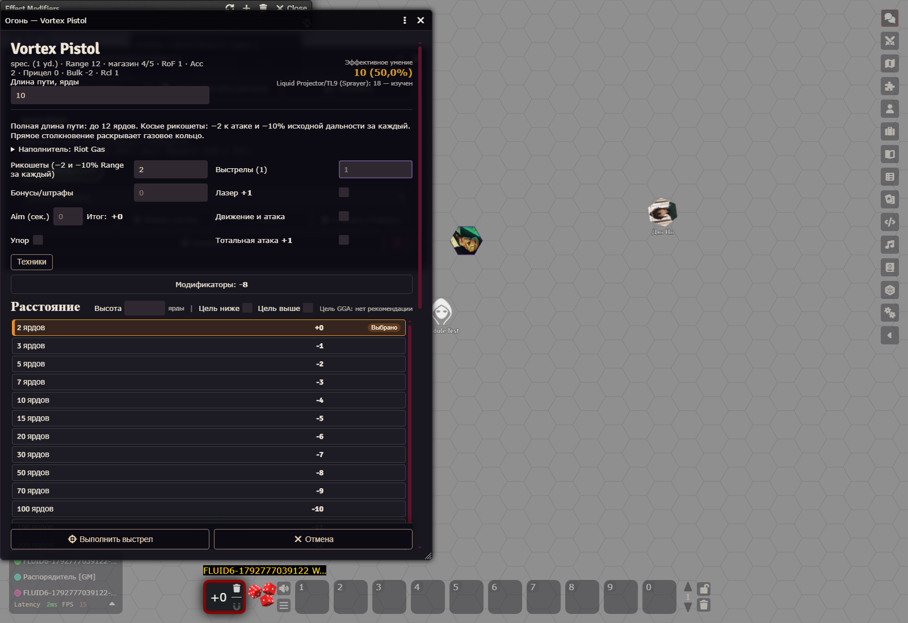

# Fluid/Vortex UT134 и запрет Gyroc Micromissile + Shotshell

23.10.2026. Foundry **14.364**, GGA **0.18.23**, модуль **0.2.1**. Версия не менялась.

## Результат и границы

Шесть существующих моделей реализованы через CatalogService, общий AttackProfileResolver,
AmmoService, Fire Control и нативный GGA. Исторический смешанный прогресс **228 → 234/346**;
остаток по исправленной классификации **48 → 42 = 18 активных + 24 отложенных**.
70 вспомогательных записей остаются вне оружейной очереди. Готовые ранее 228 здесь не
переклассифицировались; 346 не объявляется общим числом именно оружия.

Облака, экспозиция, ветер, иммунитеты, фактическая защита и длительные последствия
определяются игроком вручную. Нет новой системы областей, таймеров, автосостояний,
автоматического попадания либо обязательного допуска GM.

## Первоисточник и шесть моделей

Прочитан локальный PDF GURPS Ultra-Tech 2007: печатные UT134,144–146,153–161,
также UT169 по ссылке Nanoglop; Basic Set Campaigns B439 и High-Tech HT171.
В этом PDF печатная страница p находится на PDF-странице p+1.
Официальная страница эрраты не загружалась. PDF/GCS и пользовательские персонажи не менялись.

| Модель / статус | equipmentId / modeId | Acc; Range; RoF; Shots | ST; Bulk; Rcl; цена |
| --- | --- | --- | --- |
| Pocket Aerosol — ГОТОВО | eX-etcj5LJvUYagdH / W8SYi-R8B4aFolQUw | Jet; 1; 1; 1 | 1; -1; 1; $10 |
| Spray Can — ГОТОВО | eoxz7D2WloB6O857w / WpAt6DyOnZkKbNfJr | Jet; 2; 1; 10(5) | 2; -2; 1; $25 |
| Spray Tank — ГОТОВО | e49dEmc9T8KpD3kvU / WXki2UKT5ScYY4QsY | Jet; 3; 1; 10(5) | 4; -4; 1; $400 |
| Vortex Pistol — ГОТОВО | eZgtfzie082XytpwP / WbujzAgEOegkakUSr | 2; 15; 1; 5(3) | 7; -2; 1; $100 |
| Underbarrel Vortex Projector — ГОТОВО | ePqji5jQUAFUVUYz9 / WVP2b1TCXvqHt6azn | 2; 20/40; 1; 10(3) | носитель; носитель; 1; $150 |
| Backpack Vortex Projector — ГОТОВО | eovLuCPS-d4LIExeV / WUGCA3bH9obniRWDA | 3; 30; 1; 10(5) | 10†; -4; 1; $1200 |

Масса по таблице UT134: Pocket 0.1 lb; Spray Can 1/0.5; Spray Tank 8/5;
Vortex Pistol 1.8/0.8; Underbarrel 5/3; Backpack 12/12p. LC соответственно 4,4,4,4,4,3.
Эти справочные массы не превращены в бесплатные дозы или покупку наполнителя.
Исправлены источниковые ST/Bulk Spray Can (2/−2), Range Spray Tank (3) и RoF спреев (1).
Дубликатов оборудования и связанных режимов не создано. User overrides остаются сохранены;
исторические shotSnapshots не пересчитываются.

Pocket одноразовый: после атаки не допускает повторной загрузки, даже при наличии запаса.
Spray Can: 1–3 дозы за одно применение (RoF1), облако 1 ярд, 10 секунд внутри;
сильный ветер рассеивает его быстрее. Spray Tank: DR10, пробитие может выпустить весь
запас как 100mm biochemical (UT153), вручную; радиус зависит от газового/жидкого состава,
10/18 ярдов, для Nanoglop применяется его собственное уменьшение.

Vortex: самостоятельный linked **1d−3 cr dkb**, раскрытие газа при прямом столкновении;
лёгкий ветер не нарушает кольцо. Каждый косой рикошет: **−2 к атаке и −10% исходного Range**.
Считается полная длина пути. При двух рикошетах Pistol 15→12, Underbarrel 20/40→16/32,
Backpack 30→24. Поле рикошетов, effective skill и предпросмотр Range работают без записи Actor.
Прямой сервис проверяет тот же профиль и дальность. Допускаются 0–9 рикошетов;
10 и больше не дают положительной дальности. Геометрия углов и знание цели — вручную.
Underbarrel использует ST/Bulk и прицельные бонусы носителя, собственные Acc2 и резервуар;
исходный общий host pipeline требует Bulk ≤−3, положительный ST и числовой Acc.

## Полная матрица наполнителей

Всего **126 пар: 115 разрешены, 11 исключены из исполнения**. Это индивидуальная
проверка всех 21 названных наполнителей, а не разрешение любого вещества любому устройству.
Машинная матрица воспроизводится tools/build-ut-fluid-matrix.mjs из того же источника,
которым пользуется сервис. В таблице «+» — разрешён готовый состав, «−» — нет допуска.

| Наполнитель | Pocket | Can | Tank | Pistol | Underbarrel | Backpack | TL; $/доза; фаза; путь |
| --- | --- | --- | --- | --- | --- | --- | --- |
| Riot Gas | + | + | + | + | + | + | 9; 2; gas; respiratory |
| Musk | + | + | + | + | + | + | 9; 2; aerosol; contact |
| Lethal Nerve Gas | + | + | + | + | + | + | 9; 10; aerosol; contact |
| Sleep Gas | + | + | + | + | + | + | 9; 0.5; aerosol; contact |
| Paralysis Gas | + | + | + | + | + | + | 10; 10; aerosol; contact |
| Pheromone Spray | + | + | + | + | + | + | 10; 20; gas; respiratory |
| Mask | + | + | + | + | + | + | 10; 30; aerosol; traces |
| Anti-Tangler Aerosol | + | + | + | + | + | + | 10; 1; aerosol; tangler |
| Smoke | + | + | + | + | + | + | 9; не установлена; gas; obscurant |
| Colored Smoke | + | + | + | + | + | + | 9; 0.1; gas; obscurant |
| Hot Smoke | + | + | + | + | + | + | 9; 0.15; gas; obscurant |
| Prism Smoke | + | + | + | + | + | + | 9; 0.2; gas; obscurant |
| Electromagnetic Smoke | + | + | + | + | + | + | 9; 0.3; gas; obscurant |
| Radiant Prism | + | + | + | + | + | + | 10; 3; gas; obscurant |
| Firefoam | + | + | + | − | − | + | 9; 1; foam; fire |
| Metal Embrittlement Agent | + | + | + | − | − | − | 10; 5; liquid; metal |
| Disassembler Nanoglop | + | + | + | − | − | − | 11; не установлена; slime; material |
| Replicator Nanoglop | + | + | + | − | − | − | 12; не установлена; slime; material |
| Tear Gas | + | + | + | + | + | + | 6; 10; gas; respiratory/vision |
| Tear Gas + Vomiting Agent | + | + | + | + | + | + | 6; не установлена; gas; respiratory/vision |
| Mustard Gas | + | + | + | + | + | + | 6; 10; aerosol; contact/respiratory |

Основание газов/аэрозолей: UT134 и Gases and Clouds UT160 с прямым перечислением
спреев и Vortex как способов доставки. Musk — жидкость, применяемая в аэрозольной форме
в этой секции. Foams and Liquids UT160–161 допускает liquid projectors: спреи принимают
Firefoam, MEA и два Nanoglop. Vortex переносит газ; для MEA/вязкого Nanoglop допуск не установлен.
Firefoam у Backpack прямо назван UT134, поэтому это адресное исключение для пены.
Для остальных Vortex жидкостям/пенам разрешение не выдумано. Три HT/Basic дополнения —
согласованный пользователем перенос состава, а не утверждение новых таблиц стоимости UT.

Цена «не установлена» не равна нулю: UT160 не задаёт отдельной цены обычного Smoke;
HT171 не задаёт цены дозы смешанного Tear/Vomiting; Nanoglop отсылает к цене облаков
(disassembler $10,000 за квадратный ярд UT169), что не является опубликованной ценой дозы
данного резервуара. Автоматического списания денег/времени нет. Каждый запас добавляется
владельцем явно, загрузка переносит существующие дозы, извлечение возвращает тот же состав.
Смешивания и бесплатного пополнения нет. ТУ кампании фильтрует известный TL состава.

## Уникальные эффекты и ручная процедура

| Состав | Краткое действие / источник |
| --- | --- |
| Riot Gas | Каждую секунду HT−4: тошнота; провал ≥5 — рвота, затем тошнота MoF минут. UT160 |
| Musk | Bad Smell на 2 недели; час мытья сокращает срок на день. Sealed защищает тело, но не костюм. UT160 |
| Lethal Nerve Gas | HT−6 (остаточное загрязнение −3): 1d tox, 6 циклов по минуте; неврологические последствия по потере HP. UT160 |
| Sleep Gas | HT−6: без сознания MoF минут, затем обычный сон. UT160 |
| Paralysis Gas | Каждый ход HT−6: провал 1–2 — падение и неподвижность на ход; ≥3 — паралич MoF минут; критпровал — 1d и кома. UT160 |
| Pheromone Spray | HT−2: Lecherousness (9) в облаке + MoF минут; обычно только тот же вид. UT160 |
| Mask | Forensics по следам и выслеживание по запаху −6; сам Mask легко обнаруживается. UT160 |
| Anti-Tangler Aerosol | Растворяет связи Tangler за 1 секунду. UT160 |
| Smoke | Визуальные атаки и наблюдение −10; блокирует ladar. Облако 1–4 минуты. UT160 |
| Colored Smoke | Визуальные атаки и наблюдение −7. Облако 1–4 минуты. UT160 |
| Hot Smoke | Smoke; также мешает Infravision, Hyperspectral Vision и Night Vision. UT160 |
| Prism Smoke | Hot Smoke; блокирует лазеры, кроме X-ray и gamma-ray. UT160 |
| Electromagnetic Smoke | Hot Smoke; также мешает Radar и Imaging Radar. UT160 |
| Radiant Prism | Prism + electromagnetic; срок /2, IR/radar −5; без фильтра 1 HP/с при вдыхании. UT160 |
| Firefoam | Тушит огонь до (TL−8)d; больший ослабляет на 3d секунд. UT160 |
| Metal Embrittlement Agent | Заданный сплав: 3d cor/час, 12 часов или до очистки; полностью охваченный SM≥+2 умножает урон на SM. UT160 |
| Disassembler Nanoglop | Радиус /2 (ниже 1 ярда — только прямое попадание); 15 секунд, удвоенный урон disassembler: 2×(1d−2)(10) cor/с; только Sealed DR. UT161,169. UT161,169 |
| Replicator Nanoglop | Replicating disassemblers: превращение материи и распространение вручную по UT161,169. UT161,169 |
| Tear Gas | HT−2 отдельно: кашель/слепота в облаке + MoF минут; Vision −1…−3 на ярд. B439. B439 |
| Tear Gas + Vomiting Agent | Два HT−2: кашель/слепота в облаке + MoF минут; третий HT−2: рвота в облаке + 5×MoF минут. HT171. HT171 |
| Mustard Gas | Контакт: HT−4, 1 tox ×24/8 ч; вдыхание: задержка 2 ч, HT−1, 1d tox ×6/час. B439. B439 |

По умолчанию газовое облако — 300 секунд, при ветре ≥1 mph срок делится на скорость;
дым — 1–4 минуты, Radiant Prism вдвое меньше. Spray Can имеет собственные 10 секунд
внутри. Для Nanoglop срок 15 секунд, радиус /2; ниже 1 ярда — только непосредственно
поражённая цель. Для жидкости/следа срок облака не заменяет собственную длительность
Musk/MEA/другого эффекта. Точный объём одной заправки привязан к номиналу применений UT134;
таблица доз warhead UT153 автоматически на резервуар не переносится.

Автоматически: совместимость, TL-фильтр, раздельные запасы, загрузка/разгрузка,
сохранение, предел резервуара, атомарный расход, защита дубля атаки, пустого резервуара,
одноразового Pocket, полномочий и подделанного профиля; штраф рикошетов и Range;
независимый нативный Damage Vortex и связь с историческим снимком.

Для Riot/Sleep/Nerve/Paralysis/Pheromone/Tear доступна общая кнопка нативного HT-сопротивления.
Пользователь указывает фактическое воздействие, применимую защиту и иммунитет; защита
не угадывается из общего DR. Респираторные агенты требуют вдоха; контактные — контакта,
Sealed/соответствующая защита блокирует свой путь; глаза и дыхание Tear проверяются отдельно.
Иммунитет должен относиться к конкретному веществу; не все иммунитеты от ядов защищают
от оптического дыма, коррозии материалов или наномашин. Повторные проверки, циклический
tox/cor, состояние/срок, критические последствия и защита применяются вручную по составу.
Для Tear повторяют два HT−2, для смеси ещё третий HT−2. Mustard имеет разные задержки
и два модификатора, поэтому применяется вручную через штатные проверки GGA, без единой
выдуманной универсальной кнопки. Для неизвестного вещества допустим только свободный
Note без исполняемого химического профиля; новый справочник лекарств не добавлялся.

Модульная инструкция состава в ChatMessage — одна короткая запись плюс источник,
без общих правил Basic Set и текста о внутренней реализации. Пользовательский Note
не сокращается. Служебные секции закрыты по умолчанию; шаблон результата GGA не менялся.

## Gyroc: проектный запрет

Генератор пересчитан: **24 project-excluded**, available1777 / incompatible1283 /
deferred-grenade320. Прежних source-undetermined24 больше нет. Основание — решение
пользователя 23.10.2026, а не новая официальная эррата или найденный запрет UT.
Нельзя создать/загрузить/выбрать запрещённый состав или стрелять им через executeShot;
проверяются также вложенный warheadVariant, старый сохранённый состав и прямой сервис.
Обычный Gyroc + Shotshell и Micromissile + Homing/SEFOP сохранены. Разгрузка старого
состава разрешена, имущество и история не удаляются.
Адресные автоматические проверки охватили все шесть Gyroc; отдельного живого
Gyroc-прогона в этой сессии не выполнялось. Живые таблицы ниже относятся к Fluid/Vortex.

## Автоматические проверки

**319 уникальных PASS, 0 итоговых FAIL**, без подсчёта повторных запусков как новых тестов:

- tests/ut-gyroc-six.test.mjs, tests/ut-physical17-boundaries.test.mjs,
  tests/ut-electrolaser-fire-control-ux.test.mjs, tests/ut-gyroc-shotshell-policy.test.mjs: **71 PASS**.
- tests/damage-shot-link.test.mjs, tests/resistance-roll-dialog-ux.test.mjs,
  tests/ammo-inventory.test.mjs: **107 PASS**.
- tests/ut-fluid-vortex-six.test.mjs: **141 PASS**, включая все 126 пар и отдельный
  запас/загрузку/атаку/расход/снимок для каждой из 115 разрешённых пар.

Тестовая фикстура использует управляемые результаты бросков только в автоматических
контрактных тестах; они не выдаются за живые броски. В Foundry ниже кубы не подменялись.
22 затронутых JS проверены node --check и строгим UTF-8-декодированием, без U+FFFD
и признаков новой порчи кодировки. Матрицы пересобраны из генераторов.
Полный набор тестов не запускался.

## Живые GM / PLAYER-OWNER

Два изолированных клиента, временные пользователи с role4 и role1; Foundry en,
собственные новые поля и диалоги по-русски. Отдельного клиента с Foundry ru не запускали;
новые подписи являются русскими литералами и не зависят от языка Foundry.
Временные персонажи с Liquid Projector/TL9 (Sprayer)18, HT12. Никакой подмены кубов,
исправления результата или автоматического успеха. Числа ниже — фактические сообщения.

| Модель | Роль | Attack 3d6 | Общий запас до→после | Расход; Range | ChatMessage |
| --- | --- | --- | --- | --- | --- |
| Spray Can | GM | 4,4,3 = 11 | 30→27 | 3; 2 | Rtavg14rQYzSHYat |
| Spray Tank | GM | 1,4,6 = 11 | 30→29 | 1; 3 | vr9TZwoqBESbQEYb |
| Pocket Aerosol | GM | 5,2,2 = 9 | 3→2 | 1; 1 | IDeEgqIQBvcc12nS |
| Vortex Pistol | GM | 6,3,1 = 10 | 15→14 | 1; 12 | 5q5jFZA8aCidM9Il |
| Underbarrel Vortex Projector | GM | 5,1,4 = 10 | 30→29 | 1; 16/32 | rTxjaeFOmL8GsUGT |
| Backpack Vortex Projector | GM | 3,2,2 = 7 | 30→29 | 1; 24 | cb2n27aKxtDXLQBm |
| Pocket Aerosol | OWNER | 1,4,3 = 8 | 3→2 | 1; 1 | HDoDYaLd2LscPgOr |
| Spray Can | OWNER | 2,1,1 = 4 | 30→27 | 3; 2 | ZZ9u2rNSABqXdsEd |
| Spray Tank | OWNER | 4,2,2 = 8 | 30→29 | 1; 3 | hd8QFso9SR7N0RVN |
| Vortex Pistol | OWNER | 3,5,2 = 10 | 15→14 | 1; 12 | DAzbhICRx0J1C7Ue |
| Underbarrel Vortex Projector | OWNER | 2,6,6 = 14 | 30→29 | 1; 16/32 | 4EDPxr0KWdYCDgfp |
| Backpack Vortex Projector | OWNER | 1,1,4 = 6 | 30→29 | 1; 24 | SH5gmFSm9IP6cbKD |
| Vortex Pistol | GM | 1,1,3 = 5 | 14→13 | 1; 12 | LhrRiK01xq47ahH6 |
| Underbarrel Vortex Projector | GM | 1,2,1 = 4 | 29→28 | 1; 16/32 | txlAEhxZe4U9nK8F |
| Backpack Vortex Projector | GM | 2,5,3 = 10 | 29→28 | 1; 24 | CfHnnAadjjIMz421 |
| Vortex Pistol | OWNER | 6,6,2 = 14 | 14→13 | 1; 12 | 1fSEyVFcVN8F5Zyh |
| Underbarrel Vortex Projector | OWNER | 2,5,4 = 11 | 29→28 | 1; 16/32 | HwV3boarM4KZoKi5 |
| Backpack Vortex Projector | OWNER | 1,3,1 = 5 | 29→28 | 1; 24 | 8Cp15uBRLdd998cN |

Первый проход обнаружил четыре отказа до броска: Pocket не умещался в полосе 2 ярда,
Vortex был отвергнут проверкой несвежего construction bonus. Добавлено точное поле пути,
штраф рикошетов вынесен в собственный канал общего combat pipeline с проверкой свежести.
После исправления четыре сценария прошли. Позднее три Vortex в каждой роли повторены
для проверки нового связанного Damage; это дополнительные настоящие атаки со своим расходом.

| Модель | Роль | Linked Damage: исходные кубы / итог | dkb; без расхода; снимок сохранён | ChatMessage |
| --- | --- | --- | --- | --- |
| Vortex Pistol | GM | 1d6[Damage] - 3 + 0 = 3 | PASS; dkb; loaded=false | keRBoaqFkIy83YfL |
| Underbarrel Vortex Projector | GM | 1d6[Damage] - 3 + 0 = 1 | PASS; dkb; loaded=false | Yr5o0Ddrovqnw6n6 |
| Backpack Vortex Projector | GM | 1d6[Damage] - 3 + 0 = 1 | PASS; dkb; loaded=false | gwbj2ZIUK87vbH5e |
| Vortex Pistol | OWNER | 1d6[Damage] - 3 + 0 = -1 | PASS; dkb; loaded=false | n2Ix0nfdOWUw5jjI |
| Underbarrel Vortex Projector | OWNER | 1d6[Damage] - 3 + 0 = 1 | PASS; dkb; loaded=false | 8rXXGamJf31cbYD8 |
| Backpack Vortex Projector | OWNER | 1d6[Damage] - 3 + 0 = 0 | PASS; dkb; loaded=false | vf5VNwaJkwJavE9k |

Исходно связанной кнопки не было, поскольку химический primary не имеет числового Damage.
Исправлена интеграция существующего renderChatMessage/Damage pipeline: химический primary
не запускается как HP-урон, отдельный linked-компонент доступен штатному GGA.
Повторный Damage после разгрузки: 1d6[Damage] - 3 + 0 = -2, loaded=false,
источник LhrRiK01xq47ahH6, сообщение yzOnu84D6DZjErlL; ресурсы и snapshot неизменны.
Отрицательный сырой итог 1d−3 не заменялся; применимый итог повреждений определяет GGA.

| Actor / роль | Нативное сопротивление | Результат | ChatMessage |
| --- | --- | --- | --- |
| FLUID6-1792777039122 W8SYi-R8B4aFolQUw 4 | HT12−4 = 8; 3d6=16 | провал; margin=-8; loaded=false | HmvmuD4y08F5zYTg |
| FLUID6-1792777039122 WpAt6DyOnZkKbNfJr 4 | HT12−4 = 8; 3d6=13 | провал; margin=-5; loaded=false | s1VTF8jqNfBRFLGa |
| FLUID6-1792777039122 WXki2UKT5ScYY4QsY 4 | HT12−4 = 8; 3d6=8 | успех; margin=0; loaded=false | CmPtPaBvM32xpMF4 |
| FLUID6-1792777039122 WbujzAgEOegkakUSr 4 | HT12−4 = 8; 3d6=12 | провал; margin=-4; loaded=false | r4BV4ALXq6MvaXWn |
| FLUID6-1792777039122 WVP2b1TCXvqHt6azn 4 | HT12−4 = 8; 3d6=11 | провал; margin=-3; loaded=false | is86mlPTE4vGaaW1 |
| FLUID6-1792777039122 WUGCA3bH9obniRWDA 4 | HT12−4 = 8; 3d6=8 | успех; margin=0; loaded=false | aLgGP05oTDjrdcPk |
| FLUID6-1792777039122 W8SYi-R8B4aFolQUw 1 | HT12−4 = 8; 3d6=5 | успех; margin=3; loaded=false | OrQBMGEWZKj6vaNZ |
| FLUID6-1792777039122 WpAt6DyOnZkKbNfJr 1 | HT12−4 = 8; 3d6=10 | провал; margin=-2; loaded=false | CgMkz9kEtwXmSwtX |
| FLUID6-1792777039122 WXki2UKT5ScYY4QsY 1 | HT12−4 = 8; 3d6=8 | успех; margin=0; loaded=false | Gy1tbnIYmCLxZPdr |
| FLUID6-1792777039122 WbujzAgEOegkakUSr 1 | HT12−4 = 8; 3d6=11 | провал; margin=-3; loaded=false | HhT7YjXv7ppOJOai |
| FLUID6-1792777039122 WVP2b1TCXvqHt6azn 1 | HT12−4 = 8; 3d6=10 | провал; margin=-2; loaded=false | DRpexUmQiYo699ER |
| FLUID6-1792777039122 WUGCA3bH9obniRWDA 1 | HT12−4 = 8; 3d6=5 | успех; margin=3; loaded=false | LAEAnpqxrSZuLpKD |

В обеих ролях: все шесть пустых/использованных устройств блокируют executeShot до броска;
пять перезаправляемых моделей прошли смену Riot→Sleep через общие запасы и разгрузку;
Pocket не перезаправляется. Запрещено создание лишнего фиксированного резервуара.
OWNER получил Permission при попытке записи временного чужого Actor с Observer-правами.
Отмена/дубль/конкурентный одинаковый attackId и подделанный профиль дополнительно проверены
автоматически. Живые загрузка/смена выполнялись через реальные AmmoService-транзакции;
клики каждой кнопки загрузки отдельно для всех 115 пар не воспроизводились.

После F5: **13 временных Actor, persisted=true** — flags и остатки
полностью совпали. Это перезагрузка клиента, не перезапуск сервера Foundry.
Рикошеты проверены двумя настоящими атаками каждой Vortex/роли и визуально в Fire Control;
сцена не моделирует трассу отражения от стен автоматически. Пробитие Spray Tank, ветер,
живое применение всех длительных составов и повторных циклов не автоматизированы и
отдельно в сцене не разыгрывались; используются указанные ручные процедуры.

## Очистка, аудит и остаток

Удалены только созданные этим прогоном объекты: **13 Actor,
12 Token, 61 ChatMessage, 2 User**.
Остатков префикса: **0**. Все исходные Actor/Token/Message/User сохранены:
{"actors":true,"tokens":true,"messages":true,"users":true}. Временные browser contexts закрыты.

В старом Markdown добавлен актуальный слой поверх исторического текста; исправленный
аудит теперь показывает 42/18/24 и сохраняет исходную таблицу 48/24/24 как предыдущий срез.
JSON получил отдельный fluidVortexImplementationUpdate: исходные строки, source-статусы,
история и прежние записи не переписаны. Coercion Devices, инструменты, щиты,
оборудование и ловушки не возвращены в оружейную очередь.

Следующий пакет: **2 Displacers UT132**. Затем 5 боевых режимов сенсоров, 4 robot missiles,
7 combat swarms по зависимостям. 24 отложенные записи остаются отложенными.
Commit, push, merge, rebase, reset, tag и release не выполнялись. GGA/GCS, версия,
LT/Martial Arts и пользовательские персонажи не менялись; прежние изменения рабочего
дерева и packs/macros сохранены.
